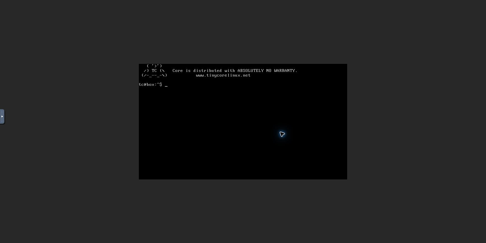
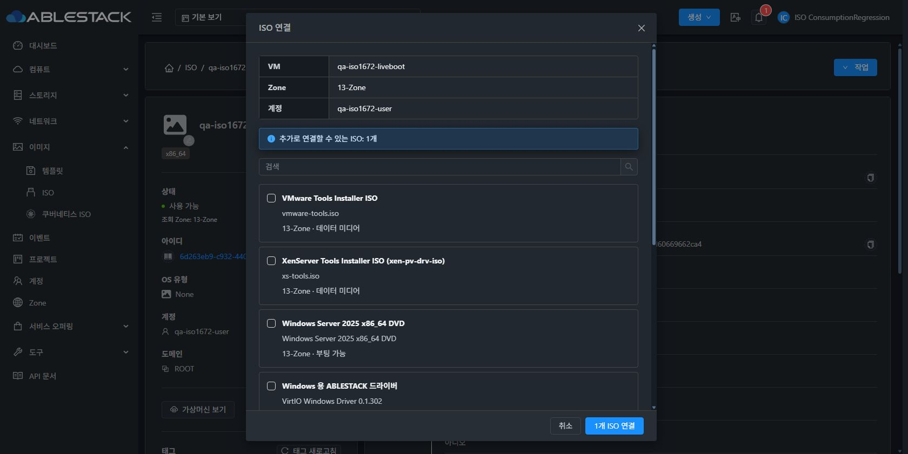
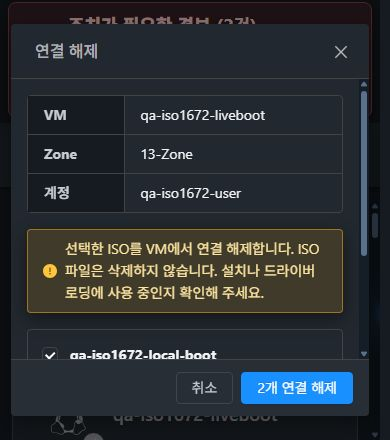
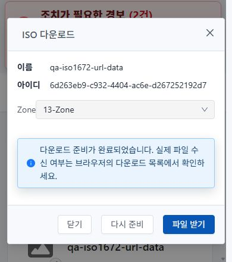
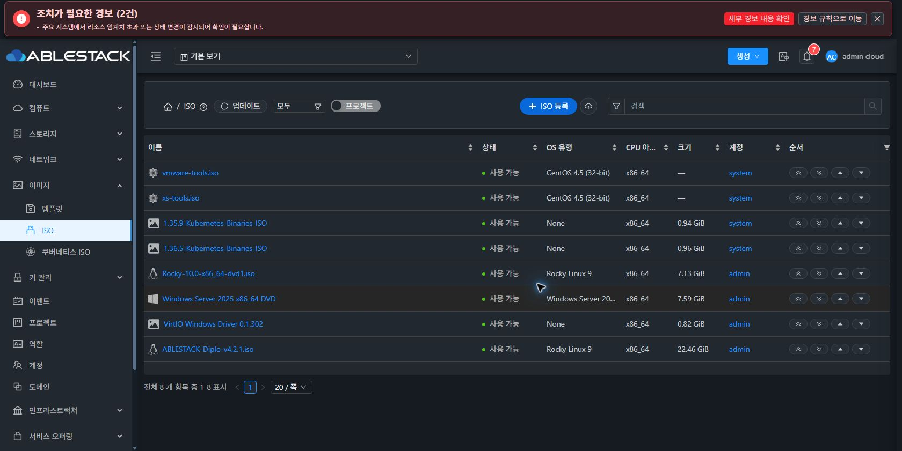

<!--
Licensed to the Apache Software Foundation (ASF) under one
or more contributor license agreements.  See the NOTICE file
distributed with this work for additional information
regarding copyright ownership.  The ASF licenses this file
to you under the Apache License, Version 2.0 (the
"License"); you may not use this file except in compliance
with the License.  You may obtain a copy of the License at

  http://www.apache.org/licenses/LICENSE-2.0

Unless required by applicable law or agreed to in writing,
software distributed under the License is distributed on an
"AS IS" BASIS, WITHOUT WARRANTIES OR CONDITIONS OF ANY
KIND, either express or implied.  See the License for the
specific language governing permissions and limitations
under the License.
 -->

# ISO-07 #1672 다운로드·부팅/데이터 미디어 소비 검증

Epic #1664 · PR #1682 · 개발 순서 7/8 · 2026-11-15 KST.

구현·13번 UI 배포·기능 검증·시험 자원 정리를 완료했다. 두 ISO는 사용자가 실제 내려받았고 로컬 파일의 크기와 SHA-256을 대조했다. VM 실제 Live ISO 부팅과 미디어 소비를 확인했으며 디스크 설치 완료로 표시하지 않는다. Epic은 7/8·OPEN, 다음 단계는 #1673 통합 UI 회귀다.

## 최종 동작

- ISO 다운로드는 기존 MoldDialog를 사용해 이름·ID·준비된 Zone, 다운로드 준비·다시 준비·파일 받기를 표시한다. 접수/job 완료/실제 수신을 분리하고, 일회 URL은 창 메모리의 안전한 HTTP(S) 링크로만 유지한다. raw HTML·전역 알림·문서/로그에 URL을 남기지 않으며 인증서/브라우저 보호를 변경하지 않는다.
- 요청이 불확실하거나 작업 ID를 받지 못하면 준비 요청을 자동 재전송하지 않는다. 접수된 job 조회 실패는 미확인 경고로 구분하고 기존 job을 GET으로 재확인한다. UI 시험에서 발견한 중복 실패 안내를 단일 상태 안내로 보정했으며 조회 실패를 준비 실패로 표현하지 않는다.
- 비부팅 데이터 ISO는 빈 OS 생성 목록으로 보내지 않고 상세 작업·Zone 행에서 기존 VM을 선택해 **같은 VmIsoManager**로 넘긴다. 요청 ISO는 후보에 있을 때만 선선택하며 확인 전 쓰기는 없다. 이미 연결됨·장치 한도·상태·조회 오류를 구분한다.
- VM의 기존 attach/detach·폴링·실패만 재시도·결과 미확인 보류를 재사용한다. 공유 미디어 후보를 페이지별로 수집하고 기존 장치·서버 제공 isomaxcount·호스트/ConfigDrive cap 계약을 보존한다. 세션/프로젝트/역할/API 경계가 바뀌면 늦은 응답과 이전 작업 문맥을 무효화한다.
- 부팅 ISO의 ready/bootable은 엄격한 boolean으로 확인하고 실제 Zone·arch/OS를 위저드에 전달한다. 고전 위저드는 ISO와 템플릿 모두 요청 ID를 선선택한다. 기존 템플릿/볼륨/스냅샷 생성 흐름을 별도 변경하지 않는다.

## 실제 파일 수신

사용자 답변은 “두 파일 다운로드 완료”이며 실제 Downloads 파일을 읽어 검증했다. 파일 mtime은 이번 수신 요청 이후다. 자동제어의 다운로드 이벤트/초기 기본 폴더 확인 실패와 사용자 수신 근거를 구분한다. 수신 파일은 보존했다.

| 원본 | 실제 수신 파일 | bytes | SHA-256 |
| --- | --- | ---: | --- |
| URL 데이터 ISO | qa-iso1672-url-data.iso | 1,525,760 | `171cc1569c3078e9b4b9e0d88338ba8ac990fb0843a431193c63d60669662ca4` |
| 로컬 부팅 ISO | qa-iso1672-local-boot.iso | 24,434,688 | `c954b2900fbbd38c2da156525819de8c80c4cc7a7ffde61a89b10f4a99985ebc` |

두 건 모두 원본 크기·SHA-256과 정확히 일치한다. [파일 수신 근거](evidence/download-receipts.json)

## UI 검증 결과

| 범위 | 실제 결과 |
| --- | --- |
| 데이터 미디어 진입 | 일반 소유자 ISO 상세 → VM 선택. VM 0개일 때 사유·다음 disabled. VM 생성 후 같은 Zone의 전용 VM 선택 → 공통 연결 창에서 요청 ISO 1개만 선선택, 확인 전 POST 0 |
| 실제 부팅 | 일반 계정에서 ISO/Zone/arch/Other Linux·BIOS를 전달해 전용 VM 생성. 1C1GB·1 GiB ROOT·전용 격리 네트워크. 실제 noVNC TinyCore 배너·tc@box 셸 프롬프트 확인. 중지 상태 재연결 후 두 미디어 유지한 재시작도 실제 프롬프트 확인 |
| 실행 중 미디어 | 데이터 ISO 연결 POST/job1. VM 탭에서 부팅 ISO 슬롯3·데이터 미디어 슬롯4와 API isomaxcount2 일치. 동일 ISO 대상 disabled·사유·다음 disabled, 추가 POST 없음 |
| 한도·상태 | 두 슬롯 사용 시 추가 연결 disabled·한도 tooltip. 데이터 단일 분리 후 한 슬롯이 남아도 Stopping 상태에서 연결/분리 disabled. 정상 중지 job1 뒤 Stopped 재연결 가능 |
| 단일/다중·메뉴/탭 | ISO 상세 연결 → VM 탭 단일 데이터 분리, VM 작업 메뉴 연결 → 같은 공통 창. 중지 상태의 의도적 HTTP400 거절은 대상/실패 유지, 명시적 재시도 실제 job1. 재시작 뒤 실행 상태에서 두 ISO 다중 분리 job1 두 건·완료2, 실제 isos[]0·legacy isoid 생략·UI 빈 상태/연결 재활성화 |
| 다운로드 상태 | 실제 준비 job 완료와 파일 받기/요청 안내 구분. held POST 중 Ctrl+Enter 두 번·Esc에도 요청1·중복0·닫기 disabled. 보정본 거절 안내1회, 재준비 실제 POST1 뒤 해당 job 조회만500 주입 → 미확인 경고·실패로 오인 없음. GET 재확인 추가 POST0·같은 job1/준비 완료·과거 경고0 |
| 작업 ID 누락 | 서버 전달 전 fake200 빈 응답으로 검증. 경고1회, 준비/상태 확인/파일 받기 CTA 없음. 실제 서버 접수/추출 성공으로 합산하지 않음 |
| 스타일·키보드 | 다크·라이트 VM 공통 창. 실제390×440, 문서 폭380, 다중 분리 body client280/scroll434/overflow auto, Header top24·Footer bottom416. Esc 닫기·‘선택 연결 해제’ 버튼 초점 복귀. 라이트 content rgb255/text75,85,99. 최종 다운로드390×440도 폭380·Header/Footer 화면 내·본문 overflow auto, GET 복구 및 Esc 확인 |
| Zone 공통 진입 | Zone 행의 기존 VM 연결이 같은 VM 선택 창을 열며 VM 선택 전 다음 disabled·쓰기 없음 |
| 읽기 전용 | 기존 Read-Only User - Default로 QA 계정을 축소하고 실제 재로그인. ISO 상세 작업/VM 생성/Zone 연결·선택0, 조회 유지. 기본 VM 읽기 API와 Metrics 경계는 아래 별도 기록 |

81개 기록은 전부 통과 81건이라는 뜻이 아니다. [기록 판정](evidence/ui-case-disposition.json)에 baseline·보정 전 결함·도구 한계·의도적 오류 주입·최종 통과를 구분한다. 선택적 필드 생략과 API 오류를 성공한 빈 목록으로 바꾸지 않는다.

## 검증 경계와 후속 #1673

- 실제 환경은 단일 Zone·KVM·현재 SystemVM 4.23이다. 다중 Zone·비KVM 양성 UI는 NOT_RUN이며 기능을 유지한다. 기존 #1667의 4.21·4.23 업로드/수신 파일 검증을 보존하며 이번에 SystemVM을 다시 생성하지 않았다.
- 전용 ConfigDrive VM은 만들지 않았다. 서버 제공 유효 cap과 기존 계약을 보존하고 단위 cap 시나리오와 실제 KVM2 슬롯 검증을 구분한다.
- TinyCore Live ISO 부팅은 실제 확인했다. 디스크에 OS를 설치하거나 선택적 게스트 명령 입력을 통과했다고 주장하지 않는다. 콘솔의 문서화된 canvas 입력/키 메서드 한계는 부팅 실패가 아니다.
- 읽기 전용 UI의 API 문서에서 허용75개 중 listVirtualMachines는 있고 listVirtualMachinesMetrics·attachIso·detachIso·extractIso는 없었다. VM 섹션은 Metrics API를 요구해 해당 역할의 VM 직접 주소가 Dashboard로 돌아갔다. 그 역할에서 **VM ISO 탭 내부 E2E는 NOT_RUN**이며 ISO 조회/쓰기 차단과 구분한다. [기본 VM 읽기와 Metrics 경계 후속](https://github.com/ablecloud-team/ablestack-cloud/issues/1673#issuecomment-6894754513)을 통합 ACL 행렬에 남겼다. 공유 역할 권한은 바꾸지 않았다. CI 부채로 분류하지 않는다.

## 검사·배포·정리

- canonical **38 suites/735 tests**, 운영 입력 **34 suites/499 tests**, 변경 UI Lint·집중 pre-commit/수동 hook·UI 빌드 통과. canonical의 공통 VPC 등 회귀와 이전 운영 입력에 없는 무관한 4개 suite를 구분해 운영본 차이를 보존했다.
- 로컬 기준 ablestack-europa와 upstream은 `1046a5dc3f21cb9cca0ab6881dd906d64b591e80`, 차이0/0 확인 후 기존 feature를 이어갔다. 제품24310382d66 → 보정75a0681bd8e. origin feature만 push, PR #1682로 관리하며 upstream 직접 push/PR 병합은 없다.
- 운영 입력에 ISO delta만 3-way 적용, 범위 밖 소스 **1,015개**와 나머지 번역·의존성/빌드 설정5개 보존. 각 언어 대상 키16개, 빌드 전후 hash 고정 확인.
- UI 정적 delta **16개 → 8개 파일** 배포. 최종 app `9f8094f1`, index SHA-256 `52cab520179482f7006fac4bc9979e2f99c34d73009c86d0b9c544656db67616`, 최종 백업 `/var/tmp/iso1672-20261115-ui-backup-wctchfth`. 기존 자산7,091개 전부 유지·해시 자산18개 추가, 원래 변경 파일은 index/en/ko뿐이다.
- config.json·WEB-INF/web.xml·color.less·backend JAR SHA `a130cccd3c545afc44afcd641b22ef49af99bbc3b83e8ffbee1c3a0af4852443`·Mold PID2620448 보존. Backend/DB/Agent/SystemVM 코드 변경·서비스 재시작 없음. 시험 VM의 생명주기 작업과 제품 배포를 구분한다.
- 전용 VM **1개** 삭제 후 명시적 영구 삭제, ROOT **1개** 정리. 계정 VM/볼륨0을 확인했다. 일반 네트워크 삭제로 전용 격리 네트워크 **1개**·라우터 **1개**·Source NAT IP **1개**를 정리했고 라우터 이름 조회0·계정 IP0을 확인했다. 강제 네트워크 삭제/DB 변경 없음.
- 전용 ISO **2/2개**, 계정 **1/1개** UI 삭제. 계정 자원0 → 비활성화 → 이름 입력 확인으로 삭제. 기존 ISO **8개 ID·목록 값 전체 일치**, 계정3·역할9·프로젝트/사용자 데이터0, VM103·템플릿48 유지. 시스템 VM v245/s255 실행/Agent Up 4.23, 호스트3대 Up/Enabled 4.23. 3번 호스트 HA Disabled는 기존 상태로 유지했다.
- 정적 시험 파일2개는 경로·크기·SHA-256 검증 후 정확한 파일만 제거하고 HTTP404 확인. 일회 추출 URL은 기록하지 않으며 정상 서버 관리 수명주기를 따른다. 감사/이벤트·사용자 수신 파일은 보존했다. QA 비밀번호는 실행 메모리에서 폐기, 원래 다크/1680×841·탐색 메뉴를 복원하고 Fetch/cache 시험 설정을 해제했다.

## CI 부채

최종 제품75a의 [Lint43718022708](https://github.com/ablecloud-team/ablestack-cloud/actions/runs/43718022708)는 기존과 같은 실패 hook **16개**·진단 경로 **11,179개**(+0/-0), PR 및 #1672 변경 경로 신규 진단 **0개**다. [License43718022728](https://github.com/ablecloud-team/ablestack-cloud/actions/runs/43718022728)는 기존 미분류 **4,077개 경로 동일**(+0/-0), PR 충돌 검사는 통과했다. 문서 포함 index export RAT도 기존4,077개 경로 동일(+0/-0), 집중 pre-commit/수동 검사 통과를 확인했다. 후속 문서 HEAD의 CI는 별도 실행되며 전체 CI를 성공으로 표시하지 않는다.

로컬 최신 yamllint의 Python>=3.10 요구는 동일 hook을 Python3.11로 실행해 처리했다. 저장소 CI 설정/검사 범위를 바꾸거나 검사를 생략하지 않았다. **#926·#1044는 별도 OPEN**, #1673은 통합 기능/ACL 후속으로 유지한다.

## 화면

