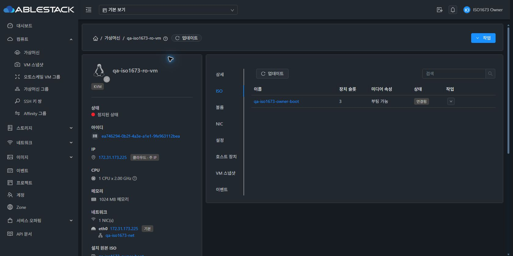
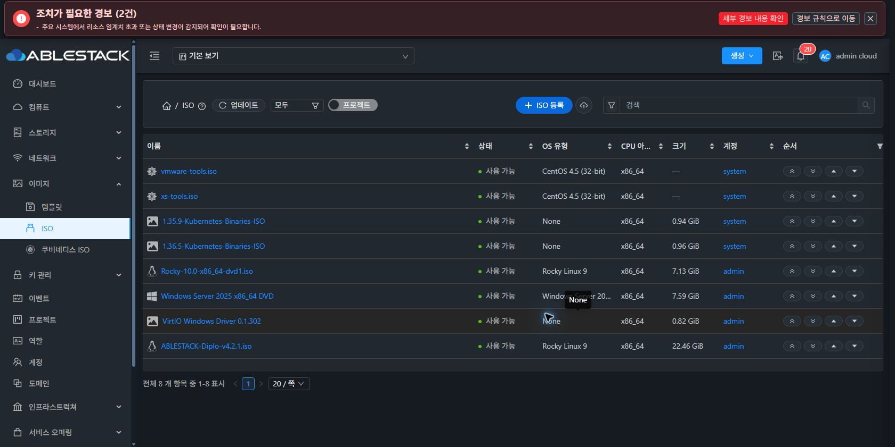

<!--
Licensed to the Apache Software Foundation (ASF) under one
or more contributor license agreements.  See the NOTICE file
distributed with this work for additional information
regarding copyright ownership.  The ASF licenses this file
to you under the Apache License, Version 2.0 (the
"License"); you may not use this file except in compliance
with the License.  You may obtain a copy of the License at

  http://www.apache.org/licenses/LICENSE-2.0

Unless required by applicable law or agreed to in writing,
software distributed under the License is distributed on an
"AS IS" BASIS, WITHOUT WARRANTIES OR CONDITIONS OF ANY
KIND, either express or implied.  See the License for the
specific language governing permissions and limitations
under the License.
 -->

# ISO-08 #1673 최종 실계정 ACL·통합 UI 회귀

Epic #1664 · PR #1682 · 개발 순서 8/8 · 2026-11-15~16 KST.

**13번 단일 Zone/KVM의 실계정 ACL A01~A16, 읽기 전용 VM 조회/Metrics 경계, UI 회귀와 전용 자원 정리를 완료했다.** 최종 이슈 상태·CI 대조 결과는 [#1673](https://github.com/ablecloud-team/ablestack-cloud/issues/1673)과 [PR #1682](https://github.com/ablecloud-team/ablestack-cloud/pull/1682)에서 함께 관리한다. 다중 Zone·비KVM 양성 시험은 합의한 NOT_RUN 범위이며 기능을 유지한다.

## 구현 결과

- 기본 `listVirtualMachines`만 허용된 계정도 VM 목록·직접 상세·연결 ISO 정보를 읽는다. Metrics-only 계정은 기존 조회를 유지하며 두 API 모두 없으면 요청과 이전 선택을 차단한다.
- Metrics 전환/열과 사용 이력은 각각 실제 API 권한으로 제한한다. 이력 권한 없는 `tab=stats`는 상세로 돌아간다. 공용 역할 권한은 확대하지 않았다.
- VM 경로에만 `permissionAny`를 적용한다. 다른 경로의 여러 필수 권한은 AND 계약을 유지한다. 계정·역할·세션·API 경계에서 이전 행·선택·열 스키마를 초기화한다.

## 실제 계정 행렬

[행렬·증거 이름](evidence/acl-matrix.json), [148개 관찰 기록](evidence/ui-cases.json), [판정/제외 사유](evidence/ui-case-disposition.json)를 연결한다. 관찰 148개 전체를 독립 PASS로 합산하지 않는다.

| 행 | 실제 역할·범위 | UI/실제 결과 |
| --- | --- | --- |
| A01 | Root Admin, 일반 ISO | 기본/저장소 행·관리·다른 소유자 수정 및 정상 삭제 완료 |
| A02 | Root Admin, 시스템 ISO | 선택/수정/공유/복사/삭제 보호, 최소 Zone 행 유지. 원본 변경 요청0 |
| A03 | User, 자신 소유 | URL/로컬 Ready·공유 저장·정지 VM 생성·ISO 연결. 비추출 미디어 제한 유지 |
| A04 | User, 공유 수신 | 직접 상세·Zone·VM 생성 진입 허용, 관리/삭제 선택 숨김 |
| A05 | User, 미공유 비공개 | 531 거부·정보 비노출·대시보드 복귀 |
| A06 | Domain Admin, 하위 도메인 | 하위 소유 ISO 조회, 타 소유자 관리/삭제 선택 제한. 서버 owner-only 계약 유지 |
| A07 | Domain Admin, 외부 도메인 | 531 오류·정보 비노출·대시보드 복귀 |
| A08 | User, 프로젝트 소유자 | project scope·상세/Zone·실제 수정 저장 |
| A09 | User, 프로젝트 일반 구성원 | 기본 역할 수정 성공 → 읽기 역할에서 등록/수정/선택 차단 → 개인 권한 복원 |
| A10 | User, 프로젝트 비구성원 | 프로젝트 선택 미노출·비공개 직접 조회531 |
| A11 | Read-Only User, 자신/공유 | 읽기 유지·쓰기/선택 숨김. 기본 VM 목록/상세/ISO 조회200, Metrics/이력 요청0 |
| A12 | Read-Only Admin | Admin 유형만으로 ISO 쓰기 우회 없음. 허용된 VM Metrics 읽기는 유지 |
| A13 | 로컬 허용/URL 거부 | 로컬 버튼만 표시, 부팅 ISO 실제 전송·SHA-256·Ready 완료 |
| A14 | URL 허용/로컬 거부 | URL 버튼만 표시, 데이터 ISO 실제 등록·SHA-256·Ready 완료 |
| A15 | 공유 조회/갱신 각각 거부 | 대상 편집은 양 권한 필요. 읽기 거부 시 숨김, 허용된 공개/추출 속성만 갱신 |
| A16 | 삭제/복사/배포/추출 교차 | 상호 보완 허용/거부를 상세·Zone·선택·대화상자/제출에서 대조 |

A16 로컬 역할은 삭제·배포·공유 변경 거부/복사·추출 허용, URL 역할은 반대다. 허용된 추출 job 완료, URL 역할의 실제 `startvm=false` VM 생성/ISO 연결, 미사용 ISO 삭제 성공1을 확인했다. 사용 중 ISO 삭제는 서버 거부와 항목별 실패 이유를 확인했다. 복사 허용은 단일 Zone의 대상 없음/제출 disabled/POST0까지이며 실제 다중 Zone 복사 성공으로 표시하지 않는다.

공유 대상 A/C 중 A만 `op=remove`로 회수했다. 재조회 C 보존, A 직접 접근531, C 상세/Zone 유지를 실제 계정으로 확인했다. 초기 일부 계정의 저장 역할이 의도와 달라 당시 관찰은 제외하고 저장 역할·도메인을 교정/확인한 뒤 다시 검증했다. 원장의 role은 최초 의도이며 실제 권한 판정은 저장 역할 검증 기록을 사용했다. 추가 제한 계정은 선택값·createAccount roleid·저장 역할을 대조했다. 렌더된 옵션 수만으로 전체 후보 누락을 판정하지 않았다. 회수 미제출·중간 UI 상태·UUID 추출기 오류도 최종 근거와 구분했다.

## VM 읽기와 UI 회귀

Read-Only User는 기본 API로 VM/ISO 메타데이터를 읽고 Metrics·이력 요청0을 유지했다. 선호 false/true, 기본만/Metrics만/둘 다/둘 다 없음 및 다른 경로 AND 권한은 단위 테스트로 대조한다. Read-Only Admin의 허용된 실제 Metrics 조회200은 별도 양성 근거다.

- 일반/다크의 실제 1440×1000·1280×720·390×844·390×480을 확인했다. 작은 창의 고정 Header/Footer·Body 스크롤과 표 내부 가로 스크롤을 유지한다.
- 1280 목록의 이름 폭375px·nowrap/ellipsis·전체 이름 tooltip, 부가 OS/계정 한 줄 표시를 확인했다. 정적 검색 설명 배너는 추가하지 않았다.
- 수정 창 Esc 후 ‘작업’ 버튼 초점 복귀를 자동 관찰했다. 실제 OS 클립보드는 #1671 사용자 확인, Tab/Enter/추출 창은 #1671/#1672 근거와 구분한다.
- VM 목록·허용된 Metrics 탭의 정상 빈 상태, 템플릿48 목록·Rocky9 상세/설정, VPC 빈 목록을 조회했다. 테마·viewport·Network cache 시험 설정은 원복했다.

[화면 크기·원본 SHA](evidence/screenshot-manifest.json), [라이트 긴 이름](evidence/light-list-long-tooltip-1280x720.jpg), [라이트 작은 창](evidence/light-edit-390x480.jpg), [다크 작은 창](evidence/dark-upload-390x480.jpg). 화면은 브라우저가 반환한 JPEG 원본 바이트를 재인코딩 없이 보존했다.

## 양 계열 업로드·실제 수신·부팅 연결

[ISO-02](../iso-1667-20261115/README.ko.md)의 실제 4.21→4.23 업로드/Ready/체크섬/후속 연결 근거를 유지한다. 이번 제품 변경은 업로드/API/server 경로를 변경하지 않아 SystemVM 재생성을 반복하지 않았다. 현재4.23에서는 User URL/로컬 업로드를 추가 확인했다.

[ISO-07](../iso-1672-20261115/README.ko.md)의 사용자 실제 수신2파일과 TinyCore Live 부팅·다중 미디어 연결/분리를 유지한다. 이번 VM2대는 정지 생성으로 소비/읽기/권한을 검증했으며 새 게스트 부팅으로 합산하지 않는다.

- 데이터 ISO: 1,525,760 bytes, SHA-256 `171cc1569c3078e9b4b9e0d88338ba8ac990fb0843a431193c63d60669662ca4`.
- 부팅 ISO: 24,434,688 bytes, SHA-256 `c954b2900fbbd38c2da156525819de8c80c4cc7a7ffde61a89b10f4a99985ebc`.
- 다중 Zone·비KVM·전용 ConfigDrive VM 양성은 이번 실환경 시험에서 NOT_RUN이다. ARM/s390x 메타데이터 저장과 실제 게스트 부팅을 혼동하지 않는다.

## 필요한 배포·최신 기준 통합

배포 입력 제품은 `f72df22acb72b396981c2088262abfc7169275af`다. 운영 입력 `/root/work/.build-iso1672-20261115/ui`에서 범위 밖 소스1,019개와 번역/빌드 설정을 보존했다. [소스 결합](evidence/source-boundary.json), [보존](evidence/runtime-source-preservation.json), [배포](evidence/ui-deployment.json), [최종 대조](evidence/final-preservation.json).

- UI 파일5개만 반영: index1 교체·해시 자산4 추가. 기존7,109개 중 index 외7,108개 해시 동일·제거0, 최종7,113개.
- index SHA-256 `61b22e5651fc8a08f89b7623cf66c6333350158ea2750e54f0942a754be15783`, app `js/app.b58a1c96.js`.
- 복구본 `/var/tmp/iso1673-20261115-ui-backup-stzjc6z9`. Backend JAR·PID2620448·config.json·web.xml·color.less 보존, 재시작0. DB/Agent/SystemVM 변경0.
- 새 upstream 기준 `8ada44ee9d921dfcca9c2be892f19730129b4188`으로 로컬 기준을 FF하고 ISO 브랜치를 rebase했다. 번역과 공통 Vue5파일의 ISO/VNF 동작을 함께 보존하고65개 스위트로 검증했다.
- 재배치 제품 `6079c143872c93496418a33883589fe9c0370566`의 [6개 소스 delta](evidence/product-delta-equivalence.json)는 기존 배포 입력과 공백을 제외한 추가/삭제 코드가 동일하다. 최신 조회 래퍼에 맞춰 테스트만 전달 방식에 독립적으로 보정했다. 불필요한 전체 UI/backend 재배포는 하지 않았다.

## 검사와 CI 분리

[검사 요약](evidence/checks-summary.json): 배포 입력 canonical40 suites/749 tests, 운영 입력36 suites/513 tests 및 UI build 통과. 최신 기준 통합은 **65 suites/1,165 tests**와 변경/충돌 소스·신규 테스트 Lint 통과다. 확대 시험의 초기2건은 신규 테스트의 조회 래퍼 인자 가정 문제였고 보정 후 전체 재실행으로 해결했다. 기존 CI 부채로 분류하지 않았다.

[최신 기준 CI](evidence/ci-baseline.json)는 Lint 실패 hook16개·진단11,179개, License 미분류4,077개다. merge8ada와 Lint 원본32ee의 source tree 동일성을 확인했다. 전체 CI 성공을 뜻하지 않으며 **#926·#1044는 별도 OPEN**이다. 최종 PR HEAD와 이 집합의 추가/삭제·변경 경로 진단은 이슈 종료 댓글/PR 본문에 기록한다.

집중 경로와 수동 pre-commit 검사도 통과했다. [문서 포함 index export RAT](evidence/report-rat-comparison.json)는 최신 기준의 미분류4,077개 경로와 동일하며 추가/제거0이다. 이 비교 자료 자체의 최종 커밋은 PR CI에서 다시 검사한다.

## 전용 자원 정리와 보존

[ID별 원장](evidence/resource-ledger.json): ISO6·VM2·ROOT볼륨2·격리 네트워크2·계정7·전역 역할2·프로젝트1·프로젝트 역할1·도메인2를 UI로 정리했다. VM 영구 삭제, 네트워크 일반 삭제를 사용했으며 라우터/Public IP는0이었다. 계정은 비활성화·정확한 이름 확인 후 삭제하고 하위 도메인부터 제거했다. 전용 잔여는 전 항목0이다.

[HTTP 시험 파일2개](evidence/http-fixtures-cleanup.json)는 경로·크기·SHA 대조 후 제거해 각각404다. 수신 파일·정상 감사 이벤트는 보존했다. [최종 UI](evidence/final-ui-state.json)에서 기존 ISO8 ID/목록 값·VM103·템플릿48·계정3·역할9·ROOT 도메인·프로젝트0, v-245/s-255 4.23.0.0 실행/Agent 정상과 호스트3대 Up/Enabled를 확인했다. 세 번째 호스트 HA Disabled는 기존 상태다.

