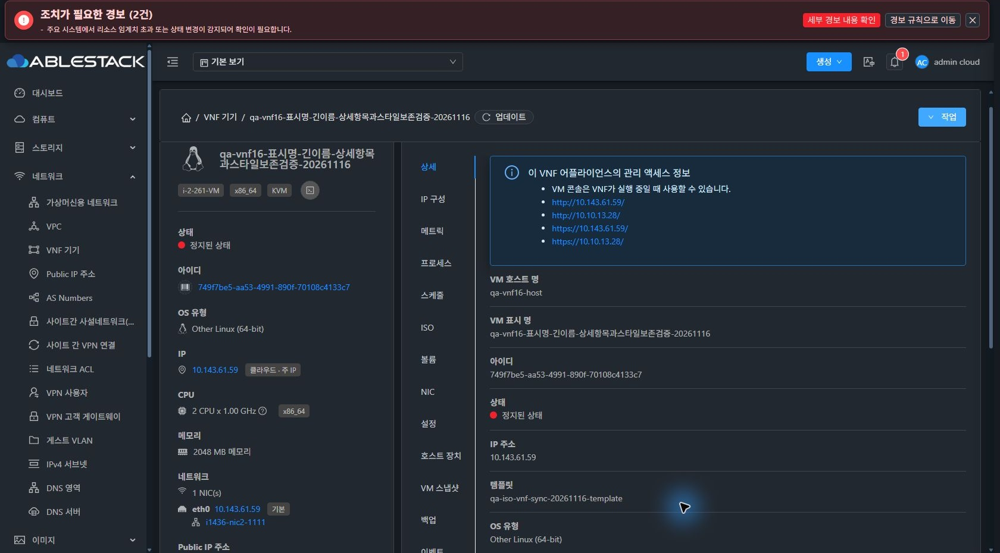
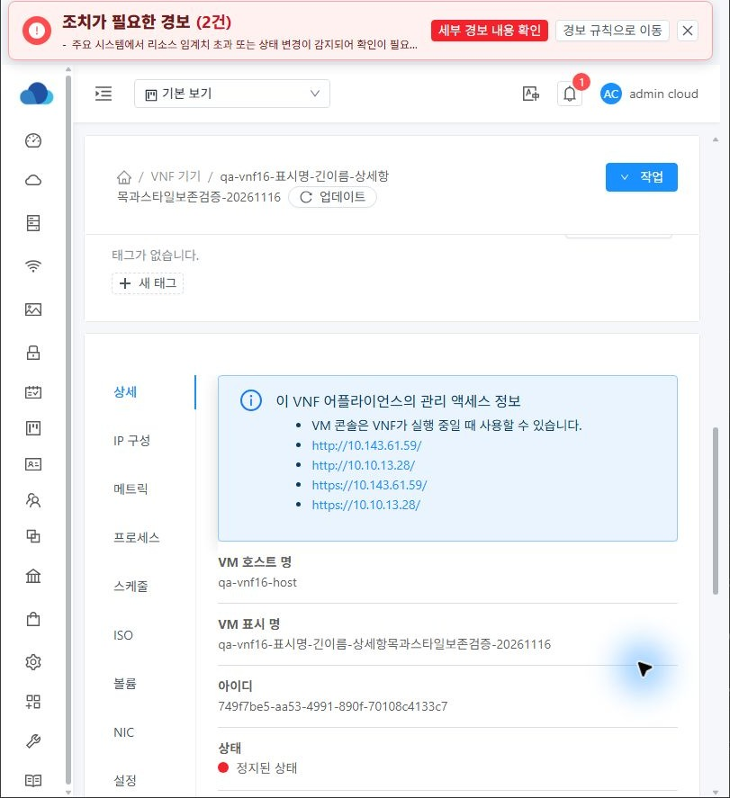
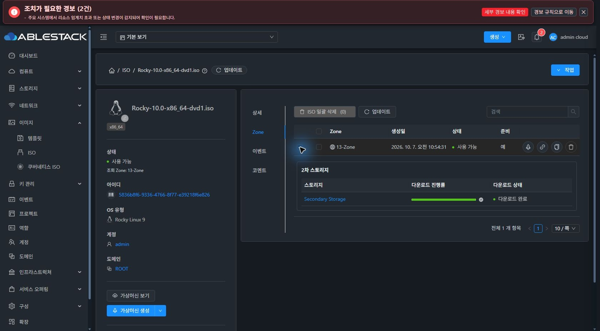

<!--
Licensed to the Apache Software Foundation (ASF) under one
or more contributor license agreements.  See the NOTICE file
distributed with this work for additional information
regarding copyright ownership.  The ASF licenses this file
to you under the Apache License, Version 2.0 (the
"License"); you may not use this file except in compliance
with the License.  You may obtain a copy of the License at

  http://www.apache.org/licenses/LICENSE-2.0

Unless required by applicable law or agreed to in writing,
software distributed under the License is distributed on an
"AS IS" BASIS, WITHOUT WARRANTIES OR CONDITIONS OF ANY
KIND, either express or implied.  See the License for the
specific language governing permissions and limitations
under the License.
 -->

# ISO Epic 이후 upstream VNF UI 동기화 및 13번 검증

2026-11-16 KST. PR #1682 / Epic #1664의 후속 검증입니다.

## 결과

최신 upstream의 VNF 기기 표시 항목과 ISO Epic 변경을 함께 유지했습니다.
13번의 이전 운영 UI에는 최신 VNF 표시 코드가 반영되지 않아,
검증한 운영 입력에 VNF UI 변경을 통합한 정적 파일 36개를 배포했습니다.
동일한 테스트 기기의 배포 전후 UI를 비교하고, 최종 검증 후 테스트 자원을 정리했습니다.
추가 제품 코드 수정은 필요하지 않았으며 이 커밋은 검증 자료입니다.

- 브랜치: `dhslove/epic-1664-iso` → upstream `ablestack-europa`, PR #1682 미병합 유지.
- 로컬 기준 / origin 기준 / upstream 기준: `8ada44ee9d921dfcca9c2be892f19730129b4188`, 차이 `0 0`.
- 동기화된 제품 HEAD: `ce4820ba90d4ed4ac1302585349e5fb3daf83ad5`.
- fetch 후 로컬 기준을 먼저 갱신하고 기존 작업 브랜치를 rebase했습니다. 이미 최신 상태였습니다.
- VNF 라우트는 upstream과 같고, 운영 입력의 VNF 라우트 AST도 작업 브랜치와 같습니다.

## 소스·배포 경계

기존 운영 빌드 입력 `/root/work/.build-iso1673-20261115/ui`에
upstream VNF 변경 구간 `1046a5dc3f21cb9cca0ab6881dd906d64b591e80` → `8ada44ee9d`
중 UI 소스 35개와 영문·한글 locale 2개를 통합했습니다.
공통 파일 5개의 충돌 38개는 ISO와 VNF 동작을 모두 보존하도록 해결했습니다.
기존 운영 VPC 동작과 빌드 설정, 범위 밖 소스 1,019개는 유지했습니다.

- 최종 입력: `/root/work/.build-iso-vnf-sync-20261116-bm2k765y/ui`.
- [소스 해시와 보존 경계](evidence/source-boundary.json),
  [공통 파일 통합 결정](evidence/runtime-conflict-decisions.json).
- [운영 입력에 적용한 정확한 차이](evidence/runtime-vnf-forward-port.patch)는
  위 기존 운영 입력의 상위 디렉터리에서 `git apply --check` 및 `git apply`로 재현할 수 있습니다.
  기존 운영 입력은 앞선 ISO의 제한 배포를 위해 보존한 입력이며 전체 canonical checkout과 구별합니다.
- 변경 파일의 빌드 전후 해시 확인, ESLint 35개 소스, 단위 검증 **64 suites / 1,126 tests**, 생산 빌드 통과.
- canonical의 기존 통합 결과는 **65 suites / 1,165 tests**입니다.
  운영 입력에 없는 VPC 전용 1개 suite는 이번 운영 빌드 검증에서 제외했습니다.
  [선택 목록](evidence/test-selection.json)과 [실행 결과](evidence/runtime-unit-summary.log)를 연결합니다.

배포는 UI 정적 파일 36개이며 index·locale 2개를 교체하고 해시 자산 33개를 추가했습니다.
기존 해시 자산을 삭제하지 않았고, 그 밖의 기존 7,110개 파일 해시를 유지했습니다.
백엔드 JAR, PID `2620448`, config, web.xml, color.less 해시가 같습니다.
DB·호스트 Agent·SystemVM 변경이나 서비스 재시작은 없습니다.

- index SHA-256: `4e4ca8047dc1f7ae43e528e31d89cee6a80354936abc2b950d5b2ab234260c75`.
- backend SHA-256: `a130cccd3c545afc44afcd641b22ef49af99bbc3b83e8ffbee1c3a0af4852443`.
- [배포 결과](evidence/ui-deployment.json), [정확한 배포 파일](evidence/deploy-files.json),
  [최종 보존 비교](evidence/preservation-final.json).

## VNF 기기 UI 검증

모든 Mold 개체 생성·수정·조회·삭제는 실제 Chrome UI로 수행했습니다.
URL 확인 실패로 중단됐던 제어를 다시 연결하고, 새 UI의 로딩을 확인한 뒤 검증했습니다.
화면별 원자료는 [UI 사례 39개](evidence/ui-cases.json)에 기록했습니다.

검증 개체는 `qa-vnf16-host` (`749f7be5-aa53-4991-890f-70108c4133c7`)입니다.
Cirros QCOW2 VNF 템플릿을 UI로 등록하고, 관리 NIC `mgmt0` / device ID `0`,
`console,http,https` 접근 속성을 지정했습니다.
기존 `i1436-nic2-1111` 네트워크에서 `CKS Instance`로 정지 상태 생성했습니다.
표시 명을 `qa-vnf16-표시명-긴이름-상세항목과스타일보존검증-20261116`으로 변경했습니다.

| 확인 대상 | 최종 UI 관찰 |
| --- | --- |
| 호스트 명 / 표시 명 | 별도 한글 라벨. 표시 명 수정 후 호스트 명 `qa-vnf16-host` 유지 |
| 이름·breadcrumb·InfoCard | 저장된 긴 한글 표시 명 반영, 영역 안 줄바꿈, 상세의 원문 유지 |
| ID·상태 | 동일 UUID, 한글 `정지된 상태`와 상태 배지 |
| OS | UUID 대신 `Other Linux (64-bit)`, InfoCard와 상세 일치 |
| 네트워크·사양·소유 | `10.143.61.59`, NIC 1개, 2 CPU / 2048 MB, CKS Instance, admin / ROOT / 13-Zone |
| false 값 | 동적 확장·HA `아니오`, 누락되거나 원시 false로 보이지 않음 |
| 삭제 보호 | `사용 안 함` → `사용 (삭제 차단)` → `사용 안 함`, 저장·재조회 반영 |
| 보호 중 작업 | VNF 기기 파괴 메뉴 비활성화, 해제 후 삭제 가능 |
| 관리 접속 안내 | 정지 VM 콘솔 사용 조건과 HTTP/HTTPS 주소 표시 |
| NIC | device ID `0`, 기본·할당됨·사용 허용, IP/MAC 값 유지 |
| 설정 | deployvm=true / rootDiskController=osdefault / tpmversion=NONE, 읽기 전용 구분 |
| ISO 탭 | 이름·장치 슬롯·미디어 속성·상태·작업 및 미연결 빈 상태 유지 |
| Metrics | 정지 VM의 기간 데이터 없음 안내, 로딩 종료·권한 오류 없음 |
| VM 표준 비교 | 같은 UUID를 일반 VM 상세에서 열어 InfoCard·탭·라벨/값·보호 표시의 공통 스타일 대조 |
| 테마·창 크기 | 다크·라이트, 데스크톱과 810×975 창에서 값·UUID·긴 이름·안내문이 영역 안에 표시 |
| 편집/삭제 대화상자 | 표준 제목·본문·하단 버튼, 다크·라이트 가독성, 대상 이름/UUID·최신 보호 상태 확인 |

VNF 상세 라우트의 24개 표시 항목 계약은 upstream 그대로 보존했습니다.
이 개체에서 실제 확인한 상세 행은 15개입니다.
IPv6·부팅 유형/모드·사용자 데이터 5개·호스트 제어 상태는 값이 없는 항목으로 구분합니다.
정지 개체의 표시 검증이며 게스트 서비스 통신·실제 부팅을 이번 결과에 합산하지 않습니다.

처음 선택한 `1C1GB` 오퍼링은 UI에서
`431 ALLOCATION_AGENT_UNAVAILABLE: no matching qualified pool and Agent; no legacy fallback is allowed`로 거절됐습니다.
기존 호환 `CKS Instance`로 생성에 성공했습니다. 할당 Agent 환경 제약과 UI 회귀 결과를 구분합니다.

## ISO Epic 보존 검증

- ISO 목록 8개의 UUID가 기존 최종 검증 자료와 모두 일치합니다.
- 이름 우선 열 너비, 한 줄 부가 정보·ellipsis, 불필요한 목록 설명 제거 상태를 유지합니다.
- `Rocky` 부분 검색 결과 1개, 상세 → breadcrumb 복귀 후 검색어·페이지·페이지 크기를 유지합니다.
- Rocky ISO의 OS, 7.13 GiB, x86_64, 부팅 가능 예, false 한글 표시, ID 복사 버튼과 상세/Zone/이벤트/코멘트 탭을 확인했습니다.
- ISO 편집의 아키텍처·OS·false 토글·사용자 데이터 입력과 Esc 취소를 확인했습니다.
- Zone의 Ready·한글 상태·2차 스토리지·다운로드 완료, 다크 대비와 확장 행을 확인했습니다.
- ISO 복사 창은 단일 Zone에서 대상 없음 안내·확인 비활성화 상태를 유지합니다.
- ISO 전용 및 VM 읽기 파일 20개와 영문·한글 ISO locale 키 각 239개가 이전 운영 입력과 같습니다.
- [소스/locale/기존 ISO ID 비교](evidence/integration-preservation.json).

4.21·4.23 업로드는 #1667, 실제 파일 수신·부팅/미디어 소비는 #1672,
실계정 ACL 전체 행렬과 읽기 전용 VM Metrics 경계는 #1673의 완료 근거를 연결합니다.
이번 후속은 VNF 표시 및 공통 UI 회귀입니다. 다중 Zone·비KVM 기능과 기존 검증 범위를 유지합니다.

## 테스트 자원 정리

| 생성 자원 | 식별자 | 최종 확인 |
| --- | --- | --- |
| VNF | `749f7be5-aa53-4991-890f-70108c4133c7` | 영구 삭제 성공, VNF 목록 0개, 템플릿 참조 VM 0개 |
| ROOT-261 | `06d3318c-54a1-4bda-98c5-c6af0511fc33` | VOLUME.DESTROY 성공, 볼륨 이름 검색 0개 |
| VNF 템플릿 | `646ee5d7-4278-40d6-b6b8-9e7d3463b8f8` | force 없이 Zone 삭제 성공, 이름 검색 0개 |
| 임시 QCOW2 | `/client/qa-iso-vnf-sync-20261116/cirros.qcow2` | 경로·크기·해시 검증 후 제거, HTTP 404 |

최종 VM 103개·템플릿 48개·ISO 8개·네트워크 8개를 확인했습니다.
사용한 기존 네트워크는 구현 완료 상태와 CIDR을 유지합니다.
[개체 장부](evidence/resources.json), [임시 파일 정리](evidence/fixture-cleanup.json),
VNF·ROOT 볼륨·템플릿의 0개 결과 스크린샷을 첨부했습니다.
브라우저는 다크 테마·원래 창 크기·북마크 표시로 복원했습니다.
스크린샷은 브라우저 상단만 잘라 Mold 내용은 유지했습니다.

## CI 부채 분리

CI 부채 #926·#1044는 OPEN이며 기능 Epic과 독립적으로 유지합니다.
제품 HEAD ce4820ba90의 최근 전체 Lint는 16개 기존 hook 실패,
진단 경로 11,178개(기준 11,179개 대비 추가 0개 / 제거 1개), License는 기존 4,077개 경로입니다.
Conflict Check는 성공했습니다. 전체 CI 성공으로 표시하지 않습니다.

- Lint: <https://github.com/ablecloud-team/ablestack-cloud/actions/runs/43738255278>
- License: <https://github.com/ablecloud-team/ablestack-cloud/actions/runs/43738255170>
- Conflict Check: <https://github.com/ablecloud-team/ablestack-cloud/actions/runs/43738255113>

이번 검증 자료의 집중·수동 pre-commit 및 staged RAT 비교 결과는 evidence에 연결합니다.
