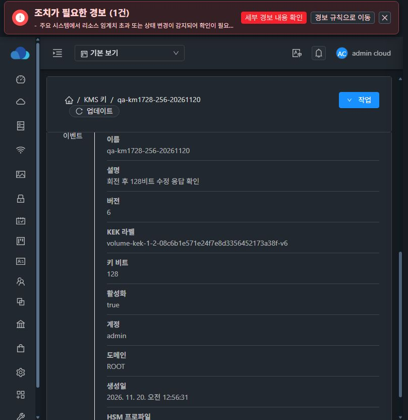

<!--
Licensed to the Apache Software Foundation (ASF) under one
or more contributor license agreements.  See the NOTICE file
distributed with this work for additional information
regarding copyright ownership.  The ASF licenses this file
to you under the Apache License, Version 2.0 (the
"License"); you may not use this file except in compliance
with the License.  You may obtain a copy of the License at

  http://www.apache.org/licenses/LICENSE-2.0

Unless required by applicable law or agreed to in writing,
software distributed under the License is distributed on an
"AS IS" BASIS, WITHOUT WARRANTIES OR CONDITIONS OF ANY
KIND, either express or implied.  See the License for the
specific language governing permissions and limitations
under the License.
-->

# #1728 KMS 회전 길이 정합성 구현·13번 UI 검증

2026-11-20 KST. 상위 Epic #1727, 작업 브랜치 `dhslove/epic-1727-key-management`.
이번 완료 범위는 KM-01 한 건이다. 다음 권장 과제는 KM-02 #1729이며,
가상머신 기준 전체 스타일 통일과 최종 UI 통합은 KM-10 #1737에 남긴다.

## 결과

- KMS 집중 회귀 **108건 / 8 suite, 실패 0·오류 0·skip 0**. 신규 회귀 17건.
- 실제 UI에서 128/192/256 및 기본 256 생성, 연속·생략 회전,
  비활성 키/프로파일·잘못된 길이 거부, 실제 DB 실패·재시도,
  관리 서버 재시작·재로그인 후 값을 확인했다.
- DB 실패 뒤 기존 v5/256/라벨/Active 버전이 보존되고 실패 v6 provider KEK가 정리됐다.
  실패 해제 후 명시적 재시도는 **v6/128**로 성공했다.
- 시험 키 4개 삭제 후 활성 KMS/provider KEK·wrapped-key·볼륨 참조 잔여 0,
  기본 Database HSM은 기존 UUID/이름/소유 범위·공개 여부를 유지한 Disabled 상태다.
- 기존 관리 서버 JAR를 백업한 후 KMS 클래스만 적용했다.
  **92,939개 항목 중 변경 2개, 나머지 92,937개 내용 hash 보존**.
  host agent·UI·SystemVM·전체 Cloud 재배포와 DB schema migration은 없다.



## 소스와 빌드

| 항목 | 값 |
| --- | --- |
| 시작 local/origin/upstream Europa | `41fe8cb0dd0c05e95c4ef6d110dafc26b85a01e2`, divergence `0 0` |
| 빌드한 변경 클래스 소스 | `5e058ec22328c43f3b0d9f20ab0e980cffe00d91` |
| 환경 | RockyLinux-9.7 WSL ext4, Java 17.0.19, Maven 3.6.3 |
| 실행 서버 | 13번 Mold, Java 17.0.20.1, 기존 class major 55와 호환 |
| 범위 | server와 의존 모듈 26개, KMSManagerImpl 관련 테스트만 실행 |

```sh
mvn -B -ntp -pl server -am -Pdeveloper,disablecheckstyle \
  -Dcheckstyle.skip=true '-Dtest=KMSManagerImpl*Test' \
  -Dsurefire.failIfNoSpecifiedTests=false -DfailIfNoTests=false package
```

기본 reactor는 변경하지 않은 cloud-api의 Checkstyle 46건,
후속 시도에서는 engine/schema의 기존 15건에서 중단됐다.
두 경로의 tree가 base와 같음을 확인했고 이 인프라 baseline을 기능 수정에 섞지 않았다.
집중 테스트에서만 기존 Checkstyle 실행을 제외하고, 프로젝트의 같은 Checkstyle 8.18 /
cloud-style.xml 설정으로 변경한 main/test Java 3개를 별도 검사해 **진단 0건**을 확인했다.
테스트를 비활성화한 것이 아니며 전체 CI 통과를 뜻하지 않는다.

[빌드·suite·클래스 receipt](evidence/build-receipt.json)에는
실제 테스트 건수와 JAR/class/패치 hash를 기록했다.
108건은 이번에 실제 실행한 KMS 8 suite의 합계이며 기존 전체 회귀 건수와 합산하지 않는다.

2026-11-20 사용자가 개발·집중 빌드는 WSL, 릴리즈 빌드는 Actions로 정한 기준을
[저장소 정책](../../../developer/build-release-policy.ko.md)에 반영했다.
fork Actions는 사용량에 따른 중지 배너와 HTTP 422를 확인했으며,
이번 검증물은 정식 릴리즈가 아니다. 개발용 Release/tag/asset은 생성하지 않았다.

## 실제 UI 검증

기능 요청은 웹 UI의 생성·수정·작업 메뉴·대화상자·상세·재로그인으로 실행했다.
SSH/DB는 배포, 비밀 없는 상태 관측과 명시적인 시험 키 실패 주입에 사용했다.
직접 API 요청으로 UI 실행을 대신하지 않았다.

| 시나리오 | 관측 결과 |
| --- | --- |
| 생성 128/192/256 | 각각 v1과 요청 길이, Database provider metadata 일치 |
| 생성 길이 생략 | createKMSKey 요청에 keybits 없음, 응답·상세·provider 256 |
| 256→128 | v2/128, 목록/상세 및 수정 응답에서도 128 유지 |
| 128→192 | v3/192 |
| 회전 길이 생략 | 요청에 keybits 없음, v4/192 유지 |
| 192→256 | v5/256 |
| 비활성 키 회전 | async 실패 431, v2/128 유지 |
| 129비트 | async 실패 530, v2/128 유지. 새 길이·버전 반영 없음 |
| 현재 HSM 비활성 + target HSM 생략 | async 실패 431, v5/256 유지 |
| DB row-lock timeout | async 실패 530, v5/256·라벨·Active 버전 보존, 실패 v6 KEK 정리 |
| 잠금 해제 후 명시적 재시도 | v6/128 성공 |
| 관리 서버 재시작 + 새 로그인 | 같은 UUID·v6/128 및 provider metadata 유지 |
| 시험 키 4개 삭제·기본 프로파일 복원 | UI 목록 0건·기존 HSM Disabled 및 DB 잔여 0 |

- [UI DOM/실행 기록](ui-results.json)
- [선택된 UI 발생 API 응답](ui-api-evidence.json), [캡처 경계](api-capture-notes.json)
- [시험 자원 allowlist](test-resources.json)
- [256→128 회전 증거](screenshots/05-rotate-128-v2.jpg)
- [DB 실패 UI](screenshots/10-bounded-db-failure.jpg)
- [재시작 후 최종 UI](screenshots/11-restart-relogin-v6-128.jpg)

API trace는 선택된 요청·응답이다. 초기 일부 network buffer 항목은 포함하지 않으며
전체 순서의 근거는 UI 기록과 DB snapshot을 함께 사용한다.
create/update/list의 keybits와 생략된 요청 인자를 확인하고, HTTP 200 접수와 실제 async 결과를
구분했다. 로그인·세션·API 자격 증명/PIN 값은 증거에서 제외했다.

## 실제 DB 실패의 범위와 복구

대상은 이 작업이 UI로 만든 키
`08c6b1e5-71e2-4f7e-8d33-56452173a38f` 한 개다.
다른 키/볼륨을 변경하지 않는 row lock으로 실제 persist lock-wait timeout을 유발했다.
최종 유한 시간 제어는 DB timeout 50초보다 긴 **70초** 후 rollback/connection close로
잠금을 해제했고 제어 프로세스 exit 0을 확인했다.

FK를 가진 새 버전 persist가 실패하면서 기존 버전 전환은 transaction rollback 대상이 된다.
실패 후 SQL로 다음을 확인했다.

1. 기존 `key_bits=256`, `kek_label=...-v5`, `version=5`, provider bits 256이 전후 동일.
2. 새 v6 버전 행 없음. 두 timeout 시도에서 생성된 v6 provider 객체는 모두 removed 상태.
3. 해당 UI async jobs는 실제 Failed/530. 성공으로 표시하거나 자동 재전송하지 않음.
4. 잠금 해제 뒤 사용자의 명시적 UI 재시도에서 v6/128 성공, 다음 재시작 뒤에도 유지.

초기 보조 제어에서 UPDATE 중단 조건에는 도달하지 않았지만 실제 실패는 DB lock timeout으로
관측됐다. 재현 절차를 유한 시간 row-hold로 정리해 exit 0으로 다시 확인했다.
SQL `KILL QUERY`는 실행되지 않았다. 권한·전역 DB 보호 설정을 바꾸지 않았고
시험 trigger는 생성되지 않았다.

[전 상태](evidence/db-before-fault.json) /
[실패 후 상태](evidence/db-after-fault.json) /
[유한 시간 잠금 제어](evidence/row-lock-control.json) /
[기계 검증 요약](evidence/verified-summary.json).

단위 시험은 DAO update=false/persist=null/unchecked DB 실패,
provider 생성·보상 삭제 실패, 접근 거부 및 잠금 획득 실패도 별도로 검증했다.
단위 callback 실행과 실제 DB transaction rollback의 증거를 구분한다.

## 적용·재시작·복구 경로

| 항목 | 값 |
| --- | --- |
| 기존 통합 JAR SHA-256 | `55f802d2b22c9d4d471644c6157781cc2604e27d4ba0d7b055e4a934bb1d6171` |
| 적용 JAR SHA-256 | `ab4d2490066a93e00ae4de454d492ca797872e54f0398d651c672791ec5672cb` |
| 백업 | `/var/lib/cloudstack/management/key-management-1728-backup-20261120/cloudstack-4.23.0.0-ABLESTACK.Mold.jar` |
| 변경 항목 | KMSManagerImpl.class, KMSManagerImpl$1.class |
| 유지 항목 | 나머지 92,937개. KmsOperation 클래스도 원래 hash 유지 |
| 재시작 후 | mold.service active, PID 3214775, /client/ HTTP 200, 실제 admin UI 로그인·조회 성공 |

[적용 receipt](evidence/deployment.json)와 [재시작 전후 DB/서비스 관측](evidence/restart.json)을
참조한다. 이는 **변경 KMS 클래스의 소스 증명**이며 전체 실행 플랫폼이 해당 Git SHA로
재배포됐다는 뜻이 아니다.

복구가 필요하면 해당 JAR와 백업의 기록된 hash를 확인하고 승인된 정비 범위에서
mold.service를 정지한 뒤 백업 JAR를 원래 경로·소유자·mode·SELinux 문맥으로 복원하고 재시작한다.
그 뒤 로그인·KMS 조회·기존 자원 접근을 확인한다.
현재 검증된 패치는 유지하고 백업은 보관했다. host agent/Usage/UI/SystemVM을 교체하지 않았다.

## 정리 및 기존 데이터

[최종 DB 관측](evidence/db-final.json):

- 활성 KMS 키 0, 활성 시험 provider KEK 0.
- 시험 wrapped-key 0, 시험 볼륨 참조 0.
- 기본 HSM UUID `bc91cad9-e49f-400f-bbc0-1f047202631f`, database/Disabled/public 상태 복원.
- 시험 row lock 해제, 시험 trigger 없음, 진행 중 API job 0.
- temporary helper/패치 파일은 서버 /tmp에서 정리했고 원래 배포 JAR 백업만 보관.
- 기존 정상 pseudo dispatcher 두 개는 일반 관리 서버 내부 작업으로 관측했으며 임의 삭제하지 않았다.
- 감사 이벤트·삭제된 시험 키/버전/provider의 soft-delete 이력은 정상 이력으로 남는다.
  테이블 전체가 빈 상태라고 보고하지 않는다.

기존 활성 KMS 키는 적용 전 0개였다. 과거 운영 키를 추정 보정하거나 키 파일/DB 설정을
변경하지 않았다. 실제 VM/볼륨 생성·삭제·전환·재포맷 또는 host agent 재시작은 수행하지 않았다.
과거 불일치의 조회·확정 보정·복구 절차는
[설계 문서](../../design/key-management-1728-design.ko.md)에 남겼다.

## 남은 검증과 Epic 경계

실물 PKCS#11 HSM 접속·장애/다중 management 실제 경합, 암호화 볼륨의 게스트 I/O·체크섬은
기존 #1025에 남는다. 이번 metadata CRUD/DB/provider 관측과 mock 테스트를 그 범위의 PASS로
확대하지 않는다. 관리자 외 실제 UI·전체 테마/반응형·키보드 통합은 KM-05/KM-10에서 수행한다.

입력 실패 시 창이 닫히는 흐름과 삭제 후 dashboard 복귀는 기존 KM-06/KM-08 범위로 유지한다.
KM-01 완료를 Epic 전체 완료 또는 전체 CI 녹색으로 표시하지 않는다.
