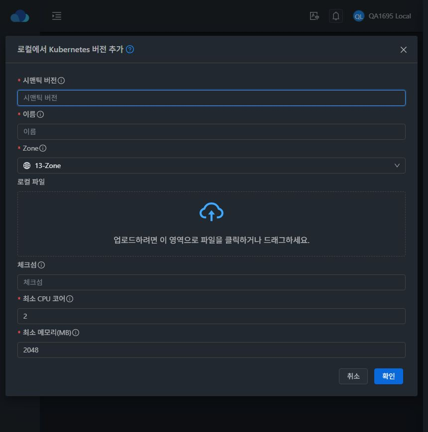

<!--
Licensed to the Apache Software Foundation (ASF) under one
or more contributor license agreements.  See the NOTICE file
distributed with this work for additional information
regarding copyright ownership.  The ASF licenses this file
to you under the Apache License, Version 2.0 (the
"License"); you may not use this file except in compliance
with the License.  You may obtain a copy of the License at

  http://www.apache.org/licenses/LICENSE-2.0

Unless required by applicable law or agreed to in writing,
software distributed under the License is distributed on an
"AS IS" BASIS, WITHOUT WARRANTIES OR CONDITIONS OF ANY
KIND, either express or implied.  See the License for the
specific language governing permissions and limitations
under the License.
-->

# #1695 쿠버네티스 ISO 공통 계약 구현·13번 UI 검증

## 완료 결과

2026-11-16, API별 capability·응답·범위·요청 소유 계약을 구현하고 13번에 필요한 정적 변경10개만 배포했습니다. 관리자와 실제 제한 계정2개로 UI 검증을 마쳤고 시험 자원을 모두 정리했습니다.

제품 head: **b1dd77b5e65cd72d02441031d42d952307c769f9**. 기준 Europa 로컬/origin/upstream: **b777311a708e0e652f05025fecb2660dfa90f74d**. 기존 작업 브랜치 `dhslove/epic-1692-ui-design`에서 origin만 갱신하고 [PR #1703](https://github.com/ablecloud-team/ablestack-cloud/pull/1703)을 유지합니다. 상위 [Epic #1692](https://github.com/ablecloud-team/ablestack-cloud/issues/1692)의 구현2/9 완료이며 다음은 **#1696**입니다.

## 변경과 설계 계약

- `kubernetesIsoCapabilities.js`: list/URL/local/update/delete를 독립 판정합니다. RootAdmin 쓰기·현재 API grant가 모두 필요하며 일반 ISO 소유·공유·VM Metrics 권한으로 대신하지 않습니다. 로컬만 허용된 역할이 URL API 설명에 의존하지 않습니다.
- `kubernetesIsoModel.js`: 정확한 응답 envelope·UUID·배열·count·업로드 ticket·쓰기 접수를 검증합니다. false/0/누락을 보존하고 Enabled/Disabled와 ISO 관측을 분리합니다. 특정/모든/미상 Zone과 directdownload 읽기 모델을 제공합니다.
- `AutogenView.vue`: 카탈로그 전용 조회 인자·오류·현재 요청 소유 범위를 연결했습니다. 미조회/빈 결과/미존재/권한 거절/만료/네트워크·서버 오류/잘못된 응답을 성공으로 바꾸지 않습니다. 계정·역할·API·프로젝트·세션·대상 변경 시 늦은 응답과 기존 선택/대화상자를 무효화합니다.
- `image.js`, 등록/상태 변경 양식: 모드별 스키마와 API 권한을 사용합니다. 로컬 API가 광고하지 않는 arch는 표시·전달하지 않습니다. 상속 name/format/zoneid·checksum과 시스템 소유/전역 범위의 처리 기준을 문서화했습니다. RootAdmin 외 isourl 사본과 상세 필드는 노출하지 않습니다.
- `api/index.js`: readScope는 명시된 Axios config에만 연결하고 wire 인자에는 넣지 않습니다. 과거 세션의 늦은401이 새 세션을 종료하지 않게 기존 오류 보존 경로를 사용합니다.
- 실계정에서 발견한 로그인 강제 의존도 보정했습니다. 기존 코드의 무조건 listZones 호출이 카탈로그 전용 계정의 첫 로그인을 막았습니다. `store/modules/user.js`의 Zone·네트워크·VPC 발견은 최신 grant가 있을 때만 선택적으로 실행하며 실패/지연이 인증을 거절하지 않습니다. 이전 Zone 캐시도 비웁니다.

제품 입력10개(JS/Vue8개·로케일2개), 테스트4개, [API 계약 문서](../../design/kubernetes-iso-1692/api-contract.ko.md)를 변경했습니다. Backend/DB/Agent/SystemVM의 변경은 없습니다.

## 기능별 검사

| 검사 | 결과 |
| --- | --- |
| 변경 Lint | JS/Vue·테스트 변경 범위 PASS |
| canonical 소스 | **7 suites / 150 tests PASS**, 실패0 |
| 실제 운영 빌드 입력 | 같은 **150개 사례 PASS**. 두 실행을300개로 합산하지 않음 |
| 적용 훅 | 제품·테스트·계약 문서15개 파일에 적용되는18개 그룹 통과/해당 없음 |
| 생산 빌드 | 동일 운영 절대 경로,815.6초/PASS |

검사 묶음: optionalDiscovery, kubernetesIsoModel, KubernetesIsoRead, API index/request, AutogenTemplateRead, IsoListSearch. 부분·최소 응답, false/0, HTTP200 안의 API531/403/401/530, 잘못된 count/UUID, 직접/중첩 upload ticket, 역할·프로젝트·세션·API·대상 변경의 늦은 응답, 실제 로컬 전용 양식 렌더링을 포함합니다.

## 실제13번 UI 검증

Mold 업무 조회·생성·수정·삭제는 브라우저 UI로 실행했습니다. SSH는 정적 배포/파일 검증과 임시 HTTP fixture 준비·정리에만 사용했습니다.

| 항목 | UI 관찰 결과 |
| --- | --- |
| 조회 전용 실계정 | listApis/listCapabilities/listUsers 로그인 bootstrap + listKubernetesSupportedVersions만 허용, 나머지 deny. Zone/일반 ISO/VM Metrics grant 없이 첫 로그인과 기존2개 목록·상세 조회 성공. URL/local 등록 및 수정/삭제 작업 없음, 상세 ISO URL 없음 |
| 로컬 전용 실계정 | 위 bootstrap·카탈로그 읽기 + listZones/getUploadParams만 허용, URL/update/delete/VM Metrics 금지. 로컬 버튼1·URL 버튼0. 양식에 버전/이름/Zone/파일/체크섬/CPU/RAM 표시, URL/직접 다운로드/미지원 arch 없음. 양식 취소, 실제 로컬 전송은 실행하지 않음 |
| 관리자 | URL/local 버튼 각각1. 전용 URL 버전 등록 성공, 상세에서 RootAdmin URL 확인. 연결 ISO 화면에서 준비 예·체크섬 일치·1.36MiB·직접 다운로드 아니오 확인. Enabled→Disabled 저장 성공. 버전 삭제 후 연결 ISO도 연쇄 정리 |
| 잘못된 상세 | 문법상 잘못된 UUID는 로컬 오류, 유효하지만 없는 UUID는 실제 서버 조회 실패/재시도로 표시. 둘 다 정상 빈 결과나 일반404 화면으로 전환하지 않음. breadcrumb 목록 복귀 성공 |
| 공통 화면 | 템플릿48개와 Ubuntu 이름350px·한 줄/ellipsis 유지, ISO8개의 ID/이름 동일, VM 상세 카드 정상, VNF0 빈 목록 정상 |

버전 생성 접수나 isostate=Ready만으로 ISO 다운로드 완료를 판정하지 않았습니다. 별도 ISO UI에서 준비와 체크섬을 확인했습니다. 임시 ISO는 **1,421,312 bytes**, SHA-256 `a4a4783a7da626153e11a811a9952b3e977b25bcaba33a0329b1b40aea65d440`이며 Kubernetes 바이너리가 없는 전송 시험용입니다.

VM 목록은 이번 관측에서 **102개/첫50행**, 이전 #1694 기록은103개/첫20행입니다. 과거 첫20개 ID·이름은 모두 같은 순서로 확인했습니다. 이번 시작 시 VM 전체 목록 기준을 별도로 취득하지 않아 전체 개수 보존을 단정하지 않습니다. 이번 작업에서 VM 생성/수정/삭제는 실행하지 않았고 시험 계정은 자원이 없는 상태로 삭제했습니다.

## 범위 제한 배포

운영 빌드 입력 `/root/work/.build-iso-vnf-sync-20261116-bm2k765y/ui`에 이번10개 입력의 변경만 적용했습니다. 기존 운영 AutogenView/로케일 차이를 보존했고, 나머지1088개 입력은 유지했습니다. 이 경로는 배포 입력 보관용이고 canonical Git 작업은 `/root/work/ablestack-cloud` 한 곳에서 수행합니다.

- lockfile/의존성을 변경하지 않았습니다. 설치된 Webpack4/Node20의 기존 빌드 호환 옵션을 사용했습니다.
- 최초 Node 기본 설정에서 실패한 빌드 및 검증 보정을 반영하기 위해 중단한 중간 빌드는 배포하지 않았습니다.
- 최종 활성 변경10개: JS4·CSS3·로케일2·index. 필요한 vendor 청크도 함께 반영했습니다. 자세한 SHA/경계는 [배포 결과](evidence/deployment-result.json)와 [입력 경계](evidence/build-boundary.json)에 있습니다.
- 기존 파일 중 덮어쓴 것은 index/ko_KR.json/en.json 3개입니다. 나머지 **7148개**는 SHA-256 보존 확인. 과거 해시 자산은 기존 브라우저와 복구를 위해 유지했습니다.
- 백업 `/var/tmp/kiso1695-backup-spnrqjv8`. 최종 index SHA-256 `54f78e61e1d30e51f4ee4c2ead0c84b785f1c84c621a06b598074d0360892e17`.
- 설정3개·Backend jar·Mold PID **2620448** 동일. 최종 HTTP 파일 해시와 UI의 app.5c1e5558.js 로드를 확인했습니다.

## 자원 정리

- 전용 버전 `b2fcdaf8-b91f-4d93-a4de-c7488821258e`와 ISO `a61c780f-f459-4e88-963e-2d571796d4d8` 삭제. 원래 카탈로그2개/ISO8개와 식별자·표시 값 보존.
- 사용자 승인으로 만든 qa-kiso1695-read/local 계정2개는 비활성화 후 UI에서 삭제. 전용 역할2개도 UI 삭제 완료. 원래 계정3개·역할9개 보존.
- 임시 HTTP 파일/디렉터리 제거 후404. 클러스터·VM·프로젝트·네트워크를 만들지 않았습니다. 감사 이벤트는 보존했습니다.
- 시험 비밀번호/티켓/세션은 파일이나 보고서에 저장하지 않았습니다. 생성한 비밀번호의 런타임 변수도 정리했습니다.
- [UI 최종 결과](evidence/final-ui-result.json), [HTTP/런타임 최종 검증](evidence/cleanup-and-final-runtime.json), [자원 ledger](evidence/smoke-resource.json).

## CI와 후속 범위

제품 head의 [Lint43825925789](https://github.com/ablecloud-team/ablestack-cloud/actions/runs/43825925789)는 완료/실패입니다. 직전 검증 문서 head273e0e4의 [완료된 Lint43808391407](https://github.com/ablecloud-team/ablestack-cloud/actions/runs/43808391407)와 실패 훅 **16개 동일**, 이번15개 변경 경로의 추가 진단0을 확인했습니다.

[License43825925799](https://github.com/ablecloud-team/ablestack-cloud/actions/runs/43825925799)의 미승인/unknown **4,077개**는 기존과 같습니다. 전체 CI 성공으로 표시하지 않으며 **#926·#1044는 별도 OPEN 유지**합니다. 후속 검증 문서 커밋의 CI는 PR에서 별도 상태로 표시합니다.

이번 #1695는 공통 계약 완료입니다. URL 필드 경계/검증은 #1696, 실제4.21·4.23 로컬 전송·arch·감사는 #1697, 검색/count/복귀는 #1698, 전역 Zone 표시·Zone별 가용성 및 상세 레이아웃은 #1699, 안전한 상태/삭제는 #1700, 최종 스타일은 #1701, 전체 ACL/통합 회귀는 #1702에서 이어갑니다. 이번 전역 시험 행의 기존 빈 Zone/undefined 링크 표시도 #1699의 F06 수정 대상으로 남습니다. 실제 다중 Zone·타 아키텍처 부팅·CKS 설치/업그레이드는 이번에 검증하지 않았습니다.

