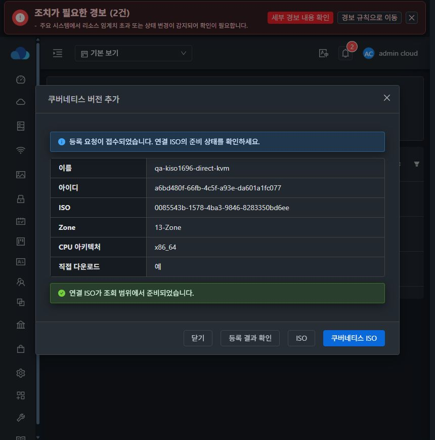

<!--
Licensed to the Apache Software Foundation (ASF) under one
or more contributor license agreements.  See the NOTICE file
distributed with this work for additional information
regarding copyright ownership.  The ASF licenses this file
to you under the Apache License, Version 2.0 (the
"License"); you may not use this file except in compliance
with the License.  You may obtain a copy of the License at

  http://www.apache.org/licenses/LICENSE-2.0

Unless required by applicable law or agreed to in writing,
software distributed under the License is distributed on an
"AS IS" BASIS, WITHOUT WARRANTIES OR CONDITIONS OF ANY
KIND, either express or implied.  See the License for the
specific language governing permissions and limitations
under the License.
-->

# #1696 URL 등록 구현·13번 UI 검증

## 완료 결과

2026-11-16, URL 전용 등록 양식의 입력 경계·Zone/직접 다운로드 정책·접수/결과 확인·중복 전송 보호를 구현했습니다. 필요한 정적 산출물8개만13번에 배포하고 실제 UI 검증과 시험 자원 정리를 완료했습니다.

- 제품 head **03fb81531ffe7f19a6f8625a30f0600df7c49f82**. 기준 로컬/origin/upstream Europa **b777311a708e0e652f05025fecb2660dfa90f74d**.
- 작업 브랜치 `dhslove/epic-1692-ui-design`, [PR #1703](https://github.com/ablecloud-team/ablestack-cloud/pull/1703). origin에만 push합니다.
- [Epic #1692](https://github.com/ablecloud-team/ablestack-cloud/issues/1692) 구현3/9 완료, 다음은 **#1697 로컬 업로드/arch/감사**입니다.

## 변경과 설계

새 `RegisterKubernetesIso.vue`를 운영 VM과 같은 MoldDialog(md)로 구성했습니다. 기존 로컬 양식을 URL 모드에서 분리하고 모드별 capability를 유지합니다. RootAdmin URL 등록은 Zone 조회 grant 유무로 숨기지 않으며, 조회가 제한되면 모든 Zone 경로를 제공합니다.

`kubernetesIsoRegistration.js`는 최소 숫자 버전1.11.0, CPU≥2, RAM≥2048MB, 32비트 정수 경계, ISO URL 구문/확장자, 서버 DigestHelper와 같은6개 체크섬 알고리즘/길이, 아키텍처를 검증합니다. 체크섬은 기존 validTemplateChecksum을 재사용하되 카탈로그가 지원하는 알고리즘으로 제한합니다.

이름은 선택 사항이며 서버 기본값을 사용합니다. 모든 Zone은 wire에서 zoneid를 생략하고 특정 Zone은 UUID로 조회합니다. Edge 포함 시 직접 다운로드를 강제하고 다른 선택으로 돌아가면 사용자의 true/false 선택을 복원합니다. false를 truthy 필터로 누락하지 않습니다.

등록 접수와 준비 완료는 분리했습니다. 결과 화면은 실제 parent/ISO ID·서버 범위·arch·directdownload를 표시하고, 재조회한 범위와 저장 옵션이 요청과 다르면 Ready로 판정하지 않습니다. ISO의 전체 관측 범위와 isready·실패 원인을 확인합니다. 실패 후 결과 확인은 기존 리소스를 읽기만 합니다.

비동기 검증 중 중복 제출을 막습니다. 응답 불명 요청은 자동 재전송하지 않고, 원문 URL/체크섬/세션 없이 해시·불명 상태만 같은 탭 sessionStorage에 보관합니다. 새로고침 후에도 동일 요청은 잠그며 새 로그인/권한 범위에서는 이전 기록을 무효화합니다. 후보 조회를 신규 생성 증거로 취급하지 않습니다.

이 보호는 서버 idempotency/exactly-once 보장이 아닙니다. 다른 탭·새 로그인·저장소 제한 환경에서는 기존 목록을 먼저 확인해야 합니다. [구체 설계](../../design/kubernetes-iso-1692/url-registration.ko.md)에 한계를 기록했습니다.

제품 입력은 신규 유틸/양식·image.js·한국어/영문 로케일5개입니다. 테스트2개와 설계 문서를 추가했습니다. Backend/DB/Agent/SystemVM 변경은 없습니다.

## 기능별 검사

| 검사 | 결과 |
| --- | --- |
| 변경 Lint | JS/Vue·테스트 PASS |
| canonical 소스 | **10 suites /255 tests PASS**, 실패0 |
| 실제 운영 입력 | 같은 **255개 사례 PASS**. 두 실행을510개로 합산하지 않음 |
| 적용 훅 | 최초8개 경로18개 그룹 통과/해당 없음. 후속 소스도 변경 범위 검사를 완료 |
| 생산 빌드 |706.3초/PASS. 설치된 Webpack4/Node20 호환 옵션 사용, 의존성/lockfile 변경 없음 |

실제 Ant 필드 오류, 최소/최대·소수/NaN·버전/URL/체크섬, Edge와 전역/특정 정책, true/false 복원, 이중 제출·재열기·새로고침·이전 로그인·부분 응답·여러 페이지·옵션 불일치·기존 ISO/템플릿/로그인 회귀를 포함합니다. 마지막 소스 보강4개 경로는 최종 적용 훅 결과로 별도 확인합니다.

## 실제 UI 결과

Mold 업무 조회·생성·수정·삭제는 모두 브라우저 UI에서 실행했습니다. SSH는 정적 파일 배포/해시 확인 및 HTTP fixture 준비·제거에만 사용했습니다.

| 항목 | 실제 관찰 |
| --- | --- |
| 입력 오류18건 | CPU1/2.5/NaN/오버플로, RAM2047/2048.5/NaN/오버플로, 잘못된 버전3종·URL3종·체크섬4종 모두 해당 필드 오류. 등록 POST **0건** |
| 통신 실패 | UI가 만든 등록 POST를 서버 전 단계에서2회 실패 주입. 임시 가로채기는 해제. 결과 불명 화면·반복 조회·재열기·새로고침의 차단 확인 |
| 새 캡처 구간 | 새로고침 후 재제출의 추가 POST **0건**, 이벤트 잘림 없음. 첫 장기 구간의 잘린 추적은 이 근거로 대체 |
| 정상 접수 재열기 | 동일 parent ID 재사용, 추가 등록 POST **0건**, 이벤트 잘림 없음 |
| 키보드 | Enter로 빈 필드 검증, Esc 취소, 호출 버튼으로 초점 복귀 |
| 오류 재조회 | 잘못된 체크섬 실패에서 결과 확인3회 → 같은 ID, 추가 POST **0건** |

### 실제 서버 저장값과 준비 상태

| 시험 | 저장/관측 결과 |
| --- | --- |
| 최소 버전1.11.0·빈 이름·MD5·전역·false | 서버 이름 v1.11.0, parent/ISO ID, x86_64, 모든 Zone, 직접 다운로드 아니오, CPU2/RAM2048과 준비 예·MD5·1.36MiB 확인 |
| 특정13-Zone·빈 이름·aarch64·SHA-256·false | 서버 이름 v1.30.9601-13-Zone, parent/ISO ID, 특정 범위·arch 저장, 직접 다운로드 아니오·체크섬·준비 예 확인 |
| 특정13-Zone·x86_64·SHA-512·true | 직접 다운로드 예, parent/ISO·범위·arch·크기·체크섬·준비 예 재조회. 기본 스토리지로의 실제 전송/VM 소비는 미실행 |
| 유효 형식의 틀린 SHA-256 값 | 접수 후 체크섬 불일치/DOWNLOAD_ERROR. Ready로 표시하지 않고 실제 원인과 기존 ID 유지 |
| 빈 체크섬·HTTP404 주소 | 선택 checksum 생략 허용. 접수 후 HTTP404/DOWNLOAD_ERROR를 준비 실패로 표시 |

시험 파일은 **1,421,312 bytes**, SHA-256 `60c79acb32d39da837de5db98ca37cf19901c9f1d7bbff93ba586b195f9e73fe`입니다. Kubernetes 바이너리가 없는 ISO9660 전송 시험 파일입니다. ARM 등록은 카탈로그 메타데이터/전송 검증이며 부팅·CKS 성공으로 해석하지 않습니다. 직접 다운로드의 Ready는 배포 시 다운로드할 수 있는 등록 준비 의미와 구분합니다.

버전5개·연결 ISO5개를 모두 UI로 삭제했습니다. [각 ID·parent/ISO 상세·결과·정리 ledger](evidence/resource-ledger.json)에 정상/음성을 구분합니다. 잘못된 사용자 체크섬 값을 유효 입력 처리의 서버 결함으로 기록하지 않았습니다.

## 공통 회귀와 정리

- 원래 카탈로그 **2개**·ISO **8개**·템플릿 **48개**의 ID/이름·표시 값 보존.
- VM **102개/첫50행**은 이번 시작 시 기준과 ID/이름·총수가 같고 상세 카드도 정상입니다. VNF0 빈 목록 유지.
- Ubuntu 이름350px·한 줄/ellipsis 보정 유지.
- 임시 HTTP 파일/디렉터리 제거와404 확인. 감사 기록은 유지합니다.
- 클러스터/VM/프로젝트/계정/역할을 만들거나 변경하지 않았습니다. 생성 대상은 전용 버전/ISO뿐이며 모두 정리했습니다.
- 최종 관측의 예기치 않은 브라우저 렌더 예외0. 의도적인 전송 실패 주입과 서버 음성 결과는 별도입니다.

## 필요한 변경만 배포

기존 운영 절대 경로 `/root/work/.build-iso-vnf-sync-20261116-bm2k765y/ui`에 이번5개 입력의 정확한 패치만 적용했습니다. 다른1095개 입력과 기존 운영 차이를 보존했습니다. canonical Git 작업은 `/root/work/ablestack-cloud` 하나에서 수행했습니다.

- 최종 변경8개: JS3/CSS2/로케일2/index. 기존 파일 중 덮어쓴 것은 index·en.json·ko_KR.json 3개이며, 나머지 **7155개** SHA-256 보존.
- 백업 `/var/tmp/kiso1696-backup-a1jnir6s`. 최종 index SHA-256 `a7b07dc98e9448b922f4308f75985548cf1dc43f0765f49d8f0f9cf3fca0af91`.
- 설정3개·Backend jar·Mold PID **2620448** 동일. 파일 HTTP 해시와 UI의 app.ac6aa70c.js 로드 확인.
- 접수 표시의 서버 값 대조를 보강하며 중단한 중간 빌드는 배포하지 않았습니다. 이전 해시 자산은 기존 브라우저와 복구를 위해 보존했습니다.

[배포 결과](evidence/deployment-result.json) · [입력 경계](evidence/build-boundary.json) · [최종 파일/런타임 검증](evidence/cleanup-and-final-runtime.json) · [UI 최종 결과](evidence/final-ui-result.json).

## CI 부채와 남은 단계

제품 [Lint43850364428](https://github.com/ablecloud-team/ablestack-cloud/actions/runs/43850364428)는 완료/실패입니다. 직전 기준 [Lint43829815640](https://github.com/ablecloud-team/ablestack-cloud/actions/runs/43829815640)와 실패 훅 **16개 동일**, 이번8개 경로의 추가 진단0입니다.

[License43850364280](https://github.com/ablecloud-team/ablestack-cloud/actions/runs/43850364280)의 미승인/unknown **4,077개**도 동일합니다. **전체 CI 성공으로 표시하지 않으며 #926·#1044는 별도 OPEN 유지**합니다. 후속 문서 커밋의 CI는 PR에서 별도 상태로 기록합니다.

실제 Edge/다중 Zone/비KVM·s390x 등록/부팅·ARM 부팅·CKS 설치/업그레이드·직접 다운로드 실제 기본 스토리지 소비는 **NOT_RUN**입니다. 모델/분기 검사와 실제 환경 검증을 섞지 않았습니다. 실제4.21/4.23 로컬 전송은 #1697, 검색 #1698, 상세/전역 Zone 목록 표시 #1699, 안전한 상태/삭제 #1700, 최종 스타일 #1701, 전체 ACL/통합 회귀 #1702에 남깁니다.

