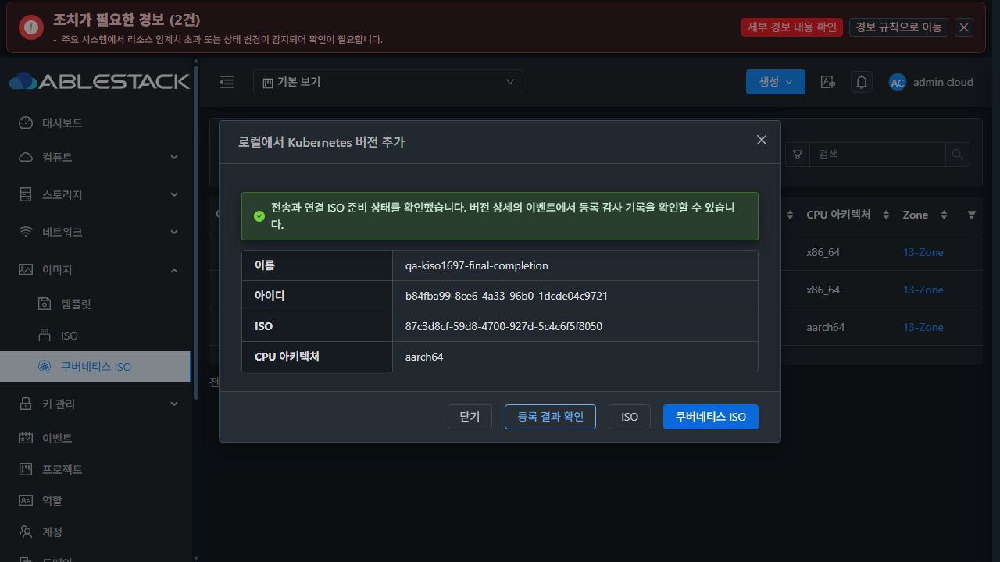

<!--
Licensed to the Apache Software Foundation (ASF) under one
or more contributor license agreements.  See the NOTICE file
distributed with this work for additional information
regarding copyright ownership.  The ASF licenses this file
to you under the Apache License, Version 2.0 (the
"License"); you may not use this file except in compliance
with the License.  You may obtain a copy of the License at

  http://www.apache.org/licenses/LICENSE-2.0

Unless required by applicable law or agreed to in writing,
software distributed under the License is distributed on an
"AS IS" BASIS, WITHOUT WARRANTIES OR CONDITIONS OF ANY
KIND, either express or implied.  See the License for the
specific language governing permissions and limitations
under the License.
-->

# #1697 로컬 업로드·arch·감사 구현과 양 계열 UI 검증

## 완료 결과

2026-11-16, 로컬 파일 검증·전송 수명주기·arch 전달·버전 ADD 감사를 보정하고, 실제4.21 런타임 SSVM에서 업로드한 뒤 새4.23 SSVM으로 재생성해 같은 검증을 통과했습니다. 시험 버전/ISO **9쌍**을 UI로 모두 정리했습니다.

제품 head **722613a3c8c875b3706a5ed9fa4436cb13e0c09e**, 기준 Europa 로컬/origin/upstream **b777311a708e0e652f05025fecb2660dfa90f74d**, 브랜치 `dhslove/epic-1692-ui-design`. [PR #1703](https://github.com/ablecloud-team/ablestack-cloud/pull/1703)은 origin→upstream 흐름으로 유지합니다. Epic #1692 구현4/9 완료, 다음은 **#1698 검색/count/복귀**입니다.

## 제품 변경과 배포 경계

- 로컬 명령에 x86_64/aarch64/s390x arch를 추가·검증하고 내부 GetUploadParamsForIsoCmd까지 전달했습니다. 기본 x86_64와 RootAdmin 권한은 유지합니다.
- 로컬 등록 메서드에 KUBERNETES.VERSION.ADD를 선언하고 생성된 **버전 UUID**를 감사 리소스로 연결했습니다. ISO UUID/ISO.UPLOAD 기록과 구분합니다.
- 새 UploadKubernetesIso와 유틸에서 정확히 파일1개·내용 크기/확장자·버전/CPU/RAM·체크섬·Zone/arch를 먼저 검증합니다. 파일 교체/제거는 자원을 만들지 않습니다.
- 실제 전송 Promise를 await합니다. 티켓·사전 연결·전송·서버 준비·완료가 분리되며100% 전송만으로 Ready로 표시하지 않습니다.
- 미사용 티켓만 사전 연결 재시도에 사용하고, 전송 시도 후에는 실패/중단 시 링크를 재사용하지 않습니다. 만료·빈 응답·부분 응답·계정/역할/API/프로젝트/세션 변경·종료의 늦은 응답을 차단합니다.
- 기존 해시 기반 같은 탭 보호로 미완료 양식 재열기가 새 티켓을 발급하지 않게 합니다. 티켓/서명/세션 원문은 저장하지 않습니다.
- 실패 자원을 자동 삭제하지 않습니다. parent/ISO ID를 유지하고 결과 확인과 UI 정리로 연결합니다. 기존 클러스터/업그레이드 참조 잠금과 업로드 삭제 보호는 변경하지 않았습니다.

[설계](../../design/kubernetes-iso-1692/local-upload.ko.md).

관리 서버는 **기존 운영 JAR의2개 클래스만** 반영했습니다. 필요한4개 메서드/arch 필드·API 설명·감사 선언 외의32개 메서드와 다른 JAR 엔트리를 보존했습니다. 새 API/서버 전체 JAR나 Agent 패키지는 배포하지 않았습니다. DB 스키마 변경은 없습니다.

UI는 기존 운영 절대 경로의5개 입력만 적용해 생산 빌드740.4초/PASS, JS4/CSS2/로케일2/index **9개**를 배포했습니다. 다른 운영 입력은 보존했습니다. 원래7163개 정적 파일 중 index/로케일3개 외 **7160개** 해시 보존을 확인했습니다.

## 검사

| 검사 | 결과 |
| --- | --- |
| Backend module/dependencies | Maven `-pl plugins/integrations/kubernetes-service -am` 빌드 PASS. 초기 단독 모듈의 캐시 의존 불일치는 실제 의존 모듈을 함께 빌드해 해결 |
| Backend 집중 | KubernetesLocalUploadTest / KubernetesVersionManagerImplTest / KubernetesVersionServiceTest, **20 tests PASS** |
| 변경 Java Checkstyle | 위반0 |
| UI/기존 경로 | **5 suites/142 tests PASS** |
| 실제 운영 UI 입력 | 동일142개 검사 PASS. 두 실행을284개로 합산하지 않음 |
| 적용 훅 | 변경10개 경로에 적용되는18개 그룹 통과/해당 없음 |
| 실제 runtime JAR | JVM `-Xverify:all` 로드·arch3종·ADD 선언 PASS, ASM 비교로 관련 없는32개 메서드 보존 |

파일 미선택/빈 파일/확장자/교체/제거/다중 batch, 비동기 이중 제출, Promise 대기·100%와 Ready 구분, 티켓 만료/부분 응답, 중단 후 단일 사용, 재열기/계정 변경, read 권한과 저장 arch의 경계를 검사했습니다.

## 실제4.21 →4.23 환경

| 구분 | UI/실제 runtime |
| --- | --- |
| 4.21 호환 | 새 s-262-VM, UUID64c610e7-7289-4c7c-95a6-978d97137c99, Running/Agent Up. agent/secondary 및 Cloud JAR29개 모두4.21.0.0-Mold.Diplo-202609221440 |
| 4.21 secondary SHA-256 | d5f6dbcf45df292dcfb1d12d84e30ee14f41cb4a9e70f0a1ff82aa62b9c78667 |
| 최종4.23 | 새 s-263-VM, UUID6f8eee76-dd70-42b1-b501-ab3d68815d8d, Running/Agent Up. 실제 agent/secondary/Cloud JAR 모두4.23.0.0 |
| 4.23 secondary SHA-256 | a7c075a5936b2d7bf6a9e6453fc25d247ac0a7b33cdd91046469ca1e28ff27a3 |

4.21 검증은 OS 릴리스 파일도4.21이라고 주장하지 않습니다. OS 이미지 릴리스는 **4.23**, 실제 업로더 Cloud JAR는4.21인 호환 runtime입니다. 버전 문자열을 바꾸거나 mock을 양 계열 통과로 합산하지 않았습니다. 실제 전송은 각각 해당 JAR 계열이 실행 중일 때 수행했습니다.

임시4.21 bootstrap을 백업 후 적용해 SSVM만 UI 재생성했습니다. 4.21 VM이 올라온 후 호스트3개 factory는 즉시 원래4.23 해시로 복원했고, 4.21 시험 정리 후 SSVM을 다시 UI 재생성했습니다. Host Agent는 재시작하지 않았고 콘솔 VM v-245-VM/UUID147cd89a-9b5b-4bcd-a0ca-a1ac88584578는 유지했습니다.

## 양 계열 실제 업로드·arch·감사

| runtime | 파일 전송 | parent/ISO arch | 체크섬 | Ready/정리 |
| --- | --- | --- | --- | --- |
| 4.21 | 로컬 실제 파일 | x86_64 양쪽 일치 | MD5 | 준비 예·1.36MiB·감사·삭제 PASS |
| 4.21 | 로컬 실제 파일 | aarch64 양쪽 일치 | SHA-256 | 준비 예·1.36MiB·감사·삭제 PASS |
| 4.23 | 로컬 실제 파일 | x86_64 양쪽 일치 | MD5 | 준비 예·1.36MiB·감사·삭제 PASS |
| 4.23 | 로컬 실제 파일 | aarch64 양쪽 일치 | SHA-256 | 준비 예·1.36MiB·감사·삭제 PASS |

각 parent 상세의 **KUBERNETES.VERSION.ADD 완료1개**를 UI로 확인했습니다. 연결 ISO의 ISO.UPLOAD 감사는 별도 child 경로로 조회했고, child 이벤트 표시를 parent ADD 완료로 대신하지 않았습니다.

마지막 운영 설정 복원 뒤 별도aarch64 전송으로 새 완료 화면과 Ready·감사·정리를 다시 확인했습니다. ARM은 메타데이터/전송 시험이며 실제 ARM 부팅·CKS 설치 시험이 아닙니다.

시험 ISO는 **1,421,312 bytes**, SHA-256 `81674774b8646f7b0d52281f9655f5ec507e5b977497b76a7717d8ef27d425b9`, MD5 `7332ea417340c275060b3954a1abe7a7`입니다. Kubernetes 바이너리가 없는 ISO9660 전송 fixture이며 guest 실행 성공으로 해석하지 않습니다.

## 실제 UI 음성과 복구

- 파일 미선택 오류 후 loading 해제·파일 선택/전송 성공 확인.
- 빈 ISO·잘못된 확장자·파일 교체/제거·bare64 체크섬은 필드 오류이며 티켓 POST0건. 실제 chooser는 multiple=false이고 다중 batch 거절은 경계 검사로 확인했습니다.
- 초기 사전 연결 실패에서 **같은 미사용 티켓**으로 재시도해 성공했습니다. 연결 실패를 준비 완료로 표시하지 않았습니다.
- 유효 형식의 틀린 SHA-256 전송은 업로더의 체크섬 불일치로 표시됐습니다. 서버의 유효 입력 처리 결함으로 분류하지 않았습니다.
- 34,975,744-byte 전용 파일을32KiB/s로 제한한 실제 전송에서 UI “전송 중단”을 실행했습니다. 복구 후 결과 조회3회는 추가 POST0건, 같은 parent/ISO ID 유지. 속도 제한은 해제했습니다.
- 실제1분 티켓을 미사용 상태로94초 기다린 후 재시도 → 만료 화면, 추가 POST0건. 임시 연결 차단은 해제했습니다.
- 만료 전에 재시도한 별도 건은 정상 재시도로 분류하고 만료 PASS로 계산하지 않았습니다.
- Enter 필드 검증·Esc 취소·호출 버튼 초점 복귀도 확인했습니다.

### 짧은 만료 시험의 운영 설정 복구

UI에서 upload.operation.timeout을60→1로 잠시 줄여 티켓을 발급하고60으로 복원했습니다. 기존 정리 모니터는 시작 시 timeout을 캐시하므로, 티켓이 만료돼도 미전송 ISO의 기존 삭제 보호가 유지됐습니다. 이를 우회하거나 DB/강제 삭제하지 않았습니다.

정리 모니터가1분을 읽도록 관리 서비스를 한 번 재초기화해 정상 만료/Failed를 UI로 확인한 후 삭제했습니다. 설정을60으로 원복하고 서비스도 다시 재초기화해 최종 캐시까지 복구했습니다. 이 부가2회와 최초 코드 배포1회를 포함해 관리 서비스가 재시작됐으며, 최종 PID는 **2784306**입니다. Host Agent/콘솔 VM/게스트 VM 재시작은 없습니다.

이 제한은 기존 모니터의 설정 캐시 동작입니다. 새 UI가 미전송 자원을 무조건 삭제하거나 참조 보호를 완화하는 기능으로 우회하지 않습니다. 원래60분 설정의 일반 운영 경계를 보존했습니다.

## 정리·보존과 제한

- 시험 버전9개·연결 ISO9개 모두 UI로 삭제. [ID·저장값·감사·정리 ledger](evidence/resource-ledger.json).
- 원래 카탈로그2·ISO8 복원, 템플릿48과 Ubuntu 이름350px/한 줄 보정 유지, guest VM102/첫20행 관측.
- 최종 SSVM4.23·원래 콘솔 ID 보존. 호스트3개 factory SHA-256 `fba45526bd0b4b2b0cd691a5accd9adae60f5b1de0a66e4606c0ce653ffa0aca`로 원복.
- upload.operation.timeout=60 UI 재조회. 임시 network 차단/속도 제한·보조 탭 정리. 티켓/서명/암호/세션은 파일에 저장하지 않았습니다.
- Backend 최종 SHA-256 `8f977468de9fb0b15f2e8652dfc5dbdb687e86388485b75cbbd3b57c37bd7909`.
- UI index SHA-256 `dffa1a6a3709e29dd3063661455631c095e359e26ed18d4441f6ccf6fed9a0e8`.
- Backend 백업 /var/tmp/kiso1697-backend-backup-il_ubaag, UI 백업 /var/tmp/kiso1697-backup-c69ofl7e. 원래 설정 파일3개 및 관련 없는 UI/JAR 내용 해시 보존 확인.
- DB 스키마·계정·역할·프로젝트·게스트 VM·클러스터를 변경하지 않았습니다. 감사 기록은 유지했습니다.

**기존 공통 아이콘 오류는 남아 있습니다.** 배포 전 동일 renderIcon/replace TypeError4회와 최종 관측12회를 분리 기록했습니다. 이번 업로드 코드에서 새로 생긴 다른 렌더 예외는0입니다. 이를 “브라우저 오류0”으로 숨기지 않고 공통 스타일 후속 **#1701**에 추적합니다. [분류 근거](evidence/rendericon-baseline-classification.json). CI 부채와도 별개입니다.

실제 다중 Zone/Edge/비KVM·물리 ARM/s390x 부팅·전체 실계정 ACL은 이번 통과 범위가 아닙니다. #1702 통합 게이트를 유지하며, 검색 #1698·상세/Zone #1699·안전한 변경/삭제 #1700·최종 스타일 #1701이 후속입니다.

## CI 부채

제품 [Lint43862258136](https://github.com/ablecloud-team/ablestack-cloud/actions/runs/43862258136)는 완료/실패입니다. 기준 [Lint43857250211](https://github.com/ablecloud-team/ablestack-cloud/actions/runs/43857250211)과 실패 훅16개가 동일하고 변경10개 경로 추가 진단0입니다. [License43862258264](https://github.com/ablecloud-team/ablestack-cloud/actions/runs/43862258264)의 미승인/unknown4,077개도 같습니다.

**전체 CI 성공으로 표시하지 않으며 #926·#1044는 별도 OPEN 유지**합니다. 후속 문서 커밋 CI는 PR에서 따로 표시합니다.

[UI 최종 결과](evidence/final-ui-result.json) · [최종 runtime/해시](evidence/final-runtime.json) · [4.21 실제 runtime](evidence/ssvm421-runtime.json) · [4.23 실제 runtime](evidence/ssvm423-runtime.json) · [배포 결과](evidence/deployment-result.json) · [Backend2개 클래스](evidence/backend-patch.json).

