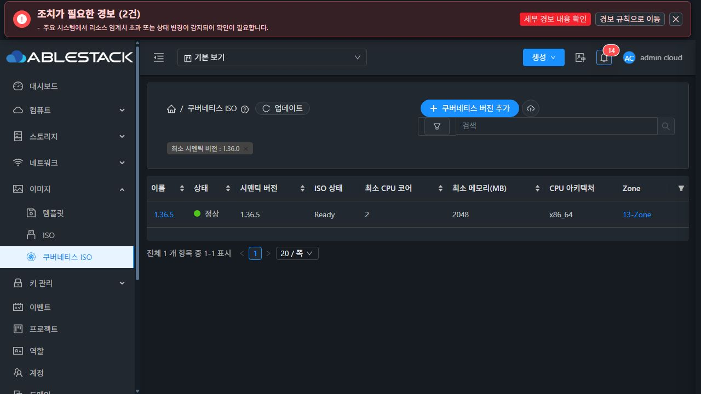

<!--
Licensed to the Apache Software Foundation (ASF) under one
or more contributor license agreements.  See the NOTICE file
distributed with this work for additional information
regarding copyright ownership.  The ASF licenses this file
to you under the Apache License, Version 2.0 (the
"License"); you may not use this file except in compliance
with the License.  You may obtain a copy of the License at

  http://www.apache.org/licenses/LICENSE-2.0

Unless required by applicable law or agreed to in writing,
software distributed under the License is distributed on an
"AS IS" BASIS, WITHOUT WARRANTIES OR CONDITIONS OF ANY
KIND, either express or implied.  See the License for the
specific language governing permissions and limitations
under the License.
-->

# #1698 검색·count·목록 복귀 검증

서버가 최소 버전 필터 전에 DB 페이지를 자르던 순서를 고쳐 전체 조건을 적용한 후 정확한 count/page를 반환합니다. UI에는 등록 버전 ID 선택기를 제공하고 상세·탭·breadcrumb·브라우저 뒤로에서 같은 계정/권한/프로젝트/세션의 검색·정렬·페이지 상태를 복원합니다.

[이슈 #1698](https://github.com/ablecloud-team/ablestack-cloud/issues/1698) · [Epic #1692](https://github.com/ablecloud-team/ablestack-cloud/issues/1692) · [Draft PR #1703](https://github.com/ablecloud-team/ablestack-cloud/pull/1703) · [검색 설계](../../design/kubernetes-iso-1692/search-return.ko.md).

초기 제품/라벨 배포는 `ff63d35973a`/`10366f30b2f`이며, 선택기 owner 초기화 보정의 운영 빌드 소스는 `826e5f0957a`입니다. 작업 중 upstream53개 커밋을 수신해 로컬 기준을 `b777311a708`에서 `985aad7fdba2ae600cfbc9920fa8f346ab930875`로 먼저 fast-forward하고 기능22개 커밋을 재배치했습니다. 최종 통합 제품 소스는 `2d39020c7807fab079145891baf27ccf8dcb9df4`, local/origin/upstream 기준 차이0/0입니다. WSL 단일 소스에서 작업하고 Windows 체크아웃은 보존했습니다.

## 계약과 설계

- 키워드 이름/UUID OR를 Zone·arch 등 조건과 AND로 묶습니다. 최소 조건을 전체 적격 카탈로그에 적용하고 서버에서 전체 정렬한 후 페이지를 계산합니다.
- 최소 버전은 숫자로 된 세 부분 이상·32비트 부분 범위를 검증합니다. 검색의1.10.0은 유효하며 등록 최소1.11.0과 혼동하지 않습니다. 텍스트 최소와 등록 ID 최소는 상호 배타입니다.
- 서버 정렬은 이름·숫자 버전·상태·최소 CPU·최소 메모리만 허용하고 ID로 동률을 안정화합니다. 미지원 열은 정렬을 끕니다. API schema를 확인하지 못하면 전체 정렬로 가장하지 않습니다.
- 목록 문맥과 계정/역할/API/프로젝트/세션의 SHA-256 단방향 소유 범위를 상세 링크에 담고 같은 범위만 복원합니다. 토큰 원문을 URL이나 증거에 남기지 않습니다.
- 검색/정렬/페이지 크기 변경은1페이지로 돌아가고, 마지막 페이지가 줄면 유효한 마지막 페이지를 다시 조회합니다. 요청 세대와 소유 범위가 바뀐 응답은 폐기합니다.
- 운영 검색 도구 모음의 고급 검색 팝오버를 사용했습니다. breadcrumb와 목록 사이 설명 문구는 추가하지 않았습니다.

## 13번 배포 범위

기존 운영 JAR의 **기존2개 클래스 + 새 helper2개**만 패치했습니다. 무관한 Manager26개/Command7개 메서드와 다른 JAR 엔트리는 보존했습니다. DB 스키마·Host Agent·SystemVM 변경은 없습니다. 백업 `/var/tmp/kiso1698-backend-backup-6wp438f4`, Mold PID2791059/active, 서비스 재시작31.8초입니다.

JAR SHA-256은 전 `8f977468de9fb0b15f2e8652dfc5dbdb687e86388485b75cbbd3b57c37bd7909` → 후 `91e9485ec6f14495fbcdab0e4505e1ce844cbc391a6138e230af6f6a19e2bcda`입니다.

UI는 같은 운영 절대 경로의11개 입력으로 생산 빌드 **761.9초/PASS** 후 JS2/CSS2/로케일2/index **7개**를 적용했습니다. 기존7169개 중 덮어쓴 index/로케일3개 외 **7166개**를 보존했습니다. UI 검증에서 발견한 최소 ID 필터의 번역 키 노출은 영어·한국어 정적 로케일2개만 추가 보정했습니다. 로케일은 public JSON이라 재컴파일 없이 두 파일을 직접 적용하고 HTTP SHA를 검증했으며 나머지7170개 자산·index·JAR·PID·설정3개는 보존했습니다.

[서버 배포](evidence/backend-deployment.json) · [무관 메서드 보존](evidence/unrelated-methods.json) · [정적 UI 배포](evidence/deployment-result.json) · [라벨 보정](evidence/locale-deployment.json) · [빌드 입력 경계](evidence/build-boundary.json).

## 기능별 검증

모든 실제 카탈로그/계정/역할 생성·조회·삭제는 Mold UI로 수행했습니다. SSH는 범위 배포·런타임/정적 HTTP 진단·시험 ISO 파일 제공/제거에만 사용했습니다. 시험 ISO는1,421,312 bytes의 전송·카탈로그 검증용 파일이며 Kubernetes 설치 바이너리나 부팅 성공을 뜻하지 않습니다.

| 검증 | 실제 결과 |
| --- | --- |
| 최초 결함 재검증 | 원래 최소1.36.0 검색의 행1/count2 → 최종1.36.5 한 행/count1 |
| 페이지 경계 | QA12개, pagesize10 UI URL로1페이지10개/2페이지2개. 뒤쪽 ARM·전역1.36 두 개만 최소1.36.0 검색 시 행2/count2/1페이지 |
| 조건 결합 | keyword·13-Zone·x86_64·최소1.36.0 → 전역 x86 한 행/count1. ARM UUID 키워드+동일 x86 조건 →0/count0 |
| 숫자·전체 정렬 | ASC의1.29.9 →10 →11, DESC1페이지 마지막11·2페이지10/9. 현재 페이지만 정렬하지 않음 |
| 등록 기준 선택 | 최소 ID 선택 후 텍스트 최소 조건 제거. Root의 Zone/x86/keyword 결합10개, 읽기 전용의 keyword+ID 선택9개·다음 ID8개 |
| 버전/오류 경계 |1.10.0 검색 정상,2.0.0 →0/count0, abc 필드 오류. 존재하지 않는 최소 ID는 조회 오류, 두 최소 조건 동시는 입력 조건 오류 |
| 페이지·크기 | page99 →실제 마지막2페이지. 실제 드롭다운20 선택 시1페이지 복귀. 마지막 두 QA 항목 UI 삭제 후2페이지 →1페이지/count10 |
| 상세 복귀 | keyword·Zone·arch·최소·DESC·page2·size10 →상세→이벤트→breadcrumb의 URL 완전 동일. 브라우저 뒤로도 동일 |
| 응답 순서 역전 |1.35의 실제200 응답을 일시 보류, 새1.36 결과 표시 후 이전 응답을 전달해도1.36.5 유지 |
| 계정 전환 | Root의 이전 상세 breadcrumb는 기본 목록으로 복귀, 과거 목록 URL의 필터/정렬/페이지는 폐기. 새 owner 사용. 읽기 전용→Root 로그인 시 이전 보류 요청은 ERR_ABORTED/canceled, 새 결과 유지 |
| 제한 계정·정보 보호 | 등록/변경/삭제 버튼0, Root 전용 ISO URL 노출0. 선택기/검색 요청은 listZones·listKubernetesSupportedVersions뿐이며 listIsos/VM Metrics를 허용하지 않음 |
| 번역 라벨 | 최소 등록 버전 필터에 번역 키가 노출되던 부분을 두 로케일만 보정한 후 재로딩 UI에서 한국어 라벨 확인 |

페이지 경계용10개 크기는 허용된 목록 UI URL을 사용했습니다. 실제 크기 선택 UI의 최소 옵션은20이며20 선택 동작도 따로 검증했습니다. 계정 전환에서 문서 이동으로 취소된 응답을 “늦게 전달해 통과”라고 합산하지 않습니다. 동일 계정의 순서 역전은 실제 전달, 계정 전환은 브라우저 취소/소유 문맥 폐기를 구분합니다.

[UI 단계별 행/건수/URL](evidence/ui-checks.json) · [관리자 실제 요청](evidence/admin-read-requests.json) · [읽기 전용 선택기 요청](evidence/read-only-picker-requests.json) · [계정 전환 취소](evidence/account-switch-cancellation.json).

## 선택기 범위 전환 보정과 최신 upstream 통합

최종 race 검토에서 동일 컴포넌트가 유지된 채 owner가 바뀌면 이전 선택기 검색어·페이지·로딩이 남을 수 있는 경계를 보완했습니다. 이전 비동기 응답을 무시하는 것과 함께 검색어/모드/오류/페이지/로딩을 초기화합니다. 의미 있는 단위 회귀에서3페이지의 이전 검색을 보류→owner 변경→응답 완료→새 조회의 keyword 없음/page1/로딩 해제를 확인했습니다. 이 보정 후 canonical·운영 입력 각각8 suites163 tests PASS입니다.

공통 InfoCard의 publicIpFieldLabel과 getImage, PublicIpSearch와 KubernetesIsoSearch, Public IP/KISO breadcrumb와 보안·목록·조회 범위가 함께 유지되도록 rebase 충돌을 해결했습니다. 최신 소스에서는 Public IP 회귀와 InfoCard를 더한 **12 suites219 tests PASS**, 충돌 파일 Lint PASS입니다. Backend3개 소스는 재배치 전과 바이트 동일하므로 불필요하게 다시 배포하지 않았습니다.

13번 추가 배포는 기존 운영 입력의 선택기 보정만 사용합니다. 최신 Public IP 소스 통합과 13번에 배포한 범위를 구분하며, 바뀐 Public IP 코드를 통째로13번에 올리지 않습니다. 선택기 컴포넌트는 최종 통합 소스와 바이트 동일하고, 나머지 운영 입력 차이는 [빌드 경계](evidence/owner-build-boundary.json)에 명시합니다.

추가 운영 생산 빌드는885.1초/PASS이고 JS1/CSS1/index **3개**만 배포했습니다. 기존7173개 중 index 외7172개·Backend JAR/PID·설정3개와 로케일을 보존했습니다. 현재 UI의 프로젝트 전환은 대시보드 이동·재마운트 경로입니다. Root에서 선택기1.35 검색→빈 프로젝트→기본 보기 복귀 후 이전 검색어 없이1.35.9/1.36.5 두 선택지를 확인하고1.36.5 기준 검색의 행1/count1을 확인했습니다. 동일 컴포넌트 유지 시나리오는 앞서 설명한 비동기 단위 회귀로 구분합니다. 빈 프로젝트1개는 UI에서 이름 확인 후 삭제해 프로젝트0개를 복원했고, 알림의 check-circle 삭제 성공 영수증도 확인했습니다. [범위 전환 UI](evidence/owner-ui.json) · [프로젝트 정리](evidence/project-delete-receipt.json).

[기준 동기화](evidence/upstream-sync.json) · [재배치 비교](evidence/rebase-range-diff.txt).

## 자동 검증

- Backend **4 suites/25 tests PASS**, 변경 Java Checkstyle0위반.
- 서버 회귀는40개 중 첫30개를 최소 미달로 두고 뒤10개가 첫/마지막 페이지·count에 포함되는지 확인합니다. 숫자 버전·동률 정렬·잘못된 기준 ID·최소 기준 충돌·키워드 AND 그룹을 포함합니다.
- Canonical UI와 실제 운영 빌드 입력 각각 **8 suites/163 tests PASS**. 같은 사례를326개로 합산하지 않습니다. owner 변경·선택기 경합·복귀·마지막 페이지 및 기존 읽기/등록/업로드 회귀를 포함합니다.
- 제품·설계·증거73개 경로에 적용되는18개 훅 그룹 PASS/해당 없음. UI 원문 TXT2개의 줄 끝 공백은 자동 보정 후 재검사 PASS입니다. [최종 범위 Lint](evidence/scoped-final-hooks.json).

[집중 테스트 요약](evidence/test-summary.json).

## 정리와 남은 범위

시험 버전/연결 ISO **12쌍 UI 삭제**, 모든 시험 ISO UUID가 최종8개 목록에 없음을 확인했습니다. 원래 카탈로그2개·템플릿48개·guestVM102개, 계정3개/역할9개의 기존 UUID 집합 보존을 확인했습니다. 승인된 읽기 전용 계정/역할 각1개는 비활성화·이름 확인 후 삭제했습니다. 원래 v-245-VM/s-263-VM 모두4.23/실행 중으로 보존했습니다.

HTTP 시험 디렉터리와 `/var/tmp/qa-kiso1698.iso`는 정확한 크기·SHA-256을 확인하고 제거/404를 검증했습니다. 감사 이벤트는 유지합니다. [자원 ledger](evidence/resource-ledger.json) · [정리 요약](evidence/restoration-summary.json) · [HTTP 정리](evidence/fixture-cleanup.json).

기존 상세 화면은 읽기 전용 계정에서 연결 ISO의 listIsos(id)를 시도해432를 받습니다. 카탈로그 상세/검색은 계속 동작했고 URL은 노출되지 않았습니다. 선택기 자체의 요청과 구분하며, 허용된 연결 ISO 조회·표시를 다루는 **#1699**에 추적 근거를 연결합니다. 로그인 직후 공통 대시보드의 listAccounts432도 검색 요청으로 합산하지 않습니다.

공통 renderIcon/replace와 전역 Zone 빈 링크·표 스타일은 기존 **#1699·#1701** 범위로 유지합니다. 최종 브라우저 로그는 error/warn2개가 일반 객체명 s로만 관측되어 “브라우저 오류0”으로 표시하지 않습니다. 다중 Zone·Edge·비KVM·실물 ARM/s390x 부팅·CKS 설치와 전체 ACL은 이번 검색 검증의 통과로 주장하지 않으며 **#1702** 통합 게이트를 유지합니다.

서버 숫자 필터/정렬은 후보 수N에 대해 O(N)메모리/O(N log N)정렬입니다. 임의 상한으로 결과를 누락시키지 않으며 대규모 SQL 인덱스 최적화는 별도 과제입니다.

## CI 부채

제품 [Lint43876632549](https://github.com/ablecloud-team/ablestack-cloud/actions/runs/43876632549)는 기준43868690029와 **실패 훅16개 동일**, 변경20개 경로의 실패 훅 추가 진단0입니다. [License43876632494](https://github.com/ablecloud-team/ablestack-cloud/actions/runs/43876632494)의 미승인 **4,077개**도 기준과 동일합니다.

Merge Conflict Check43880409989의 실패는 다른 PR 라벨 제거에서 integration403이 발생한 저장소 워크플로 권한 문제입니다. 이 PR은 MERGEABLE이며 기준 차이0/0을 재확인했습니다. 코드 충돌이나 기능 실패로 섞지 않습니다. 재배치 소스의 Lint43885343265와 License43885343155 및 후속 문서 CI는 별도 상태로 남깁니다. 최신 기준985aad7의 실제 License43881883154와 재배치 제품 License43885343155도 각각4,077개이며, 합쳐진 Public IP의 clean tracked RAT 경로 집합 비교 역시 같은4,077개입니다.

**전체 CI 성공으로 표시하지 않으며 #926·#1044를 별도 OPEN 유지**합니다. [CI 비교](evidence/ci-comparison.json).
