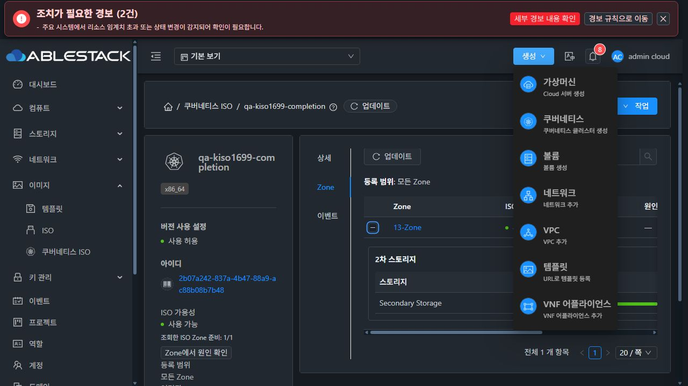
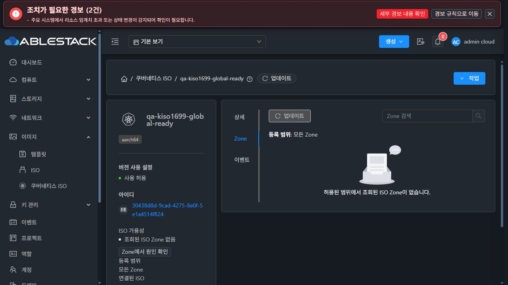
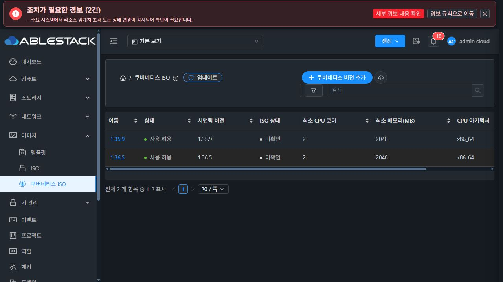

<!--
Licensed to the Apache Software Foundation (ASF) under one
or more contributor license agreements.  See the NOTICE file
distributed with this work for additional information
regarding copyright ownership.  The ASF licenses this file
to you under the Apache License, Version 2.0 (the
"License"); you may not use this file except in compliance
with the License.  You may obtain a copy of the License at

  http://www.apache.org/licenses/LICENSE-2.0

Unless required by applicable law or agreed to in writing,
software distributed under the License is distributed on an
"AS IS" BASIS, WITHOUT WARRANTIES OR CONDITIONS OF ANY
KIND, either express or implied.  See the License for the
specific language governing permissions and limitations
under the License.
-->

# #1699 쿠버네티스 ISO 상세·가용성·Zone 검증

카탈로그의 버전 사용 설정, ISO 등록 상태와 실제 ISO 가용성을 분리했습니다. 기존 API의17개 필드를 유지하고, 허용된 child ISO 읽기로 Zone별 상태·저장소·진행·원인을 관측합니다. Backend/DB/권한을 확장하지 않습니다.

[이슈 #1699](https://github.com/ablecloud-team/ablestack-cloud/issues/1699) · [Epic #1692](https://github.com/ablecloud-team/ablestack-cloud/issues/1692) · [PR #1703](https://github.com/ablecloud-team/ablestack-cloud/pull/1703) · [설계](../../design/kubernetes-iso-1692/availability.ko.md).

## 구현과 읽기 계약

- 상세 → Zone → 이벤트를 운영 VM의 ResourceLayout/InfoCard·라벨 위/값 아래·행 간격·테마 토큰으로 구성했습니다. 설정/코멘트 entity API가 없어 해당 탭을 이름만 추가하지 않았습니다.
- 버전 사용 허용/중지와 ISO의 관측 상태는 별도입니다. 카탈로그 Ready/Allocated를 준비 완료로 간주하지 않습니다. 목록은 미조회 가용성을 명시하고 전역 범위를 모든 Zone으로 표시하며 undefined 링크를 만들지 않습니다.
- Root는18개 표시 항목(기존17개 필드와 관측 가용성), 일반 계정은 Root 전용 URL을 제외한 항목을 봅니다. false/0·미제공을 구분하고 허용된 ID/URL 원문 복사는 기존 컴포넌트를 사용합니다.
- 카탈로그만 허용된 역할은 ISO 권한 제한을 표시하며 listIsos를 호출하지 않습니다. 공통 카드의 KISO 링크 확인에서 불필요한 호출을 제거했습니다. child 읽기 허용 시 Root는 all·User는 executable로 정확한 ISO UUID를 조회합니다.
- API 페이지를 모두 읽고 count·UUID·Zone·다운로드 상세·중복을 검증합니다. 등록 범위가 전역이면 특정 Zone으로 바꾸지 않습니다. 동일 관측을 요약/상세/Zone에서 공유하고 인증·역할·프로젝트·대상 변경의 늦은 응답을 폐기합니다.
- 진단의 제어 문자·URL 인증/쿼리·명명된 비밀 값을 가립니다. Root 전용 원본 URL 복사는 이 진단 가림과 별개로 원문을 보존합니다.

## 자동 검증

- 최신 기준 통합 소스16 suites/275 tests PASS, 실제 운영 입력13 suites/229 tests PASS. 두 실행의 겹치는 사례를 합산하지 않습니다.
- 500개 페이지 경계를 넘는501개 Zone, count 변동/부분 응답/잘못된 대상·Zone·다운로드 상세, 실제 읽기 상태와 메타데이터의 구분, 역할/대상 전환·해제 후 응답, 탭 공유/재시도/빈 결과·실패·인증 만료, URL 보호·false/0·원문, 실제 Empty 컴포넌트 렌더를 포함합니다.
- 통합 검증은 Summary의 한 읽기가 상세/Zone에 도달하는지, Zone 갱신 이벤트가 같은 읽기를 호출하는지와 quiet parent refresh의 비차단·이벤트 권한 deep link 복구를 확인합니다.
- 범위 Lint·훅: 변경 UI16개 파일 Lint PASS, 초기 소스19개 경로18개 훅 그룹 PASS/해당 없음. 최종 증거 포함85개 경로의18개 훅 그룹도 통과/해당 없음이며, 문서 형식2곳은 보정 후 재검사했습니다.

## 13번 UI 검증

실제 개체 생성·조회·변경·삭제와 계정 전환은 모두 Mold UI로 수행했습니다. SSH는 정적 배포/런타임 해시·시험 파일/전송 도우미 진단·정리에만 사용했습니다.

| 사례 | 실제 결과 |
| --- | --- |
| 전역 정상 | 모든 Zone·ARM·CPU4/RAM3072·URL query 원문·Ready와 등록 상태·사용 설정 분리 |
| 실제 체크섬 실패 | 사용 허용/Allocated인 카탈로그와 달리0/1 실패, SHA-256 불일치 원인 및 Image 저장소 실패 표시 |
| 사용 중지·직접 다운로드 | 버전 사용 중지와 ISO Ready가 함께 표시되고 직접 다운로드 예 확인. 실제 VM/CKS 소비 성공으로 주장하지 않음 |
| 전송 경로 실패 | 임시 경로의 No route to host를 Zone 원인으로 표시. 도우미 중지 후 기존8080 경로로 진행 검증 |
| 실제 전송 | 기존8080의2GiB ISO로48%·전송 중을 관측하고 Ready 전환 확인. 완료 전환 때 확장이 접히는 실제 문제를 소유 키에서 등록 상태를 제외해 보정 |
| 카탈로그만 User | 직접 진입/새로고침·Zone 권한 제한·이벤트 탭 fallback·URL/ISO 링크/쓰기 없음, listIsos0·VM Metrics0 |
| ISO 읽기 User | 공개 시스템 ISO의 Ready/Zone과 연결 ISO 이동, URL·쓰기 없음, VM Metrics0 |
| 부분 Zone 합성 | 클러스터 환경을 늘리지 않고 UI가 요청한 읽기 응답만 두 Zone으로 제어.1/2·일부 사용 가능/실패·저장소 확장·진단 가림 확인 |
| 읽기 오류 합성 | 잘못된 Zone은 응답 확인 필요, 연결 오류는 연결 실패, 서버 거절은 권한 없음. 재시도 복구 확인 |
| 인증 만료 합성 | 실제 UI 읽기에401을 주입해 상세 제거·로그인 화면 전환 확인 후 Root 재로그인 |
| 늦은 응답 | 이전 정상 ISO200 응답을 실패 버전 진입 뒤에 전달해도 실패 버전/상태 유지 |
| 테마·키보드 | 다크/라이트 표·확장·경고 확인,810px 표 내부 가로 스크롤, 기본 크기·다크 복원. Enter 탭 선택·URL 동기화 확인 |
| 최종 보정 | 최종 Empty 안내 본문 표시를 재확인했습니다. 새2GiB 실제 전송에서 진행→다운로드 완료·Ready 전환 뒤 Collapse row1/저장소 확장이 유지됨을 확인했습니다. |
| 클립보드 | 사용자가 별도 브라우저에서 버전 ID·연결 ISO ID·ISO URL의 실제 붙여넣기3개 모두 화면 원문과 일치함을 확인했습니다. 자동 경로의 한계와 구분해 수동 확인을 완료 근거로 반영했습니다. |

실물 다중 Zone/Edge 환경은 NOT_RUN입니다. 합성 부분 Zone UI·단위 결과를 실제 환경의 성공으로 합산하지 않으며 다중 Zone 기능은 유지합니다. 실제 ARM/s390x 부팅·CKS 설치는 이번 UI 검증 범위가 아닙니다.

## 빌드·동기화·배포

작업 시작은41430f68a87, 기준985aad7이었으며 진행 중 VNF 선택 안내 제거2개 커밋을 수신했습니다. 로컬 기준을a747a6d13b38be7444562534523b82cf228676fc로 먼저 fast-forward하고 재배치했습니다. local/origin/upstream 기준 차이0/0. 새 VNF 소스와 KISO 변경을 함께 보존했고 운영 빌드 입력의 무관한 기존 Public IP/VPC 차이는 유지했습니다.

처음 생산 빌드745.4초/PASS 후 JS6/CSS3/로케일2/index12개만 배포했습니다. 기존7175개 중 덮어쓴3개 외7172개·설정3개·JAR·PID를 보존하고 HTTP SHA를 검증했습니다. 실제 UI 검증에서 발견한 완료 전환 확장 유지와 빈 안내 본문 누락을 추가 보정했습니다. 중간 보정 빌드는 이 두 변경을 합치기 위해 중단했으며 배포하지 않았습니다.

최종 보정 생산 빌드는715.5초/PASS, JS2/CSS1/index4개만 추가 적용했습니다. 기존7184개 중 index 외7183개·로케일/설정3개·JAR/PID를 보존했습니다. 최종 index SHA-25662e447fa5ae22f2d9b244c217b3836e2c6a5134b9dcb9c4cb7136838008657d1, 백업 /var/tmp/kiso1699-backup-irrxd09z입니다. 최종 소스는052e9cd806318ad29a0a051d5a5f90c50f7b3c75입니다.

Mold PID2791059, JAR SHA-25691e9485ec6f14495fbcdab0e4505e1ce844cbc391a6138e230af6f6a19e2bcda 유지. 관리 서비스/Host Agent/SystemVM 재시작·DB 변경은 없습니다. 이전 #1697의 실제4.21→새4.23 로컬 업로드 검증은 기존 보고서에 유지하고 이번 읽기 UI 변경에서 재완료로 합산하지 않습니다.

## 시험 자원 정리

시험 계정/역할 각2개와 시험 버전/연결 ISO6쌍을 모두 UI 삭제했습니다. 원래 계정3/역할9·카탈로그2의 UUID 집합과 ISO8개 복원을 확인했으며 시험 ISO UUID 잔여0입니다. 실제 전송에 사용한2GiB 파일·임시 Python 도우미/로그·포트를 정리했고, 마지막 정상 시험 파일도 크기·SHA-256을 검증해 제거/404 확인했습니다. 템플릿48·VM102, 기존 v-245-VM/s-263-VM 모두4.23/실행 중을 보존했습니다. 최종 Mold PID2791059/active, JAR/index SHA는 배포 후와 동일합니다. [최종 정리](evidence/restoration-summary.json) · [파일 정리](evidence/final-file-cleanup.json) · [수동 복사 확인](evidence/clipboard-manual-confirmed.json).

API 감사 이력은 지우지 않습니다. 원래 카탈로그2·ISO8·계정3·역할9·VM102와 기존 시스템 VM을 보존합니다. 일반 ISO 수정/추출/VM 권한은 이 가용성 읽기의 선행조건으로 요구하지 않습니다.

## CI와 후속

기준41430f6의 Lint43887924186은 실패 훅16개, License43887923996은 미승인4,077개입니다. 기존 #926·#1044는 별도 OPEN으로 유지하며 범위 체크를 전체 CI 성공으로 표시하지 않습니다.

최신 제품 Lint43971488435는 기준과 실패 훅16개가 같고 변경19개 경로의 추가 진단0입니다. License43971488513의 미승인4,077개도 기준과 같습니다. 전체 CI 성공으로 표시하지 않습니다. 수동 원문 확인과 마지막 정리까지 완료했습니다. 후속 문서 CI는 별도 상태로 유지합니다.

후속 #1700 안전한 상태 변경/삭제, #1701 최종 스타일·공통 아이콘, #1702 전체 ACL/통합 게이트를 유지합니다.

## 근거

[UI 단계별 기록](evidence/ui-checks.json) · [카탈로그 전용 실제 요청](evidence/catalog-only-requests.json) · [ISO 읽기 실제 요청](evidence/iso-read-role-requests.json) · [시험 자원 ledger](evidence/resource-ledger.json) · [시험 접근 ledger](evidence/acl-ledger.json) · [최종 배포](evidence/final-deployment-result.json) · [빌드 경계](evidence/final-build-boundary.json) · [텍스트 대비 표본](evidence/zone-contrast.json).

수동 확인 대기 문서1798264의 전체 Lint43975490923도 실패 훅16개 동일, License43975490941도4,077개 동일입니다. 최종 정리 문서 CI는 별도 후속 상태입니다.
