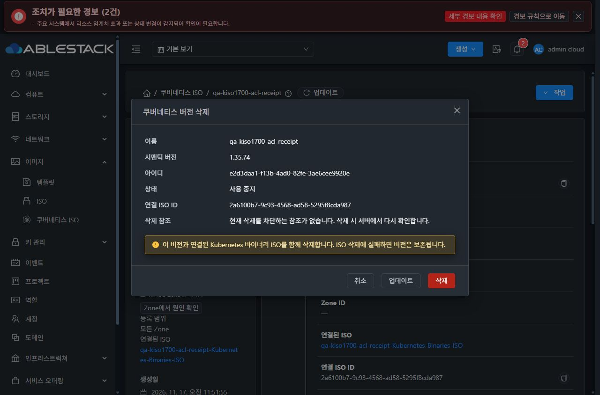
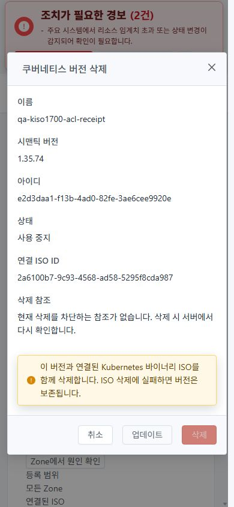

<!--
Licensed to the Apache Software Foundation (ASF) under one
or more contributor license agreements.  See the NOTICE file
distributed with this work for additional information
regarding copyright ownership.  The ASF licenses this file
to you under the Apache License, Version 2.0 (the
"License"); you may not use this file except in compliance
with the License.  You may obtain a copy of the License at

  http://www.apache.org/licenses/LICENSE-2.0

Unless required by applicable law or agreed to in writing,
software distributed under the License is distributed on an
"AS IS" BASIS, WITHOUT WARRANTIES OR CONDITIONS OF ANY
KIND, either express or implied.  See the License for the
specific language governing permissions and limitations
under the License.
-->

# #1700 상태 변경·참조 보호·연쇄 삭제 검증 결과

13번 클러스터에서 기능별 UI 검증과 시험 자원 정리를 완료했습니다. 상태 변경·삭제 창을 VM 표준으로 통합하고, 동시 변경·실패·응답 유실을 안전하게 처리합니다.

Epic #1692 · 이슈 #1700 · 누적 PR #1703 · 검증일 2026-11-17.

## 구현과 배포

- 대상명·버전·ID·현재 상태·변경할 상태를 VM 표준 720px 대화상자에 표시합니다.
- 삭제 영향에 연결 ISO ID와 참조 중/비참조/조회 실패를 구분합니다. 단일 ID와 Root 전용 참조 조회는 기존 버전 잠금 안에서 현재 값을 확인합니다.
- 상태 변경은 최신 상태를 재조회하고 expectedstate를 같은 잠금 안에서 비교합니다. 기존 클러스터가 참조하더라도 Disabled 전환을 허용합니다.
- 자식 ISO 삭제 실패 시 부모 버전 보존, 비동기 작업 조회, 결과 불명 시 중복 차단과 재확인을 제공합니다.
- 탭의 sessionStorage에는 작업/대상 ID/목표 상태/jobid만 보관합니다. 권한 문맥은 단방향 해시이며 비밀번호·토큰·API 키를 저장하지 않습니다.
- 취소/Esc/초점 복귀, 삭제 후 검색 조건을 보존한 목록 복귀, 상세·가용성·이벤트 갱신을 연결했습니다.

제품 커밋은 df0382b42e4a7e8607795474d5c4d8980914aa7b입니다. 기준 브랜치는 10150bdead45260b58313879d27402383b6b9bf8로 동기화했고 origin 기능 브랜치로 배포 소스를 게시했습니다.

서버는 기존 관리 JAR의 클래스 4개만 병합했습니다. UI는 기존 운영 빌드 입력의 차이를 보존하며 정적 델타를 배포했습니다. 최종 보정은 JS 2개·CSS 1개·index 1개입니다. 설정·DB 스키마·호스트 에이전트 변경은 0입니다.

| 검증 경계 | 최종 값 |
| --- | --- |
| UI index SHA-256 | c27703296cb0ff44801dba89965f0e32e051d72aaf4f4d9a7db2828394facfc4 |
| 관리 JAR SHA-256 | 55f802d2b22c9d4d471644c6157781cc2604e27d4ba0d7b055e4a934bb1d6171 |
| Mold 서비스 | active, PID 2860414 |
| 정적 파일 | 7,197개 전부 최종 manifest와 일치 |
| 설정 파일 | config.json, WEB-INF/web.xml, color.less 해시 보존 |
| 시험 HTTP ISO | 제거 완료, HTTP 404 |

근거: [서버 델타](evidence/backend-patch.json), [서버 배포](evidence/backend-deployment.json), [최종 UI 배포](evidence/deployment-result.json), [최종 보존 검증](evidence/fixture-cleanup-runtime-final.json), [설계](../../design/kubernetes-iso-1692/implementation-1700.ko.md).

## 실제 UI 검증

| 항목 | 결과와 근거 |
| --- | --- |
| Enabled/Disabled | 실제 외부 참조 클러스터가 있는 버전에서도 전환 성공. 기존 클러스터 Running 유지, ISO Ready와 별도 상태로 표시 |
| 참조 보호 | 전용 외부 클러스터 참조 시 삭제 비활성. 참조 해제 후 비참조로 바뀌고 삭제 성공 |
| 동시 변경 | 두 탭의 실제 변경을 재조회로 감지. 응답을 보류해 잠금 직전 경합도 만들었고 실제 서버 530 거부 후 최신 상태·재선택 안내 확인 |
| 실계정 허용/회수 | 전용 비공개 Admin 역할과 계정으로 허용된 변경·삭제 성공. 변경·삭제 권한 회수 후 실제 API 432 거부, 삭제 job 미생성 |
| 조회 권한 회수 | 참조 미확인/삭제 차단. 새로고침 후 카탈로그 메뉴와 상세 데이터 제거 |
| ISO 사용 중 삭제 | 전용 VM에 ISO 연결 후 삭제 실패. 부모 보존, 더블클릭에도 삭제 POST 1회, ISO 해제 후 재시도와 부모·자식 삭제 성공 |
| 결과 불명 복구 | 전송 실패 상태는 창 재열기·새로고침에도 중복 차단과 목표 상태 유지. 실제 상태 확인 후 정상 재열기 가능 |
| 삭제 응답 유실 | 실제 서버 접수 응답을 차단한 뒤 재전송 없이 삭제 결과 확인. 검색어·페이지를 보존한 목록으로 복귀 |
| 스타일·키보드 | 라이트 390px, 다크 390/768/1280px에서 가로 넘침 0. 모바일 내용 366px, 태블릿·데스크톱 720px. Enter·상태 선택·취소·Esc·작업 버튼 초점 복귀 확인 |
| 이벤트 | 실제 KUBERNETES.VERSION.UPDATE/DELETE와 ISO.DELETE 기록 확인 |

실계정은 qa-kiso1700-write, 역할은 qa-kiso1700-write-role입니다. VM Metrics 및 나머지 명령을 거부하는 전용 정책을 사용했고, 검증 후 계정과 역할을 삭제했습니다. 기존 계정·역할은 유지했습니다.

503/403/불완전 참조 응답과 전송 실패는 브라우저의 UI 발생 요청에 장애를 주입한 시험입니다. 실계정 API 432 거부와 ISO 사용 중 삭제 실패는 실제 서버 결과입니다. 삭제 응답 유실 시험은 실제 서버가 접수한 뒤 응답을 차단했습니다. 모든 장애 주입과 임시 화면 크기를 복원했습니다.

근거: [실제 원자적 충돌](evidence/atomic-conflict-corrected.json), [변경 권한 회수](evidence/acl-update-revoked.json), [삭제 권한 회수](evidence/acl-delete-revoked.json), [중복 요청 1회](evidence/iso-in-use-delete-trace.json), [검색 목록 복귀](evidence/lost-delete-reconciled-search-return.log), [배치 측정](evidence/final-dialog-layout.json).

## 승인된 검증 범위 이관

전용 관리형 클러스터는 기존 1.35.9 ISO와 기본 노드 템플릿으로 생성했지만 Provider 초기화에서 실패했습니다. UI 오류는 Failed to initialize Kubernetes Provider이며 로그는 managed addon identity or manifest rejected입니다. 매니페스트 식별 불일치와 파일/실행 오류가 같은 문구를 사용할 수 있어 원인을 확정하지 않았습니다.

사용자 승인에 따라 별도 #1707로 분리했고, 실제 미완료 업그레이드 source/target pin UI 회귀는 #1702로 이관했습니다. #1700의 source/target/legacy 부분 업그레이드 참조 보호는 서버 시험으로 검증했습니다. 실제 업그레이드 pin UI 통과로 집계하지 않습니다. Provider의 식별 검증을 우회하지 않았습니다.

전용 실패 클러스터와 노드는 UI로 정리했습니다. 기존 koral1/koral3는 계속 Stopped입니다. [선행 이슈](https://github.com/ablecloud-team/ablestack-cloud/issues/1707), [이관 대상](https://github.com/ablecloud-team/ablestack-cloud/issues/1702), [오류 근거](evidence/provider-error.log).

## 자동 검증과 CI 부채

- 카탈로그 UI 회귀: 정식 소스 13 suites/268 tests, 운영 빌드 입력 13 suites/268 tests 통과.
- 서버 참조 보호·동시 변경: 11 tests 통과. 모듈 Checkstyle 통과.
- 실제 패치 JAR: JVM verify 및 기존 메서드 보존 검증 통과.
- 전체 UI ESLint: 오류 0. 변경 파일 대상 pre-commit 18개 검사 통과.
- 전체 CI의 Lint/License는 GREEN이 아닙니다. 기존 16개 훅 실패와 RAT unknown 4,077건을 #926·#1044로 분리합니다.
- 새 문서의 라이선스 1건은 보정해 RAT가 기존 4,077건으로 돌아온 것을 확인했습니다.

근거: [검증 요약](evidence/test-summary.json), [변경 범위 검사](evidence/scoped-hooks.json), [CI 비교](evidence/ci-comparison.json).

## 자원 정리와 보존

시험 버전/연결 ISO 4쌍, 클러스터 2개, 노드 VM 2개, 전용 네트워크, 계정·역할을 정리했습니다. 전용 IP 10.10.13.29는 Available로 반환됐습니다. 시험 HTTP 파일과 역할 CSV, 임시 인증값도 정리했습니다. 감사 이벤트와 배포 롤백 백업을 보존했습니다.

| 기존 자원 | 최종 확인 |
| --- | --- |
| 쿠버네티스 카탈로그 | 2개, 기존 1.35.9/1.36.5 Enabled |
| ISO / 템플릿 | 8 / 48 |
| 일반 VM | 102, qa-kiso1700 검색 0 |
| 계정 / 역할 | 3 / 9, qa-kiso1700 검색 0 |
| 기존 클러스터 | 2개, koral1/koral3 Stopped |
| 시스템 VM | 2개 Running, 기존 v-245-VM/s-263-VM 4.23.0.0 |
| 시험 네트워크 | qa-kiso1700 검색 0 |

근거: [시험 자원 ledger](evidence/resource-ledger.json), [UI 보존 확인](evidence/final-ui-inventory.json), [브라우저 정리](evidence/browser-cleanup.json).
