<!--
Licensed to the Apache Software Foundation (ASF) under one
or more contributor license agreements.  See the NOTICE file
distributed with this work for additional information
regarding copyright ownership.  The ASF licenses this file
to you under the Apache License, Version 2.0 (the
"License"); you may not use this file except in compliance
with the License.  You may obtain a copy of the License at

  http://www.apache.org/licenses/LICENSE-2.0

Unless required by applicable law or agreed to in writing,
software distributed under the License is distributed on an
"AS IS" BASIS, WITHOUT WARRANTIES OR CONDITIONS OF ANY
KIND, either express or implied.  See the License for the
specific language governing permissions and limitations
under the License.
-->

> 추가 breadcrumb 정렬 보정의 최종 배포·UI 검증·정리는 [후속 최종 보고서](../kubernetes-iso-breadcrumb-1701-20261119/README.ko.md)를 참조하세요. 아래 배포 수치는 통합 검증 당시 기록입니다.

# #1707·#1702 / Epic #1692 최종 UI 검증

13번 단일 KVM/x86_64 환경의 합의된 완료 범위에서 실계정 ACL, 실제4.21→새4.23 URL/로컬 전송, 공식 Europa CKS 생성·업그레이드와 실제 pin 보호를 검증했습니다. 시험 자원은 UI로 삭제하고 원래 목록·식별자를 대조했습니다. PR #1703의 검토 및 이슈 종료 근거입니다. 병합은 수행하지 않았습니다.

## 공식 ISO와 실제 업그레이드

[공식 Europa mold-cks 릴리스](https://github.com/ablecloud-team/ablestack-kubernetes-iso/releases)의 producer `b55ee0658d961275ccb297de663ff59d94b7320d` 자산·manifest·등록 명세와 실제 파일을 대조했습니다. 과거 잘못된1.35.9/1.36.5는 소비·변경하지 않았습니다. 임시 HTTP 사본은 공식 자산과 같은 바이트이며 최종 삭제했습니다.

| 공식 자산 | 실제 bytes | SHA-256 |
| --- | ---: | --- |
| 1.34.9 mold-cks amd64 r1 | 828588032 | 9434a2fc7a0f26999f5c623d1140d013dc38a1488ab4adc6f12c5f2f23e43678 |
| 1.34.12 mold-cks amd64 r1 | 832905216 | 304235dd49d7dfd39f2299436e4238a57354244c0132a26b97a1c91116278f14 |

- 공식1.34.9로 전용 관리형 CKS를 생성해 Provider 초기화와 Running을 확인했습니다. 기본 mold-cks 프로필로 CSI는 끄고 식별/manifest 검증은 우회하지 않았습니다.
- 실제1.34.12 업그레이드 중 전용 워커를 정상 정지(`forced=false`)한 상태에서 source/target 삭제 차단을 확인했습니다. target은 업그레이드 전 참조 없음·삭제 가능 상태였습니다.
- 워커 재시작 후 업그레이드가 복구돼 실제 control/worker 두 노드가 v1.34.12 Running이 됐습니다. 완료 후 source pin 해제, CKS 삭제 후 target 참조 해제와 정상 연쇄 삭제를 확인했습니다.
- 장애는 readiness 대기 후 복구된 경우입니다. terminal failed upgrade 재현으로 표현하지 않습니다.

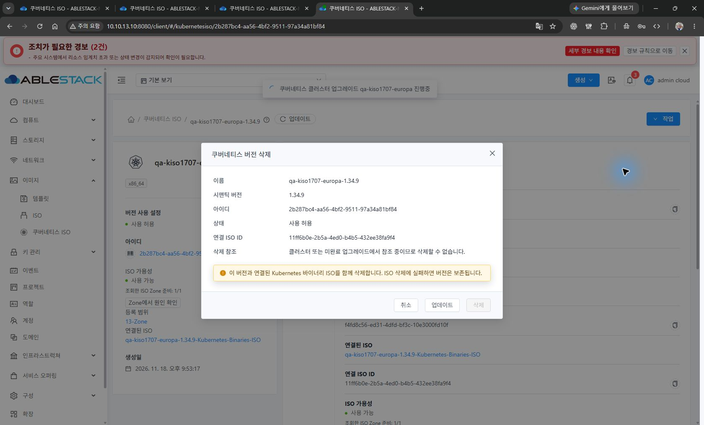

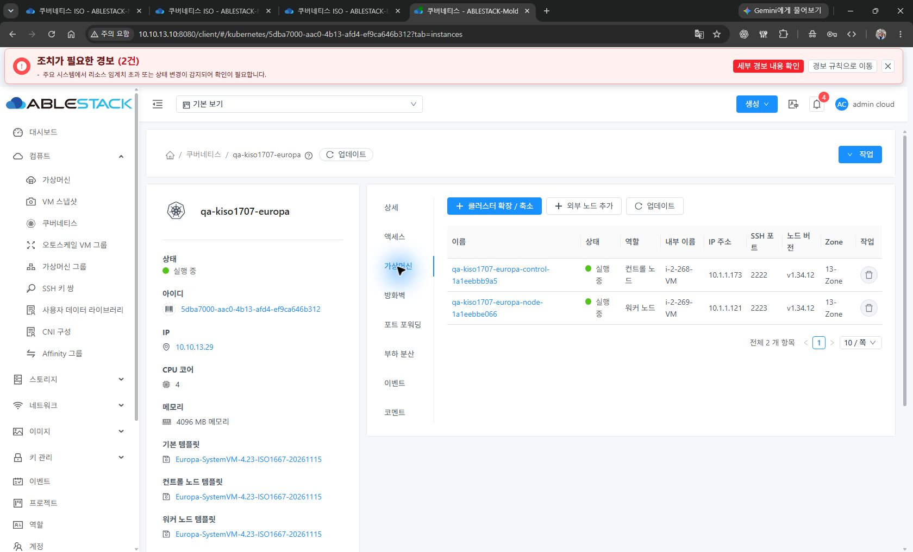

## 4.21 → 새4.23 공식 ISO 전송

| 실제 업로더 | 경로 / 실계정 | 결과 |
| --- | --- | --- |
| s-270 실제 Cloud JAR4.21 | URL / URL-only Admin | 공식1.34.9 전송, Ready1/1, parent ADD 완료1건, parent/child x86_64,790.20MiB·SHA 일치 |
| s-270 실제 Cloud JAR4.21 | local / local-only Admin | 실제828588032-byte 파일 전송, Ready, ADD 완료1건, 저장 arch·크기·SHA 일치 |
| 새 s-271 Cloud JAR4.23 | URL / Root Admin | 공식1.34.12 전송, Ready1/1, ADD 완료1건, parent/child x86_64,832905216 B·SHA 일치 |
| 새 s-271 Cloud JAR4.23 | local / Root Admin | 실제832905216-byte 파일 전송, Ready1/1, ADD 완료1건, parent/child x86_64·크기·SHA 일치 |

4.21 runtime은 `4.21.0.0-Mold.Diplo-202609221440` agent/secondary와 Cloud JAR을 확인한 호환 환경입니다. OS 이미지까지4.21이라고 주장하지 않습니다. 4.23 OS 위 실제4.21 업로더 시험이며, 양 전송 완료 후 UI로 SSVM을 파기·재생성해 실제4.23.0.0 s-271로 다시 시험했습니다. 원래 콘솔 v-245는 보존했습니다.

최초 연결 확인 실패는 파일 POST 전의 같은 미사용 티켓으로 재시도해 실제 전송을 완료했습니다. 새 parent/티켓 중복 생성으로 통과시키지 않았습니다. 세션 만료 시도는 전송 통과로 계산하지 않았고 새 로그인 후 기존 자원을 대조했습니다. 접수·전송 완료·서버 Ready를 구분했습니다. 상세 원장은 [uploads-live.json](uploads-live.json),4.21 원문 증거는 [중간 보고서](../kubernetes-iso-1702-progress-20261119/README.ko.md)에 있습니다.

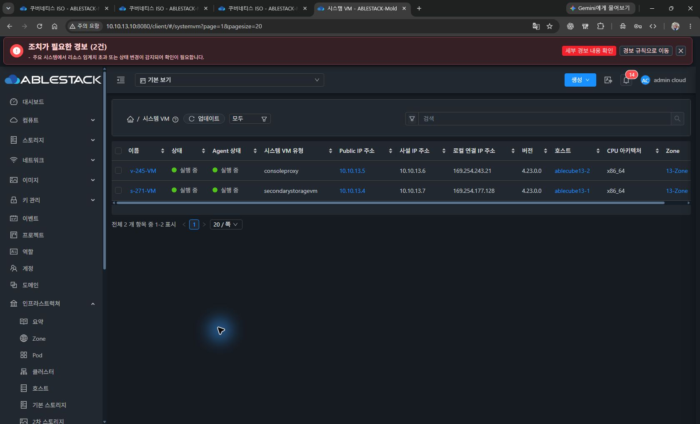

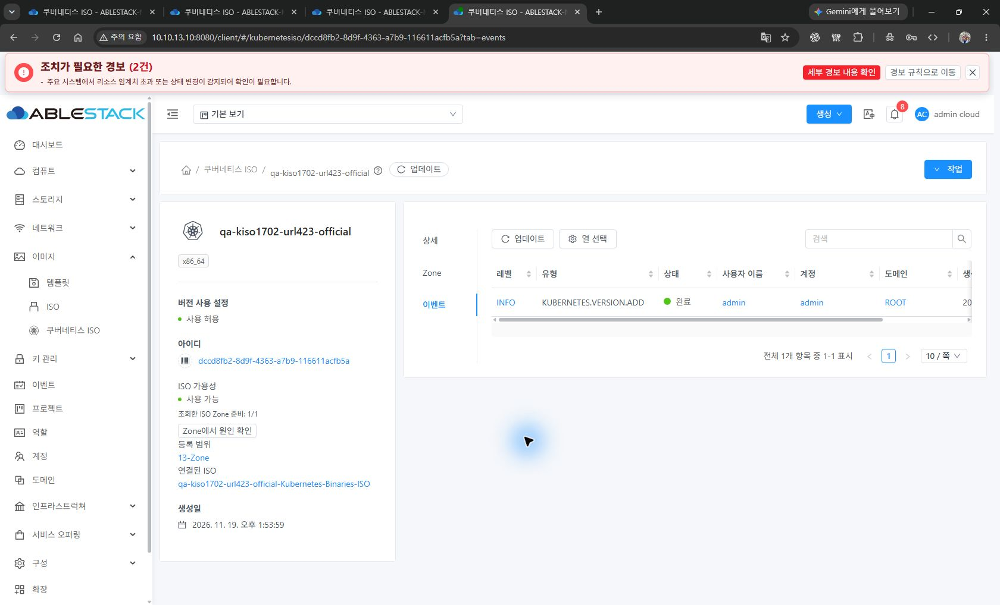

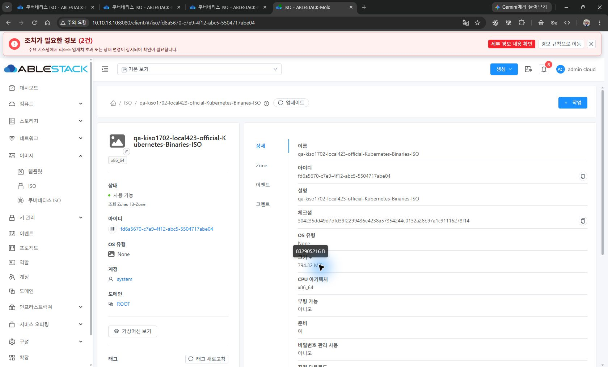

## 실계정 ACL 행렬

동일한 시험 계정의 역할을 단계별로 바꿔 각 phase를 독립 기록했습니다. 모든 역할·계정 생성/전환과 실제 작업은 UI로 수행했습니다. Resource Admin 생성 준비에만 사용자가 승인한 예외로 빈 Disabled private Zone을 API로 만들었고, 계정 시험 뒤 해당 Zone도 UI로 삭제했습니다. 이는 물리 다중 Zone 통과 근거가 아닙니다.

| 실제 actor / phase | 목록·직접 상세·연결 읽기 | URL / 쓰기 경계 |
| --- | --- | --- |
| Root Admin | 목록·상세·Zone·child·실제 CKS 소비·업그레이드 | Root URL과 등록/상태/삭제 허용, 실제 참조 시 삭제 차단 |
| Domain Admin | 카탈로그·상세·Zone1/1·child 읽기 | Root URL·등록/상태/삭제 비노출 |
| Resource Admin | 카탈로그6건·직접 상세·Zone1/1·child 읽기 | Root URL·등록/상태/삭제 비노출 |
| User 기본 | 카탈로그·상세·Zone1/1·child 읽기 | Root URL·등록/상태/삭제 비노출 |
| Read-Only User 기본 | 저장 정책에 KISO list grant 없음. 역할 전환 뒤 이전 상세 제거, F5 메뉴 제거/대시보드 이동 | 기본 역할 수정 없음, 접근 거절을 통과로 기록 |
| 비공개 catalog-only User | 카탈로그 본문 유지, child는 조회 권한 없음으로 구분 | child 링크·VM 메뉴·Root URL·쓰기 없음 |
| 같은 User + listIsos만 허용 | Ready1/1·child 링크, Zone은 일반 텍스트이며 확장/Zone 링크 없음 | Zone/VM/Metrics/쓰기 grant 추가 없음 |
| 같은 User listIsos 회수 | 기존 화면 재조회 시 Ready·child 링크 제거, 카탈로그 본문 유지 | 오래된 성공 표시 재사용 없음 |
| Root 제한 Read-Only Admin | 동일14개 읽기로 KISO→child→일반 VM104개/첫20행/상세 | VM Metrics/쓰기 grant 없이 해당 경로 HTTP229건 오류0·Metrics0·KISO 쓰기0·POST0 |
| URL-only Admin | 실제4.21 URL 등록과 Ready | local/state/delete/Metrics 거부 |
| local-only Admin | 실제4.21 local 전송과 Ready | URL 명시 거부, state/delete/Metrics 거부 |
| 상태 허용·삭제 거부 Admin | 실제 Enabled→Disabled 저장, ISO Ready 유지 | 상태 관리만 노출, 삭제 없음 |
| 삭제 허용·상태 거부 Admin | 새 서버 참조 확인 뒤 실제 KISO/child 연쇄 삭제, 목록8→7 | 삭제만 노출, 상태 관리 없음 |

URL grant가 있을 때 열린 유효 양식에서 실제 권한을 회수한 뒤 제출했습니다. 서버가 API unavailable로 거절했고 결과 불명 UI는 중복 등록을 제공하지 않았습니다. 해당 이름 재검색0건과 원래 목록 보존을 확인했습니다.

읽기 경로의 추가 grant를 요구하던 선택 조회3개를 제품에서 보정했습니다. 일반 InfoCard 링크·VM 네트워크·모니터링 설정을 현재 capability로 제한하고 늦은 응답 뒤에도 grant/VM/컴포넌트 생존을 확인합니다. 로그인 공통 대시보드/테마의 별도 거절은229건 무오류 구간과 구분합니다. 쓰기 단계의 query-only 로그0을 실제 쓰기0으로 해석하지 않았습니다.

원문: [실계정 행렬](acl-matrix-live.json), [읽기 구간 요청 집계](read-admin-postdeploy-access-result.json), [URL 권한 회수](permission-revocation-live.json).

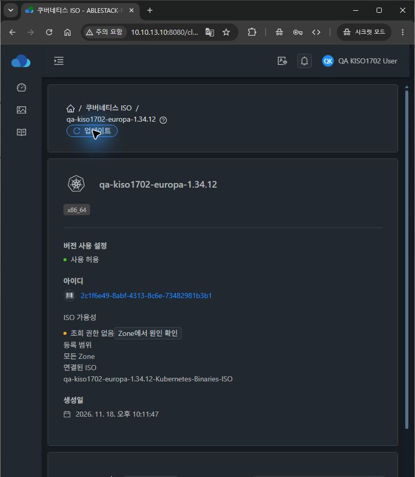

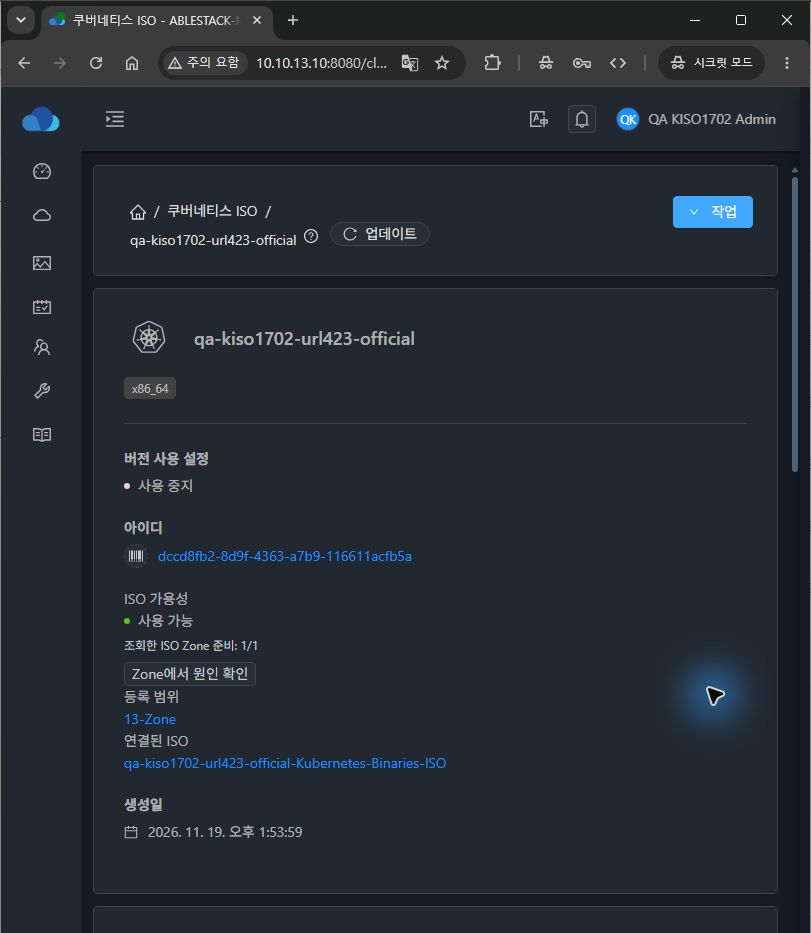

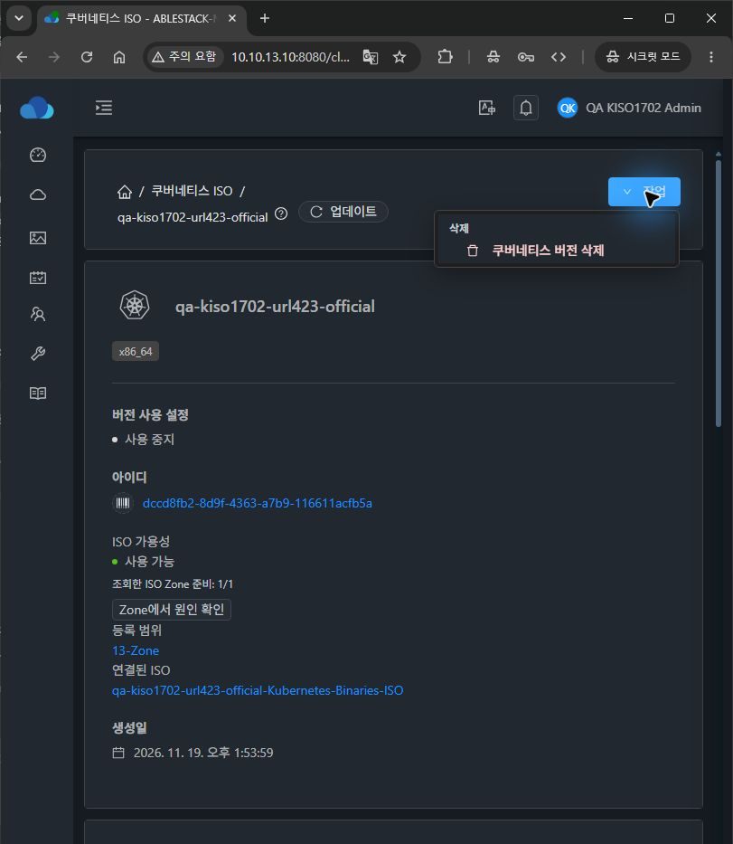

## 검색·프로젝트·VM 표준 UI

- 키워드 검색2건, Zone13+x86_64+최소1.34.10은 target1건, 상세→breadcrumb의 조건/page/count 보존을 확인했습니다. 권한 owner 변경 뒤 이전 검색 URL은 폐기됐습니다.
- 전용 프로젝트에서 전역 카탈로그7건이 유지됐습니다. 이전 기본 보기의 키워드5건 URL을 열면 낡은 owner/검색이 폐기되고 프로젝트 owner 전체7건으로 초기화됐습니다. 기본 보기 복귀 후 프로젝트를 삭제해 원래0건을 확인했습니다.
- light/dark의 목록·breadcrumb·상세 요약/세로 탭/탭 콘텐츠·상태/삭제 대화상자를 실제 UI로 대조했습니다. 이번 통합 확인의 native 창은1680px 및 약811px입니다. Enter 검색/콤보 선택·Esc 취소를 다시 확인했습니다.
- 상세390px 등 전체 스타일/초점 복귀 행렬의 확정 근거는 [#1701 최종 보고서](../kubernetes-iso-1701-final-20261118/README.ko.md)에 유지하며 이번에 전부 재실행했다고 표현하지 않습니다.
- Ubuntu OS 템플릿 `Europa-SystemVM-4.23-ISO1667-20261115`의 이름이 한 줄로 정상 표시돼 생략 부호만 남는 문제가 재발하지 않았습니다. 원래 템플릿48건을 보존했습니다.

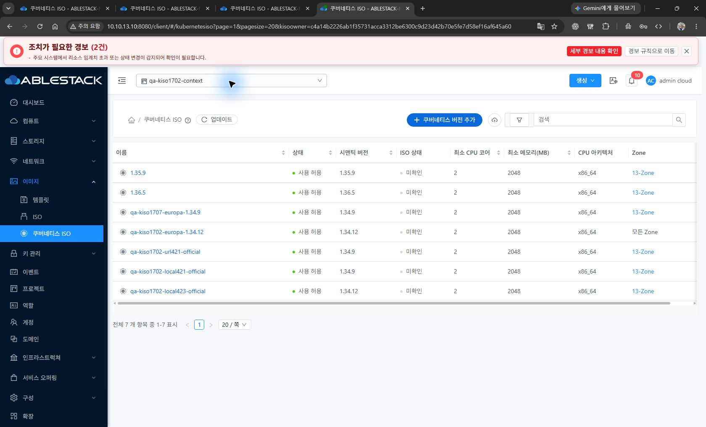

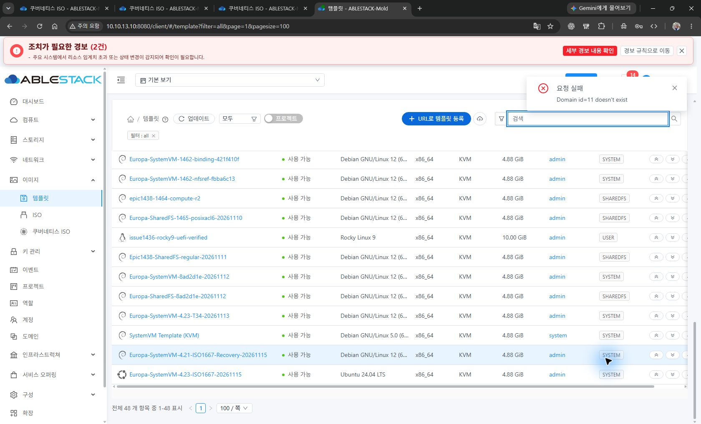

## 배포·최신 기준 동기화·검사

13번에 필요한 정적5개만 배포했습니다. index SHA-256은 `bcaabb92d96f142499de4bc8a47ef21bf97c93b862d9072f9078ee8cc2456ae1`입니다. 통합 검증 당시 정적7219개 전체 기대 해시, 기존 비index7214개와 보호 설정을 확인했습니다. 관리 JAR `55f802d2b22c9d4d471644c6157781cc2604e27d4ba0d7b055e4a934bb1d6171`/PID2860414를 보존했고 Backend/DB 스키마/Host Agent 재시작은 없습니다. 호스트3개 factory는 원래4.23 해시로 복원됐고 Agent PID3개도 동일합니다.

배포 제품 출처는 `e6a579404d476d52101157f10cfccdc6b811195b`입니다. 최종 기준 동기화에서 upstream AS 번호 변경8개를 먼저 로컬 `ablestack-europa`에 fast-forward해 `055ea57b238746c65b66cc5600215b10f0087b23`/0·0을 확인한 뒤43개 작업 커밋을 재정렬했습니다. 번역과 공통 검색/목록/요청 소유 범위 충돌5개 커밋을 해결해 ASN 처리와 KISO 처리를 모두 보존했습니다.

이번 읽기 경계 제품4개 파일은 재정렬 전후 바이트가 같습니다. 재정렬 후 **30 suites/471 tests PASS**, 충돌 해결 공통 파일과 읽기 제품7개 경로 ESLint0을 확인했습니다. 배포 당시 canonical/운영 입력의 동일21 suites/359 tests PASS와 생산 빌드792.4초 PASS는 별도 provenance입니다. 중복 실행을 합산하지 않습니다. 새 ASN 기능을13번에 함께 배포하지 않았습니다. 재정렬 후 대응 제품 커밋은 `92c1db498bf76038bb72138a4769200ecf0bcee8`입니다.

최종 변경 범위 훅·CI 결과는 PR #1703 완료 코멘트와 함께 확인합니다. 기존 전체 Lint16개 실패 그룹과 RAT unknown/unapproved4077건은 이전 head에서 동일했고 #926·#1044로 분리 유지합니다. 최신 head의 전체 CI를 green으로 미리 표시하지 않습니다.

## 정리와 원래 자원 보존

| UI 대상 | 최종 확인 |
| --- | --- |
| KISO / ISO | 원래2 /8건, 시험6쌍 연쇄 삭제와 원래 UUID 보존 |
| 템플릿 / 일반 VM | 원래48 /102건 |
| CKS | 원래 koral1/koral3 두 건·같은 UUID·Stopped |
| 시험 네트워크 | qa-kiso1707 검색0건, CKS 삭제 완료 후 노드/네트워크 정리 |
| 계정 / 역할 | 원래3 /9건, 기본 역할 변경 없음 |
| 도메인 / Zone / 프로젝트 | ROOT1 / 원래13-Zone1 /0건 |
| 시스템 VM | 새 s-271과 원래 v-245, 두 건 모두 Running/Agent Up4.23 |
| HTTP 사본 | 정확한 SHA 대조 후 두 파일 제거, 두 URL404·전용 디렉터리 부재 |

삭제는 원장의 정확한 시험 대상만 UI로 수행했습니다. 원래 카탈로그/ISO/CKS와 노드 템플릿은 보존했습니다. local 미사용 티켓 재시도는 같은 티켓을 실제 전송에 사용했고, UI에서 최종 시험 parent/child 잔여0을 확인했습니다. DB 직접 조회 결과를 정리 근거로 대체하지 않았습니다. 로컬 공식 다운로드 원본·검증 증거·배포 rollback 백업은 보관합니다. [최종 원장](resource-ledger.json), [HTTP 제거](http-cleanup-final.json), [최종 정적 검증](static-final-verification.json).

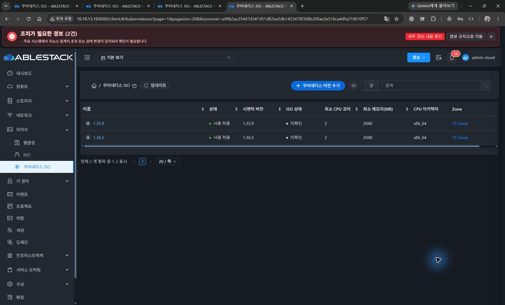

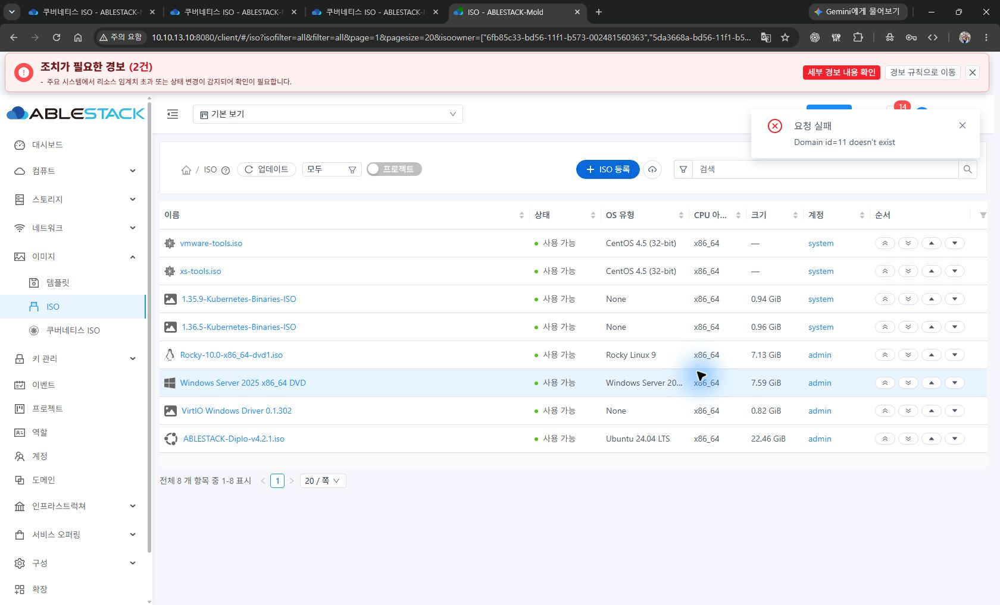

## 별도 후속과 미실행 범위

정리 중 도메인 삭제 성공 뒤 삭제된 ID를 재조회하며 실패 알림이 남는 공통 UI 문제를 관측해 [#1717](https://github.com/ablecloud-team/ablestack-cloud/issues/1717)로 분리했습니다. 해당 컴포넌트는 Epic에서 변경하지 않았고 도메인·시험 계정 삭제는 완료됐습니다. 이 결함을 CI 부채에 포함하지 않습니다.

물리 다중 Zone·Edge·비KVM·ARM/s390x 부팅은 환경이 없어 NOT_RUN입니다. 기능은 보존했고 단일13번 KVM 완료 범위와 분리합니다. native 사진은 [해시 원장](native-evidence-manifest.json)의 원본 바이트이며 편집하지 않았습니다. 암호·API 키·세션·업로드 서명/티켓 원문은 증거에 저장하지 않았습니다.
