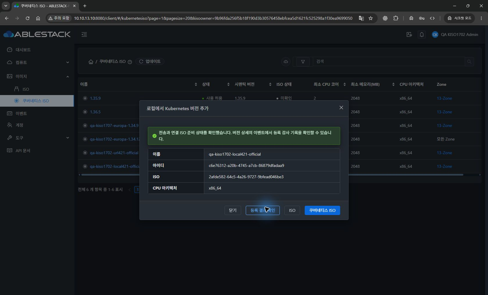
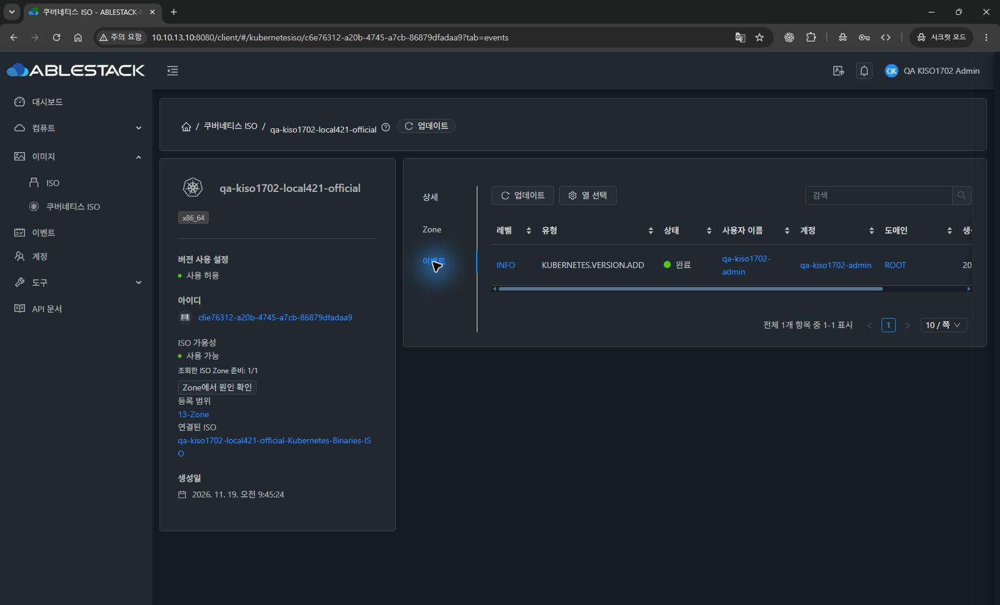
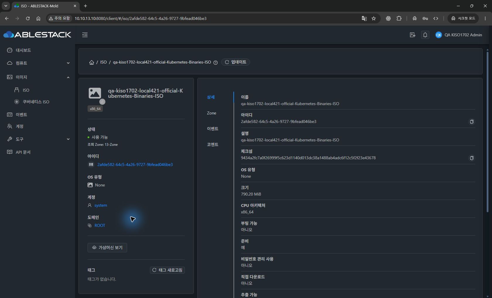
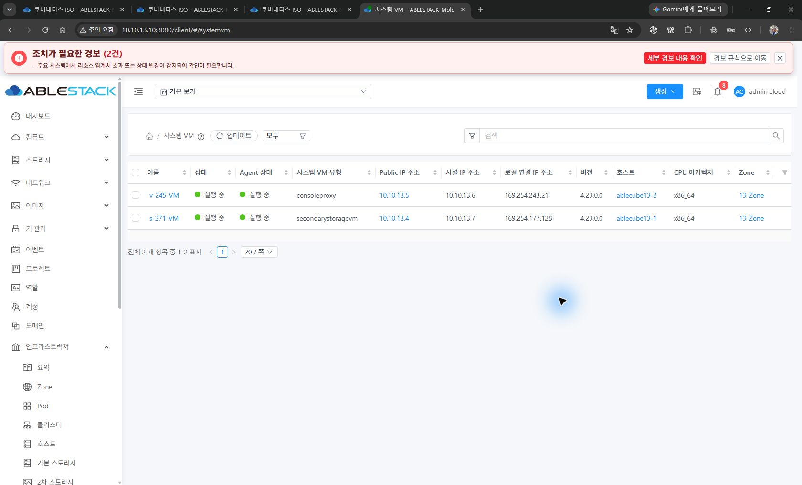
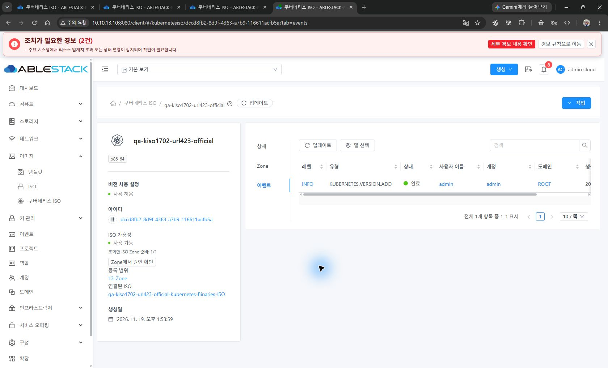
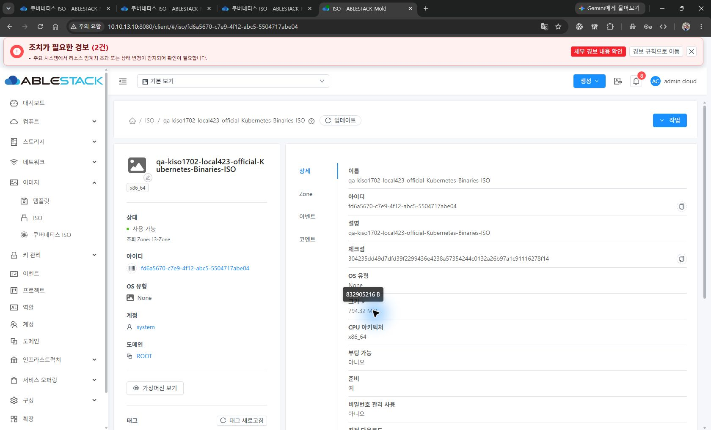
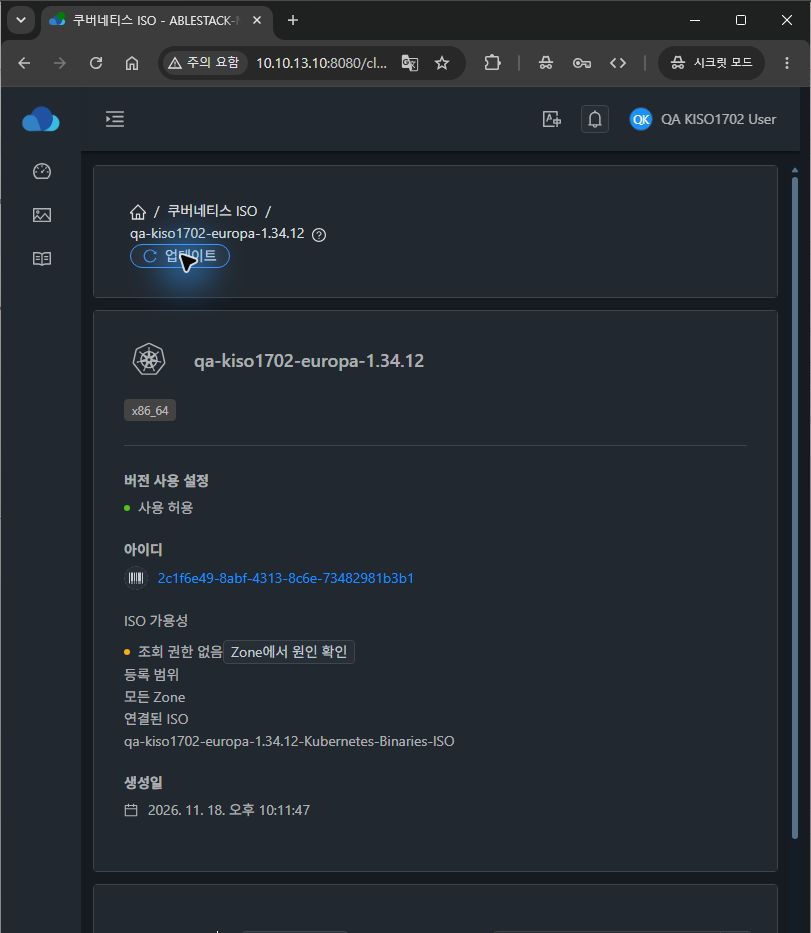
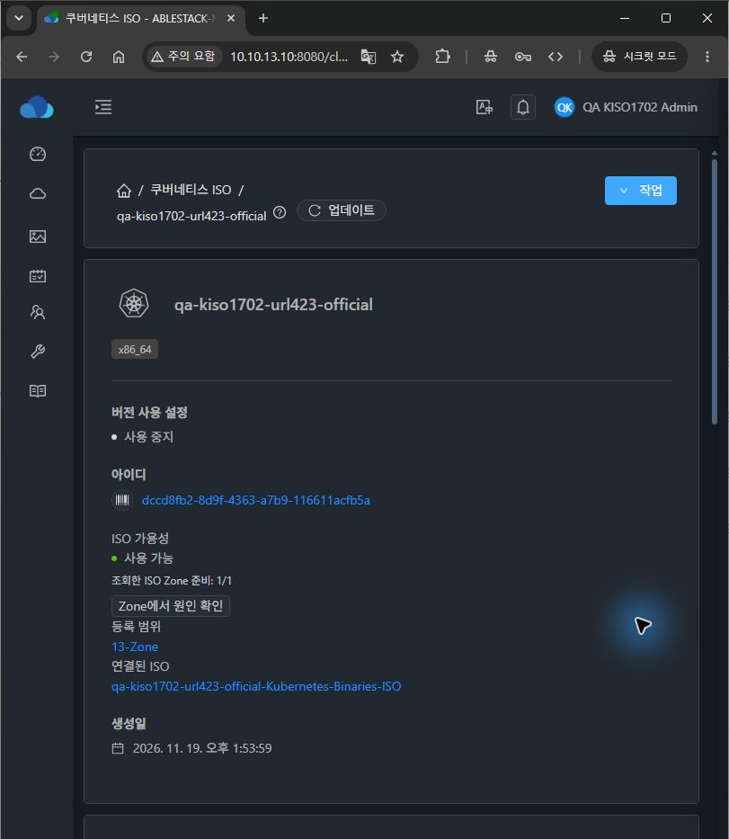

<!--
Licensed to the Apache Software Foundation (ASF) under one
or more contributor license agreements.  See the NOTICE file
distributed with this work for additional information
regarding copyright ownership.  The ASF licenses this file
to you under the Apache License, Version 2.0 (the
"License"); you may not use this file except in compliance
with the License.  You may obtain a copy of the License at

  http://www.apache.org/licenses/LICENSE-2.0

Unless required by applicable law or agreed to in writing,
software distributed under the License is distributed on an
"AS IS" BASIS, WITHOUT WARRANTIES OR CONDITIONS OF ANY
KIND, either express or implied.  See the License for the
specific language governing permissions and limitations
under the License.
-->

# #1707·#1702 통합 UI 검증 중간 결과 (당시 기록)

최종 검증과 정리 결과는 [최종 보고서](../kubernetes-iso-1702-final-20261119/README.ko.md)를 참조하세요. 아래는2026-11-19 중간 점검 당시 **진행 중** 기록입니다. #1707·#1702·Epic #1692는 OPEN이며 PR #1703은 Draft입니다. 남은 삭제 ACL·최종 UI 회귀·정리가 끝나기 전에 완료로 처리하지 않습니다.

## 확인한 결과

공식 Europa mold-cks ISO1.34.9로 전용 CKS 생성·Provider 초기화를 완료하고 실제1.34.12 업그레이드를 수행했습니다. 진행 중 전용 워커 정상 정지 상태에서 source/target 삭제 차단을 확인했고, 복구 후 두 노드 v1.34.12 Running과 완료 후 source pin 해제를 확인했습니다. 기존 잘못된 ISO1.35.9/1.36.5와 원래 koral1/koral3는 소비·변경하지 않았습니다. terminal failed upgrade를 재현했다고 주장하지 않습니다.

[공식 Europa 릴리스](https://github.com/ablecloud-team/ablestack-kubernetes-iso/releases)의1.34.9 자산은828,588,032 bytes, SHA-256 `9434a2fc7a0f26999f5c623d1140d013dc38a1488ab4adc6f12c5f2f23e43678`입니다.1.34.12 자산은832,905,216 bytes, SHA-256 `304235dd49d7dfd39f2299436e4238a57354244c0132a26b97a1c91116278f14`입니다. 릴리스 digest와 실제 파일·manifest·등록 명세를 대조했습니다. 전송용 fixture를 Kubernetes 소비 성공으로 계산하지 않았고 manifest 식별 검증을 우회하지 않았습니다.

## 읽기 권한 보정과 최소 배포

제품 `e6a579404d476d52101157f10cfccdc6b811195b`는 일반 InfoCard 링크, VM 네트워크·주석 발견, 모니터링 설정 조회에 현재 API grant 확인을 추가합니다. 계정 권한을 늘리지 않고 미허용 읽기의 불필요한432를 방지했습니다. 네트워크 응답 뒤에도 grant·VM ID·컴포넌트 생존을 재확인합니다.

- 기준 Europa 로컬/upstream `aff74eee0d835891f9209492514f6c2d204bc138`, 최신 fetch 후0/0 확인.
- canonical·운영 입력에서 각각 동일21 suites/359 tests PASS.718개로 합산하지 않습니다.
- 제품 변경8개 경로 ESLint·25개 적용 훅 PASS. 생산 빌드792.4초/PASS.
- 기존 운영 입력의 다른 VM/VNF 차이를 보존하고 정적5개만 배포했습니다. index 외 기존7214개 파일·보호 설정·관리 JAR/PID를 보존했습니다. Backend·DB 스키마·Host Agent 재시작은 없습니다.
- 같은14개 읽기 grant와 VM Metrics/쓰기 거부 상태에서 KISO → child ISO → 일반 VM104개/첫20행/상세를 재검증했습니다. 해당 구간 API229건에서 HTTP 오류0·VM Metrics0·KISO 쓰기0·POST0입니다. /api와/api/ 양쪽을 포함합니다. 로그인 시 제한 Admin의 공통 대시보드/테마 조회 거절은 이 구간과 분리 기록합니다.

## 실제4.21 업로더의 공식 ISO 전송

| 경로 | 실계정 capability | UI 결과 |
| --- | --- | --- |
| URL | 읽기14개 + URL API만 허용, local/state/delete/Metrics 거부 | Ready1/1, parent ADD 완료1건, parent/child x86_64, child790.20MiB·공식 SHA-256 일치 |
| local | 읽기14개 + local API만 허용, URL 명시 거부·state/delete/Metrics 거부 | 실제828,588,032-byte 파일 전송·Ready, parent ADD 완료1건, parent/child x86_64, child790.20MiB·공식 SHA-256 일치 |

새 s-270-VM UUID `4b1e50f1-2b97-4547-9347-ef26a4b64aa9`에서 실제 agent/secondary 및 Cloud JAR4.21.0.0-Mold.Diplo-202609221440을 확인했습니다. OS 이미지 릴리스까지4.21이라고 주장하지 않습니다.4.23 OS 이미지 위의 실제4.21 업로더 runtime 호환 시험입니다.

로컬 파일 미선택 오류를 확인했습니다. 야간 대기 뒤 인증 만료로 중단된 제출은 전송 통과로 계산하지 않았습니다. 새 로그인에서 카탈로그5개와 local 자원 부재를 대조한 뒤 재개했습니다. 최초 업로더 연결 확인 실패는 **같은 미사용 티켓**으로 재시도해 실제 전송을 완료했습니다. 전송 완료와 서버 Ready를 구분해 확인했습니다. 티켓/서명/세션/암호 원문은 증거에 저장하지 않았습니다.

4.21 VM이 올라온 뒤 호스트3개 factory를 원래4.23 해시로 즉시 복원했고 Host Agent PID를 보존했습니다.4.21 URL/local 완료 후 SSVM을 다시 UI로 파기·재생성했습니다. 새 s-271-VM UUID `0e7d4563-a48d-4602-ae5c-758008e4530b`의 실제 agent/secondary4.23.0.0과 cloud active를 확인했습니다. 새4.23의 native Running/Agent Up을 확인한 뒤 URL/local 모두 공식1.34.12 ISO832,905,216 bytes를 실제 전송했습니다. 각 Ready1/1, parent ADD 완료1건, parent/child x86_64, child794.32MiB와 정확한 SHA-256 저장값을 UI로 확인했습니다. Local 최초 연결 확인 실패는 같은 미사용 티켓 재시도로 전송을 완료했고 새 parent/티켓을 중복 발급하지 않았습니다. 원래 콘솔v-245-VM/UUID147cd89a-9b5b-4bcd-a0ca-a1ac88584578은 보존합니다.

## 실계정 ACL과 남은 게이트

Domain Admin/User의 카탈로그·상세·Zone·child 읽기와 Root URL/쓰기 비노출을 확인했습니다. 기존 기본 Read-Only User는 저장 정책에 KISO list grant가 없어, 역할 변경 뒤 상세 제거·메뉴 제거/대시보드 이동을 확인했습니다. 기존 기본 역할은 수정하지 않았습니다.

URL 허용 중 열린 유효 양식에서 grant를 실제 회수한 뒤 제출했습니다. 서버 API unavailable로 차단됐고, UI는 결과 불명 상태에서 중복 등록을 제공하지 않고 기존 결과 조회만 허용했습니다. 해당 이름을 재검색해0건, 기존 전체5건 보존을 확인했습니다. 쓰기 단계에서 POST 본문을 보관하지 않은 query-only0을 실제 쓰기0으로 해석하지 않습니다.

keyword qa-kiso →2건, Zone13+x86_64+최소1.34.10 → target 한 건과 breadcrumb 복귀 보존을 확인했습니다. API 정책이 바뀐 뒤 이전 owner 검색 URL은 폐기되고 새 범위 전체 목록으로 초기화됐습니다.

사용자가 승인한 준비 단계 예외로 Disabled private Zone `8b842cb8-bdcc-4d48-86a8-16be87716219`만 API로 생성했습니다. 호스트/Pod/물리 네트워크/primary/secondary storage0을 확인했고 원래13-Zone을 보존했습니다. Resource Admin 시험 계정 `ed23ad1e-b92c-4640-88ab-45cadf336993`은 이후 **UI로** 생성했습니다. 이는 물리 다중 Zone 기능 통과 근거가 아닙니다.

비공개 User 역할 `138759de-7f4a-4389-bc75-c79313dcfec9`에 로그인 필수3개+카탈로그 list만 허용하고 마지막 * 거부를 UI로 저장했습니다. User 계정 적용·저장된 역할 UUID를 확인했습니다. Resource Admin 실제 로그인으로 카탈로그6건·직접 상세·Zone Ready1/1·child 읽기와 Root URL/쓰기 비노출을 확인했습니다. 카탈로그-only User는 본문을 유지하면서 child를 조회 권한 없음으로 구분했고 VM 메뉴/쓰기/Root URL은 노출하지 않았습니다. listIsos만 독립 허용하면 Ready1/1·child 링크를 보여주되 Zone 링크/확장은 없었습니다. 그 grant를 회수한 뒤 기존 화면에서 재조회해 Ready와 child 링크가 지워지고 카탈로그 본문은 유지되는 것을 확인했습니다. Resource Admin 계정은 UI로 비활성화 후 삭제했고 빈 private Zone도 인프라 관리 UI로 삭제해 원래13-Zone1개만 남겼습니다.

- [x] Resource Admin·카탈로그-only User·독립 child 조회 및 실시간 권한 회수 UI 회귀.
- [x] 제한 Admin의 상태 변경 허용/삭제 거부: 삭제 메뉴 없이 실제 사용 중지 저장, ISO Ready 보존.
- [ ] 삭제 허용/상태 변경 거부의 실제 연쇄 삭제와 프로젝트 범위 UI 회귀.
- [x] 새4.23 URL/local·Ready·저장 arch/체크섬/정확한 bytes·감사.
- [ ] VM 표준 light/dark·반응형·native 키보드·Ubuntu 이름 최종 통합 확인.
- [ ] 시험 CKS/노드/네트워크/IP·카탈로그/child·계정/역할/도메인/private Zone·HTTP 사본 UI 정리와 원래 식별자/수량 보존.
- [ ] 최종 증거/검사·이슈/Epic 닫기·PR 결과 갱신.

사용자의 바탕화면 복구 후 위 추가 검증을 수행했습니다. 이후 새 창 선택 재시도에서도 `encode latest capture frame failed: window crop is outside captured monitor`가 발생해 다시 화면 복구를 요청했습니다. 사용자에게 바탕화면 활성화를 요청했고, 그 뒤 UI 입력은 중단했습니다. 이를 제품 오류나 CI 실패로 섞지 않았으며 UI 검증을 API 실행으로 대체하지 않았습니다.

물리 다중 Zone·Edge·비KVM·ARM/s390x 부팅은 NOT_RUN이고 기능을 보존합니다.

## 기존 CI 부채

제품 [Lint44324441631](https://github.com/ablecloud-team/ablestack-cloud/actions/runs/44324441631)은 entry baseline과 동일16개 실패 그룹이며 제품 변경8개 경로의 추가 진단0입니다. [License44324441773](https://github.com/ablecloud-team/ablestack-cloud/actions/runs/44324441773)의 unknown/unapproved4077도 동일합니다. 전체 CI는 green이 아니며 #926·#1044는 별도 OPEN을 유지합니다. 문서 head30469fd9d69436cee01777eb4ad16c84d6e0c7c8의 [Lint44435512553](https://github.com/ablecloud-team/ablestack-cloud/actions/runs/44435512553)도 동일16개 실패 그룹이며 변경18개 문서 경로 추가 진단0입니다. [License44435512509](https://github.com/ablecloud-team/ablestack-cloud/actions/runs/44435512509)는 같은4077건입니다. 후속 문서 head의 CI는 다시 구분해 확인합니다.

## 복구 후 추가 UI 증거

