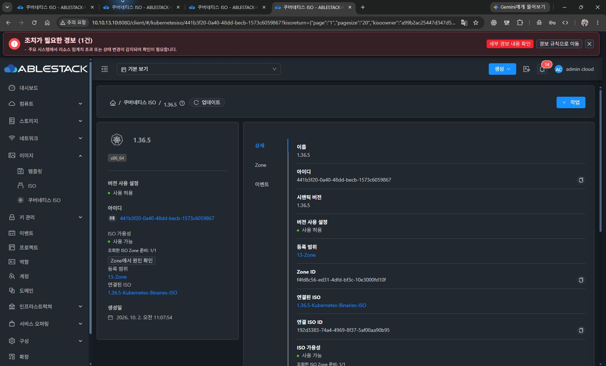
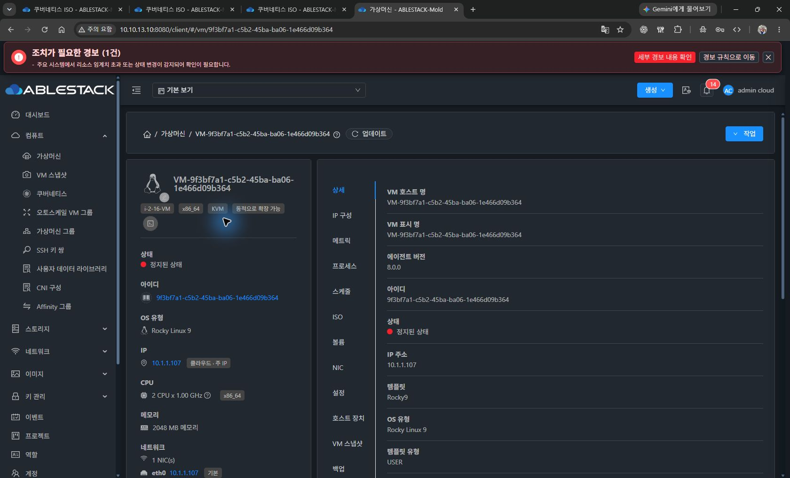
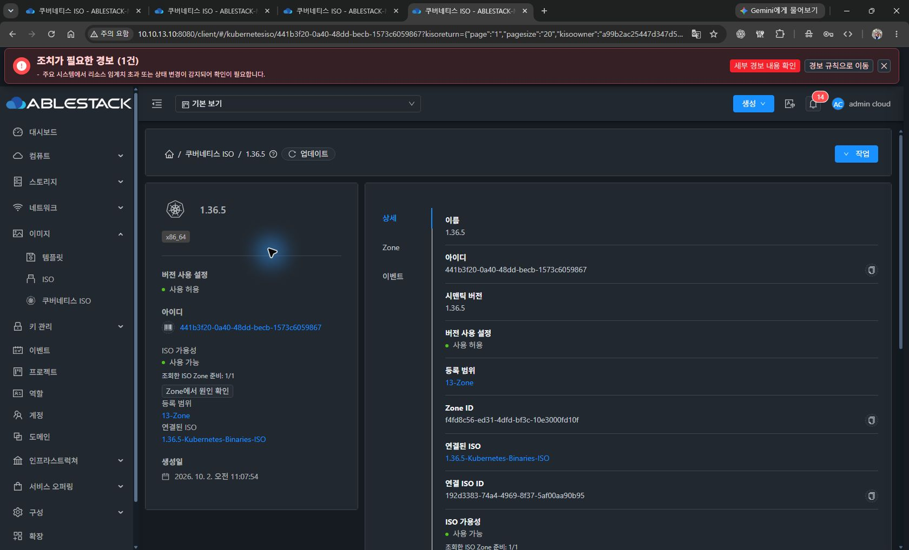
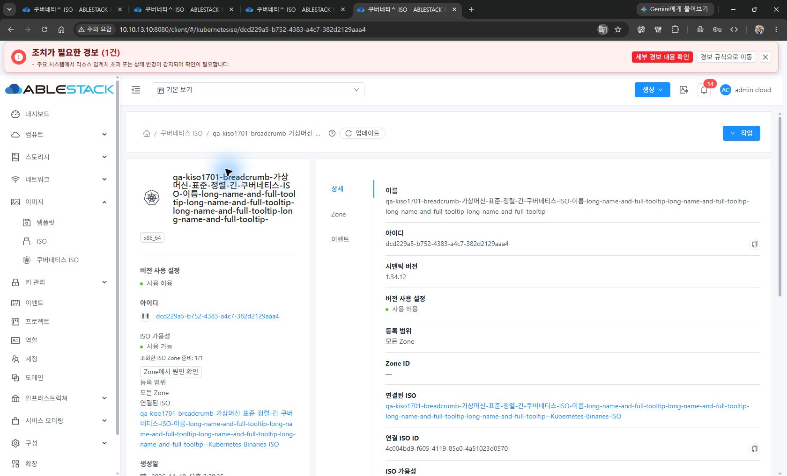
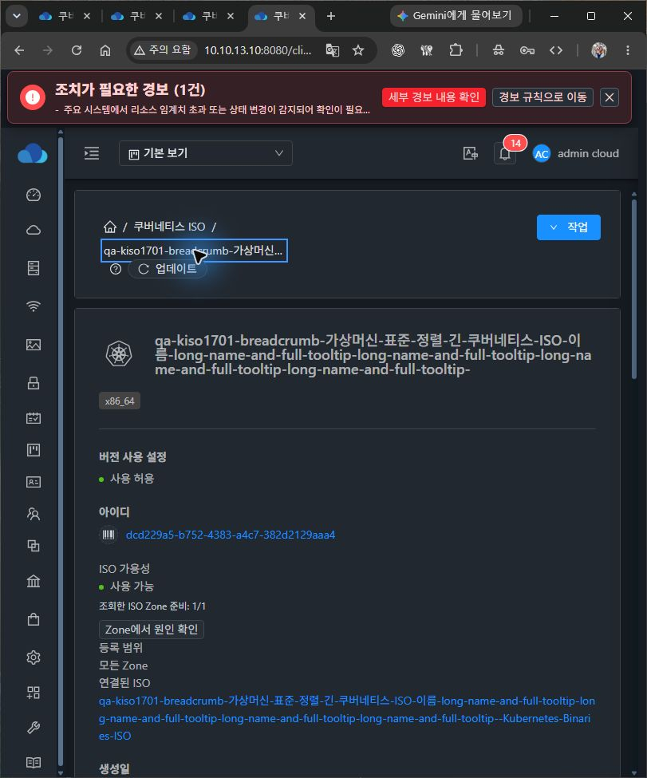
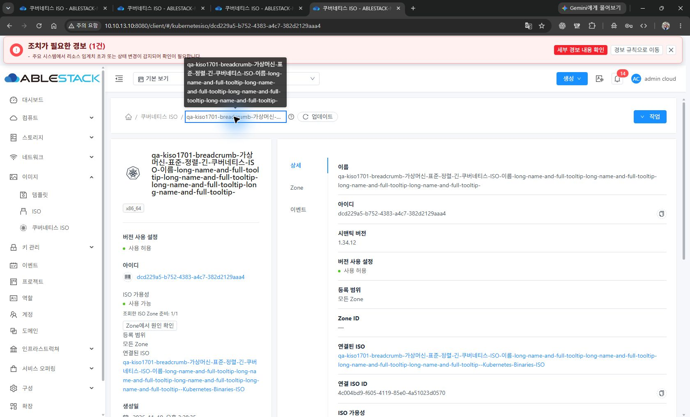

<!--
Licensed to the Apache Software Foundation (ASF) under one
or more contributor license agreements.  See the NOTICE file
distributed with this work for additional information
regarding copyright ownership.  The ASF licenses this file
to you under the Apache License, Version 2.0 (the
"License"); you may not use this file except in compliance
with the License.  You may obtain a copy of the License at

  http://www.apache.org/licenses/LICENSE-2.0

Unless required by applicable law or agreed to in writing,
software distributed under the License is distributed on an
"AS IS" BASIS, WITHOUT WARRANTIES OR CONDITIONS OF ANY
KIND, either express or implied.  See the License for the
specific language governing permissions and limitations
under the License.
-->

# KISO breadcrumb VM 표준 정렬 최종 보정 — #1701·#1702

13번의 VM 목록·상세와 직접 비교해 KISO breadcrumb 현재 값이 아래로 처지는 문제를 보정했습니다. 기존 전체 기능 검증 뒤 사용자가 지적한 추가 결함이며, 재개한 #1701·#1702·Epic #1692의 종료 근거입니다.

## 원인과 교정

VM과 같은 Breadcrumb 컴포넌트를 사용하지만 KISO 현재 값에만 `inline-block`, `overflow:hidden`, `vertical-align:bottom`이 적용돼 텍스트 기준선이 내려갔습니다. Flex 중앙 정렬에서는 공통 업데이트 버튼의 inline `margin-bottom:5px`도 오프셋을 만들었습니다.

운영 입력에는 최신 소스의 `breadcrumb-controls` 클래스가 없었습니다. 운영 컴포넌트를 덮어쓰지 않고, 마지막 컨트롤 span을 선택하는 구조 호환 규칙으로 경로·구분자·현재 값·도움말·버튼을 중앙 정렬했습니다. VM과 같은14px/22px 배율을 사용하며 긴 값의 한 줄 말줄임·전체 툴팁·focus-visible을 유지합니다.

변경 제품 코드는 `ui/src/style/components/view/kubernetes-iso.less` 한 파일입니다. 공통 VM 컴포넌트·API/권한·이벤트 처리 코드는 바꾸지 않았습니다. [소스/운영 입력 호환 근거](compatibility-summary.json).

## 실제 13번 UI 검증

| 사례 | 결과 |
| --- | --- |
| 운영 VM 목록·상세와 직접 비교 | 원본 기준 화면 확보, KISO 최종 경로/현재 값/컨트롤 같은 높이 |
| 기존 짧은 값1.36.5 / 다크 데스크톱 | 아래 처짐 해소, 변경 전/후 대조 |
| 긴 한글·영문 이름 / 라이트·다크 데스크톱 | 경로와 값 같은 기준선, 한 줄 말줄임 |
| 같은 긴 이름 / 라이트·다크811px 창 | 전체 항목 단위 줄바꿈, 텍스트 일부만 아래로 처지거나 잘리지 않음 |
| 마우스/초점 툴팁 | 전체157자 원문 표시, 마지막 반복 문자열까지 보존 |
| native Tab→Shift+Tab | 도움말로 이동 후 현재 값으로 초점 복귀·전체 툴팁 재표시 |
| native Esc | 툴팁 닫기, 현재 값에 초점/표시 유지 |
| 임시 KISO/ISO 정리 | UI 연쇄 삭제 완료, 원래2/8건 및 UUID 보존 |

원본 화면은 편집하지 않았고 [해시 원장](native-evidence-manifest.json)에 기록했습니다. 811px는 native 창 너비이며 CSS viewport390px 등 미실행 크기를 이번 통과로 표시하지 않습니다.

## 빌드·배포·정리

검증된 운영 UI 입력1120개 파일을 대조해 stylesheet 한 파일만 바꿨습니다. VNF 및 다른 운영 입력 차이는 보존했습니다. 생산 빌드757.1초/PASS 후, 버튼 여백·운영 구조 호환 보정은 같은 Vue CLI loader의 stylesheet 전용 lib target으로 컴파일했습니다. 최종 스타일 모듈 빌드는14.7초/PASS이며 CSS 규칙은 모두 KISO 범위입니다.

보정 과정의 정적 delta와 백업은 각 deployment JSON에 보존했습니다. 최종 운영 구조 호환 반영은 CSS 모듈과 index 두 개만 교체했습니다. 임시 lib JS/demo/생성 color.less는 배포하지 않았습니다. 최종 모듈은 `/client/css/kiso-breadcrumb.bbcc604a0e92.css`이며 index SHA-256은 `79434dc25bc4ff62dfe16e16135318c289107c6b820c37afad57a2bfcb3af436`입니다.

최종 정적7222개 전체 기대 해시·보호 설정과 관리 JAR/PID2860414가 일치합니다. Backend/DB/Agent 재시작은 없습니다. [최종 정적 검증](static-final-compatible.json), [최종 delta](compatible-deployment-result.json).

공식 Europa1.34.12 ISO의 같은832905216-byte/SHA-256 원본으로 긴 이름 시험 쌍 한 개를 UI로 등록해 Ready1/1을 확인했습니다. 원래 버전을 수정하지 않았습니다. 시험 쌍을 UI로 삭제했고 HTTP 사본은 정확한 SHA 확인 후 제거해404·전용 디렉터리 부재를 확인했습니다. 원래 다크 모드도 복원했습니다. [자원 원장](resource-ledger.json), [전송 파일 정리](http-cleanup-final.json).

최종 source 변경의 적용 훅25개 PASS, LESS/생산·스타일 모듈 컴파일 PASS, 기존 레이아웃·툴팁/키보드4 tests 재실행 PASS입니다. 앞선 통합30 suites/471 tests와 중복 합산하지 않습니다.

## CI와 기존 통합 검증

headb0bcd8c2153의 [Lint44471964262](https://github.com/ablecloud-team/ablestack-cloud/actions/runs/44471964262)는 기존과 동일16개 실패 그룹·실제 PR 경로 추가 진단0입니다. [License44471964175](https://github.com/ablecloud-team/ablestack-cloud/actions/runs/44471964175)는 기존4077건입니다. [분류 근거](ci-b0-classification.json). 후속 근거 커밋 CI는 PR에서 별도로 확인하며 전체 CI green을 주장하지 않습니다. #926·#1044는 별도 OPEN입니다.

공식4.21→새4.23 전송·실계정 ACL·VM Metrics 경계·실제 업그레이드 pin·원래 자원 보존 근거는 [통합 최종 보고서](../kubernetes-iso-1702-final-20261119/README.ko.md)에 유지합니다. 공통 도메인 삭제 알림 후속 #1717은 별도 OPEN이며 이번 보정과 CI 부채에 섞지 않습니다. PR #1703은 최종 반영 후 검토 가능 상태로 복원하며 병합하지 않습니다.
