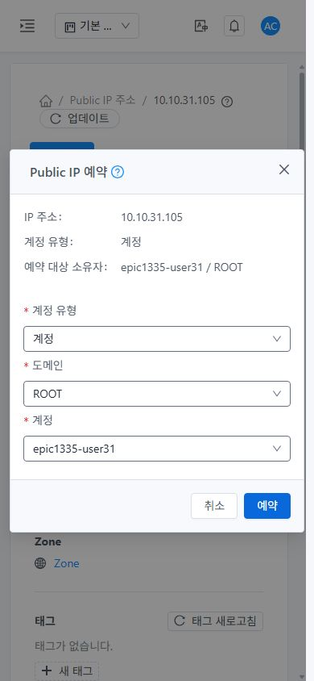

<!--
Licensed to the Apache Software Foundation (ASF) under one
or more contributor license agreements.  See the NOTICE file
distributed with this work for additional information
regarding copyright ownership.  The ASF licenses this file
to you under the Apache License, Version 2.0 (the
"License"); you may not use this file except in compliance
with the License.  You may obtain a copy of the License at

  http://www.apache.org/licenses/LICENSE-2.0

Unless required by applicable law or agreed to in writing,
software distributed under the License is distributed on an
"AS IS" BASIS, WITHOUT WARRANTIES OR CONDITIONS OF ANY
KIND, either express or implied.  See the License for the
specific language governing permissions and limitations
under the License.
 -->

# #1685 Public IP 예약 소유자 수정과 실환경 검증

- 대상: Epic #1684 / PIP-01, Europa. 소스는 dhslove 저장소의 별도 작업 트리에서 변경했다.
- 기준: `8ada44ee9d921dfcca9c2be892f19730129b4188`.
- 구현: `ca35e918542ffc500fa0c2addd488830b6737a8f`; 최종 소스 `133e1bbe8a8a10bfc3368a321a57595078cc68a0`은 미확정 안내 중복을 제거한다.
- 환경: 31 GFS2(SharedMountPoint), 32 RBD. 예약 작업은 스토리지 I/O를 생성하지 않는다.
- 범위: 예약 소유자·후보 조회·동기 결과 검증·예약 창 UI. 기존 VM용 네트워크/VPC/VNF의 NAT/FW/PF/LB/VPN 및 전체 역할 행렬은 반복하지 않았다.

## 변경 사항

번역된 값을 내부 분기에 사용하던 오류를 고정 `account`/`project` 값으로 수정했다. 계정은 `id/account/domainid`, 프로젝트는 `id/projectid`만 전송한다. 공통 요청 계층의 프로젝트 자동 주입도 이 요청에서 차단해 두 소유자 인자가 섞이지 않게 했다. 일반 사용자 계정은 로그인 정보로 결정하고 현재 프로젝트는 해당 프로젝트로 제한한다. 서버의 권한 검사·소유자 생략 기본 동작·API/DB는 변경하지 않았다.

도메인/유형 전환은 이전 소유자를 지우며, 후보의 loading/error/empty와 전체 페이지 조회를 구분한다. 자원·로그인·권한·프로젝트·요청 세대를 비교해 오래된 응답이 현재 폼을 바꾸거나 제출하지 못하게 했다. 제출 직전에 현재 Free 상태와 권한/후보를 확인한다.

예약은 동기 API다. 응답 주소 UUID/Reserved/소유자를 확인하고 Reserved를 포함한 상태 재조회까지 일치할 때만 성공으로 닫는다. 명확한 Cloud 오류는 입력을 보존한다. 응답 유실·소유자 불일치는 실제 결과와 확인 경로를 남기고 중복 쓰기를 막는다. 자동 예약·소유자 변경·해제를 하지 않는다. 미확정 요청은 같은 페이지 수명의 메모리에 유지되어 창을 다시 열어도 추적된다. 새로고침·새 브라우저 세션까지 영구 보존하는 서버 idempotency 기능은 아니다. 현재 Free 재조회 후에도 이전 요청이 늦게 완료될 수 있음을 확인하고 추적 종료를 명시적으로 선택해야 새 시도를 허용한다.

VM의 세로 a-form, MoldDialog md(720px), MoldDialogActions의 고정 footer·busy·포커스 가드를 재사용했다. 상단에 IP·유형·선택 소유자를 표시하고 취소/예약 버튼, 연결된 레이블·필드 오류, 키보드 제출 중복 방지, 닫은 뒤 작업 버튼 포커스 복원을 적용했다.

## 로컬 검증

- 변경 파일 lint 통과: `lint.log`.
- 집중 단위 테스트 3 suites / 49 tests 통과: `focused-tests-final.log`. 예약 폼/직렬화·동기 재조회·일반 사용자 자기 계정·프로젝트 제한·후보 501건 2페이지·빈 도메인·조회 실패·오래된 응답·서버 거부·소유자 불일치·미확정 재열기·중복 제출과 Autogen/공통 대화상자 회귀를 포함한다.
- Jest는 저장소 기본 전체 소스 coverage 수집 대신 `--coverage=false --runInBand --forceExit`로 집중 범위를 실행했다. 성공 테스트 후 열린 핸들 종료 경고 및 기존 Vue 중복 아이콘 등록 경고가 있다. 전역 coverage/전체 UI 테스트 PASS를 주장하지 않는다.
- UI production build: `build-production.cjs`로 Vue CLI production 모드를 사용하며 JS/CSS 소스맵만 제외했다. 기본 빌드는 webpack `SourceNode_walk/applySourceMap/getTaskForFile` 병합에서 장시간 CPU를 사용해 중단했다. 제품 소스·webpack 저장 설정은 변경하지 않았다. prebuild/postbuild는 실행했고 Node 20/OpenSSL legacy provider를 사용했다. 재빌드 전 전용 WSL 작업 트리의 빌드 스크립트가 생성한 `ui/public/config.json`만 HEAD로 복원했다. 배포는 현행 서버 config.json을 보존한다. 최초·최종 소스맵 제외 production 빌드 모두 성공했다. `build.log`와 `build-source.txt`에 최종 결과/소스를 보존했다. 기존 Browserslist 및 번들 크기 경고가 있으며, 전체 기본 빌드의 소스맵 생성까지 성공했다고 주장하지 않는다.
- Java/API/DB 변경과 전체 Cloud 빌드는 없다. GitHub Actions 전체 빌드를 시작하지 않았다.

## 배포 및 실환경 검증

### 최종 배포

| 항목 | 31 GFS2 | 32 RBD |
|---|---|---|
| 최종 소스 | `133e1bbe8a8a10bfc3368a321a57595078cc68a0` | 동일 |
| UI tgz SHA256 | `6e77190491842f0f4559289f239efcc5f7890f6e5e2131d773d0b5fc6062f27a` | 동일 |
| 활성 index.html SHA256 | `79574ae648e108095bcbd5c2f2d01c5b7a8abb05e27547ad3856e311ab19190b` | 동일 |
| 관리 서비스 PID | 2245419 유지 | 2563495 유지 |
| 활성 `/client/` | HTTP 200 | HTTP 200 |
| 최종 수정 전 백업 | `/root/publicip1685-ui-20261115-204009` | `/root/publicip1685-ui-20261115-204028` |
| 최초 배포 전 백업 | `/root/publicip1685-ui-20261115-202453` | `/root/publicip1685-ui-20261115-202514` |

`deploy-static.sh`의 정적 경로 허용 목록만 갱신했다. 서버 WEB-INF/META-INF(존재하는 경우), config.json, 백엔드 JAR의 배포 전후 체크섬이 일치한다. 배포 산출물의 정적 파일 체크섬을 활성 webapp과 전부 대조했고 Public IP 신규 마커 및 기존 FTCTL/VNF/VM 마커도 확인했다. 관리 서비스 재시작은 없었다. 예전 해시 자산을 삭제하지 않아 백업의 index/정적 파일로 복원할 수 있다. `deploy-31.log`, `deploy-32.log`에 근거를 남겼다.

### 실제 UI 예약·해제

최종 배포본을 브라우저에서 다시 로드한 뒤 아래 8개 조합을 모두 실행했다. 각 요청은 POST 1건이며 동기 응답 UUID/Reserved/소유자와 재조회·화면 표시가 일치했다. 각 예약은 UI에서 해제해 Free를 확인했다.

| 클러스터 | 한국어 계정 | 한국어 프로젝트 | 영어 계정 | 영어 프로젝트 |
|---|---|---|---|---|
| 31 | PASS | PASS | PASS | PASS |
| 32 | PASS | PASS | PASS | PASS |

- 계정: `epic1335-user31`, `epic1335-user32`. 프로젝트: `E1335-Permission-31`, `E1335-Permission-32`.
- 계정 요청: `id/account/domainid`만 포함한다. 프로젝트 요청: `id/projectid`만 포함한다. 빈 인자명, undefined, 다른 유형의 소유자 인자와 프로젝트 자동 주입이 없다.
- `wire-contract-checks.json`은 8개 최종 요청·응답과 UI 해제의 소유자 계약을 재검사한다. `ui-requests.json`에 최종 8개 조합, 명시적 재시도, 최종 합성 오류 경로를 보존했다. 전체 이력은 `ui-request-history.json`이다.
- 실제 시험 예약/해제는 총 19쌍이다. 최초 10쌍에는 Network 수집 재설정 전 32 영어 2쌍을 다시 실행한 2쌍이 포함된다. 최종 8쌍과 미확정 추적 종료 후 명시적 정상 재시도 1쌍도 모두 UI에서 해제했다. 최초 32 영어 2쌍은 요청 증적이 없어 재실행했고 최종 8조합은 모두 요청/응답을 보존했다.
- 성공 소유자가 admin으로 바뀌는 기존 오류는 재현되지 않았다. 서버 소유자 생략 기본값과 권한은 변경하지 않았다.

### 오류·중복 제출과 UI 표현

- 소유자 미선택: 필드 오류, POST 0건.
- 합성 Cloud 431: 입력과 명확한 오류 보존, 예약 버튼 재활성화.
- 합성 HTTP 503: 중복 쓰기를 잠그고 재열기에서도 미확정 추적을 유지한다. 결과 확인·추적 종료는 GET만 실행한다. 명시적 확인 후 정상 UI 예약/해제 재시도도 성공했다.
- 합성 소유자 불일치: admin을 반환하는 응답을 성공으로 닫지 않고 선택값과 실제 반환 소유자를 표시했다. 자동 해제/소유자 변경/예약 재전송은 없다.
- 최종본: Ctrl+Enter로 시작한 요청의 대기 중 추가 키 입력에서 POST는 1건이며 예약·취소 버튼은 disabled였다. 합성 503의 안내는 alert 1개만 표시된다. `ui-keyboard-busy.json`, `31-final-unknown-390.txt/png` 참조.
- 위 431/503/불일치는 **브라우저 응답 가로채기로 만든 합성 검증**이다. 해당 POST는 실제 서버에 전달하지 않았다. 실제 서버 오류를 강제로 일으킨 PASS로 해석하지 않는다. 단위 테스트는 지연 후보/응답, 빈 도메인, 501번째 후보, 일반 사용자 자기 계정과 현재 프로젝트 제한 등 나머지 경계를 검증한다.
- 정상 폼은 31 프로젝트/32 계정으로 1280·768·390px × 라이트/다크 총 12화면에서 가로 넘침·하단 버튼·레이블 연결·읽기·닫은 후 작업 버튼 포커스를 확인했다(`ui-layouts-initial.json`). 이 12화면은 직전 배포 `ca35e918542`에서 검증했으며 최종 변경은 미확정 안내 한 줄뿐으로 정상 폼 마크업/CSS는 동일하다. 최종본에서 31 계정 폼의 세 폭과 390px 미확정 오류 창도 다시 확인했다(`ui-layouts.json`).
- 실제 UI 8개 조합은 Root Admin의 계정/프로젝트 대리 예약이다. 일반 사용자/Domain Admin의 전체 실환경 권한 행렬이나 스크린리더 전체 적합성 검사를 새로 수행한 것은 아니다. 기존 권한 검증을 재사용한다.

### 정리·자원 보존

| 클러스터 | 시험 IP | 최종 상태 | Free 전/후 | 전 프로젝트 Reserved 전/후 |
|---|---|---|---|---|
| 31 | 10.10.31.105 | Free | 18 / 18 | 0 / 0 |
| 32 | 10.10.32.103 | Free | 84 / 84 | 0 / 0 |

`preservation-check.json`의 18개 범위(IP 상태·소유자/연결 참조, 네트워크, VPC, VM, 프로젝트, 계정, 스토리지 주요 필드)가 모두 일치했다. 전 프로젝트 Reserved 및 두 시험 주소를 별도로 재조회했다(`cleanup-summary.json`, `31-target-final.json`, `32-target-final.json`). 새 VM/망/스토리지/계정을 만들지 않았다.

양쪽 UI에서 Free, 열린 창 0개와 한국어 복원을 확인했다. 라이트 테마를 복원했고 가로채기·화면 크기 임시 설정을 지운 후 시험 탭을 닫았다. 32의 기존 경보 2건 배너는 검증 시작 전부터 있었으며 이 작업의 진단 범위에 포함하지 않았다. 게시 증적은 자격 증명 필드를 재귀적으로 제거한 뒤 검사했다. 인벤토리와 후보 응답은 검증에 사용한 식별자·상태·소유자·연결 참조의 필드만 투영해 게시했으며 자격 증명을 제거한 전체 캡처는 로컬에 보존했다.

최종 검증 명령: `python finalize-evidence.py`. 8개 요청 소유자 계약, 해제, 키보드 중복 차단, 18개 자원 범위, 시험 IP Free, 전 프로젝트 Reserved 0 및 자격 증명 필드 검사를 통과했다.

## GitHub 검사와 라이선스 기준 비교

PR #1691의 최초 License Check는 미승인 4,116개로 실패했다. 이번 소스·문서·생성 전사 기록에 표준 라이선스 헤더를 보완했고, 깨끗한 WSL ext4 작업 트리에서 같은 RAT 정적 검사 명령으로 기준/변경본을 비교했다.

- 기준 `8ada44ee9d9`: 미승인 **4,077개**.
- 변경본(헤더 보정 포함): 미승인 **4,077개**, 추가/제거 집합 모두 0개. 두 미승인 파일 집합이 동일하다.
- `license-baseline-comparison.json`, `rat-base.log`, `rat-head.log`에 비교 근거를 보존했다. 전역 라이선스 검사는 기존 미승인 파일 때문에 여전히 실패하며 전체 CI PASS를 주장하지 않는다.
- 변경 Vue/Markdown/Shell의 저장소 license insert hook, 변경 lint 및 집중 테스트 49개를 헤더 보정 후 다시 통과했다. 실행 코드가 배포 소스 `133e1bbe8a8`과 바이트 단위로 동일함을 확인했다. 후속 커밋은 라이선스 주석·증적 헤더만 보완한다.
- PR의 전체 저장소 Lint는 GitHub 상태를 별도로 확인해야 한다. 전체 저장소 오류를 이 UI 수정에서 일괄 정리하지 않았다.

## 다음 작업

다음 권장 이슈는 [#1686 P2 — VLAN 필드 매핑과 공용·연결 네트워크 구분](https://github.com/ablecloud-team/ablestack-cloud/issues/1686)이다. #1687의 예약 표시 옵션 결합은 #1685의 병합·완료를 선행 조건으로 유지한다. Epic #1684와 다른 5개 기능의 범위는 확장하지 않았다.
