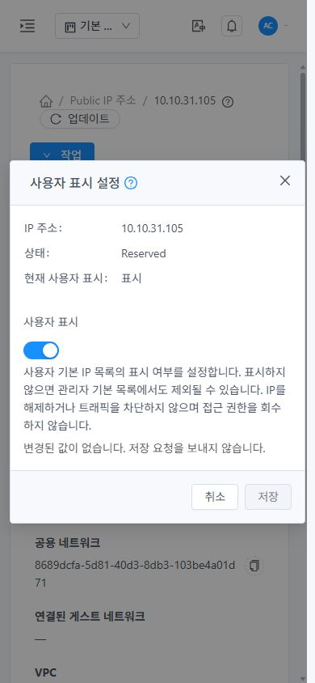
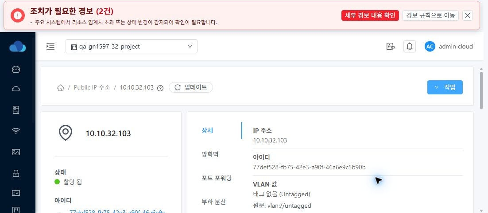

<!--
Licensed to the Apache Software Foundation (ASF) under one
or more contributor license agreements.  See the NOTICE file
distributed with this work for additional information
regarding copyright ownership.  The ASF licenses this file
to you under the Apache License, Version 2.0 (the
"License"); you may not use this file except in compliance
with the License.  You may obtain a copy of the License at

  http://www.apache.org/licenses/LICENSE-2.0

Unless required by applicable law or agreed to in writing,
software distributed under the License is distributed on an
"AS IS" BASIS, WITHOUT WARRANTIES OR CONDITIONS OF ANY
KIND, either express or implied.  See the License for the
specific language governing permissions and limitations
under the License.
-->

# Public IP #1687 구현·31/32 UI 검증 완료 보고

검증일: 2026-11-16 KST. Epic #1684의 PIP-03 / P2 #1687 완료 근거다. 배포한 UI 구현 커밋은 **40e05f046985f3017afd9a8f94cb761c92aef323**이다. PR #1691의 누적 구현에 포함하며 PR은 미병합으로 유지한다. 다음 구현 순서는 **P3 #1688 연결망 없는 목록 행의 빈 링크 제거**다.

## 결과와 설계

- Root Admin과 현재 API 인자 지원 여부를 함께 확인한다. 예약 고급 옵션의 사용자 표시 기본값은 true이며 선택한 true/false와 정확한 계정·도메인 또는 프로젝트 소유자를 전달한다.
- 비시스템 Reserved/Allocated IP의 작업 메뉴에 **사용자 표시 설정**을 추가했다. VM 편집처럼 세로 a-form, MoldDialog md(720px), 공통 footer·busy·포커스를 사용한다. IP/상태/현재 설정은 읽기 전용이며 표시 설정 하나만 편집한다. 값 미확정·미지원·Free/시스템/전환 상태는 쓰기 경로를 열지 않는다.
- update의 업무 인자는 정확히 `{id, fordisplay}`다. `ignoreproject`는 내부 요청 제어용으로 제거되며 실제 POST에 account/domainid/projectid/customid를 넣지 않는다. 무변경은 POST를 보내지 않는다.
- 접수 정보를 현재 인증·프로젝트·자원 범위에 보존한다. 같은 탭의 재진입/새로고침은 알려진 작업 ID만 다시 확인한다. jobstatus=1 이후에도 IP·표시 값·소유자·망/NAT/규칙 식별 정보를 재조회해 일치해야 성공으로 닫는다. 실패는 창·입력·오류를 유지한다. job0/시간 초과/접수 유실은 미확정으로 잠그고 자동 재전송하지 않는다.
- Root 기본 목록도 fordisplay=true가 기본이다. 숨긴 IP의 정확한 ID 조회가 정상 0건일 때만, Root 권한과 인자 지원을 확인해 fordisplay=false로 재조회한다. 조회 실패를 0건으로 오인하지 않고 User/DomainAdmin의 생략 응답을 관리자 호출로 복구하지 않는다.
- 요약과 상세에 표시/표시하지 않음/미제공/알 수 없음을 구분한다. 성공 알림은 재조회한 결과와 기본 목록에서 제외될 수 있다는 이유를 설명한다. 숨김을 IP 해제·트래픽 차단·접근 권한 회수로 설명하지 않는다.

구현: `ui/src/utils/publicIpDisplay.js`, `EditPublicIpDisplay.vue`, `ReservePublicIP.vue`, `AutogenView.vue`, `network.js`, Public IP 상세 값/InfoCard와 한국어·영어 메시지. Java/DB 스키마·서버 권한은 변경하지 않았다.

## 검증 결과

| 구분 | 31 GFS2 | 32 RBD | 근거 |
|---|---|---|---|
| Root 예약 true/false, 정확한 User 소유자 | PASS | PASS | 예약 폼·상세 스냅샷, ui-wire.json, ui-cases.json |
| Reserved 표시 true→false→true 및 무변경 | PASS | PASS | 실제 job1 + fresh read, 무변경 저장 비활성 |
| 프로젝트 Allocated 표시 true→false→true | PASS | PASS | 실제 job1 + fresh read, 프로젝트 문맥에서도 최소 POST |
| 숨김 IP의 Root 상세 재조회 | PASS | PASS | 기본 0건 후 false 조회 1건 |
| User/DomainAdmin 숨김/표시 화면 | 4개 PASS | 4개 PASS | 숨김은 상세 자원 없음, 표시 주소의 필드는 미제공·편집 메뉴 없음 |
| Free 쓰기 메뉴 없음·최종 Free 원복 | PASS | PASS | Final-Free-readonly-menu 및 Final-cleaned-Free |
| 편집 1280/768/390 × light/dark | 6개 PASS | 6개 PASS | responsive.json와 해당 스크린샷 |
| 예약 고급 옵션 390px × light/dark | 2개 PASS | 2개 PASS | reserve-responsive.json, 긴 소유자·고급 옵션·footer |

실제 update 작업은 **10개 모두 jobstatus=1과 최신 IP 재조회 일치**를 확인했다. 해당 POST는 각각 id/fordisplay만 포함했다. 전용 IP 두 개를 예약과 프로젝트 추가 할당에 재사용했으며 VM·망·VPC를 새로 만들거나 기존 서비스의 NAT/FW/PF/LB/VPN 패킷 시험을 반복하지 않았다.

31의 실제 예약 작업 `f3e7d24d-af82-42a6-81fd-54ebf7a0bc73`과 프로젝트 작업 `a0d29b08-9422-4a50-925f-6fea82818313`에는 job0 응답을 주입해 대기를 유지했다. 닫기/재진입과 프로젝트→기본 보기→원래 프로젝트 전환 후 같은 job을 조회해 실제 job1과 재조회로 완료했고 각 update POST는 1건이었다. 32에서는 자연 발생한 job0→job1도 확인했다.

### 오류·권한 경계의 검증 수준

- 브라우저 응답 주입: 31 HTTP403/error431, 32 가짜 jobstatus=2는 선택 false와 오류를 보존하고 명시 재시도를 허용했다. 해당 POST는 서버로 전달하지 않았다.
- 브라우저 응답 주입: 31 HTTP503/error530, 32 jobid 없는 접수는 미확정으로 남았다. 닫고 재진입·재조회해도 저장 잠금과 요청 1건을 유지했다. 실제 서버가 접수한 뒤 응답을 잃었다는 시험으로 표현하지 않는다.
- 미지원 인자/권한/값 미확정/시스템/Allocating/Releasing, storage 실패, 잘못된 작업 ID/대상, 60회 job0 시간 초과, 늦은 IP·프로젝트·역할·세션 응답과 새로고침 복원은 집중 단위 검증이다. 실환경에 없는 전환 상태를 실제 클러스터 PASS로 간주하지 않았다.
- 일반 User/DomainAdmin의 실제 updateIpAddress 메타데이터에는 id만 존재했다. 직접 fordisplay=false를 보내면 jobstatus=1을 반환해도 그 인자가 적용되지 않아 Root가 재조회한 값은 true로 유지됐다. 서버가 HTTP 거절을 반환했다고 보고하지 않는다. `role-api-policy.json`에 현행 정책을 보존했다.
- Root가 Free 주소에 동일 값 true를 직접 보내면 양쪽 현행 서버에서 jobid 없이 530/cserrorcode4250, account_id 범위 오류가 발생했다. 새 UI는 Free 편집을 제공하지 않으며 이 별도 백엔드 후속은 [#1693](https://github.com/ablecloud-team/ablestack-cloud/issues/1693)으로 등록했다. #1687의 완료 범위와 Epic의 기존 6개 하위 이슈 수는 유지한다.

### 표시 효과와 관련 소비자

실제 Reserved 주소의 fordisplay=false일 때 Root·소유 User·같은 도메인의 DomainAdmin 기본 조회는 모두 0건, true 복원 후 모두 1건이었다. User/DomainAdmin의 목록 응답은 표시 필드를 생략한다. Allocated 프로젝트의 소유자·공용/연결망·NAT·규칙·UUID는 표시 전환 전후 동일했다. `observations.json`과 `validation-summary.json`에 비교 근거가 있다.

코드상 `BaseListAccountResourcesCmd` 기본 display=true가 목록 필터로 전달된다. `NetworkServiceImpl.updateIP`는 전달된 표시 값만 저장하며 NAT·망 변경이나 기존 사용량 기록의 재집계를 호출하지 않는다. `IPAddressUsageParser`는 사용량 IP 행의 hidden 값을 별도 소비한다. 따라서 과거 사용량·청구의 소급 변경이나 보안 차단을 이 옵션의 효과로 보장하지 않는다. 이번 검증에서 과거 청구 재집계를 실행하거나 그 결과를 실환경 PASS로 주장하지 않았다.

### 도구와 증적 해석

32 최초 false 의도 자동화에서 collapse 애니메이션 중 포인터 입력이 스위치를 바꾸지 않아 실제로 true가 전송됐다. ui-wire의 `reserve false outcome`은 원래 관찰 라벨을 보존한 것이며 true 결과로 해석한다. 해제 후 키보드 Space와 aria-checked=false를 확인하고 다시 예약해 false를 검증했다. 31의 별도 true 예약은 실제 UI 완료 상세로 확인했으며 해당 요청은 로그인 전환 후 Network 기록 비활성 구간이라 wire에 없다. 명시 인자는 소스/집중 검사 및 32의 실제 true POST로 교차 확인한다.

브라우저 연결 만료·짧은 조작 제한 시간·완료 알림/사용자 hover 메뉴의 겹침은 상태를 새로 확인해 복구했다. 작업 메뉴를 키보드로 열고 Enter로 선택하는 경로도 확인했다. 이미 제출된 작업을 도구 오류 때문에 재제출하지 않았다. 반응형은 실제 innerWidth와 footer 경계를 기록했으며 임시 viewport·응답 주입·테마를 복원했다. 두 검증 탭은 종료했다. 앞선 연결 만료 탭 두 개는 Debugger unattached로 닫을 수 없었으며 테스트 요청/주입을 남기지 않았다.

## 로컬 검사와 배포

- **6 suites / 164 tests PASS**, 변경 파일 lint PASS. `tests.log`, `lint.log` 참조. 기존 NetworkIpVmLink/VM 표준·상세·예약 경계와 새 비동기 편집을 함께 검증했다. Jest는 기존 방식의 forceExit로 종료하며 전체 UI/Cloud 테스트 통과를 뜻하지 않는다.
- WSL rocky ext4 `/home/ablecloud/work/issue-1685-public-ip`에서 Node 20/Vue CLI production UI build PASS. webpack4 호환 옵션과 sourcemap 비활성 로컬 빌드 스크립트를 사용했다. `/mnt/c` 빌드나 전체 Cloud 빌드/Actions dispatch는 하지 않았다.
- 정적 UI만 활성 `/usr/share/cloudstack-management/webapp`에 허용 목록으로 배포했다. WEB-INF/META-INF·기존 설정·백엔드 JAR을 보존했고 서비스 재시작 없이 HTTP200·실제 UI 동작을 확인했다. `deploy-static.sh`, `deploy-both.sh`, build/deploy/runtime-final 로그 참조.

| 항목 | 값 |
|---|---|
| UI artifact SHA256 | `8959ecfea134450fd3e48cbda5382b099455f60817d36ba7acf02e7bfb338836` |
| 양쪽 활성 index SHA256 | `63dfb023d66d3ae9c85d9324e30153fdbee3d99699e5f6bd738f9a50002b5c6e` |
| 31 백업 | `/root/publicip1687-ui-20261115-225022` |
| 32 백업 | `/root/publicip1687-ui-20261115-225054` |
| 31/32 관리 PID | `2245419` / `2563495`, 배포 전후 동일 |

빌드·배포 후 최종 재검증에서도 정적 파일 전체와 서버 디렉터리·설정·백엔드 JAR 해시가 일치하고 사용자 표시/기존 예약·FTCTL 마커가 활성 번들에 있었다. UI 외 Cloud/qemu 빌드를 실행하거나 설치하지 않았다. PR 자동 CI는 이 집중 검사·실환경 결과와 별도로 기록한다.

## 정리와 보존

- 31 `10.10.31.105` / `956b6cb3-4bf8-41e4-b6df-12911f30e625`, 32 `10.10.32.103` / `77def528-fb75-42e3-a90f-46a6e9c5b90b`: 원래 표시 true로 복원하고 UI에서 Allocated 및 Reserved를 해제했다. 최종 UI/API는 Free, 소유자·프로젝트·연결망 없음이다.
- 시험 계정 4개·도메인 2개 정리 완료. 임시 망/VM 생성 없음. 기존 프로젝트 망에 추가한 전용 IP만 해제했다. fixtures.json의 cleaned와 API 전체 인벤토리로 확인했다.
- IP/네트워크/VPC/VM/계정/도메인/프로젝트/스토리지 풀 **8종 × 2클러스터 = 16개 인벤토리 전체 동일**이다. 31 IP 53(Free18/Allocated35), 32 IP102(Free84/Allocated18), Reserved는 모두 0이다.
- 원본 FTCTL 작업 트리 HEAD와 기존 추적 변경 3개 파일 SHA256이 시작/종료 시 동일하다. 해당 작업 트리에서 reset/checkout/수정을 하지 않았다.
- Root 기본 보기·한국어·라이트 테마로 복원하고 임시 viewport·Fetch 주입을 제거했다. 자격 증명·세션키를 증적에 저장하지 않았다.

증적의 생성 텍스트에는 라이선스 헤더를 추가했고 빌드 로그의 줄끝 공백만 정규화했다.

핵심 증적: [validation-summary.json](validation-summary.json), [ui-wire.json](ui-wire.json), [ui-cases.json](ui-cases.json), [observations.json](observations.json), [preservation-check.json](preservation-check.json), [ui-final.json](ui-final.json). 스크린샷과 DOM 텍스트는 같은 파일명의 jpg/txt 쌍이다.

