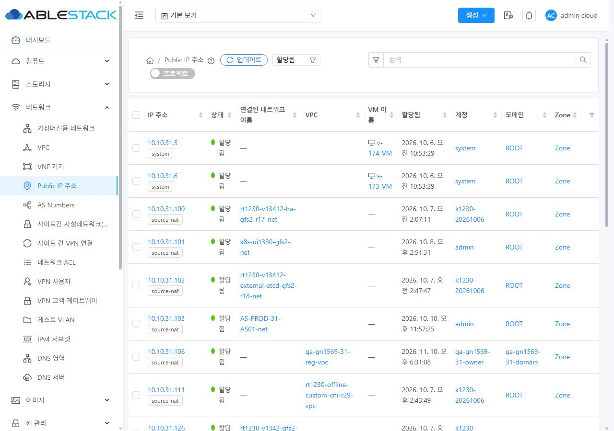
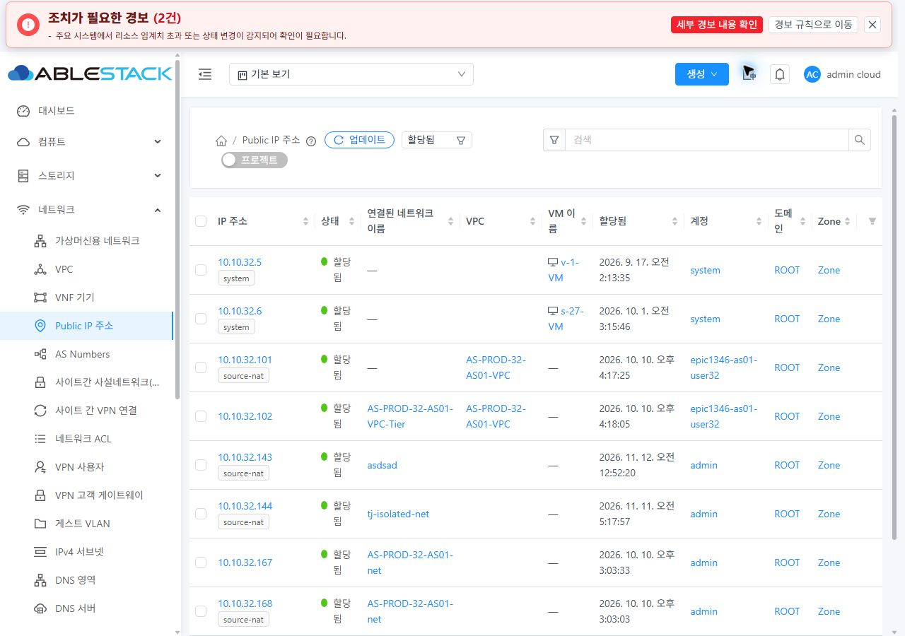

<!--
Licensed to the Apache Software Foundation (ASF) under one
or more contributor license agreements.  See the NOTICE file
distributed with this work for additional information
regarding copyright ownership.  The ASF licenses this file
to you under the Apache License, Version 2.0 (the
"License"); you may not use this file except in compliance
with the License.  You may obtain a copy of the License at

  http://www.apache.org/licenses/LICENSE-2.0

Unless required by applicable law or agreed to in writing,
software distributed under the License is distributed on an
"AS IS" BASIS, WITHOUT WARRANTIES OR CONDITIONS OF ANY
KIND, either express or implied.  See the License for the
specific language governing permissions and limitations
under the License.
-->

# Public IP #1688 구현·31/32 UI 검증 완료 보고

검증일: 2026-11-16 KST. Epic #1684의 PIP-04 / P3 #1688 완료 근거다. 최종 배포 구현은 **1d54fa48086720c1f89497b99e04a6dd3900c28a**, 연결망 셀의 선행 구현은 **5f278f07b62df12ffd7788a5f12fd3891a22460d**다. 누적 PR #1691에 반영하며 미병합 상태를 유지한다. 다음 구현은 **P3 #1689 VPC·NAT·전환 상태 검색과 URL 범위 계약 보강**이다.

## 구현 결과

`ListView.vue`의 Public IP 연결망 셀에 `PublicIpNetworkLink.vue`를 적용했다. PIP-02의 `publicIpField` 식별자·권한 규칙을 재사용하고 API 응답의 associatednetworkid/name만 소비한다.

| 응답 | 목록 표시 |
|---|---|
| 유효 ID + 이름 | 이름 링크 |
| 유효 ID만 있음 | ID 링크 |
| 이름만 있음 / 잘못된 ID + 이름 | 일반 텍스트 |
| 둘 다 없음 / 빈 값·null·undefined 식별자 | VM 표준 `—`, 링크·아이콘·포커스 대상 없음 |

공용 networkid·VPC·Source/Static NAT·시스템 여부로 연결망을 추론하지 않는다. listNetworks 권한이 없으면 기존 상세처럼 일반 텍스트로 표시하며 권한 복구 조회를 하지 않는다. 이름은 Vue 텍스트로 이스케이프한다. 새 UUID 정규식을 전역 적용하거나 실제 자원 UUID를 변경하지 않았다. AutoScale 전용 셀과 Public IP 외 기존 연결망 렌더러, VM/VPC 참조는 유지했다.

실환경 지연 응답 시험에서는 필터 변경 후 새 응답을 기다리는 동안 옛 행이 잠시 남는 문제도 확인했다. Public IP 목록을 기존 공통 범위 전환 처리에 포함해 **다른 범위에서는 행·선택·컨텍스트 메뉴를 즉시 제거**한다. 같은 범위의 갱신은 확인된 행을 유지한다. 기존 요청 세대 검증이 늦은 이전 응답을 적용하지 않는 것도 확인했다. 이 보강은 기존 목록의 전환 처리이며 #1689의 새 검색 필터·URL 정규화 구현을 완료했다는 의미는 아니다.

Java·DB 스키마·서버 API/권한 변경은 없다. 새 셀은 네트워크 조회를 발행하지 않는다.

## 최종 실환경 검증

| 항목 | 31 GFS2 | 32 RBD |
|---|---|---|
| Free / 전용 Reserved의 빈 셀 | PASS | PASS |
| 기존 시스템 / VPC-only / 정상 연결 IP | PASS | PASS |
| 목록 페이지·필터·프로젝트 전환 | PASS | PASS |
| 시스템·VPC-only·정상 망의 Tab 이동 | 3개 PASS | 3개 PASS |
| 실제 망·VPC·VM 상세 이동 | Enter 3개 + 망 마우스 1개 PASS | Enter 3개 + 망 마우스 1개 PASS |
| 우클릭 메뉴 및 브라우저 뒤로 가기 후 메뉴 폐기 | PASS | PASS |
| 1280/768/390px × 라이트/다크 | 6개 PASS | 6개 PASS |
| 읽기 합성 9개 조합 및 390px 긴 값 | PASS | PASS |
| 지연·응답 역전의 새 범위 행/링크 제거 | PASS | PASS |

최종 소스에서 **목록 관찰 20개**, 합성 셀을 제외한 **API 인벤토리↔DOM 연결망 비교 18개**를 기록했다. 연결 ID가 없는 셀의 anchor는 없으며 이름/ID가 있는 정상 링크는 정확한 associatednetworkid를 사용했다. 기존 프로젝트 망의 IP 목록도 양쪽 각 2행을 확인했다.

수정 전 표본 4개 화면에는 빈 `#/guestnetwork/undefined` anchor가 총 28회 나타났다. 31 시스템 IP에서 다음 Tab이 이름 없는 anchor로 이동하는 것도 재현했다. 최종본에서는 같은 동작이 실제 시스템 VM 링크로 이동하고, VPC-only는 VPC 링크로, 정상 연결 주소는 실제 게스트망 링크로 이어졌다.

### 대기·역전 응답과 발견한 추가 수정

초기 배포(5f278f07b62)에서 32의 필터 전환 대기 구간은 옛 행 9개·연결망 링크 6개가 남았다. 해당 발견은 delay.json의 before-scope-fix 기록과 initial-deployment 메타데이터로 보존했다.

보강 후 양쪽에서 실제 목록 요청을 브라우저에서 보류하고 필터를 변경했다. 새 범위 응답을 먼저 반환하고 이전 응답을 나중에 반환했다. 같은 범위 갱신 대기에서는 31의 20행·32의 9행이 유지됐지만, **범위가 바뀐 대기 구간은 양쪽 모두 행 0·연결망 링크 0**이었다. 늦은 응답의 고유 이름 `PIP1688-LATE-OLD-LINK-*`도 다시 나타나지 않았다. 서버 작업 지연을 인위적으로 만든 시험이 아닌 **읽기 응답 제어 시험**이다.

행 선택 후 페이지/필터/프로젝트 변경 시 선택이 초기화됐다. 실제 우클릭 메뉴는 유지됐고, 포인터 클릭 없이 브라우저 뒤로 가기로 예약 범위에 돌아왔을 때 이전 컨텍스트 메뉴가 남지 않았다.

### 합성·단위 검증의 구분

각 클러스터에 읽기 응답만 주입해 ID+이름, ID만, 이름만, 없음, 문자열 undefined/null, VPC-only, HTML 형태 이름, 긴 이름을 확인했다. 비UUID 사용자 지정 식별자는 렌더링 호환성 시험이며 실제 서버 customid 지원이나 개체 생성을 검증했다고 주장하지 않는다. API로 UUID를 변경하지 않았으며 합성 목적지로 서비스를 생성하지 않았다.

일반 사용자/도메인 관리자 권한 행렬과 기존 NAT/FW/PF/LB/VPN·망/VM 생성은 재검증하지 않았다. API 미지원, 악성/불완전 식별자, 동적 행 재사용, 다른 ListView 소비자와 AutoScale 경계는 집중 단위 검증이다. 새 API 명령이나 인자는 추가하지 않았다.

수동 갱신·기존 자동 갱신·전역 VM 조회가 같은 추적 구간에 포함될 수 있다. 이를 새 셀의 행별 조회로 세지 않았으며 최종 갱신 추적에는 **listNetworks/listVPCs 복구 조회 0건**이었다. 셀 자체의 getAPI 호출 0건도 집중 검사로 확인했다.

### UI 기준과 도구 관찰

VM의 공통 ListView·빈 값·타이포·테마·선택·참조 탐색을 사용한다. 반응형 12개 조합은 최종 배포본에서 실제 viewport와 셀/표 경계를 측정했다. 기존 공통 표의 줄바꿈·스크롤을 유지했고 새 셀의 가로 넘침은 없었다. 전체 메뉴 표현의 최종 결합 회귀는 #1690 범위다.

최초 합성 관찰은 자동 갱신으로 실제 데이터가 복원돼 합성 PASS로 채택하지 않고, 합성 9행을 확인한 동일 호출 안에서 다시 캡처했다. 초기 viewport 변경 직후의 포인터 조작은 비실재 합성 목적지 읽기 431로 이어져 새로고침으로 복구했다. 최종 검증은 키보드 및 실제 보이는 텍스트 조각 좌표로 탐색을 확인했고 합성 후 새로고침으로 실제 데이터를 복원했다. 실제 자원 변경은 없었다. 테마/화면 전환 중의 일시 측정과 안정된 최종 측정은 source/phase로 구분한다.

## 로컬 검사와 배포

- 최종 **6 suites / 108 tests PASS**, 변경 lint PASS. public IP 셀·상세 값·VM 참조·다른 목록 참조와 Public IP 목록/상세의 범위 경계를 검사했다. 전역 coverage 수집은 끄고 변경 범위만 실행했으며 기존 Jest forceExit 방식이다. 전체 UI/Cloud 검사 통과를 의미하지 않는다.
- WSL rocky ext4 `/home/ablecloud/work/issue-1688-public-ip`의 분리 작업 트리에서 production UI build PASS. Node 20/webpack4 호환 옵션과 sourcemap 비활성 로컬 스크립트를 사용했다. 전체 Cloud 빌드·Actions dispatch·Java/qemu 빌드는 하지 않았다.
- 활성 `/usr/share/cloudstack-management/webapp`의 정적 파일만 허용 목록으로 갱신했다. WEB-INF/META-INF·설정·백엔드 JAR·관리 PID를 보존했고 서비스 재시작 없이 HTTP200과 활성 번들을 확인했다. 최종 재검증에서도 정적 파일 전체와 서버/설정/백엔드 해시가 일치했다.

| 배포 항목 | 최종 값 |
|---|---|
| 구현 소스 | `1d54fa48086720c1f89497b99e04a6dd3900c28a` |
| UI artifact SHA256 | `c3cf6923d6afa792ecb052e558a3cd7b55f51008c794a8c3cfbaa2ac5d7132cf` |
| 양쪽 활성 index SHA256 | `1017375d1249888c7f541ad70a2866e93da574eacd9e46350358df506229ea85` |
| 31 최종 백업 | `/root/publicip1688-ui-20261116-001609` |
| 32 최종 백업 | `/root/publicip1688-ui-20261116-001644` |
| 31/32 관리 PID | `2245419` / `2563495`, 배포 전후 동일 |

초기 배포 메타데이터는 initial-deployment/에 있으며 최종 결과와 혼합하지 않는다. 로그의 줄끝 공백만 정규화하고 생성 텍스트에 라이선스 헤더를 추가했다. 큰 JSON은 값을 바꾸지 않고 자원/행별 한 줄로 정리했다. 자격 증명·세션키는 증적에 저장하지 않았다.

## 시험 자원 정리와 기존 작업 보존

현재 인벤토리에서 확인한 Free IP를 각각 admin 소유로 예약해 Reserved 목록만 시험했다. 31 `10.10.31.105` / `956b6cb3-4bf8-41e4-b6df-12911f30e625`, 32 `10.10.32.103` / `77def528-fb75-42e3-a90f-46a6e9c5b90b`다. 예약 세대·할당 시각·소유자·연결 없음 조건을 확인하고 해당 두 주소만 API로 해제했다. 최종 UI는 예약 0건과 두 주소의 Free 복원을 확인했다.

새 네트워크·VM·계정·도메인은 생성하지 않았다. IP/네트워크/VPC/VM/계정/도메인/프로젝트/스토리지 풀 **8종 × 2클러스터 = 16개 인벤토리가 모두 시작과 동일**하다. 31 IP53(Free18/Allocated35), 32 IP102(Free84/Allocated18), Reserved는 모두 0이다.

원본 FTCTL 작업 트리 HEAD와 추적 변경 3개 파일 SHA256, 비추적 파일 **14,538개**의 전체 지문이 시작/종료 시 동일했다. 관련 없는 원본 작업 트리의 reset/checkout/수정을 하지 않았다. 비추적 파일별 원본 목록은 작업 추적 폴더에 두고 공개 증적에는 개수와 집계 지문만 기록했다.

Root 기본 보기·기본 할당 목록·한국어·라이트 테마·선택 없음으로 복원했고 임시 viewport·Fetch 주입을 제거했다. 검증 탭 두 개를 종료했다. Epic은 기존 6개 중 **4/6 완료·OPEN**, 다음은 **P3 #1689**다. 별도 백엔드 후속 #1693은 유지한다. PR #1691의 기존 base 충돌·미병합 상태와 자동 CI는 구현·실환경 검증 결과와 별도로 보고한다.

핵심 증적: [validation-summary.json](validation-summary.json), [ui-after.json](ui-after.json), [ui-wire.json](ui-wire.json), [delay.json](delay.json), [synthetic.json](synthetic.json), [responsive.json](responsive.json), [preservation-check.json](preservation-check.json), [ui-final.json](ui-final.json).

