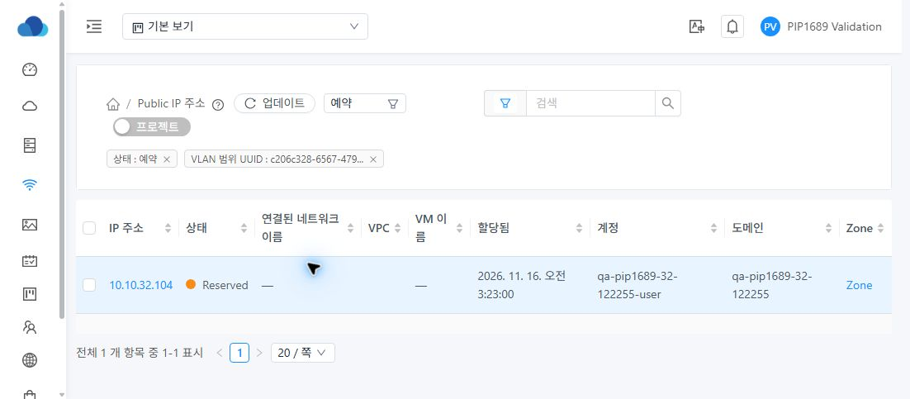

<!--
Licensed to the Apache Software Foundation (ASF) under one
or more contributor license agreements. See the NOTICE file
distributed with this work for additional information
regarding copyright ownership. The ASF licenses this file
to you under the Apache License, Version 2.0 (the
"License"); you may not use this file except in compliance
with the License. You may obtain a copy of the License at

  http://www.apache.org/licenses/LICENSE-2.0

Unless required by applicable law or agreed to in writing,
software distributed under the License is distributed on an
"AS IS" BASIS, WITHOUT WARRANTIES OR CONDITIONS OF ANY
KIND, either express or implied. See the License for the
specific language governing permissions and limitations
under the License.
-->

# Public IP #1689 구현·배포 및 UI 검증 진행 보고

검증일: 2026-11-16 KST. **구현과 31 GFS2·32 RBD 배포는 완료했지만, 남은 UI 검증 때문에 #1689는 OPEN으로 유지한다.** 최종 구현·배포 소스는 `f8c8c7d3e8cf3bffca70d971242f5d1c18c29206`이다. 누적 PR #1691은 미병합·기존 base 충돌 상태다. Epic #1684는 4/6 완료이며 다음 순서는 #1689 잔여 검증 → P3 #1690 표현 통합·변경 범위 회귀다.

## 구현 결과와 VM UI 기준

VM 메뉴가 사용하는 공통 SearchView·SearchFilter chip·AutogenView·ListView·breadcrumb·검색/업데이트 툴바를 재사용한다. Public IP 전용 정규화와 후보 선택만 별도 도우미·폼으로 제한했다. 페이지는 서버 조회이며 첫 500행을 브라우저 전체 검색으로 취급하지 않는다.

- VPC·연결 네트워크·Source NAT·Static NAT, 5개 상태를 추가했다. Root 확장으로 공용 네트워크·물리망·사용자 표시 여부를 제공한다. NAT false를 보존하며 Source NAT가 아니오라는 이유로 Static NAT를 추론하지 않는다.
- 전체는 state 생략과 `allocatedonly=false`를 함께 보낸다. Free/Reserved/Allocating/Releasing도 상태에 맞는 정식 인자를 사용한다. 기존 예약·해제·NAT·표시 설정 액션의 권한/상태 가드를 확대하지 않는다.
- 서버의 `fordisplay` 생략은 true 기본값이므로, 양쪽 표시 값을 검색하기 위한 **Root 전용 Boolean `displayall`**을 api 모듈에 추가했다. `fordisplay`와 동시 지정은 거부한다. UI의 모두는 `displayall=true`로 변환하며 Boolean API에 문자열 all을 전송하지 않는다. 기본 조회 의미와 비관리자 역할은 유지한다.
- Root의 비할당 조회가 서버 ACL 생성 경로를 건너뛰는 점을 확인해 현재 로그인 도메인·recursive 인자를 명시한다. 기본/명명 프로젝트/모든 프로젝트의 기존 허용 범위를 유지한다. Free는 해당 조건의 **미소유 가용 풀**이며 특정 VPC·망에 이미 연결된 주소로 표현하지 않는다.
- URL의 enum/Boolean/UUID/중복 값/미지원 인자를 검증한다. 잘못된 URL은 오류·기본 필터 복귀를 표시하고 조회 범위를 조용히 확장하지 않는다. 명명 프로젝트 URL은 현재 호출자의 listProjects 정확한 ID 조회로 접근을 확인한 뒤 복원한다.
- 조건 변경은 page=1, 페이지 크기는 유지한다. 상세 복귀·뒤로/앞으로·reload는 query를 보존한다. 외부 프로젝트/계정/권한 전환은 이전 종속 UUID·행·선택·메뉴를 제거하며 늦은 응답은 세대가 같은 경우에만 반영한다. 같은 조회의 실패는 기존 행과 재시도를 유지한다.
- 후보는 현재 API 지원/권한과 Zone·소유/프로젝트 범위를 사용한다. 부모 변경 시 종속 선택을 무효화한다. 공용망 후보는 Zone 선택이 선행한다. VLAN은 숫자 태그 대신 범위 UUID를 보낸다. User/DomainAdmin의 listVlanIpRanges 권한이 없으면 기존 UUID 입력을 유지하고 권한 없는 후보 조회를 하지 않는다.

## 실제 검증과 발견한 수정

두 클러스터의 실제 API·UI 행 ID/전체 건수·요청 인자를 대조했다. 기본/단독/복합 16개씩의 결과는 ui-search-results.json·ui-wire.json과 원본 DOM에 있다. 아래 건수는 전용 Root 예약을 숨김으로 설정한 검증 시점이며 최종 정리 후 수치와 혼합하지 않는다.

| 조회 | 31 | 32 |
|---|---:|---:|
| 기본 Allocated | 24 | 10 |
| 전체 / 표시 값 모두 포함 | 41 / 42 | 92 / 93 |
| 숨김 Reserved | 1 | 1 |
| VPC / 연결망 | 1 / 1 | 2 / 1 |
| Source NAT 예 / 아니오 | 15 / 9 | 6 / 4 |
| Static NAT 예 / 아니오 | 0 / 24 | 0 / 10 |
| Source 아니오 + Static 아니오 | 9 | 4 |
| Allocating / Releasing 실제 조회 | 0 / 0 | 0 / 0 |
| 모든 프로젝트·양쪽 표시 값 | 53 | 102 |
| 명명 프로젝트 전체, 가용 풀 포함 | 17 | 82 |

공용망·물리망·VLAN UUID 검색도 API와 일치했다. 명명 프로젝트 Source NAT=false·Static NAT=true 복합 URL은 양쪽 1행, reload 후 동일했다. 현재 사용자에게 없는 프로젝트 UUID는 목록 요청을 보내지 않고 행을 비운 뒤 범위 오류를 표시했다.

실제 User는 본인 Reserved 1행, DomainAdmin은 도메인 Reserved 2행이었다. Root 전용 필드와 User 전체/DomainAdmin Free URL은 차단됐다. 서버가 비관리자의 Root 전용 인자를 무시하는 동작을 HTTP403으로 잘못 기록하지 않았다. UI는 해당 인자를 노출·전송하지 않는다.

검증 중 기존 switchProject가 Public IP URL의 projectid를 지워 복원과 반복되던 문제, 입력/검색어의 오래된 정확 주소 조건 충돌, Escape 미처리, 생략 필드 처리 문제를 수정했다. **최종 소스에서 User VLAN 검색은 양쪽 본인 1행·금지된 후보 조회 0·Escape 닫기 정상**이다. 비관리자 응답에 없는 vlanid를 Root 수준으로 강제 검증하던 처리를 제거했으며, 응답에 값이 있는데 다르면 계속 거부한다. 폼과 부모 URL의 정규화 경로도 통일했다.

최종 소스 Root 31 기본·전체·표시·VPC·망·VLAN·NAT 일부를 다시 대조하던 중 Windows 데스크톱 접근이 끊겼다. 이전 배포본의 전체 검색 행렬과 최종 소스에서 다시 확인한 항목을 모두 최종본 전수 재검증으로 합산하지 않는다.

### URL·응답 순서·실패 경계

32의 93건에서 50개 페이지 크기·2쪽 43행·조건 변경 시 페이지 초기화와 선택 제거, 양쪽 상세 복귀·history·reload를 확인했다. query와 실제 선택/표시가 일치했다. 이전 구현에서 발견한 프로젝트 복원 반복은 전용 분기로 제거했다.

양쪽 브라우저의 읽기 응답을 제어해 같은 범위 503은 기존 행+재시도, 새 범위 503은 이전 행 0+오류, 정상 0건은 별도 표시를 확인했다. 이전 A 응답을 실제로 보류한 뒤 현재 B를 먼저 반환하고 A를 늦게 반환해 이전 행·선택·후보가 다시 나타나지 않는 것을 확인했다. 후보 0건·503·재시도·Zone 변경도 구분했다.

Allocating/Releasing은 현재 실서버 0건이다. 실제 주소의 **읽기 응답만 해당 상태로 합성**해 각각 예약·해제·NAT·표시 설정 액션이 열리지 않는 것을 확인했다. 실제 할당/해제 작업을 만들거나 전환 작업 성공을 검증했다고 주장하지 않는다. 기존 네트워크/VPC/VNF의 서비스 CRUD 체인은 반복하지 않았다.

PIP-02 VLAN/공용·연결망 상세 의미, PIP-04 빈 연결망 링크와 Reserved의 작업 가드는 기존 실제 주소로 결합 확인했다. 숨김 주소의 상세 조회/목록 복귀도 확인했다. PIP-03 표시 변경 후 현재 필터 제외 안내의 최종 실제 UI 결합 검증은 아래 잔여 항목이다.

## 남은 UI 검증과 중단 근거

브라우저 도구가 `GetCursorPos failed: access denied (0x80070005)`로 데스크톱 접근을 거부했다. 기존 탭 복구와 상태 조회도 같은 오류였고 사용자에게 Windows 잠금 해제/접근 복구를 요청했다. 다른 자동화 도구로 우회하지 않았다.

- [ ] 양쪽 최종 소스 Root 검색의 남은 항목 및 고급 검색 실제 입력 재확인.
- [ ] 1280/768/390px × light/dark × 2클러스터에서 목록·검색 popup의 label/줄바꿈/스크롤/footer/키보드 확인. 이전 #1688의 반응형 통과를 이번 새 폼의 통과로 대체하지 않는다.
- [ ] 전용 예약 주소로 표시 변경의 비동기 최종 결과와 현재 검색에서 제외 안내를 실제 UI로 결합 확인.
- [ ] 최종 UI 기본 필터·기본 보기·light·선택 없음·viewport/캐시 override 해제와 검증 탭 종료.
- [ ] 위 항목 완료 뒤 #1689 종료 및 Epic 5/6 진행률 반영.

## 로컬 빌드와 현재 배포

WSL rocky ext4 `/home/ablecloud/work/issue-1689-public-ip`에서 실행했다. **UI 집중 8 suites / 147 tests, 변경 lint, production UI build PASS**, 변경 Maven 모듈 `api`의 `ListPublicIpDisplaySearchTest` **5 tests / package PASS**다. 전체 Cloud 빌드·Actions dispatch·qemu 빌드는 하지 않았다. 기존 webpack4/Node20 호환 옵션과 sourcemap 비활성 로컬 스크립트를 사용했다. 기존 Jest forceExit와 Browserslist 경고는 전체 CI 통과를 뜻하지 않는다.

| 항목 | 현재 값 |
|---|---|
| 구현 소스 | `f8c8c7d3e8cf3bffca70d971242f5d1c18c29206` |
| UI artifact SHA256 | `3284ed3825f031a6d32f7e74e4bd13939a4e3edb9e83753623c1e5fccc55f4d4` |
| 양쪽 index SHA256 | `5b1f30172bf32b5805e335a10b71864f3678b5ffe94bd53d5ceb92bfb2d678af` |
| API class SHA256 | `7d8d1cf034c34c6aa480fdfcec65a5da05a24976a44c584d3236fe9edcfa4f6c` |
| 최종 UI 백업 31 / 32 | `/root/publicip1689-ui-20261116-044814` / `/root/publicip1689-ui-20261116-044858` |
| API 백업 31 / 32 | `/root/publicip1689-api-20261116-031911` / `/root/publicip1689-api-20261116-032025` |
| 관리 PID 31 / 32 | `2375963` / `2698517`, 최종 static 배포 전후 유지 |

활성 webapp의 허용된 정적 파일만 갱신했다. WEB-INF/META-INF·설정과 이전 JAR 내용을 보존했다. API 배포는 fat JAR의 대상 class 1개만 교체하고 나머지 205,028 entries가 같음을 검증한 뒤 관리 서비스를 재시작했다. 이후 최종 정적 배포에는 재시작하지 않았다. 최종 runtime 재확인에서도 정적 전체·서버 디렉터리·설정·API JAR 해시가 백업 기준과 일치했고 양쪽 HTTP200·서비스 active였다.

## 시험 자원 정리·보존

브라우저 접근 중단 후 API로 전용 Root 예약 2개의 표시 값을 원래 true로 복원하고 비동기 job 성공과 실제 값을 확인했다. 이는 **정리 API 검증이며 실제 UI 변경 성공으로 세지 않는다**. 예약 세대·소유자·연결 없음 조건을 확인한 뒤 총 6개 Reserved 주소를 원래 Free로 복원했다. 임시 User/DomainAdmin 계정 4개·도메인 2개를 삭제했다.

| 최종 인벤토리 | 31 | 32 |
|---|---:|---:|
| Public IP / Free / Reserved / Allocated | 53 / 18 / 0 / 35 | 102 / 83 / 0 / 19 |
| 네트워크 / VPC / VM | 44 / 5 / 149 | 29 / 4 / 73 |
| 계정 / 도메인 / 프로젝트 / 풀 | 26 / 7 / 7 / 1 | 22 / 5 / 5 / 1 |

IP/네트워크/VPC/VM/계정/도메인/프로젝트/풀 **8종 × 2 = 16개 주요 필드 인벤토리가 시작과 동일**하다. 새 망/VM/VPC/스토리지/규칙을 만들지 않았다. 예약 세대/이벤트 이력의 동일성까지 주장하는 비교는 아니다. 이전 감사 뒤 외부에서 바뀐 자원이 있으므로 이번 시작 인벤토리를 기준으로 비교했다.

기존 dirty FTCTL 작업 트리 HEAD·추적 변경3개와 비추적14,538개를 포함한 파일14,541개의 해시가 이번 전후 동일하다. 전체 목록은 Git 밖에 두고 공개 증적에는 집계만 기록했다. 원본 worktree와 upstream 저장소는 수정하지 않았다.

핵심 증적: [검증 상태](validation-summary.json), [검색 비교](ui-search-results.json), [요청/응답](ui-wire.json), [실패·역전 제어](ui-faults.json), [history](ui-history.json), [프로젝트](ui-projects.json), [자원 보존](preservation-check.json), [최종 런타임31](runtime-final-31.log), [최종 런타임32](runtime-final-32.log).

