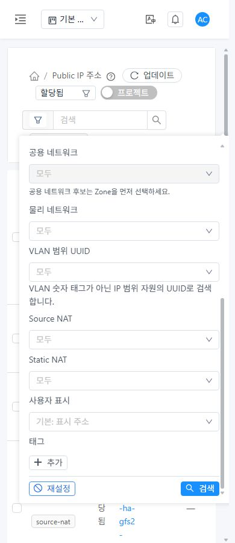
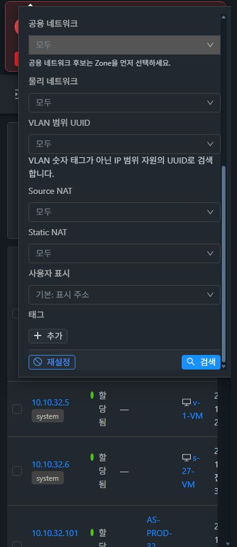
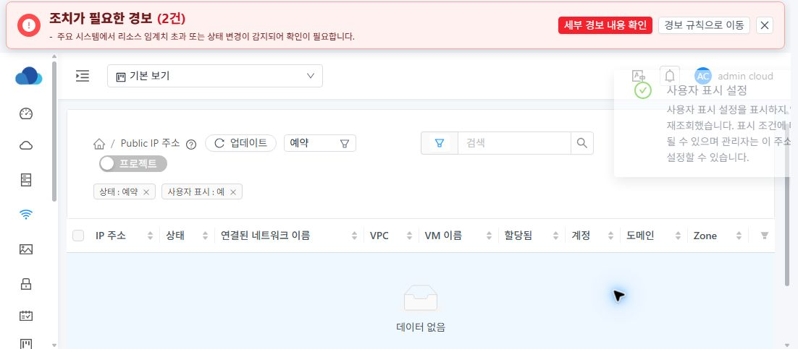

<!--
Licensed to the Apache Software Foundation (ASF) under one
or more contributor license agreements. See the NOTICE file
distributed with this work for additional information
regarding copyright ownership. The ASF licenses this file
to you under the Apache License, Version 2.0 (the
"License"); you may not use this file except in compliance
with the License. You may obtain a copy of the License at

  http://www.apache.org/licenses/LICENSE-2.0

Unless required by applicable law or agreed to in writing,
software distributed under the License is distributed on an
"AS IS" BASIS, WITHOUT WARRANTIES OR CONDITIONS OF ANY
KIND, either express or implied. See the License for the
specific language governing permissions and limitations
under the License.
-->

# Public IP #1689 구현·31/32 최종 UI 검증 완료

검증일: 2026-11-16 KST. Epic #1684의 P3/PIP-05 완료 근거다. 최종 배포 구현은 **0f6d1497c2b0f58e6320d157829188cb00612152**다. 중단 시점 f8c8c7d3e8c의 잔여 관리자 검색·반응형·표시 변경 결합 UI를 모두 완료했다. #1689 종료 기준을 충족했으며 Epic은 5/6 완료, 다음은 **P3 #1690 한국어 표현 통합·변경 범위 회귀**다. 누적 PR #1691은 미병합·기존 base 충돌 상태다.

## 구현과 API 계약

VM 메뉴의 공통 SearchView·SearchFilter chip·AutogenView·ListView·breadcrumb·툴바를 재사용한다. Public IP의 query 정규화와 후보 선택만 전용 도우미·폼으로 제한했다. 서버 페이지를 사용하며 첫 500행을 받은 뒤 전체 검색했다고 표시하지 않는다.

- VPC·연결 네트워크·Source NAT·Static NAT·5개 상태와 Root의 공용망·물리망·표시 여부 검색을 제공한다. false를 보존하고 Source NAT가 아니오인 주소를 Static NAT로 추론하지 않는다.
- 전체는 state 생략 + allocatedonly=false다. 예약/가용/전환 상태도 해당 서버 계약으로 보낸다. 기존 예약·해제·NAT·표시 액션의 상태/권한 가드는 확대하지 않는다.
- 기존 API는 fordisplay 생략을 true로 해석한다. 이를 유지하면서 양쪽 값을 검색하기 위해 **Root 전용 Boolean displayall**을 api 모듈에 추가했다. UI의 모두는 displayall=true로 변환하며 Boolean API에 문자열 all을 보내지 않는다. fordisplay와 동시 지정은 거부한다. DB 스키마·기존 역할·기본 조회 의미는 유지한다.
- Root 비할당 검색의 서버 ACL 경로에 현재 도메인/recursive를 명시해 기본·명명 프로젝트·모든 프로젝트 범위를 보존한다. Free는 조건에 맞는 **미소유 가용 풀**이며 VPC·망에 연결된 주소로 표현하지 않는다.
- 지원 API metadata, enum/Boolean/UUID/중복 URL 값과 현재 권한을 검증한다. 잘못된 URL은 원인·재설정을 표시하고 범위를 조용히 확장하지 않는다. 직접 명명 프로젝트 URL은 현재 호출자의 정확한 listProjects ID 조회로 접근을 확인한 뒤 복원한다.
- 조건 변경은 page=1, 페이지 크기는 유지한다. 상세 복귀/history/reload는 같은 범위 query를 보존한다. 외부 프로젝트·계정·권한 변경은 이전 종속 UUID·행·선택·메뉴를 제거한다. 같은 조회 실패는 기존 행과 재시도를 유지하며 늦은 응답은 세대가 같을 때만 반영한다.
- 후보의 Zone·소유/프로젝트 조건과 권한을 유지하고 부모 변경 시 종속 선택을 무효화한다. 공용망은 Zone 선택이 선행한다. VLAN은 숫자 태그가 아닌 범위 UUID를 보낸다. 비관리자의 후보 API가 없으면 지원되는 UUID 입력을 유지하고 추가 권한 조회를 하지 않는다. 비관리자 DTO에서 권한상 생략된 vlanid를 강제로 복구하지 않으며 반환된 값이 다르면 계속 거부한다.

## 최종 관리자 검색·권한·URL

**최종 배포본에서 18개 조건 × 2클러스터 = 36개 API↔UI 행 ID/전체 건수/요청 인자 비교를 완료했다.** 표는 이번 재개의 전용 Root Reserved가 표시=true인 검증 시점이다. 이전 중단 전 숨김/역할 예약 시점의 건수와 혼합하지 않는다.

| 검색 | 31 GFS2 | 32 RBD |
|---|---:|---:|
| 기본 Allocated | 24 | 10 |
| 전체 / 표시 값 모두 포함 | 42 / 42 | 93 / 93 |
| 표시=true Reserved | 1 | 1 |
| VPC / 연결망 | 1 / 1 | 2 / 1 |
| 공용망 / 물리망 / VLAN 범위 | 42 / 42 / 40 | 93 / 93 / 91 |
| Source NAT 예 / 아니오 | 15 / 9 | 6 / 4 |
| Static NAT 예 / 아니오 | 0 / 24 | 0 / 10 |
| Source 아니오 + Static 아니오 | 9 | 4 |
| Allocating / Releasing 실제 조회 | 0 / 0 | 0 / 0 |
| 명명 프로젝트 전체, 가용 풀 포함 | 19 | 84 |
| 모든 프로젝트·양쪽 표시 값 | 53 | 102 |

390px 실제 폼에서도 Source/Static NAT의 아니오를 선택하고 검색해 9/4행과 두 false 인자를 확인했다. 하단 재설정 버튼은 기본 Allocated·projectid=0·page1·pagesize20으로 복귀했다.

권한/URL 경계는 선행 검증을 유지하고 최종 Root 프로젝트 범위를 다시 대조했다. User 본인 Reserved 1행, DomainAdmin 도메인 Reserved 2행, Root 전용 필드 비노출 및 비관리자 전체/Free URL 차단을 확인했다. 최종 검색 로직의 User VLAN도 양쪽 본인 1행·금지된 후보 목록 호출0·Escape 정상이다. 서버가 비관리자 Root 전용 인자를 무시하는 결과를 HTTP403으로 기록하지 않았다.

명명 프로젝트의 Source=false·Static=true 직접 URL은 양쪽 1행이고 reload 후 유지됐다. 없는 프로젝트 UUID는 목록 요청 없이 범위 오류를 표시했다. 32의 93건/50개 페이지2 43행, 양쪽 page/pagesize·상세 복귀·뒤로/앞으로·reload와 선택 초기화를 확인했다. 기존 switchProject가 projectid를 지워 복원과 반복되던 문제도 전용 분기로 수정했다.

같은 범위 503의 기존 행 보존·재시도, 새 범위 503의 이전 행0·오류, 정상0건 구분, 보류한 이전 응답을 현재 응답 뒤 실제로 반환하는 순서 역전과 후보의 Zone 변경/0건/오류/재시도를 확인했다. 이는 **브라우저 읽기 응답 제어**다. Allocating/Releasing 실서버 조회는 0건이며 해당 상태의 액션 가드는 실제 주소의 읽기 응답만 합성해 검사했다. 실제 전환 작업 성공으로 확대하지 않는다. 기존 네트워크/VPC/VNF의 NAT/FW/PF/LB/VPN 전체 체인은 반복하지 않았다.

## 표시 변경 후 검색 제외 결합 UI

전용 Reserved에서 실제 우클릭 메뉴 → 사용자 표시 설정 → 스위치 → 저장 경로를 사용했다. 양쪽 표시=true 조건에서 끄면 1→0행, 숨김 조건에서는 동일 UUID 1행, 다시 켜면 숨김 목록에서 1→0행이었다. 성공 안내는 저장 후 재조회 및 현재 표시 조건에서 제외될 수 있다는 내용을 표시했다.

이번 재개에서 총 **8회 UI 저장/8개 서로 다른 비동기 job**을 기록했다. 각 저장은 정확한 주소·Boolean의 POST 1회, 해당 jobstatus=1, 동일 주소/설정의 실제 재조회와 필터 결과로 연결됐다. 처음 끄기2회는 f8c8c7d3e8c, 이후 복원·최종 끄기/켜기6회는 0f6d1497c2b다. 최종 빌드에서도 양쪽 전체 끄기→숨김 검색→켜기 체인을 완료했다. 정리 직전 원래 fordisplay=true를 UI로 복원했다.

PIP-02 VLAN/공용·연결망 의미와 PIP-04 빈 연결망 링크·Reserved 작업 가드도 변경 경계에서 결합 확인했다. 기존 API Free 표시 변경 오류 #1693은 별도 미구현 후속으로 유지한다.

## 반응형·테마·키보드와 추가 수정

초기 재개 검증은 경계 측정이 통과했지만 원본 화면에서 다크 VLAN 도움말 대비 부족과 긴 검색 폼의 하단 버튼 배치 차이를 발견했다. 이를 반응형 완료로 채택하지 않고 initial 증적으로 분리했다.

PublicIpSearch에 VM 폼과 같은 **공통 secondary 테마 토큰**, 긴 도움말 줄바꿈, **검색·재설정의 좌우 배치와 sticky 하단**, 포커스 스크롤 여유를 적용했다. 다른 검색/VM 폼의 전역 스타일은 변경하지 않았다.

최종 0f6d1497c2b를 재배포한 뒤 **1280/768/390px × light/dark × 2클러스터 = 12개 조합**을 모두 다시 검사했다. 목록/표 내부·검색 popup의 가로 넘침, 연결망 셀, label/세로 스크롤, 두 하단 버튼의 열기 직후와 키보드 이동 후 실제 hit-test, Shift+Tab 재설정 포커스, Escape 닫기를 확인했다. 도움말 색은 light rgb(75,85,99), dark rgb(197,204,212)로 현재 테마 토큰과 일치한다. 원본 캡처에서도 글자와 두 버튼이 보인다. 390px 실제 입력/검색/재설정까지 양쪽 수행했다.

32의 기존 조치 필요 경보2건은 시험으로 생성한 경보가 아니며 backend 확인/보관/삭제를 하지 않았다. 전환/원격 제어 도구의 일시 dispatch 지연은 새 DOM으로 실제 적용 여부를 확인한 뒤 진행했다. 동일 이름 증적 집계에 이전 저장이 포함된 경우 job ID별로 분리했고 이를 제품 중복 POST로 세지 않았다.

## 빌드·배포·현재 런타임

- WSL rocky ext4 `/home/ablecloud/work/issue-1689-public-ip` 로컬 production UI build·변경 lint·집중 **8 suites / 147 tests PASS**. Node20/webpack4 호환 옵션과 sourcemap 비활성 스크립트를 사용했다. 최종 집중 검사에서 누락된 경로를 바로잡아 8개 suite 전체 로그를 다시 수집했다.
- Java는 변경 Maven 모듈 **api**만 WSL ext4에서 빌드했고 API 계약 **5 tests/package PASS**다. 마지막 변경은 UI CSS뿐이므로 동일 API class를 유지한다. 전체 Cloud 빌드·Actions dispatch·qemu 빌드는 하지 않았다. 기존 Jest 종료 방식/Browserslist 경고와 등록된 triage를 전체 CI 통과로 표현하지 않는다.
- 활성 webapp의 정적 허용 목록만 갱신했다. WEB-INF/META-INF·설정·API JAR·관리 PID를 보존했다. 앞선 API 배포는 class1개만 교체하고 나머지205,028 entries 동일성을 검증한 뒤 관리 서비스를 재시작했다. 이번 정적 재배포는 재시작하지 않았다. 최종 정적 전체/서버/설정/JAR 해시·검색 CSS marker·HTTP200·서비스 active를 다시 확인했다.

| 항목 | 최종 값 |
|---|---|
| 구현 소스 | `0f6d1497c2b0f58e6320d157829188cb00612152` |
| UI artifact SHA256 | `64c26d60998b7aa9381df949f034037c7f51e333943909dfce5c74bec4898d54` |
| 양쪽 index SHA256 | `7476b3a45ba6084b12e23737379986b4a20b1563f0c3c30df3aba8e0dbe3fd97` |
| API class SHA256 | `7d8d1cf034c34c6aa480fdfcec65a5da05a24976a44c584d3236fe9edcfa4f6c` |
| 최종 UI 백업 31 / 32 | `/root/publicip1689-ui-20261116-072654` / `/root/publicip1689-ui-20261116-072738` |
| 관리 PID 31 / 32 | `2375963` / `2698517`, 이번 static 배포 전후 유지 |

## 정리·기존 작업 보존·다음 이슈

이전 중단 시 시험 예약6개·계정4개·도메인2개를 이미 정리했다. 이번에는 새 인벤토리를 기준으로 Root 주소2개만 다시 예약했다. 표시 값을 실제 UI로 true 복원한 뒤 소유자·예약 세대·할당 시각·연결 없음 조건을 확인해 해당 두 예약만 해제했다. 새 계정/도메인/VM/망/VPC/스토리지/규칙은 만들지 않았다.

| 최종 인벤토리 | 31 | 32 |
|---|---:|---:|
| Public IP / Free / Reserved / Allocated | 53 / 18 / 0 / 35 | 102 / 83 / 0 / 19 |
| 네트워크 / VPC / VM | 44 / 5 / 149 | 29 / 4 / 73 |
| 계정 / 도메인 / 프로젝트 / 풀 | 26 / 7 / 7 / 1 | 22 / 5 / 5 / 1 |

재개 전후 주요 필드 **8종×2 = 16개 인벤토리 모두 동일**하다. UI에서도 Reserved0 및 시험 UUID의 Free 복원을 확인했다. 기존 FTCTL dirty 작업의 추적3개·비추적14,538개를 포함한 파일14,541개와 원본 HEAD의 지문도 동일하다. 원본 dirty worktree와 upstream 저장소를 수정하지 않았다.

Root 기본 보기·Allocated·page1/20·한국어·light·선택 없음으로 복원했다. 로컬 시간대는 기존 설정(31 on /32 off)을 유지·복원했다. 임시 viewport/캐시 override·읽기 주입을 해제하고 이번 검증 탭2개를 종료했다. 이전 중단 세션의 탭2개는 현재 도구의 제어 대상이 아니어서 현재 탭 정리와 구분했다.

이번 잔여 검증 항목은 없다. #1689 완료 후 **#1690**에서 다섯 상태/예약·Boolean·날짜 표현과 PIP-01~05의 최종 변경 범위 회귀를 통합한다. Epic은 해당 이슈가 남아 OPEN이다. PR #1691은 기존 충돌·미병합 상태를 별도로 보고한다.

핵심 증적: [최종 상태](validation-summary.json), [최종 검색36](resume-final-search-results.json), [요청·결과](resume-wire.json), [표시 UI8회](resume-display.json), [반응형12](resume-responsive.json), [모바일 실제 입력](resume-interactive.json), [최종 UI](resume-final-ui.json), [자원 보존](resume-preservation-check.json), [기존 작업 보존](resume-protected-worktree.json), [최종 런타임31](runtime-final-31.log), [최종 런타임32](runtime-final-32.log). 큰 JSON은 자원/관찰별로 줄을 정리했고 값은 유지했다. 자격 증명·세션키는 저장하지 않았다.

