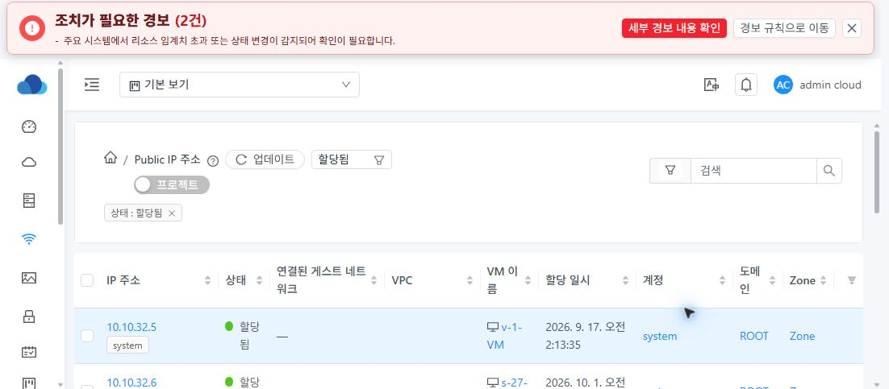

<!--
Licensed to the Apache Software Foundation (ASF) under one
or more contributor license agreements.  See the NOTICE file
distributed with this work for additional information
regarding copyright ownership.  The ASF licenses this file
to you under the Apache License, Version 2.0 (the
"License"); you may not use this file except in compliance
with the License.  You may obtain a copy of the License at

  http://www.apache.org/licenses/LICENSE-2.0

Unless required by applicable law or agreed to in writing,
software distributed under the License is distributed on an
"AS IS" BASIS, WITHOUT WARRANTIES OR CONDITIONS OF ANY
KIND, either express or implied.  See the License for the
specific language governing permissions and limitations
under the License.
 -->

# PR #1691 최신 Europa 통합 회귀 검증

Public IP 주소 개선을 최신 `ablestack-europa`의 ISO·VM 공통 화면 변경과 합쳤다. Public IP와 ISO의 상태 표시, 상세 값 변환, 검색·URL 범위, 목록 복귀를 각 리소스 조건으로 유지한다. VM 기준 breadcrumb의 14px 링크·홈 정렬·반응형 제어 배치도 유지한다.

## 소스와 충돌 해결

- 원래 PR: `9a6d2994b2e5a4336f11d97b9ea090a86c4d9b3a`
- 실제 최신 Europa: `b777311a708e0e652f05025fecb2660dfa90f74d` (원격 브랜치 API와 Git 원격 참조로 교차 확인; PR 메타데이터의 이전 base 값과 구분)
- 통합 커밋: `444a219cd59a1b7cdae0913a289b40717563b281`
- 최종 제품 검증 소스: `940e6d166d5e5f99e6df2fdb00d0f8ade06604a5`
- 충돌 7개 파일은 두 기능의 조건·이벤트·필드를 함께 보존했다. 공통 변경 9개 파일에는 자동 병합된 SearchFilter/SearchView도 포함된다. en/ko의 독립 Public IP·ISO 번역을 모두 유지했다.
- 비중첩 파일 1,754개는 각 부모와 내용·모드가 동일하다. 기존 FTCTL 소스는 최신 Europa와 동일하다. `composition-audit.json`, `conflict-resolution-plan.json`, `locale-comparison.json` 참조.
- 회귀 범위를 넓히면서 발견한 기존 PR 테스트의 들여쓰기 55건과 JUnit wildcard import 1건을 수정했다. UI 테스트 AST 및 제품 소스 트리 동일성을 확인했다. `test-format-equivalence.json`, `build-source-equivalence.json` 참조.

## 로컬 검증

| 항목 | 결과 | 근거 |
|---|---|---|
| 변경 UI 소스·테스트 lint | PASS | `lint.log` |
| Public IP·ISO·VM·VNF 공통 경계 47 suites / 771 tests | PASS | `ui-test-targets.json`, `ui-tests.log` |
| API 모듈 컴파일·5개 테스트 클래스 / 32 tests·package | PASS | `api-build.log`, `api-tests-summary.json` |
| production UI build | PASS | `build.log`, `artifact.sha256` |

Maven과 UI 빌드는 WSL ext4 작업 복제본에서 실행했다. API 모듈은 저장소의 `-Pdisablecheckstyle` 프로필로 테스트·패키징했다. 엄격한 Checkstyle에는 최신 Europa와 바이트가 같은 22개 파일의 기존 위반 46건이 남아 있다. 이번 PR 변경 파일의 위반은 0건이다. 전체 Cloud 빌드나 GitHub Actions 빌드는 실행하지 않았다. 이 결과를 전체 CI 성공으로 해석하지 않는다.

## 31(GFS2)·32(RBD) 실제 UI

모든 아래 작업은 배포된 통합 UI에서 실행하고 인증 정보를 제거한 실제 요청·응답을 `ui-wire.json`에 보관했다. `ui-results.json`과 JPG/DOM 텍스트가 화면 증거다.

| 범위 | 결과 |
|---|---|
| 예약 소유자 | 31 사용자 계정·도메인 예약, 32 기존 프로젝트 예약 각각 1 POST 및 실제 Reserved 재조회 일치 |
| 사용자 표시 | 두 클러스터 false→true 총 4회, 각각 1 POST·비동기 jobstatus=1·재조회 및 반대 표시 필터에서 제외 확인 |
| 목록·상세/반응형·테마 | 두 클러스터 × 목록·상세 × 1280/768/390 × light/dark = 24조합. breadcrumb 14px·첫 줄 정렬, 필터 label 연결, 상태 한글 표시, 가로 넘침·빈 네트워크 링크 없음 |
| 일반 사용자 | 31 본인 Reserved 1건 및 상세의 미제공 VLAN/표시 값·관리자 표시 변경 메뉴 미노출. 32 타 도메인 프로젝트 예약 미노출(0건). 양쪽 기본 VM 조회 200/0건 |
| ISO 공통 경계 | 관리자 기본 목록 31=30건/32=6건, 상세 가용 상태·값 변환 및 breadcrumb 목록 복귀 확인. Public IP 배지 혼입 없음 |
| VM 공통 경계 | 실제 VM 메뉴의 기본 URL로 목록 200 (31=132건/32=59건), 실제 상세 조회·기존 필드 유지·Public IP 배지 혼입 없음 |
| VNF 공통 경계 | 기본 보기 양쪽 200/0건의 빈 목록 정상 처리. 배포된 VNF 상세 객체가 없는 범위이며 생성·재설치 체인은 재검증하지 않음 |
| 예약 해제 | 양쪽 각각 1 POST 성공, Reserved 목록 0건, 실제 IP Free 및 기존 표시·네트워크 메타데이터 복원 |

VM의 초기 시험 보조 함수가 Public IP 전용 `projectid=0`을 VM URL에 넣어 431을 받았다(`31-vm-read-failure.*`). 실제 VM 메뉴는 이 값을 보내지 않는다. 공식 `#/vm` 경로에서 재검증해 정상 200을 확인했다. 이 시험 URL 오류를 제품 결함이나 통과 사례로 계산하지 않았다. VNF·가상머신용 네트워크·VPC 수명주기 시험과 FTCTL 보호 전환은 반복하지 않았다. ISO 백엔드 최신 기능은 컴파일·단위 테스트 범위이며 업로드·연결 전체 체인을 주장하지 않는다.

## 배포·정리·보존

정적 파일 허용 목록만 `/usr/share/cloudstack-management/webapp`에 갱신했다. `WEB-INF`·`META-INF`(존재 시), 서버 설정, backend JAR를 보존했다. 서비스 재시작 없이 두 서버 HTTP 200, MainPID 유지, 배포 파일 해시·FTCTL/ISO/Public IP bundle marker를 배포 직후와 시험 종료 후 확인했다.

- UI 아카이브 SHA256: `1db73a647ff7269477f20d337b368887199f22b1babde1504754b9546eb2c14c`
- index SHA256: `d63ef44f57d9c8596ed79a6567dee6cc509ac2951f9eba481ae5d6a4f78cbef1`
- 31 백업: `/root/publicip1691-merge-ui-20261116-132349`, PID `2375963`
- 32 백업: `/root/publicip1691-merge-ui-20261116-132452`, PID `2698517`
- Public IP API 클래스의 컴파일 해시는 기존 배포본과 같아 이번 통합에서 JAR를 교체하지 않았다.
- 시험용 사용자 2개·도메인 2개를 삭제했다. IP·네트워크·VPC·VM·계정·도메인·프로젝트·스토리지 풀 16개 인벤토리가 시험 전과 같다. Free/Reserved/Allocated는 31=18/0/35, 32=83/0/19로 복원됐다. `preservation-check.json` 참조.
- 한국어·밝은 테마·기본 보기/Allocated/1쪽/20개로 복원하고, viewport override·cache override를 해제했으며 작업 탭을 닫았다.
- 기존 dirty FTCTL 작업트리는 별도 스냅샷으로 보호했다. 병합 커밋 부모·트리, 최종 Origin/Local/Upstream 참조 일치 및 작업트리 최종 보존 비교는 병합 후 PR 결과 댓글에 기록한다.

