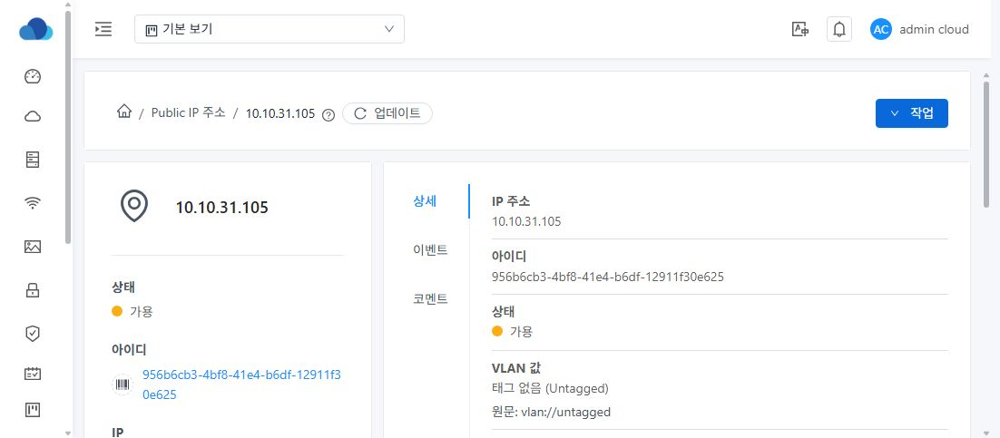

<!--
Licensed to the Apache Software Foundation (ASF) under one
or more contributor license agreements.  See the NOTICE file
distributed with this work for additional information
regarding copyright ownership.  The ASF licenses this file
to you under the Apache License, Version 2.0 (the
"License"); you may not use this file except in compliance
with the License.  You may obtain a copy of the License at

  http://www.apache.org/licenses/LICENSE-2.0

Unless required by applicable law or agreed to in writing,
software distributed under the License is distributed on an
"AS IS" BASIS, WITHOUT WARRANTIES OR CONDITIONS OF ANY
KIND, either express or implied.  See the License for the
specific language governing permissions and limitations
under the License.
 -->

# #1693 Free Public IP 비동기 소유자 수정 검증

2026-11-17 KST. Root Admin의 Free `updateIpAddress` 요청이 jobid 없이 530으로 실패하던 경로를 수정했다. 기존 서버의 미할당 주소 수정 지원 정책을 유지하며, Root 사전 권한 검사와 유효한 이벤트 소유자 결정으로 정상 비동기 작업을 생성한다.

## 원인과 구현

실제 31(GFS2)·32(RBD) Free IP에서 `fordisplay:true` 동일 값 요청으로 530/cserrorcode4250을 재현했다. DB의 `user_ip_address.account_id`는 NULL이고 `IPAddressVO.getAccountId()`는 이 경우 -1을 반환한다. 기존 `UpdateIPAddrCmd.getEntityOwnerId()`는 이를 Long으로 저장해 null fallback을 거치지 못했다. `ApiServer.processAsyncCmdInternal`은 작업 제출에 앞서 이 소유자로 Scheduled 이벤트를 저장하므로 unsigned `event.account_id` 범위 오류가 발생한다. 이 경로는 API 오류 응답·실제 DB 스키마/행·실행 소스 및 배포 class 해시로 대조했다. 재현 실패 요청의 대상 이벤트/작업/IP 변경은 0이었다. 별도의 관리 서버 과거 로그에서 SQL 바인딩 값을 확보했다고 주장하지 않는다.

- nullable `getAllocatedToAccountId()`로 현재 소유자를 매번 읽는다. 캐시/비공개 ownerId 값으로 실제 소유자를 대체하지 않는다.
- 미할당 주소는 기존 NetworkService 정책과 같이 Root Admin만 허용하며, 이벤트·작업 저장 전에 권한을 검사한다. Scheduled 이벤트 소유자는 SYSTEM(1), 비동기 작업 소유자는 실제 호출자다. Root 호출자의 계정으로 주소 소유자를 일괄 치환하지 않는다.
- Reserved/Allocated 및 프로젝트 주소는 실제 할당 계정 소유자를 유지한다. 비양수 할당 계정은 정상 검증 오류로 거절한다.
- 기존 실행부의 표시/UUID 인자 전달과 응답 계약, 역할별 `fordisplay` 인자 정책을 유지한다. UI의 Free 표시는 읽기 전용이다.

기준 Europa `a747a6d13b38be7444562534523b82cf228676fc`, 제품 검증 소스 `f505208869d0e89ed38e9ca7c429eba94ca0bc39`. 제품 변경은 API 명령 1개와 해당 단위 테스트다.

## 로컬 검증

| 검사 | 결과 |
|---|---|
| 버그 재현 테스트 | 기존 소스에서 15개 중 10개 실패, 오류·캐시·권한 경로 재현 |
| API 변경 모듈 테스트·package | 3개 클래스 29 tests PASS, 신규 소유자 검증 15개 포함 |
| Public IP·VM 대화상자 경계 UI 테스트 | 10 suites / 230 tests PASS |
| 엄격한 API Checkstyle | 기존 22개 파일의 46건 유지, 변경 파일의 신규 위반 0 |

Maven과 UI 테스트는 WSL ext4에서 실행했다. API package는 저장소 `-Pdisablecheckstyle` 프로필로 수행했으며 기존 Checkstyle 문제를 통과로 계산하지 않았다. 전체 Cloud 빌드·수동 GitHub Actions 빌드·UI 재빌드는 실행하지 않았다. UI 소스와 정적 배포 파일은 그대로이며 배포는 변경한 Java 클래스 하나로 제한했다.

## 실제 API·DB·UI

| 사례 | 두 클러스터의 결과 |
|---|---|
| Root Free 동일 값/숨김/표시 복원 | 총 6개 jobstatus=1. Free·소유자 없음·기존 네트워크/NAT 메타데이터 유지 |
| User·DomainAdmin Free (인자 없음/fordisplay 포함) | 총 8개 요청 531 권한 오류. 대상 IP·이벤트·작업 전후 동일 |
| User·DomainAdmin 소유 Reserved `fordisplay:false` | 기존 정책대로 인자를 무시해 4개 jobstatus=1/no-op. Root 재조회 true 유지, 역할별 API 메타데이터에 fordisplay 없음 |
| Root Reserved/Allocated 실제 UI 변경 | 총 8회 false→true, 각 1 POST·jobstatus=1·대상 재조회 및 소유자/상태/메타데이터 일치 |
| 프로젝트 Scheduled 소유자 | 31=438, 32=250 유지. Free Scheduled는 SYSTEM=1. 비양수 이벤트 소유자 없음 |
| 일반 사용자/도메인 관리자 UI | 총 4개 사례, 해당 도메인의 Reserved 1건 조회·상세·관리자 표시 편집 메뉴 미노출 |
| VM 기준 UI 스타일 | 실제 VM 편집 대화상자를 열어 취소하고 비교. 제목 16px/22px, 버튼 14px/32px, 우측 푸터·8px gap 일치 |
| 반응형·테마 | 두 클러스터 × 1280/768/390 × light/dark = 12개 대화상자 조합. 문서/내용 가로 넘침 없음, 버튼 영역 viewport 내 |

`free-api-results.json`, `role-api-results.json`, `owned-role-policy.json`, `ui-results.json`, `ui-wire.json`, `31/32-db-owner-proof.json`이 근거다. 대상 2개 IP씩 총 18개의 실제 update 작업이 성공했다. 거절된 Free 요청은 DB 전후 대조에서 부분 이벤트·작업·IP 변경이 없었다. 일반 권한의 소유 주소 요청을 오류로 거절했다고 해석하지 않는다. 기존의 미지원 표시 인자 무시/no-op 계약을 확인했다.

완료 알림이 작업 버튼 위를 가리는 상태에서는 알림을 정리하고 목록의 숨김 검색을 통해 재진입했다. 이 과정의 미완료 입력과 경로 이탈을 성공한 저장으로 계산하지 않았다. 저장 횟수는 실제 POST·job 결과로 대조했다. UI 검증은 현재 Public IP 표시 편집과 소유 범위에 한정하며 가상머신용 네트워크/VPC/VNF 수명주기나 FTCTL 보호 전환 시험은 반복하지 않았다.

## 배포와 보존

31·32의 활성 `/usr/share/cloudstack-management/lib/cloudstack-4.23.0.0-ABLESTACK.Mold.jar`에서 `UpdateIPAddrCmd.class` 1개만 교체하고 Mold를 재시작했다. 서버마다 나머지 198,632개 JAR 항목과 FTCTL 클래스 95개의 내용이 동일하다. 원본 JAR 백업을 보관했고 WEB-INF/META-INF(존재 시), 정적 index·설정, HTTP 200, 서비스 active 및 최종 배포 class/JAR 해시를 확인했다. 원본 JAR 항목 전체 해시 목록은 로컬 raw 증거로 보관하고, 저장소에는 개수·원본 manifest SHA와 FTCTL 해시·배포 비교 결과를 기록했다.

- class SHA256: `ffaef41792c538bc4554a8dbdcb54b5dddc86deb86d972567a49f42274ba0792`
- 31 백업: `/root/publicip1693-backend-20261116-213157` (UTC), 새 PID `2487789`
- 32 백업: `/root/publicip1693-backend-20261116-213318` (UTC), 새 PID `2812588`
- 양쪽 정적 index SHA256: `fd706e43fbcbf74689256464bc78b750fffaf4700453b4df84abbd24ce9f62e0`

전용 Reserved IP 2개를 원래 Free/표시=true로 복원하고 시험 계정 4개·도메인 2개를 삭제했다. 기존 프로젝트 Allocated IP의 DB 행·NAT·규칙 해시도 원복됐다. IP·네트워크·VPC·VM·계정·도메인·프로젝트·스토리지 풀 16개 인벤토리가 시험 전과 일치한다. 최종 Free/Reserved/Allocated는 31=18/0/35, 32=83/0/19다. 관리자 한국어·밝은 테마·기본 보기/Allocated/1쪽/20개를 복원하고 viewport override·작업 탭을 정리했다.

기존 FTCTL 작업트리는 Windows HEAD `8c0a6d9a0a947311abb0ee6d2604fdcb855906d1`의 14,541개 변경·미추적 경로와 WSL HEAD `084d43aa0b37c46a94256fff6fcd966696d9f1b0`의 12개 경로를 전후 비교했다. HEAD·브랜치·상태·staged/unstaged diff·파일/심볼릭 링크·모드가 완전히 동일하다(`ft-preservation.json`). 기존 FTCTL 소스·호스트 패키지는 수정하지 않았다.

