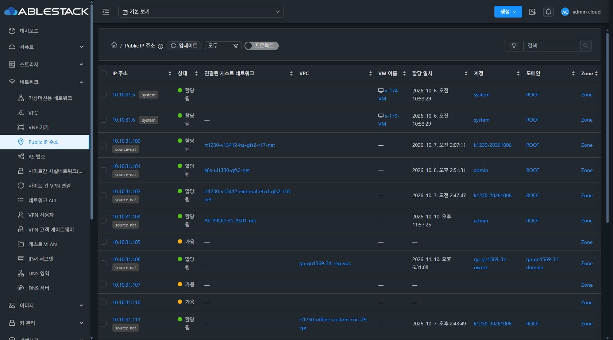
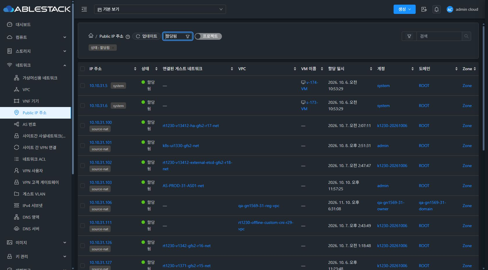
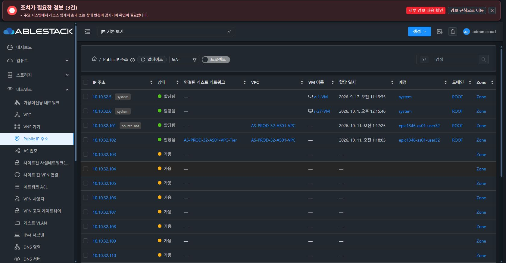

<!--
Licensed to the Apache Software Foundation (ASF) under one
or more contributor license agreements.  See the NOTICE file
distributed with this work for additional information
regarding copyright ownership.  The ASF licenses this file
to you under the Apache License, Version 2.0 (the
"License"); you may not use this file except in compliance
with the License.  You may obtain a copy of the License at

  http://www.apache.org/licenses/LICENSE-2.0

Unless required by applicable law or agreed to in writing,
software distributed under the License is distributed on an
"AS IS" BASIS, WITHOUT WARRANTIES OR CONDITIONS OF ANY
KIND, either express or implied.  See the License for the
specific language governing permissions and limitations
under the License.
-->

# Agent Guide for Apache CloudStack

# Public IP 기본 모두 필터 검증

2026-11-20 KST. 최신 upstream `ablestack-europa` `ebce1bfb72a22e2f0d6a21e6b553b152240f07a1`에서 `dhslove/public-ip-default-all` 브랜치를 생성했다. 제품 커밋은 `8435582bc3beaf646780a47f47eb1b416145895c`다.

관리자 Public IP 목록을 조건 없이 열면 breadcrumb 표시 필터가 **모두**로 선택되고, API에는 `allocatedonly=false`를 전송하며 `state`는 전송하지 않는다. 기본 상태에서는 상태 칩과 칩 행이 표시되지 않는다. 상태 칩 제거와 검색 오류 초기화도 같은 기본값을 사용한다. 다른 조건의 칩과 명시적 상태 URL, 프로젝트/도메인 범위는 유지한다.

기존 정책에서 모두·가용 선택지는 Root Admin 전용이다. User/DomainAdmin은 기존 허용 선택지와 할당됨 기본값을 유지했다. API·백엔드·FTCTL 코드는 변경하지 않았다.

| 검증 | 결과 |
| --- | --- |
| Public IP 및 VM 공통 대화상자 단위 회귀 | 10 suites / 241 tests PASS |
| 변경 4개 파일 ESLint / git diff --check | PASS |
| WSL ext4 프로덕션 UI 빌드 | npm run build, 기존 검증용 source map 제외 설정으로 PASS |
| 실제 브라우저 | 로컬 production dist에 31(GFS2)·32(RBD) API를 읽기 전용으로 연결, 아래 결과 참조 |
| 실제 목록 count | 31 모두 42 / 할당됨 24, 32 모두 93 / 할당됨 10. Public IP 응답 HTTP 200, 잘못된 상태는 API에 전송하지 않음 |
| 데이터/배포 | 조회·로그인만 수행. 클러스터 UI/JAR 배포와 자원 생성/삭제 없음 |
| 기존 FTCTL 변경 | Windows 15,950경로·WSL 12경로의 HEAD/브랜치/diff/파일 해시와 모드 전후 동일 |

브라우저 결과: {"clusters": [31, 32], "cases": [{"cluster": 31, "case": "initial-all-no-state-chip", "pass": true}, {"cluster": 31, "case": "reload-all-no-state-chip", "pass": true}, {"cluster": 31, "case": "allocated-has-state-chip", "pass": true}, {"cluster": 31, "case": "remove-state-chip-restores-all", "pass": true}, {"cluster": 31, "case": "invalid-search-reset-all", "pass": true}, {"cluster": 32, "case": "initial-all-no-state-chip", "pass": true}, {"cluster": 32, "case": "reload-all-no-state-chip", "pass": true}, {"cluster": 32, "case": "allocated-has-state-chip", "pass": true}, {"cluster": 32, "case": "remove-state-chip-restores-all", "pass": true}, {"cluster": 32, "case": "invalid-search-reset-all", "pass": true}], "passed": true}

프로덕션 빌드는 `VUE_CLI_SERVICE_CONFIG_PATH=docs/validation/s2s-1723-standard-filter-20261120/build.config.js`(절대 경로로 지정)를 사용했다. 소스맵을 제외하고 기존 production 최적화/압축은 유지하는 upstream 검증 설정이다. 기본 소스맵 포함 빌드는 장시간 실행 후 의도적으로 중단했으며 성공으로 계산하지 않았다. 최종 `build-summary.json`에 사용 설정과 산출물 해시를 기록했다. 기존 Browserslist/asset-size 경고와 단위 테스트의 기존 Vue stub 경고는 별도로 남는다. 전체 Cloud 빌드나 수동 Actions 빌드는 실행하지 않았다. 테스트 로그와 읽기 전용 API 요청 추적 원본은 별도 로컬 검증 디렉터리에 보관했고, 요약은 `summary.json`에 기록했다.

