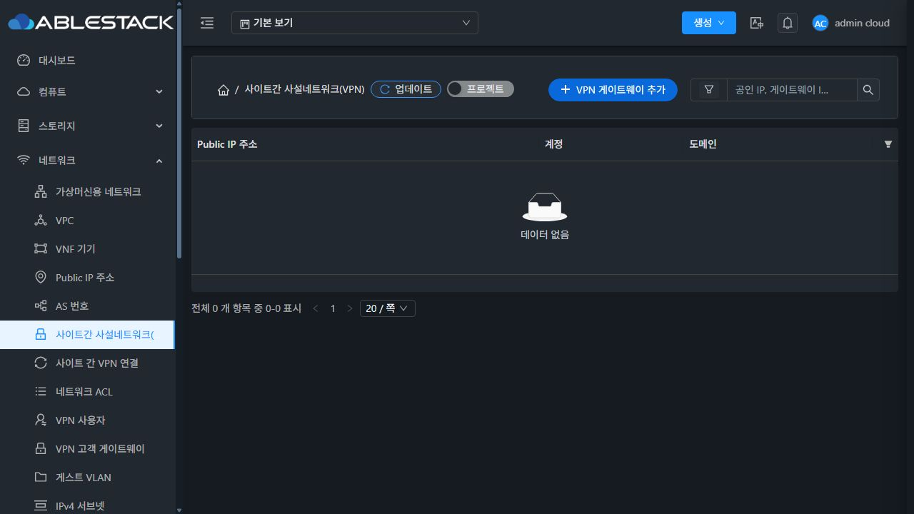
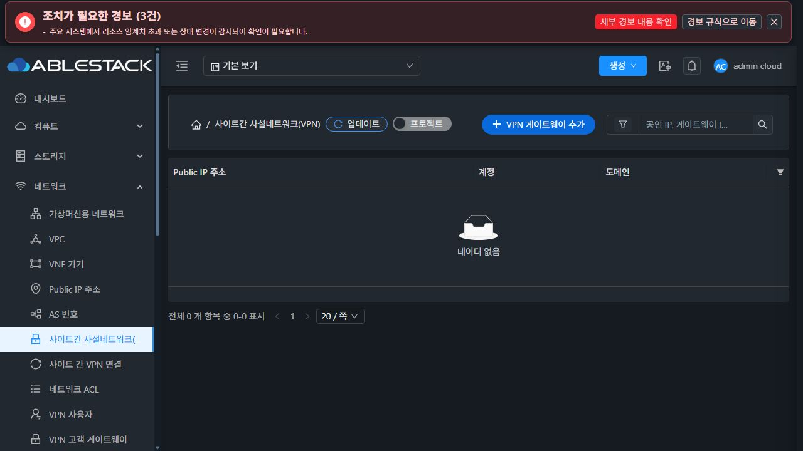
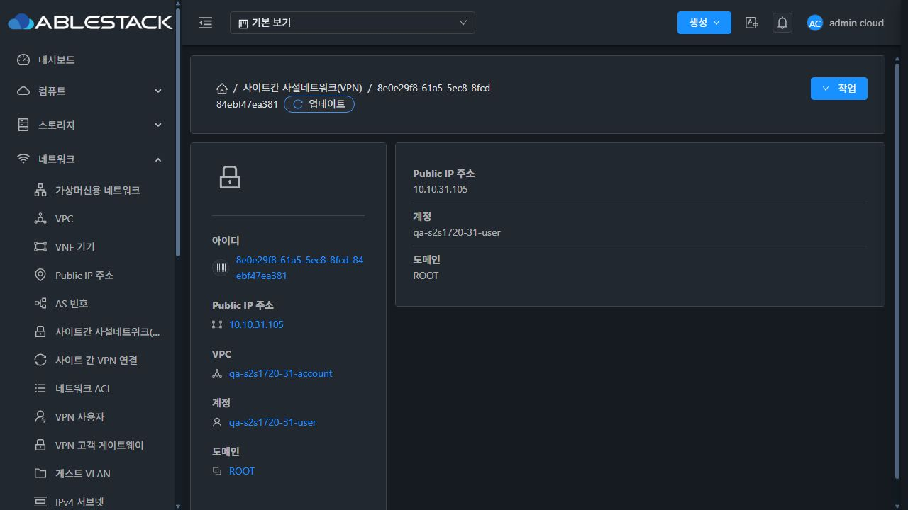
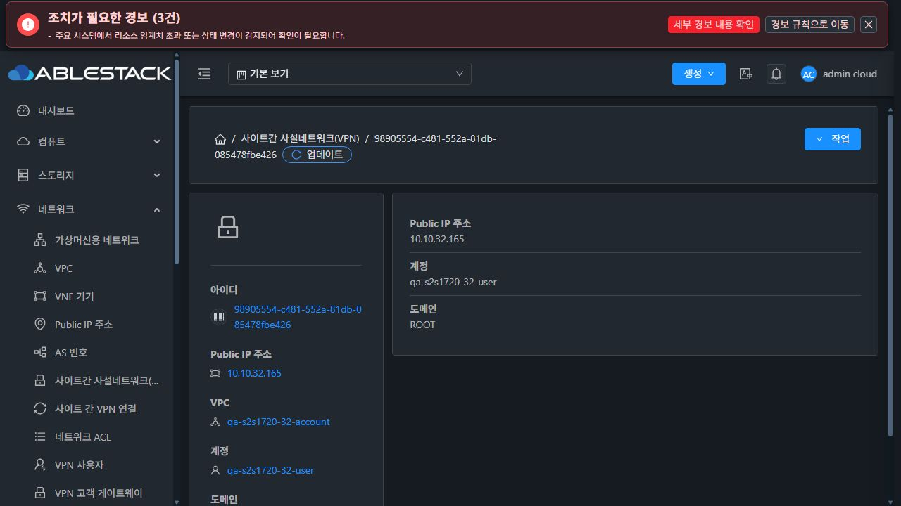
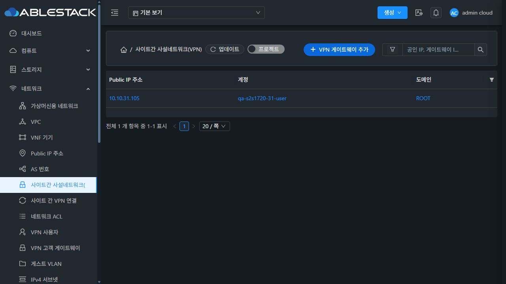
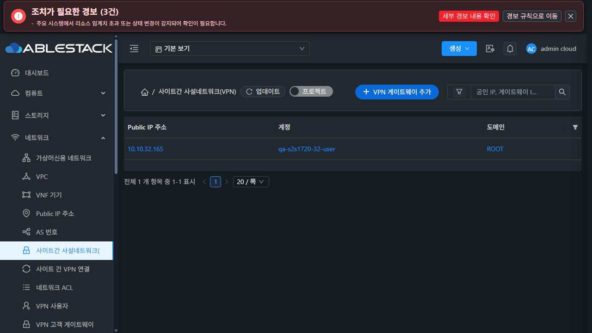

<!--
Licensed to the Apache Software Foundation (ASF) under one
or more contributor license agreements.  See the NOTICE file
distributed with this work for additional information
regarding copyright ownership.  The ASF licenses this file
to you under the Apache License, Version 2.0 (the
"License"); you may not use this file except in compliance
with the License.  You may obtain a copy of the License at

  http://www.apache.org/licenses/LICENSE-2.0

Unless required by applicable law or agreed to in writing,
software distributed under the License is distributed on an
"AS IS" BASIS, WITHOUT WARRANTIES OR CONDITIONS OF ANY
KIND, either express or implied.  See the License for the
specific language governing permissions and limitations
under the License.
-->

# #1720 VPN 게이트웨이 수정 비동기 결과·실패 계약 검증

2026-11-19 KST. 상위 Epic [#1718](https://github.com/ablecloud-team/ablestack-cloud/issues/1718), 대상 [#1720](https://github.com/ablecloud-team/ablestack-cloud/issues/1720). 기준 소스 `61d39d7cd2dd6b1caaa6634eef16e8757f1cc05a`의 독립 브랜치 `dhslove/s2s-1720-response`에서 구현했다. #1719 PR의 미병합 변경을 이번 PR에 섞지 않았으며 기존 시험 클러스터의 #1719 배포는 보존했다.

## 결과와 변경

`updateVpnGateway`가 만든 `Site2SiteVpnGatewayResponse`를 `setResponseObject`에 등록하도록 수정했다. 이제 최종 `queryAsyncJobResult`가 `jobstatus=1`과 `jobresult.vpngateway`를 반환한다. 서비스 반환이 null이면 `ServerApiException(INTERNAL_ERROR)`로 실패한다. 기존 서비스/UUID 예외는 그대로 전파하며 id 설명을 로컬 VPN 게이트웨이로 정정했다.

제품 변경은 API 명령 1개와 회귀 시험 1개다. API 이름·접수 jobid·매개변수·ACL·기본 표시 정책·서비스·DB·터널 구현은 그대로다. UI 파일은 추가/수정/배포하지 않았다.

## 로컬 검증

WSL Rocky ext4 `/home/ablecloud/work/dhslove/cloud-s2s-1720`에서 **api 모듈만** 빌드했다.

```bash
mvn -pl api -Dtest=UpdateVpnGatewayCmdTest -DfailIfNoTests=false -Dcheckstyle.skip=true -Drat.skip=true package
```

- 수정 전 동일 회귀 시험: 24건 중 12건 실패, 오류 0건. 성공 응답 미등록 6건과 null 빈 성공 6건을 재현했다.
- 수정 후 24건 통과: fordisplay null/false/true × customid 없음/있음 6조합에서 응답 객체·이름, null 실패, 서비스 예외 전파, 기존 UUID 검증 위임을 검사했다.
- 모듈 JAR에 포함된 실제 배포 클래스 바이트 일치 확인. `-Xverify:all`로 같은 24건 재실행 통과.
- 변경 Java 2개에 프로젝트 `cloud-style.xml`/Checkstyle 8.18 적용 통과. 전체 API 시험·전체 모듈 Checkstyle/RAT·전체 Cloud 빌드는 실행하지 않았다.
- [로컬 검증 요약](local-verification.json), [모듈 빌드 로그](api-package.log), [클래스 검증 로그](class-verification-tests.log), [변경 파일 Checkstyle 로그](changed-checkstyle-final.log).

## 31 GFS2·32 RBD 실환경 API

각 클러스터에 전용 일반 계정 1개, 관리자 소유 프로젝트 1개, 해당 범위의 VPC·VPN 게이트웨이 각 1개를 만들었다. 기존 게이트웨이나 UUID는 변경하지 않았다.

| 검증 항목 | 31 | 32 |
| --- | --- | --- |
| 배포 전 jobstatus=1 + 빈 jobresult 재현 | 확인 | 확인 |
| fordisplay false → 생략(false 유지) → true → 생략(true 유지) | 통과 | 통과 |
| customid 지정 × false/생략/true, 이전 UUID가 더 이상 대상에 해당하지 않음 | 통과 | 통과 |
| 모든 수정 접수 jobid → 최종 상태 1 → vpngateway → 명시적 표시 재조회 일치 | 통과 | 통과 |
| 실제 소유 계정·도메인·프로젝트·VPC·공인 IP 유지 | 통과 | 통과 |
| 중복/잘못된 customid | 최종 상태 2, 오류 431 | 최종 상태 2, 오류 431 |
| 존재하지 않는 대상 | 접수 오류 431 | 접수 오류 431 |
| 일반 사용자의 타 소유 프로젝트 자원 수정 | 최종 상태 2, 오류 530 | 최종 상태 2, 오류 530 |
| 일반 사용자 목록·자기 자원 수정 결과에 fordisplay 미노출 | 통과 | 통과 |
| 일반 사용자가 보낸 Admin 전용 fordisplay/customid | 기존 BaseCmd 정책에 따라 무시, 원래 값 유지 | 동일 |
| listApis id 설명 정정 | 통과 | 통과 |

권한 정책상 **타 소유 자원 수정은 거부**되지만, 자기 소유 자원에 보낸 허용되지 않은 Admin 전용 인자는 **무시**된다. 후자를 거부됐다고 기재하지 않았다. 각 31개 고유 검사항목을 통과했다. 권한 검증 재개 중 없는 대상 항목을 1회 반복한 원본 실행 기록도 보존하므로 JSON에는 각 32개 실행 기록이 있다. 시험 스크립트의 로그인 역할 값 문자열 `"0"` 처리를 수정한 뒤 권한 항목만 재개했으며 제품 수정은 추가하지 않았다.

null 서비스 반환은 **통제된 단위 fixture에서만 검증**했다. 실환경 DB를 훼손하거나 서버에 null 장애를 주입하지 않았다. 실제 서버에서는 없는 대상·접근 거부·잘못된/중복 UUID의 오류 결과를 확인했다. DB 직접 조회 대신 명시적 API 재조회로 저장 결과를 대조했다.

- [31 API 요청/접수/최종 결과/재조회](31-api-validation.json), [32 API 증거](32-api-validation.json).
- [31 수정 전 결과](31-baseline-live-update.json), [32 수정 전 결과](32-baseline-live-update.json).
- 시험 절차를 재현하는 `api_client.py`, `fixtures-create.py`, `api-validation.py`, `ui-state.py`, `cleanup.py`, `postcheck.py`는 인증정보를 환경변수로 받는다. 시험 자원은 `qa-s2s1720-*` 전용이며 정리 전에 UUID와 VPC 소유 범위를 검사한다.

## UI와 가상머신 표준 적용 범위

기존 배포 UI에서 각 4개 흐름, 총 8개를 확인했다. 1280×720, 다크 모드, 기본 프로젝트 보기에서 API false 변경 후 업데이트 버튼으로 0건, true 변경 후 1건, 변경 UUID 상세의 소유 계정/VPC/IP 표시와 새로고침, breadcrumb 복귀의 페이지·소유 문맥 유지를 확인했다. 원본 JPEG 캡처도 모두 1280×720이다. 테마와 viewport는 변경하지 않았다.

**#1720은 확정 설계에 따른 백엔드 전용 이슈로 새 UI가 없다.** VM 기준 전체 390/768/1280×라이트/다크 비교는 이번 변경에 N/A이며 수행한 것으로 표시하지 않는다. 기존 사이트간 VPN 전체 화면이 VM 표준으로 통합됐다고 판정하지 않는다. 기존 UUID breadcrumb·상세 본문/탭/대화상자 등을 VM 기준으로 통합하는 책임은 다음 [#1721](https://github.com/ablecloud-team/ablestack-cloud/issues/1721), 표시 설정 UI는 [#1723](https://github.com/ablecloud-team/ablestack-cloud/issues/1723)에 남는다. 두 후속 이슈의 VM 표준·전체 테마/viewport 인수 조건은 필수다.

[UI 판정](ui-validation.json). 캡처는 시험 개체 정리 전 관찰 기록이며 현재 개체가 남아 있다는 뜻이 아니다.

| 31 GFS2 | 32 RBD |
| --- | --- |
|  |  |
|  |  |
|  |  |

32의 상단 시스템 경보는 현재 환경의 기존 경보이며 이 변경의 VPN 응답 검증이나 전체 클러스터 무결성 판정을 뜻하지 않는다.

## 변경 클래스 배포와 보존

api 모듈 산출물 `UpdateVpnGatewayCmd.class` **1개**만 기존 관리 JAR에 반영했다. 소스 기준 execute와 기존 배포 execute의 명령 로직을 대조했고, 나머지 메서드 7개·클래스/API/인자 계약을 보존했음을 검사했다. id 설명만 의도적으로 달라졌다. 배포 클래스 SHA256:

`44fab23a3bd1da902f4d99ee99f754f1caca876f02f773c0414b79040b3238ed`

배포 전 JAR SHA guard, 서명/중복 ZIP 항목 검사, 원본 백업 후 다른 ZIP 항목의 데이터 바이트가 전부 동일함을 확인했다. Mold를 재시작한 뒤 HTTP 200·WEB-INF·UI index/config 해시·호스트 3개 Up/Enabled를 확인했다. JAR 전체를 모듈 JAR로 교체하지 않았다. 정적 UI와 서버 디렉터리를 배포/삭제하지 않았다.

| 항목 | 31 | 32 |
| --- | --- | --- |
| 변경 후 관리 JAR SHA256 | `78be7a8014f90e44bbd077a59750b9aec64363ee4e8d6b106b37935fc2910295` | `c0d14a2a1dea30943f0cc9692c9180f06e47adff90d51369fee3f3d45ac3b657` |
| 백업 | `/root/s2s1720-server-20261119-082111/cloudstack-before.jar` | `/root/s2s1720-server-20261119-082230/cloudstack-before.jar` |
| 최종 서비스/PID | active / 2852430 | active / 3173376 |
| client / WEB-INF / UI index·config 보존 | 200 / 있음 / 동일 | 200 / 있음 / 동일 |

백업 경로 시각은 UTC다. 복구가 필요하면 해당 원본 JAR를 사용해 Mold를 중지·복원·재시작한 뒤 HTTP/API/호스트 건강을 다시 확인한다. 정상 기동해 자동 복구 경로는 실행하지 않았다.

[클래스 보존 검사](preservation-check.json), [배포 manifest](payload-manifest.json), [31 배포](31-deployment.json), [32 배포](32-deployment.json).

## 정리와 최종 보존

두 클러스터의 시험 게이트웨이 4개·VPC 4개·프로젝트 2개·일반 계정 2개를 삭제했다. 전용 시험 개체 잔존 0개. 기존 기본 범위 VPN 0개와 기존 프로젝트 범위 VPN/연결/고객 게이트웨이 각 1개, 기존 VPC·프로젝트·계정·공인 IP의 UUID/주요 설정이 초기와 동일하다. 31은 35개, 32는 27개 API·소유 문맥 조합을 대조했다. 두 클러스터의 라우팅 호스트 3개가 모두 Up/Enabled이고 HTTP 200이다. 최근 관리 로그 4 MB에서 클래스 로딩/검증 오류가 없었다. 기존 dirty FTCTL 원본 작업 트리는 수정하지 않았다.

[31 정리](31-cleanup.json), [32 정리](32-cleanup.json), [31 최종 보존](31-postcheck.json), [32 최종 보존](32-postcheck.json).

ISP/피어 환경이 없어 실제 사이트간 터널·패킷·ISP 호환성은 시험하지 않았다. 기존 VM 네트워크/VPC/VNF/Public IP/ASN의 완료 기능을 전수 재검증하지 않았다. 전체 Cloud 빌드·수동 GitHub Actions는 실행하지 않았다. 원격 PR 자동 검사 결과는 완료 보고에 별도로 기록한다.

다음 순서는 P2 **#1721 VM 표준 화면·탭·대화상자 통합**이다. #1721은 착수하지 않고 사용자 지시를 기다린다. Epic #1718 및 #1721~#1723은 열린 상태로 유지한다.
