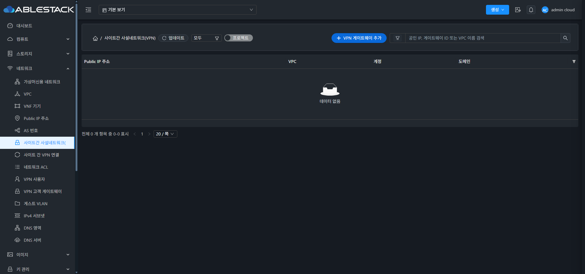

# #1723 VM breadcrumb 표시 필터·기본 모두 정책 교정

## 최종 판정과 이전 판정 정정

사용자가 지적한 기능 배치와 기본 동작을 교정했다. 이전 두 차례의 완료 보고는 breadcrumb 내부 순서·표시 필터 위치·기본값·하단 칩 정책을 충분히 확인하지 못했다. 이전 보고의 해당 UI 준수 판정과 ‘표시 대상 기본/모두 미제공’ 설계는 **이 문서의 계약으로 대체**한다. 원본 이력과 다른 기능의 검증 증거는 보존한다.

- 순서: **위치 정보 → 업데이트 → 표시 필터 → 프로젝트 → 우측 생성 작업 → 검색**. VM이 사용하는 공통 breadcrumb select와 도구 배치를 재사용한다.
- Root 관리자 기본값은 **모두**다. 표시 대상과 숨김을 실제 서버 조회에서 함께 반환한다.
- 표시 필터는 고급 검색창에서 제거했다. 모두·표시 대상·숨김 어느 선택에서도 표시 필터 칩과 그 빈 행을 breadcrumb 하단에 만들지 않는다.
- 생성·수정 완료 후 기본 모두를 유지한다. 사용자가 선택하지 않은 ID/VPC/계정/도메인 조건을 자동 삽입하지 않는다. 명시적으로 선택한 고급 조건만 보존한다.
- 상세 조회는 해당 행의 실제 표시값을 사용하며, breadcrumb 복귀는 기존 목록의 모두/명시 필터와 프로젝트 문맥을 복원한다.
- 다크 테마의 실제 select 값과 고급 검색 보조 문구가 읽히는 것을 확인했다. 검은색 wrapper 계산값을 실제 글자색으로 오인하지 않고 렌더링된 자식 요소를 측정했다.

최종 제품 소스: `b62e9fbcac4eaf5789d9d8c609599da5baeee26c`.
API 소스 변경은 `5caa6c43b1a964e4c0ded9eb6aa30fa4e12730bf` 이후 동일하다.
관련 [PR #1742](https://github.com/ablecloud-team/ablestack-cloud/pull/1742), [이슈 #1723](https://github.com/ablecloud-team/ablestack-cloud/issues/1723), [Epic #1718](https://github.com/ablecloud-team/ablestack-cloud/issues/1718).

## 실제 모두 조회와 호환성

`listVpnGateways`에 Root 전용 `displayall=true`를 추가했다. 기존 Public IP의 displayall 설계와 같은 방식으로 `getDisplay()`에서 null을 반환해 기존 서버의 표시 조건을 생략한다. 서버 검색/count/페이지를 한 번의 정상 쿼리로 처리하며 브라우저에서 true/false 페이지를 합치지 않는다. Public IP 제품 소스나 기능은 변경·재시험하지 않았다.

| 선택·호출 | 실제 인자·결과 |
| --- | --- |
| UI 기본 모두 | `displayall=true`, `fordisplay` 없음 |
| 표시 대상 | `fordisplay=true`, `displayall` 없음 |
| 숨김 | `fordisplay=false`, `displayall` 없음 |
| 기존 API 호출에서 둘 다 생략 | 종전대로 표시 대상만 반환 |
| displayall=true와 fordisplay 동시 지정 | 431, 상호 배타 인자 오류 |
| User/DomainAdmin | 관리자 인자는 API 메타데이터/UI에서 제외. 위조 인자가 숨김 조회 권한을 확대하지 않음 |

UI의 `fordisplay=all`은 라우트 상태이며 API boolean에 문자열 all을 보내지 않는다. 모두 API가 없는 환경에서는 권한/계약 확인 오류로 막아 잘못된 전체 목록을 표시하지 않는다. 제한 역할의 관리자 인자를 기존 서버가 무시하는 동작을 HTTP 403 거부로 보고하지 않는다.

## 변경 모듈 빌드·검사

WSL ext4 `/home/ablecloud/work/dhslove/cloud-s2s-1723`에서만 수행했다.

- **api 모듈만** 정상 Maven package. `ListVpnGatewayDisplaySearchTest` 5건과 기존 생성 메타데이터 테스트 3건, 합계 **8건 통과**. `api-package.log`.
- 변경 Java 2개 Checkstyle 통과. JVM `-Xverify:all` 5건 통과. 배포 baseline 대비 ASM 비교로 기존 필드/API annotation/관련 없는 메서드 보존 및 모듈 JAR 내 클래스 일치를 확인했다. `preservation-check.json`, `changed-checkstyle-final.log`, `class-verification-tests.log`.
- **UI 집중 회귀 8개 suite / 227건**, 변경 JS/Vue ESLint, 최종 production build 통과. `ui-tests.log`, `lint.log`, `ui-build.log`.
- source map 없는 기존 검증용 build 설정을 사용했다. `build.config.js`, `ui-manifest.json`에 소스/설정/산출물 SHA를 기록했다.
- 중간 구현을 보완하면서 중단한 빌드는 최종 성공으로 계산하지 않는다. 최종 `ui-build.log`의 완료 결과만 배포 근거다.
- server 모듈/전체 Cloud 빌드/수동 GitHub Actions/호스트 패키지 빌드는 실행하지 않았다.

## 31 GFS2·32 RBD 배포

API 모듈에서 만든 `ListVpnGatewaysCmd.class`만 기존 management fat JAR에 교체하고 양쪽 서비스를 재시작했다. 전체 API JAR 교체로 선행 #1720 응답 패치를 잃지 않도록 **나머지 ZIP entry의 모든 바이트 동일성**을 검사했다. class major=55다. 새 displayall 계약 때문에 이번 교정은 UI 전용 배포가 아니다.

| 클러스터 | 최종 JAR SHA256 | API 백업 | 최종 UI 백업 |
| --- | --- | --- | --- |
| 31 | `2b14a18f6f400fc409258588d8fcd8088145eea4444e544095ff46d5c9f4fbbc` | `/root/s2s1723-standard-server-20261120-050557` | `/root/s2s1723-ui-20261120-052415` |
| 32 | `f60d7c6798fe92f321a4ceb1fa96fc841ce741ca4a897c5c70a32be7177d25f2` | `/root/s2s1723-standard-server-20261120-050716` | `/root/s2s1723-ui-20261120-052439` |

최종 UI index SHA256: `0050406a212bf60643c1771511cda8c5b7d6048df24a78370ffb032e31a7d30b`.
UI payload SHA256: `e264833b8241eea800ec7b214008918c57bd446232aef937337f25a9ddcba329`.

정적 파일만 active `/usr/share/cloudstack-management/webapp`에 배포했다. WEB-INF/config.json과 API 배포 후 JAR/PID를 보존했고 `/client/` HTTP 200을 확인했다. 최종 health 증거에서 #1720 Update 및 #1722 Create 클래스 SHA가 유지되고, 검사한 mold journal 구간에 VerifyError/NoSuchMethodError/NoSuchFieldError/ClassFormatError가 없다. 전체 로그 무오류를 주장하지 않는다. `31/32-health-final.json`, `31/32-deployment.json`, `31/32-ui-deployment.log` 참조.

## 실제 UI·API 검증

두 클러스터에 각각 전용 domain1·계정2·project1·VPC4·GW4를 만들었다. 고객 GW/터널/게스트 VM은 생성하지 않았다. 기본 보기에는 표시 2·숨김 1, 전용 프로젝트에는 숨김 1을 준비했다.

| 검증 | 31·32 결과 |
| --- | --- |
| 기본 모두 → 표시 대상 → 숨김 → 모두 | 각각 3/2/1/3행, 서버 count·요청·URL 일치. 하단 표시 칩/행 없음 |
| 서버 모두 페이지 | pagesize1, page1~3의 count=3·중복 없는 세 ID. UI는 이 결과를 합치지 않음 |
| 기본 모두에서 숨김 생성 | UI POST 정확히 1회, 최종 job 객체와 false 재조회 일치. 모두 3행 유지, 임의 필터 칩 0 |
| 기본 모두에서 true→false→true | 변경마다 POST 1회. 모두 선택 유지·3행, 자동 ID/소유 범위 조건 없음 |
| 프로젝트 포함 스위치 | 기존 VM 의미대로 기본 자원+프로젝트 자원을 포함해 모두 5행. 프로젝트만 2행이라는 잘못된 테스트 기대값을 정정했고 제품 의미는 변경하지 않음 |
| 전용 프로젝트 | 모두 1/표시 0/숨김 1. 숨김 상세는 false 명시. breadcrumb로 모두+선택 프로젝트 복원 |
| 계정/도메인/VPC 범위 | 모두 조회와 AND 결합. 다른 프로젝트 VPC 혼합 요청은 교차 노출 없음 |
| User/DomainAdmin | UI 표시 필터/고급 표시 조건 없음. 직접 all URL은 권한 오류이며 gateway 조회 0회. API 위조 all로 숨김 대상 노출 없음 |
| 정리 후 최종 화면 | Root/기본 보기/다크, 기본 모두·0행·하단 표시 칩 없음. 임시 browser/CDP viewport 복원 |

`31/32-all-api-verification.json`은 API 요청/결과, `*-filter-network.json`, `*-create-hidden-network.json`, `*-update-*-network.json`, `*-project-network.json`, `*-permission-network.json`은 브라우저가 실제 보낸 허용 목록 인자·결과를 기록한다. 비밀 헤더/세션키/암호는 수집하지 않았다.

## VM 동시 조건 비교·다크 가독성

각 클러스터의 **390/768/1280 × light/dark**, 합계 **12조건**에서 VM·기본 모두·표시 대상·숨김·모두 복원·고급 검색의 **원본 72장**을 비교했다. 추가 1920 dark VM/VPN과 생성·수정·역할·프로젝트·정리 화면은 별도 증거다.

공통 card/body/업데이트의 배경·여백·글꼴·테두리·반경, 실제 select 값/selector 스타일, 도구의 DOM 순서, 기본값, 하단 칩 없음, 고급 표시 필드 없음, 행/count를 검사했다. 선택 후 focus 테두리와 VM의 비포커스 테두리는 정상 상태 차이로 구분했다. 메뉴명·액션 글자 길이에 따른 자연 줄바꿈을 VM과 다른 전용 레이아웃으로 바꾸지 않았다.

요청 크기=DOM innerWidth/Height=PNG 치수를 검증했고 1280 이미지의 901px 반복 타일도 검사했다. 이미지 최적화/주석/합성/리사이즈 없이 native PNG를 보존했다. 측정한 선택 텍스트/도움말의 최소 대비는 **7.56:1**이다. 동일 이름의 재시도는 마지막 관측을 채택하며 raw 순서와 최종 manifest를 구분한다.

- `ui-standard-audit.json`: 12조건/72장 표준 대조 결과.
- `ui-capture-manifest.json`: 최종 관측·스타일·치수·이미지 해시·중복 제거 정책.
- `ui-captures.json`: 관측 시퀀스 이력. 읽기 전용 테스트 기대값/DOM 지원 차이로 재시도한 관측을 별도 성공 건수로 더하지 않는다.
- `screenshots/31-final-clean-all.png`, `screenshots/32-final-clean-all.png`: 정리 후 최종 원본 화면.

## 정리·보존·남은 통합

생성한 GW8·VPC8·project2·계정4·domain2를 모두 정리했다. `31/32-cleanup.json`에 접수와 완료를 기록했다. 전후 **167개 인벤토리 항목/기준 VM 비교 일치**, 계정 31=26/32=22·프로젝트 31=7/32=5로 복원, 각 Routing host3 및 기존 프로젝트 GW/연결을 보존했다. `inventory-preservation.json`, `31/32-inventory-before/after.json` 참조. DB 이력/모든 호스트 파일 전수 보존까지 주장하지 않는다.

이슈 #1723은 구현 완료/Closed를 유지한다. Epic #1718은 관련 PR #1724/#1725/#1738/#1740/#1742 검토·통합과 **병합 소스 기준 변경 모듈 재빌드·배포·최종 확인**이 남아 Open이다. #1742의 UI는 별도 API PR #1725 응답 변경의 선행 통합이 필요하며 이번 runtime 패치에서도 그 클래스를 보존했다. 자동 병합하지 않았다. 새 기능 하위 이슈는 없다.

이번 시험은 변경한 breadcrumb/표시·검색 문맥/UI–API 범위다. 기존 네트워크/VPC/VNF/Public IP/ASN 기능의 전체 재시험, ISP/외부 제공자/실제 터널·패킷 시험은 하지 않았다. 로컬 검사 통과와 자동 PR CI 결과는 별개다.
