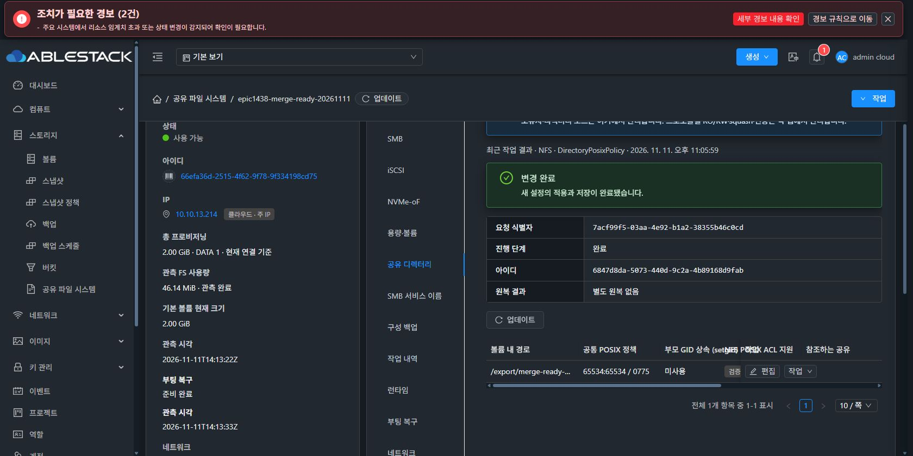
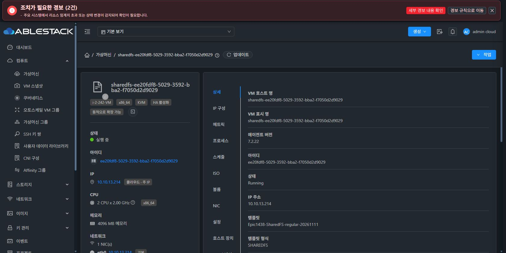
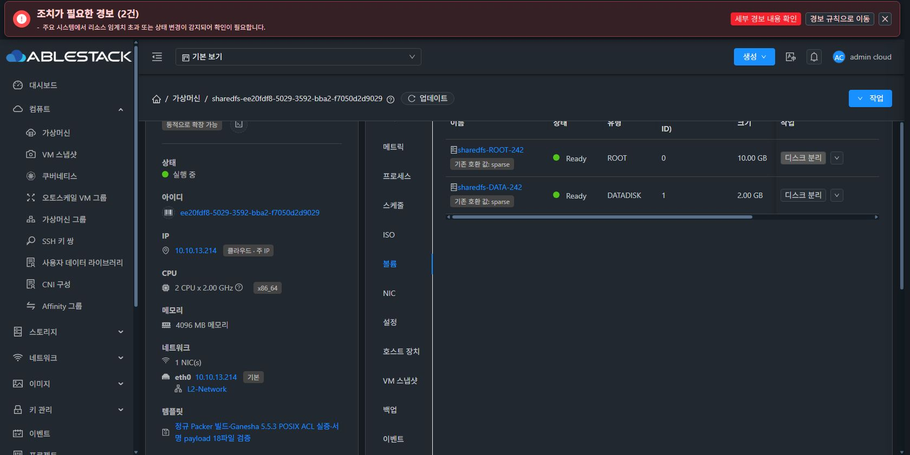

# Epic #1438 병합 전 보완 완료 — 자동 DB 이관·정규 Ganesha 이미지·회귀

2026-11-11 KST. [PR #1470](https://github.com/ablecloud-team/ablestack-cloud/pull/1470)의 최종 검토에서 확인한 세 항목을 보완했다. **기술적 병합 차단 3항목은 해소**, PR은 사용자 지시에 따라 **Draft·미병합**을 유지한다. 새 이슈/브랜치나 운영 VM 자동 교체 기능을 추가하지 않았다.

- Epic 실제 하위 이슈30개: #1439~#1466·#1468 완료29, #1467 not planned 취소1, OPEN0. 각 기존 인수의 범위·제약을 유지한다.
- base: local ablestack-europa / upstream 동일 45944c40dedef7ff6b377db94225cf598c82739d. 작업은 기존 epic/1438-sharedfs에서 진행하고 origin만 갱신한다.
- 코드: 0b8f3692ba1(DB·기존 회귀2건), fa161e3e227(실제 DAO의 자동 이관 경로), 218bbfda0fc(정규 이미지·native 검증), 03d21399af2(빌드 비밀값 trace 차단).
- [실제 UI 갤러리](gallery.md), [검증 요약/원본 로그 해시](evidence/validation-summary.json).

## 1. 기존 Europa에서 자동 실행되는 DB 이관

완료된 S4/legacy 표식을 수정하지 않고 독립 checkpoint를 추가했다.

| key | 이관 대상 |
|---|---|
| europa-storage-directory-policy-v1 | storage_directory_policy |
| europa-storage-runtime-catalog-v1 | storage_service_runtime_bundle_validation / storage_service_runtime_bundle_event, bundle의 state_revision·validation_status·current_validation_id, upgrade의 catalog_policy_json |

DatabaseUpgradeChecker가 EuropaSharedFSRegistryUpgrade를 호출한다. helper는 각 phase가 Complete인 경우 재실행하지 않으며, Pending/부분 DDL은 기존 idempotent SQL로 재개한다. 기존 상태 AVAILABLE→DRAFT·DISABLED→SUSPENDED만 정규화하고 이미 PUBLISHED인 행의 상태/검증/리비전, 디렉터리 소유권·모드·metadata는 보존한다. 기존 완료 표식 초기화나 수동 SQL 선행 작업은 필요하지 않다.

**실제 격리 MariaDB + production checkpoint/SQL 3건**: 이전 S4/legacy Complete 상태의 최초 이관, 두 번째 기동의 PUBLISHED/VERIFIED revision7와 디렉터리 UID/GID·mode·revision 보존, 일부 컬럼/테이블만 있는 Pending의 재개를 확인했다. 기존 checkpoint 실패/재개·완료 skip 회귀3건도 PASS다. 테스트는 명시적 loopback13348 전용 DB에서만 실행한다.

기존 StorageDirectoryPolicyCoordinatorDaoTest의 수동 DDL 준비를 새 production migration 호출로 대체했다. **실제 coordinator→DAO 저장·재조회39건 PASS**, 실패/오류/생략0. loopback13344의 별도 DB만 사용했고 시험 종료 후 해당 데몬을 종료했다.

## 2. 정규 SystemVM 이미지에 Ganesha를 포함하는 경로

수동으로 교정한 시험 이미지를 산출물로 대체하지 않고, **Debian12.12 공식 ISO부터 정규 Packer x86 파이프라인 전체를 실행**했다.

1. 기존 cloud scripts 설치/서비스 설정 뒤에 install_sharedfs_ganesha.sh를 실행한다.
2. Ganesha V5.5.3 commit2a57b6d53295426247b200cd100ba0741b12aff9와 ntirpc commitbf7fd0259c33ce95f5f2bf22817a8912f7fe5188를 검사한다.
3. 기존 native CMake 구성을 재사용해 ENABLE_VFS_POSIX_ACL=ON으로 이미지 guest 안에서 빌드한다. 임시 builder만2CPU/2048MiB로 조정했고 이미지 가상 디스크 크기는 기존5000MiB를 유지한다. Mold의 사용자 오퍼링/VM 리소스 정책을 변경하지 않는다.
4. 새64MiB SPARSE ext4 시험 파일시스템과 private net/mount namespace에서 **실제 NFSv4.1 I/O**로 named principal 읽기, 쓰기 차단, default ACL·setgid 상속, 기존 시험 파일 inode/권한/내용 보존을 확인한다.
5. 성공한 경우에만 실제 native4파일의 SHA·검증 결과를 profile로 발행하고 보호된 unit override를 설치한다. 빌드 도구/임시 파일은 이미지에서 제거한다.
6. export 이미지와 압축 해제 round-trip 모두에서 서명·18개 managed payload·baseline·native4파일 SHA/권한·unit을 검증한다.

Packer의 이미지 빌드/압축/round-trip까지 **BUILD SUCCESSFUL**을 확인했다. [실제 native 시험 및 gate2회](evidence/image-validation.json).

| 산출물 | 값 |
|---|---|
| 압축 이미지 SHA256 | 0f39ed25874f8d64ab1de13e8ab5fb212d8b6700d31b4cbb7b6491a70c6d736f |
| 압축 바이트 | 671420932 |
| 이미지 | QCOW2 compat0.10, backing file 없음, 가상5242880000bytes, SPARSE |
| native | Ganesha5.5.3, 4개 파일 검사 및 실제 mapped library 확인 |
| runtime | 1466.smb-ad-names.2 / ABI1 / schema1 / signed managed18개 |

이번 변경은 DB·빌드 도구·시험만 수정해 guest runtime18개 파일이 기존 정상 서명 bundle과 바이트 동일하다. 실제 파일 SHA와 서명을 확인해 기존1466.smb-ad-names.2 manifest/signature를 이미지에 사용했다. 새 개인키를 만들거나 원문을 파일에 쓰지 않았다. 기본 공개키/manifest는 로컬 빌드 입력으로만 사용하고 source tree에서 제거했다. 정규 release workflow의 기존 보호 signing secret 계약은 유지하며 Actions를 실행하지 않았다.

### 시험 코드 교정과 검증 경계

첫 정규 빌드는 native 컴파일까지 통과했으나 자체 probe namespace에 loopback만 있어 Ganesha의 AI_ADDRCONFIG 주소 초기화가 실패했다. 하위 stderr를 전달하지 못한 진단 결함도 있었다. 실제 SystemVM에서 원인을 재현하고 **시험 namespace 안에만** 사설 dummy 인터페이스를 추가했다. 주입 파일을 /run에 둔 사전 시험에서는 private /run mount가 파일을 가리는 문제도 발견해 probe SHA를 mount 전에 읽도록 수정했다.

교정본은 기존 SystemVM의 새64MiB SPARSE 파일시스템에서 실제 I/O를 통과한 뒤 정규 ISO 빌드를 다시 실행했다. 기존 DATA·ACL·계정·운영 리스너를 수정하지 않았고 own /run 시험 파일을 제거했다. [원인 재현](evidence/native-systemvm-pretest.json), [경로 진단](evidence/native-systemvm-posttest-harness-path.json), [실제 SystemVM PASS](evidence/native-systemvm-posttest.json).

최종 이미지에는 정규 빌더가 새로 컴파일한 native 파일이 들어 있다. 사전 시험 VM의 바이너리·profile을 복사하지 않았다. 첫 실패 이미지가 배포되지 않았고, 두 번째 정규 빌드의 실제 probe와 export gate 결과를 최종 근거로 사용한다.

## 3. 회귀2건의 실제 계약 검증

- test_boot_reconcile: 관리 파일15개 상수를 제거했다. 현재 baseline과 전체 managed set 동등성, 명시적 이전 서명13개 layout fixture/이전 boot helper 없는 layout의 허용, 불완전한 현재 layout 거부를 확인한다.
- test_sharedfs_network_policy: 제거된 셸 본문 문자열을 잘라 실행하던 시험을 실제 Python BootReconciler→Runtime.network 경로로 교체했다. primary 준비 실패 시 최초 사유/phase를 저장하고 DATA 마운트·네 프로토콜 apply 전에 차단되는 것을 확인한다. deadline clock만 앞당겨 실제30초 대기를 피하며 보호를 생략하지 않는다.

| 로컬 검증 | 결과 |
|---|---|
| 관련39개 Maven 모듈 package | BUILD SUCCESS |
| 실제 DB migration + 기존 checkpoint | 6 PASS, 실패/오류/생략0 |
| 실제 coordinator/DAO | 39 PASS, 실패/오류/생략0 |
| SystemVM unit | 449 OK, 실패/오류0 / 환경 의존17건 생략 |
| runtime updater | 28 OK |
| native image gate·logging | 5 OK |
| 실제 배포 JAR 경로 | S4 Complete 후 신규 두 phase 및 두 번째 실행 PASS |
| syntax / diff | Python compile·bash -n·변경 diff check PASS |
| UI | 제품 UI 소스 미변경. 이전31suite/277건 근거 유지, 이번 실제 UI 인수는 아래 결과 |

생략17건을 실행 성공으로 세지 않는다. 전체 저장소 CI·네 프로토콜의 전체 클라이언트 재인수를 실행한 것으로 확대하지 않는다. GitHub 빌드 Actions는 호출하지 않았다.

## 4. 13번 배포와 실제 UI

### 관리 모듈

13번의 현재 runtime JAR는 다른 upstream 기능의 배포 버전과 다르므로 전체 새 JAR/XML을 덮어쓰지 않았다. 기존 S4 checkpoint method의 정상 반환에 같은 신규 helper를 연결하는 한정 호환 overlay와 신규 helper3개·SQL2개만 반영했다. canonical source는 정규 DatabaseUpgradeChecker에 직접 연결한다.

실제 **배포할 JAR 자체**를 격리 DB에 연결해 S4 Complete에서 신규 두 이관, 반복 실행, 비대상 phase 동작을 확인했다. 비대상 JAR 엔트리는 바이트 동일성을 검사했고 기존#1436·API·Spring·host agent·runtime resource는 유지했다.

- 전 JAR: aef93d4371defacdc5cb595ce1548d841be1c16864dac0c642ff4988bd143d10.
- 배포 JAR: **bfa280129a9aa142bd8c6781c0de3c14431fc3de822eb9e94d4aba661a3c2f9d**.
- UI index 보존: 318c047708bd7780acaf85fe86ddf56910f414eedae6b94fff60ddc68d356549.
- 시작 로그에서 신규 key2개 Complete, mold.service active / UI HTTP200.
- [항목 보존 manifest](evidence/management-manifest.json), [배포 결과](evidence/management-deployment-result.json), [자동 이관 로그](evidence/management-migration-startup.txt).
- 실제 UI로 기존 공용 정책 UID/GID65534:65534·0775·revision1, 카탈로그 PUBLISHED/VERIFIED·revision3·감사 이력3행, 기존 복합 서비스 NFS/SMB/iSCSI/NVMe-oF 활성 상태를 확인했다. 기존 서비스/디스크/MAC을 변경하지 않았다.

### 새 정규 이미지와 새 VM·DATA

| 대상 | 실제 UI 결과 |
|---|---|
| 템플릿 | Epic1438-SharedFS-regular-20261111 / 35fa8b86-943e-44b7-8a5c-ffc2bb825550 |
| template 속성 | SHAREDFS, KVM, x86_64, QCOW2, 동적 확장 true, private/non-extractable/non-featured, checksum SHA256 지정 |
| 다운로드 | 13-Zone Download Complete / 준비 예 |
| 선택 경로 | Zone sharedfsvm.compute.template.uuid를 새 UUID로 지정. 일반 SYSTEM template 선택은 변경하지 않음 |
| 새 SharedFS | epic1438-merge-ready-20261111 / 66efa36d-2515-4f62-9f78-9f334198cd75 / Ready |
| 새 VM | ee20fdf8-5029-3592-bba2-f7050d2d9029 / 등록한 새 template / Running |
| ROOT | 500f8724-49a8-41b2-81fe-4cc1c7a95e15 / 10GiB / sparse / Ready |
| DATA | e15293f0-14d3-4fb6-981e-373f57d02ded / 2GiB / sparse / XFS / Ready |
| 네트워크 | 사전 ARP3회 응답0, STATIC10.10.13.214/24, gateway 없음, Mold가 정한 MAC02:0d:00:cc:00:bc |
| NFS | merge-ready-nfs /2049/v4 전용, CIDR10.10.13.0/24, RW/RootSquash, UID/GID65534:65534·0775, 공유/ACL Ready 및 mount 점검 완료 |
| native 지원 | 신규 VM의 공유 디렉터리에서 **검증 지원·5.5.3**. 별도 guest 수동 설치/보정 없음 |
| DB 등록 | UI 현재 실제 값으로 정책 등록→사전 점검→승인→확정→재조회. permission 변경 없이 policy revision1·일치, 변경 완료 |
| 작업 이력 | 초기 enable/export/ACL와 정책 등록의4개 작업 모두 변경 완료, 중복 생성 없음 |
| UI 재시작 | 같은 VM/NIC/MAC/ROOT/DATA, 원래IP 복귀. 부팅 복구 COMPLETED/READY, NFS1/1 준비 완료 |
| 재시작 후 | UID/GID·0775·정책revision1·native지원·NFS/ACL 보존. runtime1466.smb-ad-names.2 / 실행파일 일치 / ABI1·schema1 |

새 template 등록·준비 확인·Zone 선택·서비스/볼륨 생성·사전 점검 승인·정책 등록·재시작은 **실제 Mold UI**로 실행했다. API/QGA로 자원을 미리 만들거나 UI의 누락 단계를 대체하지 않았다. QGA는 앞 절의 격리 코드 사전 시험/자체 시험 파일 정리에만 사용했다.

신규 서비스에서 별도 외부 클라이언트 mount 시험·SMB/iSCSI/NVMe-oF 전체 재시험은 이 작업에서 하지 않았다. 실제 NFS 클라이언트 I/O/데이터·ACL 보존은 이미지 builder의 private namespace 및 사전 SystemVM 시험에서 확인했고, 새 서비스는 UI의 mount 점검·등록·재시작·지원 상태로 확인했다. 별도 Cloud API 정상 작동 시험도 수행하지 않았다.

원래 한국어·다크모드를 유지했고 마지막 UI console error0·열린 dialog0이다. 기존 전역 경보2건과 과거 실패 이력은 보존했다. 단순 최초 조회의 관측 전 표시를 제품 오류로 오인하거나 보호를 해제하지 않았다. 새 검증 서비스/이미지는 검토용으로 보존했고 이미지는 읽기 전용 정적 경로로 제공한다.

## 5. 로그·임시 자료 위생

로컬 임시 작업 상태 JSON에 인증 문자열을 넣은 실수를 즉시 제거했다. 해당 파일은 source tree 밖에만 있었고 Git/PR에 포함되지 않았다. 관련 텍스트65개 검사에서 해당 문자열·개인키 원문0건을 확인했고 최종 추가 자료도 다시 검사한다.

정규 빌드의 기존 finalize.sh가 자동 생성 cloud 암호를 xtrace에 노출하는 점도 확인했다. 로컬 로그의 해당 값을 동일 길이로 즉시 마스킹했고, 앞으로는 해당 생성/적용 구간만 trace를 꺼서 비밀값을 출력하지 않도록 보완했다. 실제 randomizer를 부작용 stub으로 실행하는 회귀로 값 비노출과 이후 trace 복구를 확인했다. 암호 생성 강도·shadow 저장·이미지 계정 정책은 변경하지 않았다. 이 후속 logging 변경은 이미지에 포함되는 파일/기능 코드를 바꾸지 않는다.

## 6. 최종 판단과 범위

확인한 **DB 자동 이관 누락·native 이미지 연결 누락·실패하는 회귀2건**을 해소했다. 최신 base와 충돌 여부·하위 이슈 상태·현재 head의 검사 상태를 다시 확인하고 PR1470에 반영한다. 사용자 지시로 PR은 Draft·미병합으로 두며 Ready 전환/최종 리뷰/병합은 후속 지시 단계다.

기존29개 완료의 인수 범위를 전체 재시험 결과로 바꾸지 않는다. 환경 의존17개 생략·전체 CI/배포 release 미실행을 명시하며, 로컬/13번/새 정규 이미지의 위 결과로 기술적 병합 준비 완료를 판단한다.

