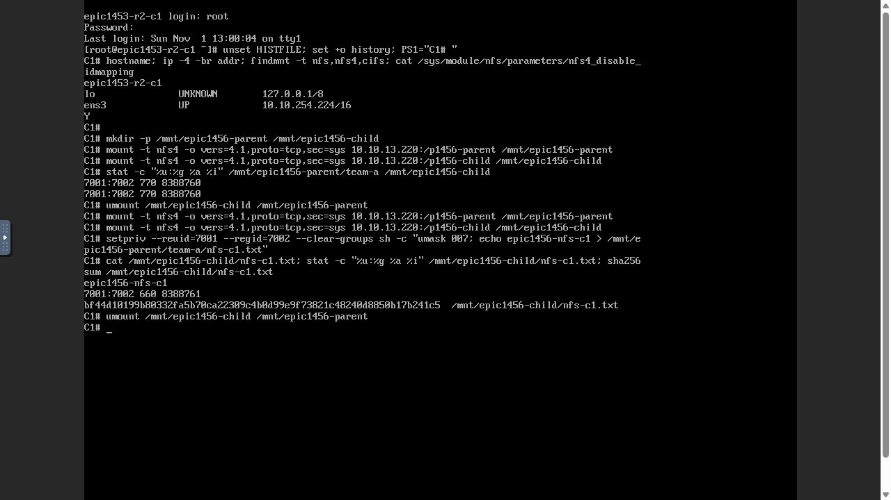
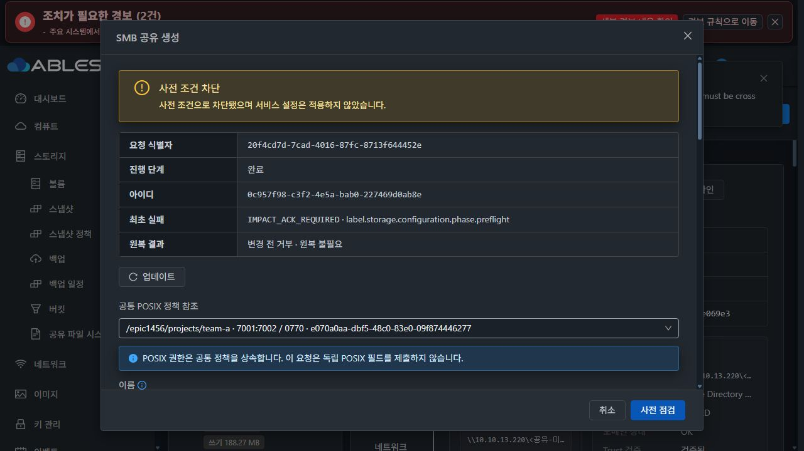

# #1456 구현·배포 및 실제 UI 검증 중단 보고

2026-11-01 KST. Epic #1438 / 브랜치 epic/1438-sharedfs / Draft PR #1470.

**구현·모듈 빌드·13번 변경 모듈 배포까지 진행했습니다. 실제 UI의 고정 UID/GID SMB 생성에서 제품 계약 결함을 확인해 재시도·추가 적용을 중단했습니다. #1456은 OPEN, 최종 인수5개는 미완료입니다.** 이 문서는 전체 기능 완료나 기존 모든 이슈의 재인수를 뜻하지 않습니다.

## 1. 반영한 구현과 검증 범위

구현 commit `2e65c14c086d0d7719b0206921deca9a1a02a530`. 로컬 Europa를 upstream과 먼저 동기화한 기준은 `1c5b169cd6283da23cc3e155d4b6d14e39e42793`이며 당시 divergence0/0을 확인했습니다.

기존 SMB create/update API에 optional 고정 identity 입력을 추가하고, 원래 인증·공유 ACL과 파일 작업 identity를 분리했습니다. 관리 identity의 locked/nologin·passdb 미가입·소유 registry·재시도/원복·구버전 보호, 실제 POSIX 경로/inode/SGID 검사, 소유 리스너 force/audit 검증을 기존 transaction에 연결했습니다. 새 API·DB DDL·호스트 에이전트 변경은 없습니다.

UI는 기존 SharedFSTab·Mold 대화상자·AntD 컴포넌트와 테마 토큰을 사용합니다. 생성/편집의 고정 UID/GID 입력, 변경값만 제출하는 helper와 실제 관측 표시를 추가했습니다. 실제 다크 대화상자의 고정 헤더/푸터·본문 스크롤은 확인했지만, 제품 차단으로 라이트/다크 전체 화면 인수는 완료하지 않았습니다. 전면 UI 정리 #1468은 착수하지 않았습니다.

빌드/사전 시험:

- Maven26모듈 package 성공, Java/API·실제 coordinator→DAO53시험 PASS/skip0.
- UI4suite32시험·lint·production build PASS. 기존 테스트 runner open handle 때문에 forceExit를 사용했습니다.
- guest61시험 중59PASS·native 의존 환경2skip. 별도 공통 POSIX12/사전 점검7과 최종 identity10시험 PASS. 서로 겹치는 suite를 합산하지 않습니다.
- 실제 SystemVM의 private namespace/계정·native module overlay 주입32검사 PASS. 서명11파일/보호 baseline9의 최초·반복 bootstrap3회와 소유 identity가 남은 구버전 거부를 실증했습니다. 주입 시험은 운영 계정·데이터를 변경하지 않았습니다.
- Java17/JAXB 속성·Maven checkstyle/rat/license skip을 사용했습니다. 저장소 전체 CI 통과를 주장하지 않습니다.

## 2. 13번 실제 배포와 무결성

관리 서버의 기존 정렬 JAR에 바뀐 class/resource15개만 교체했고 나머지92,543항목을 바이트 비교했습니다. UI는 변경8파일을 배포하고 운영 config.json/color.less를 보존했습니다.

| 항목 | 결과 |
|---|---|
| 관리 JAR SHA256 | b5f55e9ac9367b918b929dcba7cf633edefa5e527144c1d063365ef577692e6f |
| UI index SHA256 | 68da395696a126dc7897ee57497ec1f7294fcfa7938f470440e2878dbdbb4dfa |
| 활성 guest | 1456.identity.1 / protected baseline9 / managed11 |
| 서명 manifest SHA256 | a590d3b706a3e8e78c99c02b3669ec9516e56cf672a87e60943b596af2ccf5ee |
| native full_audit | 공식 Samba4.17.12 u4 정렬 module, 준비 확인 |
| 새 SystemVM image SHA256 | 05a0aa4d8b32b1f4efdcdcef3f4df258847ec46358bb1aaa4ae6fe1a74fbe0f3 |

기존 보호된 cluster13 서명 수단을 메모리에서만 사용했습니다. 개인키·암호는 저장소/증거에 넣지 않았습니다. 게스트 root baseline·native module은 기존 신뢰키로 서명한 maintenance3파일을 검증한 뒤 설치했습니다. 기존 공유 설정을 재적용하거나 디스크를 포맷하지 않았습니다.

새 이미지는 실제 UI로 SYSTEM/cross-zone/x86_64/KVM/QCOW2·SHA256 checksum을 지정해 등록했습니다. UUID `e3d6c230-c4f3-4570-b70f-e5512ff61222`. **중단 시 UI 준비=false이며 새 이미지의 Ready·새 VM 인수는 미완료**입니다. 이 결과를 성공한 새 VM 시험으로 대체하지 않습니다. 최초 등록의 단일 Zone 지정431은 SYSTEM cross-zone 입력 조건을 잘못 선택한 시험 준비 오류로, 모든 Zone으로 교정해 등록1건을 성공했습니다.

모듈 설치 helper의 최초 키 경로 지정도 변경 전 검증에서 실패했으며, 실제 /etc/ablestack-storage/runtime-trusted-keys 경로로 교정했습니다. 이는 제품 결함과 구분합니다.

## 3. 실제 UI/API·NFS 클라이언트에서 통과한 부분

기존 전용 서비스3f0056db… / instance c1eca707… / VM d9c423e9…의 **10GiB SPARSE XFS DATA e070a0aa…**를 사용했습니다. 기존 경로를 바꾸지 않고 새 `epic1456/projects`와 `team-a`만 UI로 준비했습니다. 디스크 생성/포맷/수동 MAC 변경0입니다.

- UI에서 p1456-parent 및 p1456-child 생성, 실제 서버 COMMITTED 확인.
- 각 공유에 C1 10.10.254.224/32·C2 10.10.254.223/32 접근 규칙을 UI로 적용.
- 자식 root를 명시적7001:7002/0770으로 만들고, 실제 값을 공통 POSIX 정책 revision1로 등록.
- C1 실제 noVNC에서 부모를 통한 자식과 직접 자식 마운트가 동일 inode8388760을 가리키는 것을 확인.
- C1 noVNC에서 UID7001/GID7002로 부모 경로에 쓰고 직접 자식 별칭에서 읽기·stat·SHA256 확인.
- nfs-c1.txt의 owner7001:7002/mode0660, SHA256 `bf44d10199b80332fa5b70ca22309c4b0d99e9f73821c48240d8850b17b241c5`.
- C2는 실제 noVNC 로그인·IP/도구/NUMERIC 모드 사전 점검까지만 완료했습니다. C2 I/O·SMB 접속을 완료했다고 주장하지 않습니다.

## 4. 중단한 제품 오류: UI 점검/생성 계약 불일치

UI의 새 SMB s1456-fixed 생성은 같은 공통 경로, guest=false·inherit owner=false, FIXED7001/7002, ACL0의 미게시 구성입니다.

사전 점검은18:46:46 READY/revision42/연결0이었고, 사용자가 보는 영향 확인을 체크해 해당 fingerprint를 실제 생성 요청에 보냈습니다.18:46:59 생성 요청의 작업0c957f98…는18:47:03 **ROLLED_BACK / PREFLIGHT / IMPACT_ACK_REQUIRED / NOT_NEEDED**로 종료했습니다. 토큰 유효기간은18:47:16까지였으므로 만료가 아닙니다.

| UI 점검 | 실제 생성 단계 |
|---|---|
| smbfullapply=true 때문에 creation patch 생략 | CREATE commandIntent가 fullapply 표시를 만들지 않아 readOnly=false/browseable=true를 smbcreation에 포함 |
| smbinheritance.inheritOwner=false 명시 | 미변경 false를 실제 API 입력에서 생략; fileidentitytarget.config에 inheritOwner 키 없음 |
| resourcesdigest=436123fc… | creation patch 포함으로 resourcesdigest=a59020ef… |
| ACK a59fe1e2… | 재점검14984782… |

정확한 코드 경로:

1. SharedFSTab.vue:4717은 새/편집을 구분하지 않고 identity patch에 smbfullapply를 넣습니다.
2. 실제 생성 params(:8465)는 inheritOwnerParameters를 사용해 baseline과 같은 false를 생략합니다. 반면 storageConfigPreflight.js:58의 inheritanceIntent는 공통 정책이 있으면 false를 명시합니다.
3. 서버 commandIntent(:176)의 smbfullapply 생성은 UpdateStorageSmbShareCmd에만 있습니다.
4. StorageSmbCreationPolicy.query가 creation patch 포함 여부를 다르게 계산하고, StorageSmbFileIdentity.query는 false/누락을 서로 다른 target config로 지문화합니다.
5. Preflight resourcesdigest(:355)와 guest fingerprint가 달라져 requireReady(:414)의 기존 보호가 변경 전에 거부합니다.

실제 관리 로그의 **게스트 전달 UI intent**와 실패 operation의 **실제 생성 intent**, UI에 반환된 관측을 확보했습니다. 현행 guest fingerprint 함수에 넣어 **UI/서버 지문 양쪽을 정확히 재현**했습니다. 차이는 fileidentitytarget.config.inheritOwner·smbcreation·그에 따른 resourcesdigest 3개입니다. 영향 범위/연결 수·경로/FS/inode/POSIX·identity preview·상속 preview는 양쪽이 동일합니다. 네트워크나 클라이언트 MAC 문제, 권한·데이터 변화가 원인이 아닙니다.

- [실제 요청과 실패 operation](fixed-create-blocked.json)
- [UI 사전 점검의 실제 게스트 intent](ui-guest-preflight-intent.json)
- [양쪽 지문 재현과 정확한 diff](failure-contract-evidence.json)

## 5. 영향·보존·최소 개선 방향

서버는 apply 전에 차단했습니다. SQL revision42 유지, 새 SMB 공유·고정 관리 계정·identity registry·리스너 섹션 생성0입니다. readonly 조사에서 기존54객체와 #1455 데이터·권한/ACL, 기존 SMB config hash·계정4파일·FS UUID·MAC이 보존됐습니다. 새 NFS 시험 파일도 위 SHA/UID/GID/mode로 유지됐습니다. 두 클라이언트는 마운트를 해제하고 로그아웃했습니다. 전용 로컬 DAO DB도 종료했습니다.

**다음 개선은 UI 요청 계약을 실제 생성 params와 맞추는 것으로 제한합니다.**

- 생성의 점검 intent를 실제 생성 params와 동일한 helper/optional boolean 규칙에서 만듭니다. 생성의 불필요한 smbfullapply와 미제출 inheritOwner=false를 점검에만 추가하지 않습니다.
- 편집 identity 변경의 full transaction과 기존 mask-only reload는 유지합니다. 서버 requireReady·fingerprint·권한 보호를 느슨하게 하지 않습니다.
- 실제 mounted SharedFSTab의 preflight→submit payload 양쪽을 캡처하고, 실제 API 입력 직렬화→commandIntent→guest query/fingerprint를 함께 비교하는 회귀 시험을 추가해야 합니다. FIXED/기본 모드, false 누락·명시, 공통 정책 유무, 신규/편집을 포함합니다.
- 이번32 UI시험과 private native 시험은 각 단계의 동작을 검사했지만, **같은 사용자 입력의 UI 점검/실제 CREATE를 모두 서버로 통과시켜 지문 동등성을 검증하지 못했습니다.** 이를 보완한 후에만 다음 배포/재시험을 진행합니다.

이 수정은 이번 중단 후 구현하지 않았습니다. 전체 SMB 로컬/AD·두 클라이언트·포트·실패 원복·재시작·데이터/권한·경로/부모 삭제/detach 최종 인수는 남아 있습니다. 이슈를 닫거나 다음 과제로 진행하지 않습니다.
