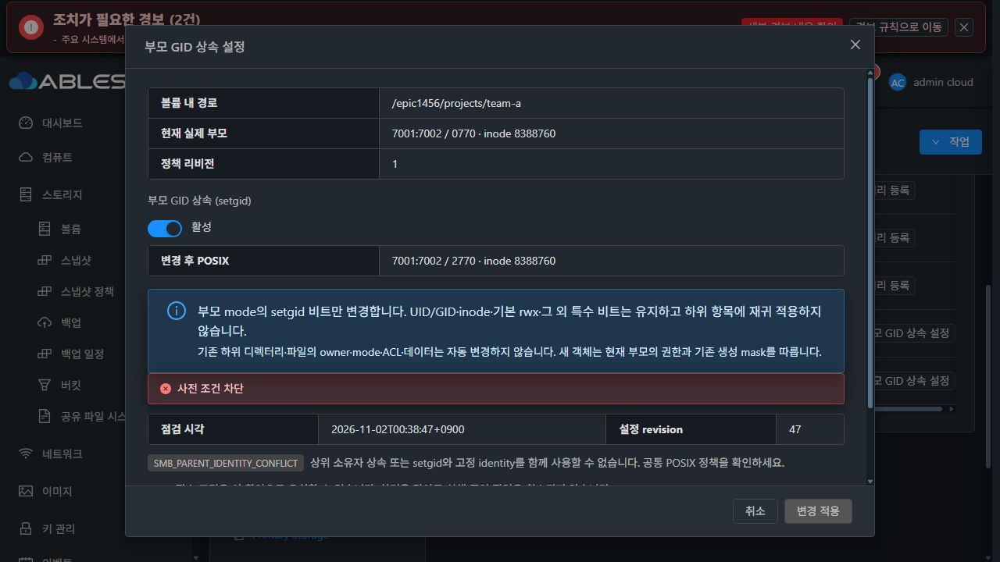
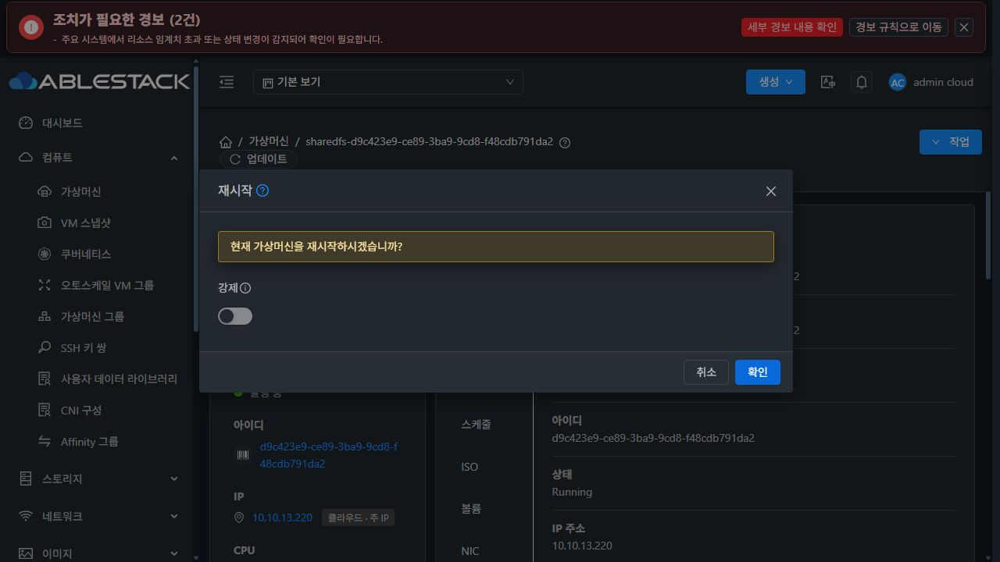
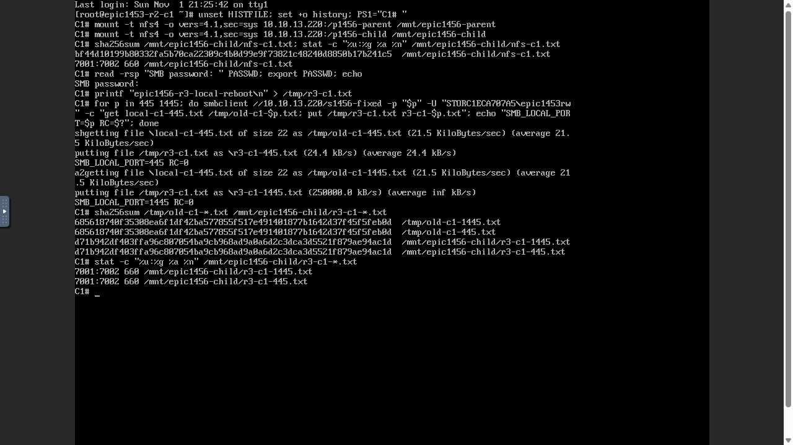
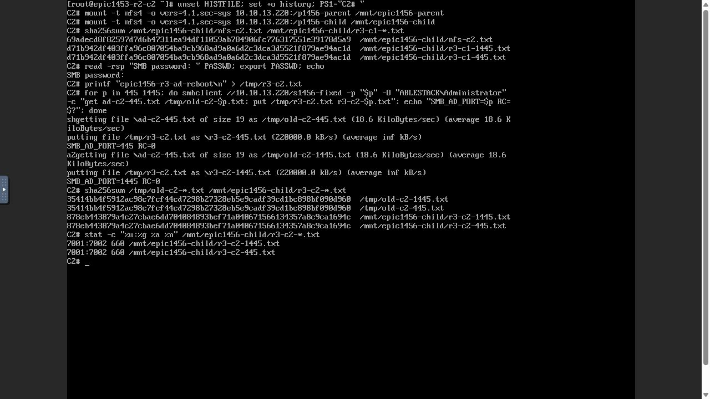
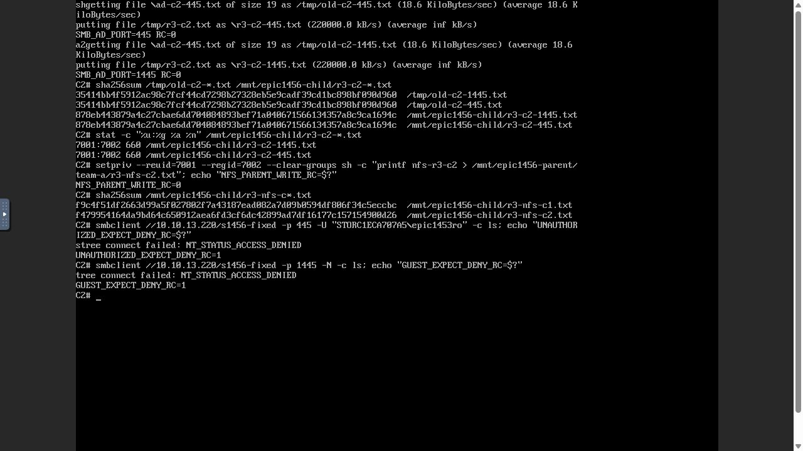

# #1456 R3 최종 인수 — 고정 POSIX identity와 보호 오류 계약

2026-11-02 KST. 상위 Epic #1438 / 기존 Draft PR #1470 / 작업 브랜치 `epic/1438-sharedfs`.

**기능 인수 5항목을 통과했습니다.** R2에서 남은 디렉터리 사전 점검의 알려진 보호 코드 분류·UI 안내를 최소 수정했고, 13번 배포 후 실제 UI VM 재시작과 두 noVNC 클라이언트의 NFS·SMB 재접속을 완료했습니다. 기존 ACL/POSIX·ACK/신원·중복/원복 보호는 유지합니다.

## 1. 원인과 최소 수정

R2의 게스트는 setgid와 FIXED identity의 충돌을 `SMB_PARENT_IDENTITY_CONFLICT`로 올바르게 거부했습니다. 관리 서버의 디렉터리 preflight catch가 `DIRECTORY_*`만 예상 보호로 취급해 이를 `UNKNOWN / DIRECTORY_OBSERVATION_UNAVAILABLE`로 바꿨습니다. 실제 mode0770과 policy revision1은 보존됐지만 UI가 기존 충돌 안내를 보여주지 못했습니다.

제품 commit **9f1b3b517a309b416db4134f21c68b58fabede86**의 변경은 두 파일입니다.

- `StorageServiceConfigurationPreflight.java`: 기존 DIRECTORY 보호 분류에 정확한 두 코드 `SMB_PARENT_IDENTITY_CONFLICT`, `SMB_FIXED_IDENTITY_PERMISSION_DENIED`만 추가해 BLOCKED로 전달합니다. 임의의 SMB 접두사를 전부 허용하지 않습니다.
- `StorageConfigurationPreflightPanel.vue`: BLOCKED의 해당 blocking check에 기존 한국어 identity 충돌 안내를 연결합니다. 원래 코드 태그도 유지합니다. 기존 컴포넌트·테마·대화상자 배치를 재사용하며 CSS·문구·서버 적용 계약을 바꾸지 않습니다.

통신 예외·null 응답·코드 부재·미등록 SMB 코드는 계속 **UNKNOWN**입니다. ACK를 주거나 점검이 만료돼도 거부를 READY로 바꾸지 않습니다. DB DDL·게스트·호스트 에이전트 변경은 없습니다.

시작 시 upstream/origin fetch → 로컬 Europa fast-forward → 로컬 base/upstream divergence **0/0** → 기존 Epic 브랜치의 local-base 기준 rebase를 확인했습니다. base SHA는 `1c5b169cd6283da23cc3e155d4b6d14e39e42793`입니다. 새 이슈·브랜치·PR을 만들지 않았습니다.

## 2. 사전 실증·회귀·빌드

| 검증 | 결과와 한계 |
|---|---|
| 구현 전 실제 SystemVM | 실제 directory preview RPC가 setgid 충돌을 반환함을 확인했습니다. mode0000 요청은 기존 DIRECTORY_ACL_MASK_CONFLICT 보호가 먼저 차단하며 이를 유지합니다. FIXED 권한 보호 함수의 독립 경로도 확인했습니다. 설정 변경·계정/권한 완화 없이 관측했습니다. |
| Java 실제 오류 경로 | 실제 DirectoryPolicies.preflight → proposal → RPC 결과 파싱 → 관리 observe → ApiResponseSerializer를 연결했습니다. DAO/guest 경계만 대역이며 저장 호출0을 검사합니다. 보호 코드3종과 관측 불가4종의 실제 직렬화 fixture를 생성했습니다. |
| Vue 실제 컴포넌트 | 실제 SetgidDialog·PreflightPanel과 위 wire fixture로 충돌 안내·UNKNOWN·ACK/만료 시 적용 금지를 검증했습니다. Form slot을 생략한 최초 시험 대역은 수정했고 제품 오류로 분류하지 않았습니다. |
| 관련 Java/API | **24 PASS / 실패0 / skip0**, Maven **26모듈 package SUCCESS** |
| 관련 UI | **3 suite / 26 PASS**, 변경 파일 lint·production build PASS |
| 빌드 환경 한계 | JDK17 JAXB noOptimize·기존 checkstyle/rat/license skip, Jest forceExit를 사용했습니다. Node20/Webpack4 호환 옵션을 쓴 UI 빌드 export는 canonical WSL 소스와 변경 파일 hash를 대조했습니다. 전체 저장소 CI 통과를 주장하지 않습니다. |

실제 native RPC의 첫 시험에서 mode0000의 선행 DIRECTORY_ACL_MASK_CONFLICT를 FIXED 코드로 예상했던 것은 시험 기대값 오류여서 기존 보호 순서에 맞춰 교정했습니다. 보호를 변경하거나 실패 요청을 적용하지 않았습니다.

## 3. 13번 배포

기존 정렬된 관리 JAR의 **outer class 1개만 교체**했고 나머지 **92,557 entries는 바이트 동일**입니다. UI는 바뀐 **6자산**을 배포하고 운영 config.json/color.less를 보존했습니다. 관리 서비스 mold.service를 재시작했고 HTTP200·실제 UI 재로그인을 확인했습니다.

| 항목 | 실제 배포 결과 |
|---|---|
| 관리 JAR SHA256 | `cda2c91bd86fc5accf79863be4a383cf3439f728c22b148908972c940624bb3f` |
| 변경 class SHA256 | `4282cbfe165c0950bb4a00994e6cf075c605307f85f736a46496954eb2669ab7` |
| HTTP /client/ index SHA256 | `01b7adac8bbd8467b2bde4b2fec8442d1002566b9ddef77ad47c5e5e74307f63` |
| 활성 guest | R1의 `1456.identity.1 / protected baseline9 / managed11`, R3 변경 없음 |
| DB / host agent | migration 없음 / 변경 없음 |

대상은 기존 전용 SharedFS `3f0056db-4dfe-4f13-908d-b809dd565d34`, instance `c1eca707-a554-4c42-85cd-1e9e9744d804`, VM `d9c423e9-ce89-3ba9-9cd8-f48cdb791da2`입니다. 기존 **10GiB SPARSE XFS DATA** `e070a0aa-dbf5-48c0-83e0-09f874446277`를 사용했고 새 디스크 생성·포맷·MAC 변경0입니다.

R1에서 별도로 UI 등록한 새 SYSTEM 이미지 `e3d6c230-c4f3-4570-b70f-e5512ff61222`는 현재도 **준비=false**입니다. 새 이미지 Ready/새 VM 검증을 수행했다고 주장하지 않습니다. 이번 요청의 수정·인수는 위 배포된 기존 SystemVM과 SPARSE DATA에서 실시했으며, 기능 인수 5항목에 새 SYSTEM 이미지 배포나 새 VM 생성 요건을 임의로 추가하지 않았습니다. 이미지 등록 상태를 성공한 기능 검증 결과로 대체하지 않습니다.

## 4. 실제 UI/API — 보호 안내·재시작·이력

모든 Mold 자원·설정 조작은 실제 UI로 수행했습니다. API 증거는 UI의 실제 요청/응답을 관측한 것입니다. QGA는 구현 전 주입 검증과 변경 후 읽기 전용 신원/데이터 대조에 사용했습니다. 클라이언트 I/O는 두 VM의 실제 noVNC에서 실행했습니다.

1. 공유 디렉터리 → `/epic1456/projects/team-a` → 부모 GID 상속 설정 → 활성 → 사전 점검을 실행했습니다.
2. 실제 응답은 **BLOCKED / SMB_PARENT_IDENTITY_CONFLICT / revision47 / fingerprint 빈 값**입니다. 기존 한글 안내와 비활성 ‘변경 적용’을 확인하고 취소했습니다. policy UPDATE는0이며 실제0770/policy revision1을 유지했습니다.
3. VM 표준 화면의 **작업 → 재시작**, 강제 옵션OFF로 실행했습니다. UI reboot job **3aef6408-3da0-4018-b1b6-56bb301936de**가 성공했습니다. boot ID가 실제로 변경됐습니다. 관리 서비스 재시작과 혼동하지 않습니다.
4. 원래 STATIC **10.10.13.220**에 복귀했고 실제 SMB UI가 AD **JOINED/OK/trust 검증됨**, 리스너 **445·1445 READY**, FIXED 실제 관측 **7001:7002**를 표시했습니다.
5. 작업 내역 UI에서 이번 6작업의 **COMMITTED5/ROLLED_BACK1**을 재조회하고 원복 작업 `611853f7-c254-4ded-8862-a57d142ea00f`의 최초 `PROTOCOL_APPLY_FAILED`·원복 확인 성공 진단이 남아 있음을 확인했습니다.
6. 재시작 뒤 같은 setgid 사전 점검을 다시 실행해 동일한 BLOCKED/한글 안내/적용 금지를 확인했습니다. 새로운 실패를 반복한 것이 아니라 재부팅 뒤 보호 유지의 예상 거부 시험입니다.

실제 다크모드에서 VM 표준 Breadcrumb·ResourceLayout의 세로 탭과 기존 Mold 대화상자의 고정 헤더/푸터·본문 스크롤을 유지했습니다. 충돌 코드와 도움말이 읽히고, 취소·비활성 적용 버튼이 보입니다. 기존 생성자 예측 문구/상속 열의 표시 차이는 R2와 같이 최종 UI 정리 #1468 검토 항목이며 기능 차단으로 취급하지 않았습니다. #1468의 전면 정리는 시작하지 않았습니다.

## 5. 재시작 후 실제 두 클라이언트

| 클라이언트 | 실제 noVNC 결과 |
|---|---|
| C1 / 10.10.254.224 | NFS parent/child 재마운트 성공. 기존 nfs-c1.txt SHA·7001:7002/0660 보존. 로컬 허용 계정으로 SMB445/1445의 기존 파일 읽기·새 파일 쓰기 모두 RC0. |
| C2 / 10.10.254.223 | NFS parent/child 재마운트 성공. 기존 nfs-c2.txt SHA와 C1의 새 SMB 파일 교차 읽기 일치. AD ADMIN 계정으로 SMB445/1445 읽기·새 파일 쓰기 모두 RC0. |
| 두 포트 작업 identity | 새 SMB 파일4개 모두 **7001:7002 / 0660**. 두 NFS 부모 경로의 명시적 UID/GID7001/7002 쓰기 성공, 자식 별칭에서 같은 데이터 조회. |
| 재시작 후 접근 보호 | 인증 가능한 미허용 로컬 계정은 fixed 공유 tree connect ACCESS_DENIED/RC1. guest도1445에서 ACCESS_DENIED/RC1. |
| 감사 분리 | 새4파일 감사에 원래 `epic1453rw` / `administrator`와 실제 작업 `asfs_u_c1eca707_7001 / asfs_g_c1eca707_7002`가 함께 남습니다. %D의 ‘UNIX USER’를 원래 AD realm이라고 주장하지 않습니다. |
| 시험 종료 | 클라이언트의 런타임 암호 변수 제거·NFS 마운트 해제·로그아웃을 완료했습니다. |

고정 관리 계정은 **UID7001/GID7002·locked·/usr/sbin/nologin·home 없음·Samba passdb 미가입**을 유지합니다. 445/1445 두 소유 리스너는 force user/group 일치, **admin users 빈 값 / guest no / inherit owner no / full_audit**를 유지합니다.

## 6. 보존 대조와 이전 인수의 연결

- 기존 서비스 **54객체**와 이전 #1455 중첩 시험 **19객체**의 내용 SHA256·owner·mode·ACL·inode가 R1 변경 전 기준과 같습니다.
- 재시작 전 이번 시험 **16객체**가 재시작 직후 모두 같고, 클라이언트 새 쓰기6파일 추가 후에도 기존16개는 그대로입니다. 최종22객체입니다.
- SMB 리스너/desired 설정 bytes·identity 소유 registry·FS UUID `9c8ddfe9-3e23-46f0-9476-5c794b004841`·XFS·MAC `02:0d:00:cc:00:93`를 보존했습니다.
- passwd/group/gshadow는 동일합니다. 전역 shadow hash는 SystemVM의 기존 부팅 루틴이 cloud 서비스 계정 암호를 임의화하므로 달라졌습니다(`setup/common.sh` parse_cmd_line). 관리 identity는 계속 locked/nologin이며 shadow 복원이나 계정 재설정을 하지 않았습니다. 이를 계정 파일 손상으로 오판하지 않습니다.

R2의 실제 UI 생성/ACL·원복·온라인 변경·보호 검증은 [이전 보고서](../sharedfs-1456-ui-contract-r2-20261101/README.md)의 구분된 증거를 사용합니다. 이번에 중단 지점을 교정하고 남은 재부팅/재접속/최종 보존을 완료했습니다.

| #1456 인수 기준 | 최종 근거 |
|---|---|
| 허용 로컬/AD의 파일·디렉터리 고정 UID/GID | R2 실제 생성/두 포트 디렉터리 + R3 재시작 후 파일·교차 NFS |
| 비허용 계정·POSIX 권한 없는 고정 identity 거부 | R2 LOCAL 및 AD ADMIN의 mode0000 거부·0660 복원, R3 미허용/guest 거부 |
| 원래 사용자 감사·기존 파일·NFS 교차 보존 | R2/R3 실제 감사 및 기존54+19·이번16객체 보존 |
| 상속/identity·재부팅·원복 | R2 UID1001 충돌·guest/inherit guard·mask reload/열린 세션·단발성 리스너 실패 자동 원복, R3 BLOCKED 안내/실제 reboot |
| 보호 ID·UID 충돌·ADMIN/guest·관리 identity 금지 | native/API 보호 ID 시험, R2 실제 UID 충돌·AD ADMIN POSIX 우회 거부, R3 non-login/passdb 부재·두 소유 리스너의 admin users 빈 값 |

모두 #1456 범위의 인수이며 Epic 전체나 다른 프로토콜/볼륨/이미지 배포 기능의 완료로 확대하지 않습니다.

## 7. 증거

- [실제 UI 사전 점검·VM 재시작 API wire](actual-ui-preflight-reboot.json)
- [재부팅/객체/계정 보호 요약](restart-preservation.json)
- [최종22객체·registry·설정 hash](final-test-state.json)
- [기존54객체·이전19객체·FS/신원](final-original-state.json)
- [실제 리스너·ACL·원래/작업 사용자 감사](final-identity-audit.json)
- [재시작 후 UI에서 조회한 작업 요약](ui-operation-history.json)
- [관리 변경 모듈](management-module-build.json) / [UI 변경 자산](ui-module-build.json)

전체 raw 계정 hash·인증정보·서명 개인키·콘솔 URL 토큰은 공개 근거에 포함하지 않았습니다. 관련 R1/R2 과거 중단 결과는 역사 기록으로 유지하고 이 R3 최종 결과로 완료 판정을 갱신합니다. 다음 대상은 **#1457 공유별 클라이언트 IP/CIDR 접근 허용 정책**이며 아직 착수하지 않았습니다.
