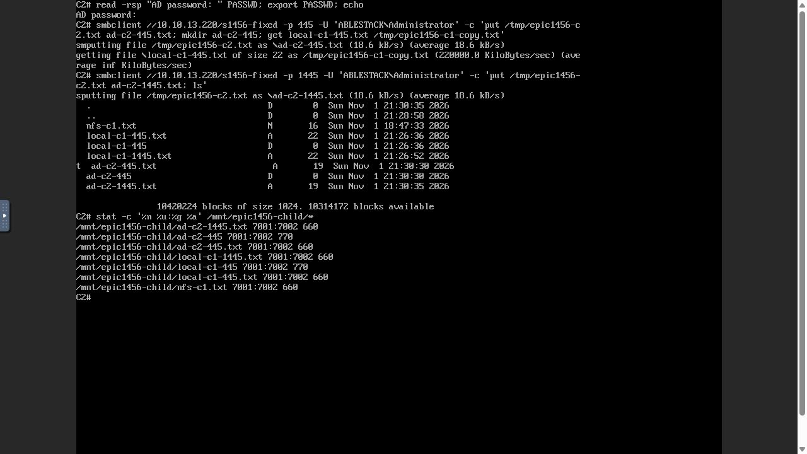
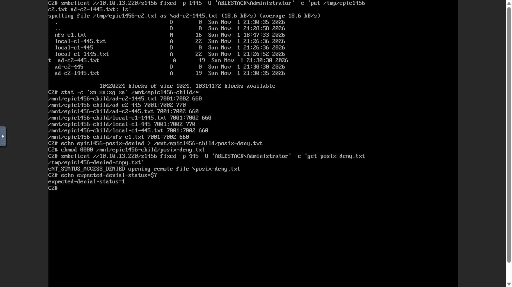
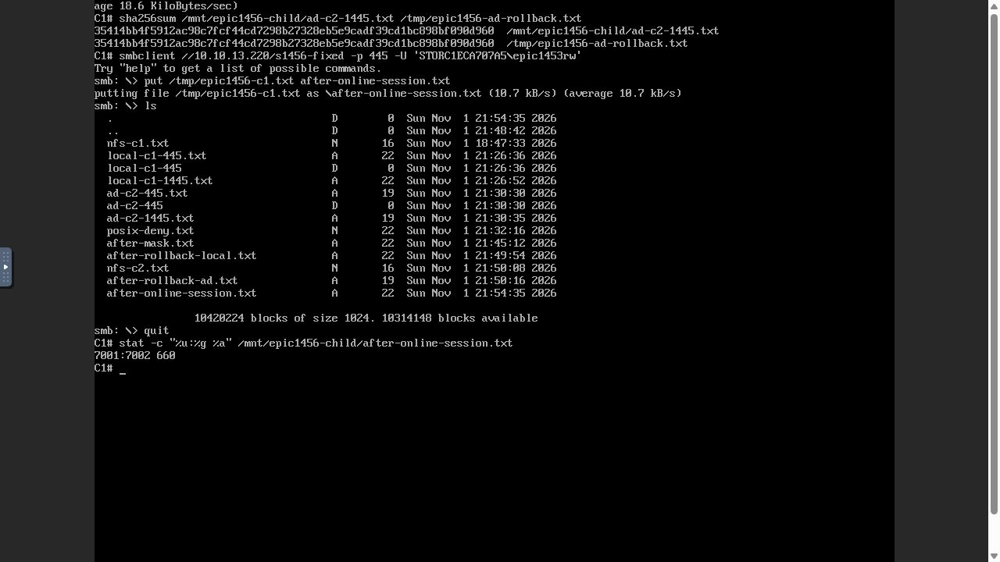
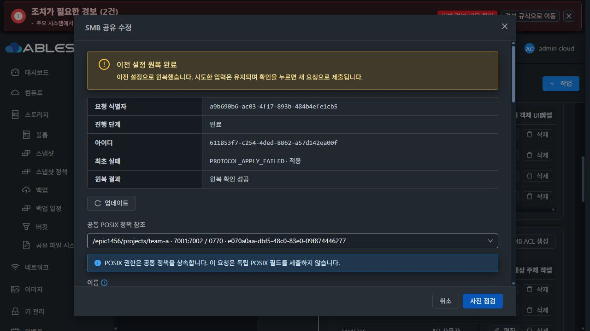
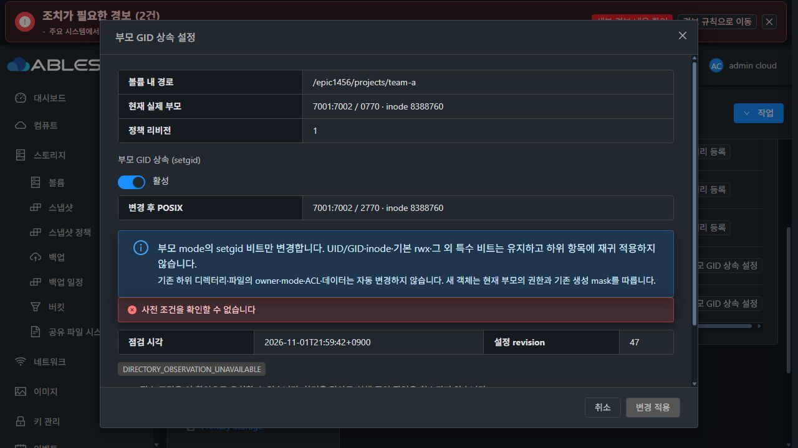

# #1456 UI 계약 교정·배포·실환경 검증 R2

2026-11-01 KST / Epic #1438 / epic/1438-sharedfs / Draft PR #1470.

**이전 SMB 생성 ACK 불일치는 수정·배포했고 실제 UI 생성/ACL 게시/두 클라이언트 접속/자동 원복까지 통과했습니다. 이후 setgid 충돌의 API 오류 분류 결함을 확인해 중단했습니다. #1456은 OPEN, SystemVM 재시작 등 최종 인수는 미완료입니다.**

## 1. 이번 변경 범위와 사전 실증

제품 변경은 UI3파일뿐입니다.

- smbShareParameters.js에서 생성/편집의 공통 정책 파라미터를 만듭니다. 실제 submit과 점검 intent가 같은 optional inheritOwner·identity delta·guest/RO/browseable 값을 사용합니다.
- storageConfigPreflight.js는 그 파라미터에서 SMB 점검 intent를 구성합니다. CREATE에만 섞이던 smbfullapply/미제출 false를 제거하고 UPDATE full transaction·기존 단순 옵션 경로를 유지합니다.
- SharedFSTab.vue의 중복 정책 파라미터/점검 생성 코드를 공통 helper로 대체합니다.
- 서버·게스트 제품 코드·공개 API·DB 스키마·Mold 마크업/CSS·로케일 변경0입니다. 게시된 섹션 누락·상속/권한·ACK 보호를 변경하지 않았습니다.

제품 commit **7364cd24859e548d013c798e12e94b300b703488**. 로컬 Europa/upstream **1c5b169cd6283da23cc3e155d4b6d14e39e42793**를 먼저 확인해 divergence0/0으로 동기화하고 기존 Epic 브랜치를 유지했습니다.

구현 전에 실제 SystemVM에서 이전 UI/API payload의 지문 불일치를 재현했고 동일 파라미터의 점검 지문이 같음을 확인했습니다. private mount/network namespace·RAM 계정/passdb overlay에서 **33검사 PASS**: 게시된 공유의 섹션 누락, 상속/SGID 충돌, live drift, 보호 ID/UID 충돌, 관리 identity 인증/계정 보호, 실제 Samba UID/GID·데이터 보존을 확인했습니다. 운영 계정 파일은 불변입니다.

## 2. 회귀 시험·빌드·배포

- mounted SharedFSTab의 실제 점검→submit4쌍: FIXED 생성, 기본 모드 생성, 상속 생성, FIXED 편집. UI4suite37시험 PASS.
- 캡처 fixture를 실제 컴포넌트 출력과 다시 비교한4시험 PASS. 앞선37건과 중복이므로 합산하지 않습니다.
- 실제 ParamProcessWorker의 UUID/boolean/long 입력 처리→commandIntent→기존 상속 정규화→실제 서버 guest query 생성의 양쪽 요청4쌍이 동일합니다. 관련 Java11시험 PASS/skip0. 실제 DAO 전체 회귀를 이번 UI 전용 교정에서 재실행했다고 주장하지 않습니다.
- 그 중 이번 오류 경로의 **실제 API 처리로 생성한 두 guest query**를 실제 SystemVM에 전달했습니다. 양쪽 READY와 같은 fingerprint **4b2d52f5…**를 확인했습니다. 시험 DAO 참조/포트 수가 달라 이 지문을 운영 UI의 지문 값과 직접 비교하지 않습니다.
- UI lint·production build PASS. 임시 호환 build export를 사용하고 canonical WSL의 제품3파일 hash를 대조했습니다. 의존성 업그레이드0입니다.
- API 시험은 Maven26모듈에서 수행했습니다. JDK17/JAXB noOptimize, 기존 checkstyle/rat/license skip을 사용했습니다. UI의 Node20/Webpack4 호환은 build-only openssl-legacy-provider로 처리했습니다. 저장소 전체 CI 통과를 주장하지 않습니다.
- UI 변경 자산8개만13번에 배포했습니다.595자산은 hash가 동일했고 변경과 무관한307개 debug map은 배포하지 않았습니다. config.json/color.less는 보존했습니다.

| 배포 대상 | 확인 |
|---|---|
| UI index SHA256 | cc562918e0ded68ab29e2af4632f905c7859684e4d407fa73b38ee6bf3c7554a |
| 관리 JAR SHA256 | b5f55e9ac9367b918b929dcba7cf633edefa5e527144c1d063365ef577692e6f · 이번 교체0 |
| 활성 guest | 1456.identity.1 / baseline9 / managed11 · 이번 변경0 |
| DB·호스트 agent | 변경0 |

관리 서비스는 이미지 저장소 동기화를 위해1회 재시작했고 HTTP200을 확인했습니다. **이를 SharedFS SystemVM 전체 재시작 인수로 세지 않습니다.** 앞서 UI로 등록한 신규 SYSTEM 이미지 e3d6c230…는 마지막 관측 시 Ready=false이며 신규 이미지 부팅 검증은 완료하지 않았습니다. 활성 SystemVM의 정상 기능 시험과 구분합니다.

## 3. 실제 UI/API·두 noVNC 클라이언트 결과

대상 SharedFS **3f0056db-4dfe-4f13-908d-b809dd565d34**, instance **c1eca707-a554-4c42-85cd-1e9e9744d804**, SystemVM **d9c423e9-ce89-3ba9-9cd8-f48cdb791da2 /13.220**입니다. 기존 **10GiB SPARSE XFS DATA e070a0aa…**의 새 epic1456/projects/team-a 경로를 사용했습니다. 디스크 생성·포맷·수동 MAC 변경0입니다. C1/C2는13번의 전용 Rocky 클라이언트 aaa3c43c…/e6744029…를 실제 Mold VM 콘솔로 조작했습니다.

| 시험 | 실제 결과 |
|---|---|
| FIXED7001/7002 미게시 생성 | UI 점검/submit의 ACK14984782… 일치, COMMITTED42→43 |
| 기존 로컬 epic1453rw ACL 게시 | UI COMMITTED43→44, 두 포트의 실제 force 설정 확인 |
| AD ABLESTACK\\Administrator ADMIN ACL | UI COMMITTED44→45 |
| C1 로컬445/1445·C2 AD445/1445 | put/get/mkdir PASS. 파일·디렉터리 UID/GID7001:7002 |
| NFS 부모/직접 자식·SMB 교차 | 두 클라이언트의 실제 쓰기·읽기·source/copy SHA 일치 |
| 비허용 계정 | 기존 common 공유에서 같은 계정 인증 성공(exit0), 새 FIXED 공유는 ACCESS_DENIED(exit1) |
| POSIX 권한 없는 파일 | 로컬/AD ADMIN 모두 읽기 거부. mode0660 복구 후 같은 내용 읽기 성공 |
| guest/관리 identity | 공유 접근 거부. 관리 계정은 locked/nologin·home 없음·passdb 미가입 |
| 외부 UID1001 충돌 | UI/API BLOCKED / SMB_FIXED_IDENTITY_UID_COLLISION, apply 비활성·계정 미변경 |
| FIXED+inherit owner/guest 초안 | UI 충돌 안내·점검 비활성, apply0 |
| mask0660→0640 | UI COMMITTED45→46. actual POST에 identity/POSIX 재제출0, 새 파일640·기존660·UID/GID 보존 |
| 제어된445 리스너 기동1회 실패 | UI ROLLED_BACK / rollback SUCCEEDED. 원래 공유명·설정·계정·데이터로 복귀 |
| mask0640→0660·열린 연결1개·double click | COMMITTED46→47, POST1. 같은 interactive SMB 세션에서 새 파일 쓰기 성공,7001:7002/0660 |
| 상위 경로 ../outside-1456 | UI 안내로 거부, preflight 및 생성 요청0 |
| 부모 p1456-parent 삭제 | 자식 NFS/SMB 명시 안내·DELETE0 |
| 참조 중 DATA detach | 실제 버튼 disabled=true |

아래 행은 정상 인수로 세지 않습니다.

| 미완료/오류 | 상태 |
|---|---|
| 게시된 FIXED 참조가 있는 공통 정책의 setgid 시도 | 게스트는 올바른 충돌 차단. 관리 API가 UNKNOWN으로 잘못 분류해 중단 |
| SystemVM 전체 재시작·cold AD/클라이언트 재접속 | 이번 오류 후 시작하지 않음 |
| 신규 SYSTEM 이미지 Ready/새 VM | 미완료 |

감사에는 원래 username **epic1453rw/administrator**와 작업 사용자/그룹 **asfs_u_c1eca707_7001/asfs_g_c1eca707_7002**가 구분돼 남았습니다. VFS의 도메인 필드는 effective UNIX USER 문맥이며 이를 원래 AD realm이라고 주장하지 않습니다. 원래 LOCAL/AD principal은 SQL/desired ACL에 유지됩니다. 모든 실패 파일 syscall 감사까지 검증했다고 주장하지 않습니다.

## 4. 실패 원복·보존

one-shot /run systemd drop-in은 전용445 리스너의 다음 기동1회만 실패시켰습니다. 실제 UI에서 공유명 변경 초안을 적용했고, 최초 PROTOCOL_APPLY_FAILED와 rollback SUCCEEDED가 남았습니다. 이 실패는 의도한 시험입니다. cleanup은 훅만 제거했고 별도 서비스 재시작/복구 API를 실행하지 않았으며 리스너 active와 marker 소모를 확인했습니다.

작업 **611853f7-c254-4ded-8862-a57d142ea00f** / request a9b690b6…는 ROLLED_BACK입니다. 원복 전후11객체의 hash·owner/mode/ACL/inode, SMB 설정/desired hash·계정4파일·MAC이 동일했습니다. 이후 두 클라이언트의 새 쓰기/교차 읽기도 성공했습니다.

최종 readonly 비교는 기존54객체·#1455 데이터·FS UUID·MAC 보존, FIXED 생성 이후 계정 파일 불변, 새 시험16객체와12파일의 해시를 확인했습니다. 기존 nfs-c1.txt SHA는 **bf44d10199b80332fa5b70ca22309c4b0d99e9f73821c48240d8850b17b241c5**로 유지됐습니다. root는 **7001:7002/0770/inode8388760**이며 setgid는 적용되지 않았습니다.

[원복 비교](rollback-preservation.json) / [최종 보존·파일 SHA](final-preservation-summary.json) / [UI의 실제 요청·응답/작업6건](ui-api-public-evidence.json)

## 5. 중단한 새 제품 결함의 정확한 원인

실제 UI: 공유 디렉터리→해당 공통 정책→부모 GID 상속 설정→0770에서2770으로 초안→사전 점검. 예상한 결과는 알려진 **SMB_PARENT_IDENTITY_CONFLICT / BLOCKED**입니다.

실제 guest RPC directory policy preview는 read-only이며 **exit1, {\"code\":\"SMB_PARENT_IDENTITY_CONFLICT\"}**를 반환했습니다. 동일한 실제 payload를 올바른 파일 인수 계약으로 readonly 재현해 확인했습니다. 신규 policy UPDATE는 전송0, SQL revision47·실제 mode0770·데이터가 유지됐습니다.

원인 경로:

1. smb_file_identity.validate_directory_change는 게시된 FIXED 참조와 새 setgid의 충돌을 올바르게 거부합니다.
2. StorageDirectoryPolicies.rpc(:40)는 게스트의 code를 CloudRuntimeException에 그대로 보존합니다.
3. **StorageServiceConfigurationPreflight.observe(:210)의 디렉터리 분기는 DIRECTORY_* 코드만 인정합니다.**
4. SMB_PARENT_IDENTITY_CONFLICT가 whitelist 밖이라 DIRECTORY_OBSERVATION_UNAVAILABLE로 치환되고, UNAVAILABLE 문자열 때문에 API **status=UNKNOWN**이 됩니다.
5. 실제 UI는 그 응답대로 ‘사전 조건을 확인할 수 없습니다’를 표시합니다. 확인된 정책 충돌을 관측/QGA 장애로 잘못 판정하는 **API 계약 결함**입니다. 단순 번역/단계 이름 표시 차이와 구분했습니다.

[실제 UI 요청/응답과 guest 원인 코드](setgid-error-contract-evidence.json)

### 다음 최소 개선 방향 — 이번 중단 후 구현하지 않음

- 디렉터리 preflight 분기에서 실제 재현한 **SMB_PARENT_IDENTITY_CONFLICT**와 같은 보호 함수가 명시적으로 반환하는 **SMB_FIXED_IDENTITY_PERMISSION_DENIED**를 알려진 BLOCKED 코드의 최소 whitelist로 보존합니다. 후자는 코드 검토로 동일 분류 누락을 확인했으며 이번 실환경에서 별도로 실행하지 않았습니다. 임의의 SMB_* 문자열을 광범위하게 허용하지 않습니다.
- 진짜 전송/관측 장애는 UNKNOWN으로 유지합니다. apply·ACK·published-section·POSIX/상속/UID 보호는 그대로 둡니다.
- 실제 UI의 같은 SetgidDialog/PreflightPanel에서 기존 file.identity 충돌/권한 안내 로케일을 재사용해 이유를 보여주고 apply 비활성을 유지합니다.
- 실제 guest 실패 code→StorageDirectoryPolicies.rpc→directoryObserver→observe→ApiResponseSerializer→mounted SetgidDialog의 오류 경로 회귀를 추가해야 합니다. 명시된 두 보호 코드와 실제 전송 장애를 함께 검사합니다. 현재 UI/입력 동등성·직접 native 보호 시험은 이 **디렉터리 observer 오류 분류 분기**를 검사하지 못했습니다.
- 그 교정 후 동일 UI 충돌 차단을 재검증하고, 남은 SystemVM 재시작/재접속·최종 보존 인수를 진행합니다.

## 6. UI 범위·현재 정리 상태

MoldDialog/기존 VM 표준 Breadcrumb·세로 탭·목록/상세 레이아웃과 다크 테마를 사용했고 이번 교정은 DOM/CSS를 변경하지 않았습니다. 실제 다크 화면은 증거로 보존했습니다. 최종 전체 UI/대비/스크롤 인수를 완료했다고 주장하지 않습니다.

비차단 표시 사항은 #1468 정리 대상으로 남깁니다: FIXED row의 부모 GID 상속 칼럼에 고정 GID가 그대로 표시되는 부분, 생성 권한 하단의 일반 상속 예측 문구와 고정 identity 안내의 정합성입니다. #1468 구현은 착수하지 않았습니다. 위 API UNKNOWN 분류 결함은 이 표시 사항에 포함하지 않습니다.

시험용 one-shot 훅은 제거됐고 클라이언트는 마운트 해제·PASSWD unset·로그아웃했습니다. 오류 후 config apply/VM 재시작/재시도/기능 수정은 진행하지 않았습니다. 새 이슈·브랜치·PR를 만들지 않았고 **#1456 OPEN / Epic PR Draft**로 유지합니다.
