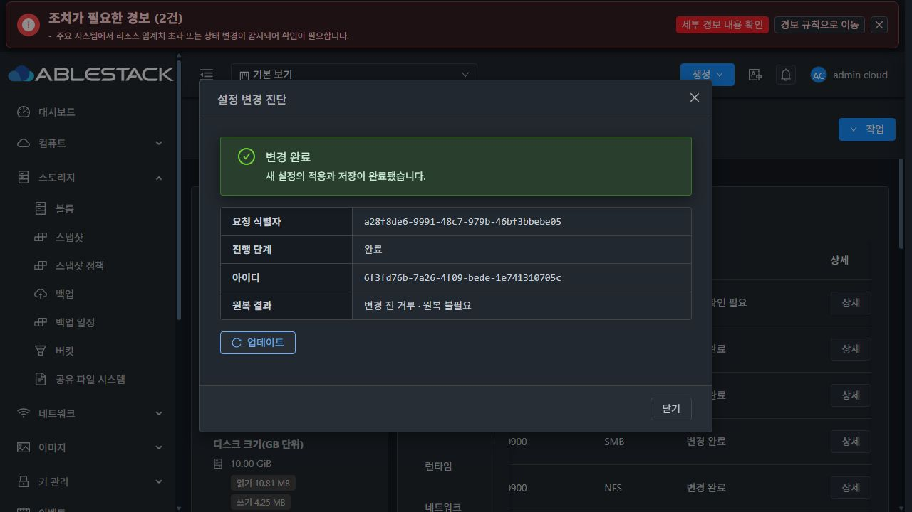
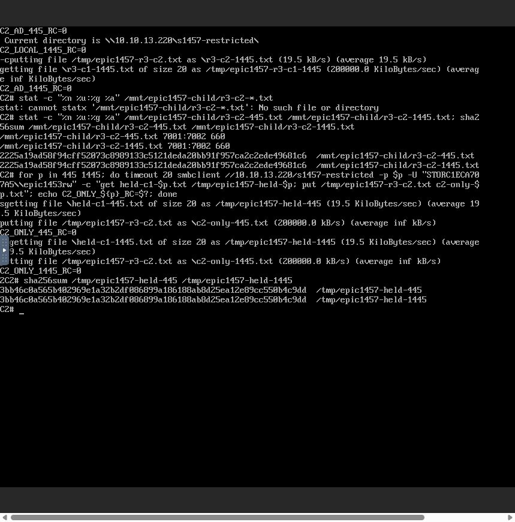
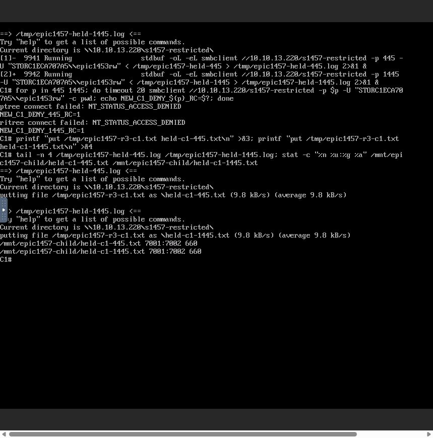
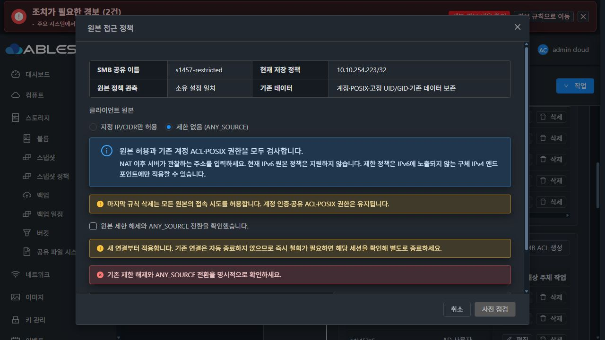
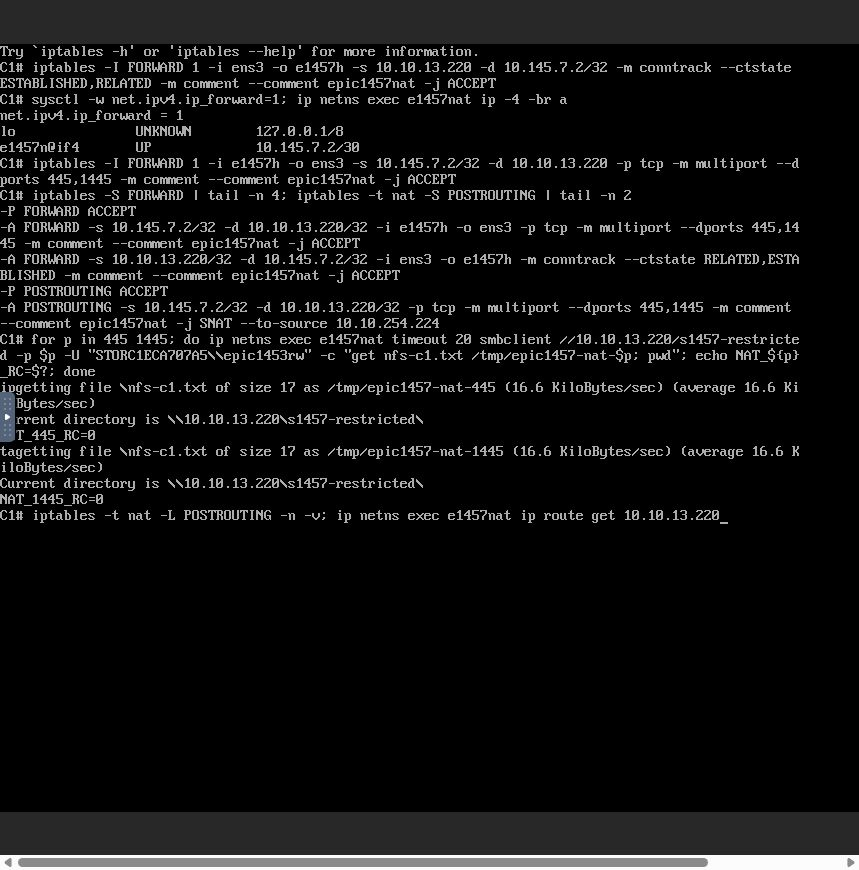
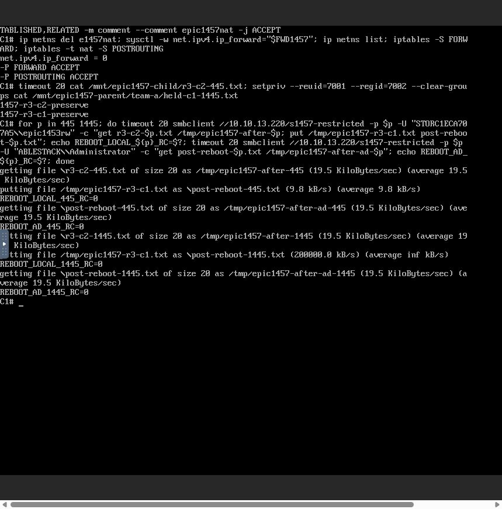
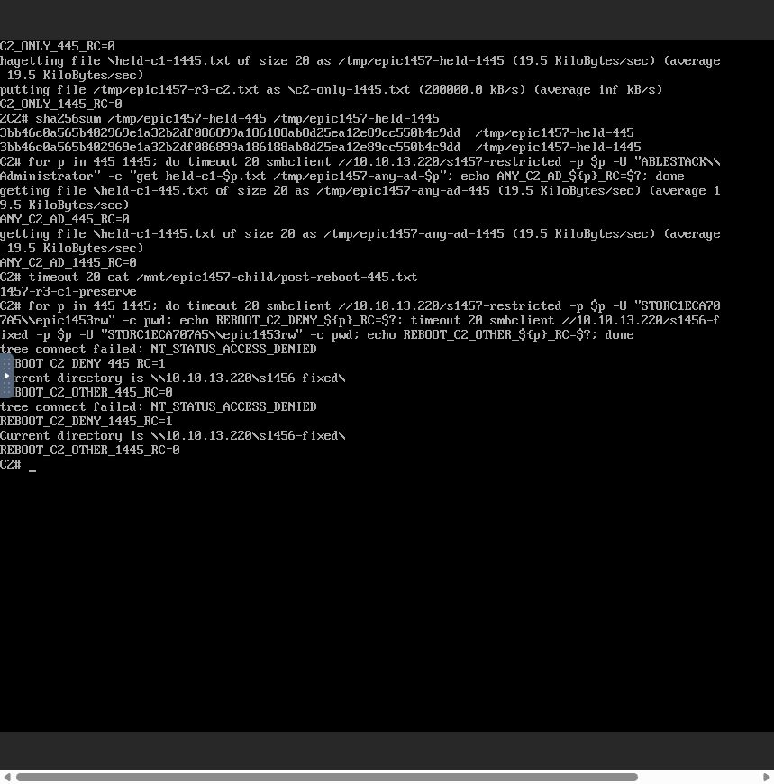
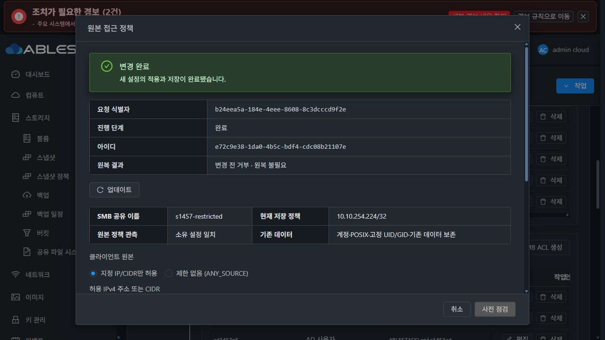
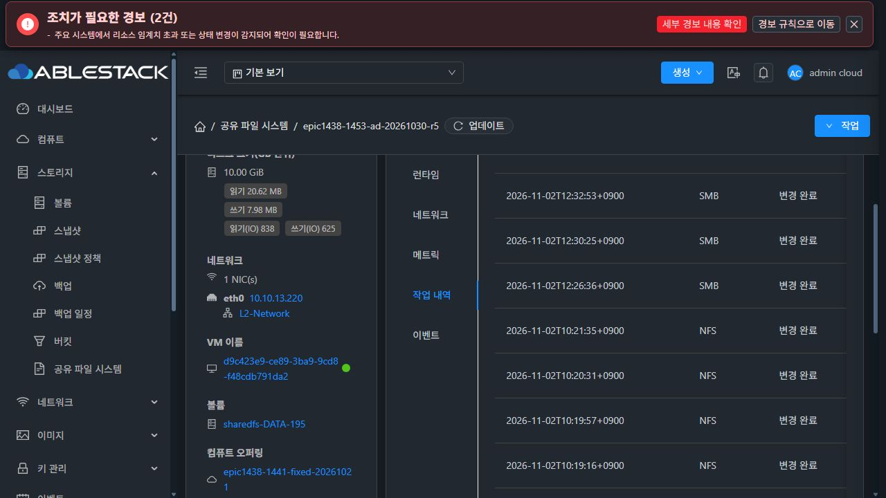

# #1457 R3 완료 — 원본 정책 전용 확정·실제 UI 복구·클라이언트·재시작 검증

2026-11-02 KST / Epic #1438 / 기존 branch epic/1438-sharedfs / Draft PR #1470

**이전 DIRECTORY_BINDING_RECEIPT_MISSING을 해결했고, 보존된 동일 작업을 UI에서 확정한 뒤 남은 검증을 통과했습니다.** 새 이슈·브랜치·PR을 만들지 않았습니다. 최종 저장/실행 정책은 C1 10.10.254.224/32입니다. IPv6 정책은 설계대로 지원하지 않습니다.

## 1. 최소 수정과 구현 전 실증

구현 commit **cc8bc5aa0390eb38034d7f63e5ce1e8eae73d868**. 로컬 Europa를 upstream **e3aaec913ff35e92124434235eef8a76534b4c2c**에 먼저 동기화하고 기존 Epic을 rebase했습니다. 기준 브랜치/upstream 차이0/0입니다.

실제 SystemVM의 실패 요청·VERIFIED 영수증·capability를 읽어 fixture로 사용했습니다. 기존 코드에서 실제 coordinator→DAO 시험이 **DIRECTORY_BINDING_RECEIPT_MISSING으로 실패**함을 먼저 확인했습니다. 자원/설정은 UI에서 변경했고, QGA는 실제 상태·시험 fixture 수집과 격리 native 시험에 사용했습니다.

제품 수정은 관리 서버 helper 두 개입니다.

- StorageFileSharePaths.applyBindings(): 서버가 검증한 원본 정책 전용 작업만 새 무경로 확정 분기로 연결합니다.
- StorageSmbClientAccessPolicy.pathPreservingCommit(): durable flag와 UPDATE/SMB/실제 command 유형·원본 전용 파라미터를 확인합니다. 요청한 정책과 실제 후보 정책이 같아야 하며, **clientAccess를 제외한 전체 전후 스냅샷이 같아야** 합니다. 경로·볼륨·pathIdentity·계정 ACL·다른 공유 등은 변경할 수 없습니다.
- 일반 경로 변경의 영수증 필요, 잘못된 영수증 거부, 혼합 요청 차단, 기존 onlineSmbOptions 계약은 유지합니다. 보호를 끄거나 DB를 수동 수정하지 않았습니다.

[실제 SystemVM fixture](../../../server/src/test/resources/storage-config/storage-1457-source-verified.json) · [수정 전 재현](evidence/before-fix-report.md)

## 2. 회귀·빌드·배포

| 검증 | 결과 |
|---|---|
| 실제 coordinator→DAO 포함 관련 Java/API 10suite | **53 PASS / skip0** |
| 실제 bound 공유 + VERIFIED/pathbindings 없음 | 정책 저장·revision 증가·경로/alias/peer 보존 |
| 동일 durable 작업 재개·완료 요청 중복 재생 | 재적용 없이 같은 작업 확정 |
| 경로·inode·volume·peer·혼합 요청·다른 정책·두 flag 오용 | 차단 유지 |
| 일반 경로 영수증 누락·제공한 영수증 불일치 | 차단 유지 |
| SharedFSTab 생성/편집 포함 관련 UI6suite | **36 PASS** |
| server -am package26모듈 / UI production build | **PASS** |
| 실제 SystemVM 격리 native 엔진 회귀 | **31 PASS**, 서비스 파일 불변 |

13번 관리 JAR의 **두 class만 교체**하고 mold.service를 재시작했습니다. 나머지 **92,557개 entry는 동일**합니다. DB schema/API/guest 코드 변경은 없습니다.

- 관리 JAR SHA: **c34b3ec27fe163b6b2246ec46d4f835907d3bf71f12c16d5299f32134250a458**
- UI 재빌드 index SHA: **f68719a8d5e9984218d813b367227b177c1a977b6b1df9583cdb85ef8f14b95e**
- 이번 UI 코드는 미변경입니다. 기존 배포 호환 소스의 재빌드 결과를 13번 자산·HTTP와 비교해 **추가 교체0/모두 동일**을 확인했습니다. 운영 config/color를 유지했습니다.
- guest **1457.sources.1 / 보호 baseline10 / managed12**, manifest SHA **9fef476290e2bb7862844acd8d5818864daecbd422921fd53dad409daf81ae60** 유지.

전체 저장소 CI 통과를 주장하지 않습니다. 기존 환경과 같은 JDK17 JAXB noOptimize, baseline checkstyle/rat/license 제외 옵션 및 Jest forceExit를 사용한 범위 시험입니다.

[시험 요약](evidence/checks.md) · [관리 배포](evidence/management-deployment.json) · [UI 대조](evidence/ui-deployment.json) · [런타임](evidence/runtime-final.json)

## 3. 실제 UI에서 동일 실패 작업 복구

관리 서버 재시작 후 실제 UI로 로그인하고 ‘작업 내역 → 기존 실패 작업 상세 → 복구 재개’를 실행했습니다.

- 원래 요청 **a28f8de6-9991-48c7-979b-46bf3bbebe05**
- 원래 작업 **6f3fd76b-7a26-4f09-bede-1e741310705c**
- 재개 async job **1931f5ea-fcbf-411f-bc4f-b62d7e490bd9**
- **COMMITTED / COMPLETED / revision57→58 / canresume=false**
- 재조회 UI·API에서 저장 정책10.10.254.0/24와 실제 두 포트 정책이 일치했습니다. 새 apply 요청으로 대체하지 않았습니다.

## 4. 실제 UI·클라이언트 결과

시험 대상은 SharedFS **3f0056db-4dfe-4f13-908d-b809dd565d34**, SystemVM **d9c423e9-ce89-3ba9-9cd8-f48cdb791da2**, STATIC **10.10.13.220**입니다. 기존 **10GiB SPARSE XFS DATA e070a0aa-dbf5-48c0-83e0-09f874446277**와 C1/C2의 SPARSE ROOT를 사용했습니다. 디스크 생성·포맷·MAC 변경0입니다.

공유 변경은 실제 UI의 입력→점검→영향 확인→적용으로 실행했습니다. API는 이 UI 요청/응답을 관찰했습니다. 클라이언트는 실제 Mold noVNC 콘솔에서 작업했습니다.

| 실제 수행 | 결과 |
|---|---|
| /24 정책에서 C1·C2, 445·1445 | 로컬/AD 접속·쓰기·상호 읽기 성공 |
| NFS child 및 부모 경유 동일 경로 | 기존·새 SMB 파일 읽기, 숫자 UID/GID·권한 대조 성공 |
| C2만 허용하는 /32로 UI 변경 | 작업0fad1a9a-58fe-45f9-bb0d-b329ab3fffea, revision58→59 COMMITTED |
| C1 새 연결 / C2 새 연결 | C1 두 포트 거부, C2 두 포트 읽기·쓰기 성공 |
| 변경 전 C1의 두 열린 tree | 정책 철회 뒤에도 파일 쓰기 유지. 새 연결 적용 안내와 일치 |
| 마지막 제한 해제 | 확인 전 제출 차단, 명시적 확인 뒤 clientcidrs=[]/confirmanysource=true |
| ANY_SOURCE UI 변경 | 작업7f88b685-caaf-4a59-a595-5b19dfdaed67, revision59→60 COMMITTED |
| ANY_SOURCE의 인증 보호 | C1·C2 정상 계정 접속, 공유 ACL 없는 유효 계정은 두 포트 계속 거부 |
| C1 /32 제한 재설정 | 작업e72c9e38-1da0-4b5c-bdf4-cdc08b21107e, revision60→61 COMMITTED |
| 실제 NAT | C1 내부10.145.7.2를10.10.254.224로 SNAT. 두 포트 읽기 성공, 서비스 관측 원본10.10.254.224 확인 |
| 다른 기존 공유 | C2의 s1456-fixed 두 포트 접속 유지 |
| 재시작 후 | 아래와 같이 제한·인증·NFS·SMB·데이터 보존 통과 |

R2에서 확인한 hostname/wildcard/정규화 중복/0-prefix/IPv6의 실제 UI 입력 차단 및 원본×계정×POSIX 거부는 변경하지 않았습니다. 이번53건의 관련 보호 회귀와 ANY_SOURCE 계정 거부도 통과했습니다.

[UI 요청·응답](evidence/ui-contract-evidence.json) · [완료 작업](evidence/completed-operations.json) · [NAT 서비스 원본](evidence/nat-server-observation.json)

### 실패 원복·loopback 시험의 정확한 범위

실제 SystemVM의 private mount/network namespace와 RAM /etc/Samba 상태에서 **실제 원본 정책 엔진·Samba 두 포트**를 시험했습니다. 현재 활성 helper와 시험 helper의 SHA **1a88a1a3c798c5ec820a251aff866bdbee057e2d7577e1617a19909735a415f6**가 같습니다.

부분 reload 실패를 한 번 주입한 뒤 이전 bytes·두 포트 허용/거부·다른 공유·기존 파일을 복구했고 loopback 접근도 통과했습니다. **31검사 PASS, 서비스 파일 불변**입니다. 이 격리 원복을 실제 UI coordinator의 ROLLED_BACK 결과라고 바꾸어 적지 않습니다. 실제 UI에서는 앞 절의 기존 COMMITTING 실패를 동일 작업 재개로 확정했습니다. 구체 IP에만 bind한 배포 listener를 loopback bind로 확장하지 않았습니다.

[실제 native 결과](evidence/native-engine-regression.json)

## 5. UI SystemVM 재시작·보존

표준 VM 화면에서 해당 UUID/IP를 확인하고 **강제 옵션 없이 재시작**했습니다. 실제 UI가 호출한 rebootVirtualMachine은 forced를 생략했고, RebootVMCmd.isForced() 기본값은 false입니다.

- async job **67887e0d-039b-49ca-b61d-977fb06c7be4**, jobstatus1.
- 실제 VM 콘솔 login 화면, boot ID 변경, 원래 STATIC IP/MAC 유지 확인.
- C1은 두 포트 로컬·AD 읽기/쓰기와 NFS child/부모 접근 성공.
- C2는 제한 공유에서 두 포트 거부, 다른 공유 두 포트 접근 및 NFS 데이터 읽기 성공.
- 두 profile의 전체 effective 섹션 hash가 재시작 전후 같습니다. 원본 정책은 **10.10.254.224/32 + 127.0.0.1/32** 유지.
- 재시작 전 **117객체의 내용 hash·UID/GID·mode·ACL·inode가 모두 동일**했습니다.
- 작업 시작109객체 모두 보존, 이번 시험 파일10개 추가로 최종119객체입니다.
- DATA 장치명 /dev/sda→/dev/sdb는 열거 순서 차이입니다. XFS UUID **9c8ddfe9-3e23-46f0-9476-5c794b004841**, 실제 mount/데이터/볼륨 신원을 유지했습니다. 포맷하지 않았습니다.
- passwd/group/gshadow·managed identity·Samba passdb 유지. shadow의 cloud 계정만 기존 부트 스크립트 common.sh:953-954의 암호 무작위화로 바뀌었습니다. 파일 전체 불변이라고 주장하지 않습니다.
- 관리 재시작 후 원래 작업 복구, VM 재시작 뒤에도 완료 이력이 보존됩니다.

[UI 재시작 API](evidence/vm-ui-api.json) · [정확한 보존 요약](evidence/preservation-summary.json) · [재시작 전후 전체 profile](evidence/profiles-before-restart.json)

## 6. 정리·UI 기준·완료 판정

- 임시 NAT namespace/veth·전달 규칙을 제거하고 ip_forward를 원래0으로 복구했습니다.
- 클라이언트2대의 런타임 인증 변수와 NFS mount를 해제하고 로그아웃했습니다. 이번에 연 VM/콘솔 탭을 닫았습니다.
- 전용 loopback13344 시험 DB를 정상 종료했습니다. 공유 서비스와 증거 파일은 보존했습니다.
- NAT 준비 중 브라우저 입력 제한으로 절단된 시험 명령과 NFS glob 캐시는 시험 절차를 교정해 처리했습니다. 제품 오류로 오인하거나 변경 리비전을 추가하지 않았습니다.
- UI layout/style 변경0. 기존 MoldDialog 고정 header/footer·본문 스크롤, VM 표준 breadcrumb·세로 탭·왼쪽 툴바와 다크모드를 유지했습니다.
- R2의 확인/원복 문구와 일부 완료 영수증의 이전 관측 cache 표시는 #1468 최종 정리 대상으로 기록합니다. 최종 인수는 현재 설정 JSON·fresh UI/API·native 값·클라이언트 결과를 대조했습니다. 최종 UI 정리 작업은 시작하지 않았습니다.

#1457 인수5항목을 충족했습니다. 이 기록과 구현을 기존 Epic PR #1470에 반영한 뒤 이슈를 종료합니다. Epic의 다음 과제를 자동 착수하지 않습니다.
