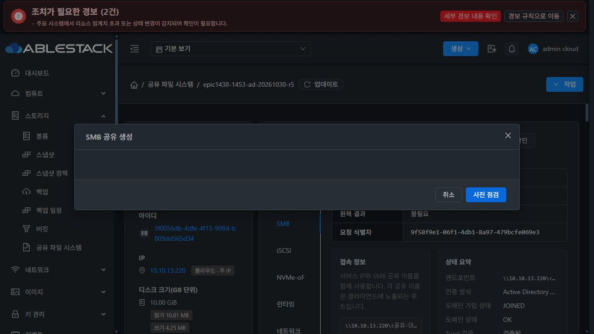
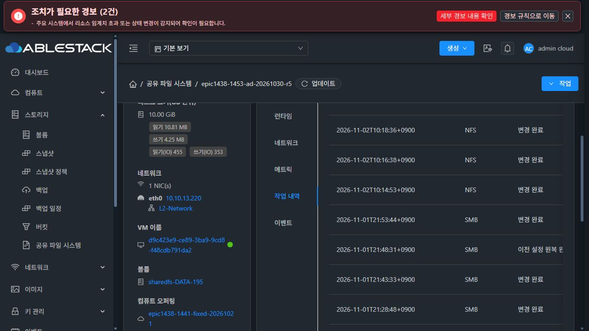

# #1457 구현·배포·사전 시험 / SMB 생성·편집 UI 회귀로 인수 중단

2026-11-02 KST / Epic #1438 / 기존 Draft PR #1470 / 브랜치 `epic/1438-sharedfs`.

**제품 UI 오류를 확인해 원인 분석 후 중단했습니다. #1457은 OPEN·인수5항목 미완료입니다.** 오류 후 제품 수정·추가 배포·재시험·임의 원복을 하지 않았습니다. 미제출 SMB 초안은 취소했고 전용 로컬 DAO 시험 서버를 종료했습니다.

## 1. 정확한 오류·영향·개선 방향

실제13번 UI에서 ‘SMB 공유 생성’을 한 번 열자 제목/푸터만 보이고 본문이 비었습니다. 2026-11-02 **10:22:04 KST**부터 콘솔에 다음 오류가 기록됐습니다.

```text
TypeError: i.isModal is not a function
.../client/js/chunk-872353a6.327fbe38.js:1:221492
```

원인은 이번 구현 commit **0c4411ab8ccd92a4ef3c93e9b27afd43ac3bc6ce**에서 제가 추가한 `ui/src/views/storage/SharedFSTab.vue:1990`입니다.

```vue
<SmbClientAccessFields v-if="isModal('smbShare')" ... />
```

**SharedFSTab에는 isModal()이 없습니다.** 기존 코드가 사용하는 상태는 `actionModal.type`입니다. 같은 파일1853줄의 일반 SMB 생성/편집 공통 분기에서 이 조건이 평가되므로, 영향은 **일반 SMB 생성과 편집 폼 본문**입니다. 새 입력 영역을 추가하면서 기존 기능에 회귀를 만들었습니다. 네트워크·MAC·서명·게스트 formatter·DB 문제로 돌리지 않습니다.

생성 버튼을 다시 누르거나 다른 경로로 우회하지 않았습니다. 한 번 연 화면의 주기적 렌더에서 같은 예외가 누적됐습니다. 관측한 실제 요청에서 **createStorageSmbShare=0, clientcidrs를 포함한 updateStorageSmbShare=0**입니다. SMB 생성이나 원본 정책 적용은 서버에 제출되지 않았습니다.

최소 개선은 없는 메서드를 새로 만드는 대신, 기존 방식 그대로 **`v-if="actionModal.type === 'smbShare'"`**로 조건 한 줄을 바꾸는 것입니다. 신규 생성에만 원본 입력을 보이고 일반 편집의 기존 정책 보존/별도 정책 대화상자 경로는 유지해야 합니다. 이 변경은 아직 하지 않았습니다. 이번 오류 해결을 위해 API/게스트/DB를 바꿀 이유는 없습니다.

추가 회귀는 **실제 SharedFSTab의 일반 SMB 생성·편집 모달 분기**를 렌더해야 합니다. 생성의 원본 입력 표시·ANY_SOURCE 기본값·필수 기존 폼 항목, 편집의 원본 입력 미표시/원본 파라미터 비제출, Vue runtime error0을 확인해야 합니다. 이후 UI 모듈 빌드/최소 배포 후 같은 실제 UI 진입을 먼저 검증하고 남은 인수를 재개합니다.

이번37 UI시험은 새 전용 Dialog·파라미터 helper와 기존 보호 컴포넌트를 검사했지만, **기존 전체 모달의 새 v-if 경로를 렌더하지 못했습니다.** lint/production compile도 JS 템플릿 멤버 존재를 검사하지 않았습니다. 제가 전체 생성/편집 진입 회귀를 빠뜨린 검증 공백입니다.



[실제 콘솔 오류](smb-create-render-error.json).

## 2. 구현한 범위

기존 create/updateStorageSmbShare와 config_json을 재사용해 optional clientcidrs/confirmanysource·IPv4 정규화·생략 보존/명시 해제·단일 공유 온라인 갱신·포트별 관측·서명/capability/boot-downgrade 보호를 구현했습니다. 계정 ACL과 POSIX/고정 UID·GID를 별도로 유지합니다.

- API의 clientcidrs는 JSON 배열 문자열1024자/최대32개입니다. hostname/wildcard·정규화 중복·/0·지원하지 않는 IPv6를 거부합니다. 기존 intent4096자/byte 제한은 유지합니다.
- 원본 정책 전용 UPDATE는 다른 필드와 혼합하지 않으며 해당 공유의 hosts allow/deny만 바꿉니다. 기존 안전한 파일/PID 검사와 targeted reload·durable 원복 primitive를 재사용합니다.
- 공유 섹션/ACL 대기·global 충돌·IPv6 노출/wildcard listener를 구분합니다. 기존 계정/POSIX/신원·중복·상속·경로/부모 삭제/detach 보호를 완화하지 않았습니다.
- 새 UI는 VM 표준 MoldDialog/Actions·테마·16px 간격을 재사용합니다. 기존 생성 폼의 새 조건에 위 회귀가 남았으므로 UI 인수 완료로 판정하지 않습니다.
- 새 mutation API·DB DDL·host agent 변경은 없습니다.

최신 upstream/origin fetch 후 로컬 Europa부터 갱신하고 local base/upstream **0/0**을 확인했습니다. base는 `1c5b169cd6283da23cc3e155d4b6d14e39e42793`입니다. 새 이슈·브랜치·목업 PR은 만들지 않았습니다.

## 3. 사전 시험·빌드 결과와 한계

| 층 | 결과 |
|---|---|
| 게스트 회귀 | **46 PASS**. 숫자 입력/정규화·단일 공유 semantic diff·ACL/POSIX 보존·확인 없는 마지막 삭제 거부·downgrade 보호, request.json 생성 전 실제 adapter 경로 선택 포함 |
| 실제 SystemVM 신규 엔진 | **31 PASS**. private mount/network·RAM 계정/passdb, 기존 SPARSE DATA의 전용 임시 경로에서 두 원본·445/1445 허용/거부·계정/POSIX 추가 차단·loopback·기존 세션 유지·다른 공유 보존·부분 reload 실패 원복·private daemon 재시작 검증 |
| Java/API·실제 DAO | **43 PASS / skip0**, 실제 API marshaller→commandIntent→양쪽 guest query 동등성, 실제 serializer fixture, 실제 coordinator→전용 로컬 DAO 저장/재조회·중복 재생 방지 포함 |
| UI 컴포넌트 | **5suite37 PASS**, 실제 API wire를 쓰는 전용 Dialog의 확인·UNKNOWN/BLOCKED·ACK 무효화·중복 적용/종료 응답 보호. 전체 일반 SMB 모달 회귀는 누락 |
| 모듈 | **Maven26모듈 package PASS**, UI production build/lint PASS. baseline profile 정렬 후 보호 bootstrap resource를 다시 package |
| 서명·bootstrap | 기존 cluster13 DPAPI 보호 signer 재사용. 정상 서명·12파일 hash/mode/profile 일치, 실제 SystemVM private 최초/반복 bootstrap3회, 실제 활성 CLI의 원본 preflight **READY/2 profiles**, 비호환 구버전 거부 PASS |

JDK17 JAXB noOptimize·기존 checkstyle/rat/license skip, Jest forceExit, Node20/Webpack4 호환 build export를 사용했습니다. 전체 저장소 CI 통과를 주장하지 않습니다.

DAO 개발 시험의 최초 실패는 새 정책 호출 전 synthetic baseline에4byte emoji를 넣어 기존 utf8 storage_file_share 테이블이 거부한 것입니다. 해당 새 fixture만 지원되는 한글로 더 큰 바이트 크기를 구성했고, schema/charset/제약을 바꾸지 않았습니다. 이슈를 UTF8 기능으로 확대하지 않았습니다. 전용 로컬 DB는 종료했습니다.

[native 신규 엔진](native-engine-summary.json), [정상 서명/실제 bootstrap·CLI](native-signed-bootstrap-result.json), [빌드·배포 요약](verification-and-deployment.json).

## 4. 실제13번 배포 상태

| 대상 | 반영/보존 |
|---|---|
| 관리 JAR | 변경 **13 entries**, 나머지 **92,546 entries byte 동일**. SHA `d98002dbfa7a0cf915175b4f688e6a5151ed9187423a1115fa498b3399f26273` |
| UI | 변경 **10자산**. HTTP index SHA `092a4db8c59235e7cd6039c4dc90d03887237d36a1ec3d2a57d72eedd307687c` |
| 운영 UI 설정 | config.json·color.less·로고 등 비관련 자산 보존. 실제 서비스 root인 /usr/share/mold-management/webapp과 HTTP index hash를 대조 |
| guest | `1456.identity.1 → 1457.sources.1`, 실제 protected updater/profile **10**, managed12 |
| manifest | SHA `9fef476290e2bb7862844acd8d5818864daecbd422921fd53dad409daf81ae60`, 기존 신뢰키 정상 서명 |
| 보존 | 기존 native full_audit bytes·계정4파일·Samba 설정·445/1445 PID 유지. 관리 서비스와 모니터 재시작은 했지만 공유 설정 재적용·VM 재시작은 하지 않음 |

실제 key는 기존 Windows DPAPI CurrentUser의 보호 수단에서 메모리에만 읽었습니다. private key·운영 암호를 파일/공개 증거에 기록하지 않았고 새 신뢰키를 만들지 않았습니다.

운영자 설치 helper의 재사용 receipt에 과거 상수 ‘baseline9’가 남았습니다. readonly AST/실제 profile로 **둘 다10**임을 확인한 [현재 관측](stop-inventory.json)을 판정 기준으로 사용합니다. 이 시험 메타데이터를 실제 baseline9라고 보고하지 않으며 이를 고치려고 소프트웨어를 재적용하지 않았습니다.

백업은 관리 `/var/tmp/epic1457-management-before.jar`, UI `/var/tmp/epic1457-ui-before`, guest `/var/tmp/epic1457-sources-before`에 있습니다. 오류 후 추가 변경/원복 없이 현재 배포를 보존했습니다. 신규 이미지 Ready나 새 VM 생성·재시작 검증을 했다고 주장하지 않습니다.

## 5. 실제 UI에서 진행한 준비와 보존

대상은 기존 전용 SharedFS `3f0056db-4dfe-4f13-908d-b809dd565d34`, instance `c1eca707-a554-4c42-85cd-1e9e9744d804`, VM `d9c423e9-ce89-3ba9-9cd8-f48cdb791da2`, 기존 **10GiB SPARSE XFS DATA e070a0aa-dbf5-48c0-83e0-09f874446277**입니다.

모든 Mold 준비는 실제 UI에서 했고 API는 그 요청/응답만 관측했습니다. 실패 후 QGA는 보존 대조의 readonly 진단으로만 사용했습니다.

- UI 재로그인·기존 SMB4개/AD JOINED·OK·trust·445/1445 READY, 원본 관측 ANY_SOURCE/소유 설정 일치를 확인했습니다.
- **p1457-parent**를 `epic1457/projects`, 명시65534:65534/0775로 생성했습니다.
- **p1457-child**를 `epic1457/projects/team-a`, 명시7001:7002/0770·RootSquash anon7001:7002로 생성했습니다.
- 두 NFS 각각 C1 **10.10.254.224/32**, C2 **10.10.254.223/32** RW ACL을 적용했습니다.
- 자식 경로를 실제7001:7002/0770 그대로 공통 POSIX 정책으로 등록했습니다.
- 준비 작업 **7개 모두 COMMITTED / revision47→54**입니다. 중간 점검30초 만료는 제가 화면 조사에 시간을 써 생겼으며 새 점검 후 적용했습니다. 제품 오류/중복 생성으로 보고하지 않습니다.
- 이어 SMB 생성 모달 진입에서 위 제품 UI 오류를 확인했습니다. **SMB 생성·원본 정책 변경0, 클라이언트 콘솔 I/O0, VM 재시작0**입니다.



기존 **54객체 + 이전 중첩19객체 + 이번 이전22객체**의 데이터 hash·owner/GID·mode·ACL·inode, 계정4파일·기존 SMB desired/config·고정 identity registry·FS UUID·boot ID·MAC을 보존했습니다. 신규 디스크/포맷/수동 MAC 변경0입니다. 다음 지시 전까지 새 시험 자원은 삭제/변경하지 않고 남겼습니다.

작업 완료에 ‘원복 불필요’를 ‘변경 전 거부’로 보이는 기존 보조 문구 차이는 #1468 검토 항목으로 기록합니다. 이번 중단 사유는 실행을 막는 TypeError이며 단순 표시 차이가 아닙니다.

[실제 UI 준비 요청](actual-ui-mutation-requests.json), [실제 작업 결과/자원](ui-operation-results.json), [기존 데이터·권한/신원 보존](preservation-stop.json).

## 6. 남은 작업

UI 조건 수정 및 전체 부모 컴포넌트 회귀 후, UI 모듈 재빌드/13번 반영과 실제 생성·편집 진입부터 재개해야 합니다. 새 backend/API/DB 변경으로 이 UI 오류를 우회하지 않습니다.

아직 완료하지 않은 인수는 실제 UI의 원본 정책 추가/변경/철회/마지막 해제·IPv6/입력 오류/호환 경로, 실제 두 클라이언트의 원본×로컬/AD ACL×POSIX·중첩 NFS/SMB·NAT/loopback, 실제 parent 삭제/detach·경로 거부, 운영 transaction 실패 원복/VM 재시작·접속/권한/데이터 보존입니다.

인수5체크는 전부 미완료로 유지하며 이슈를 닫지 않습니다. 현재 코드/증거를 기존 Draft Epic PR에 남기고 다음 수정 지시를 기다립니다. 제품 오류 뒤 소스 수정이나 재시험은 진행하지 않았습니다.
