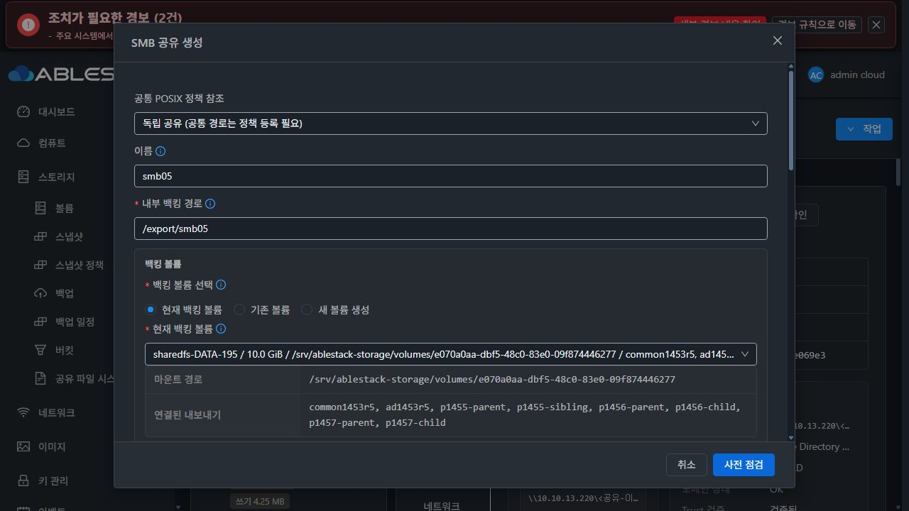
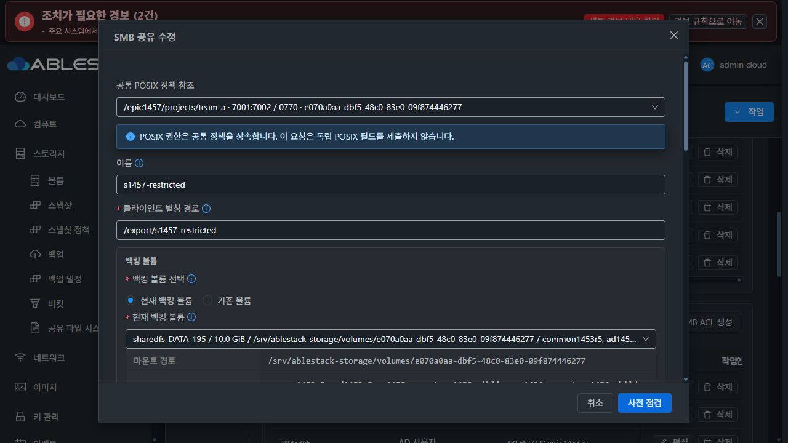
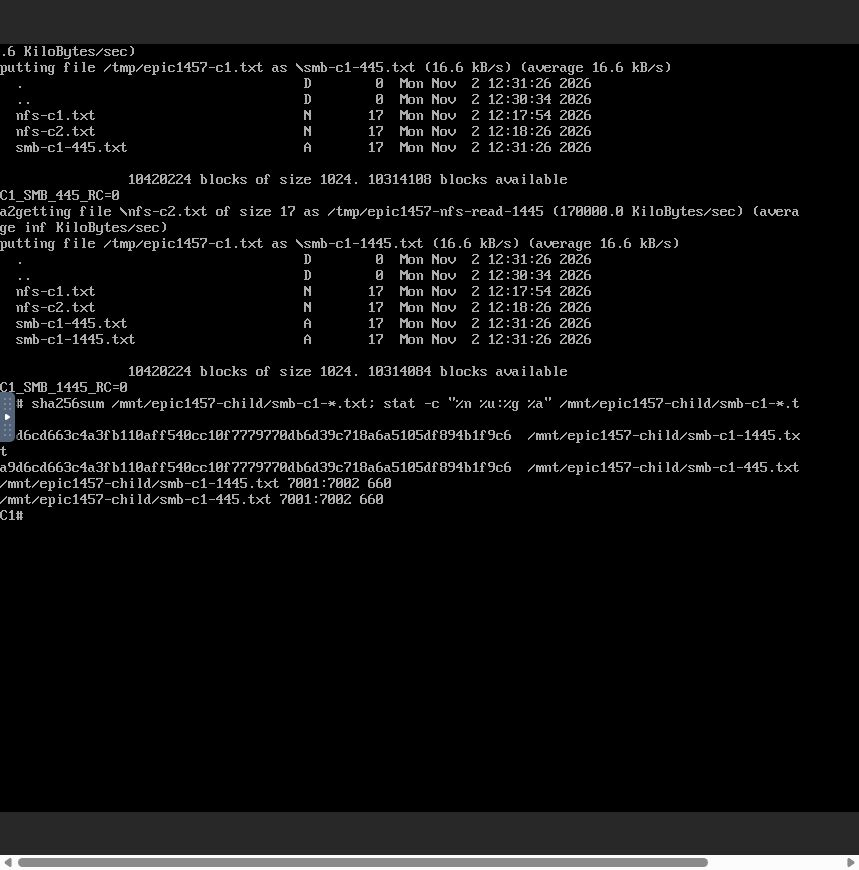
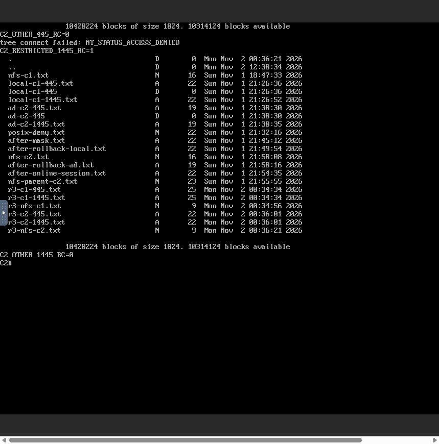
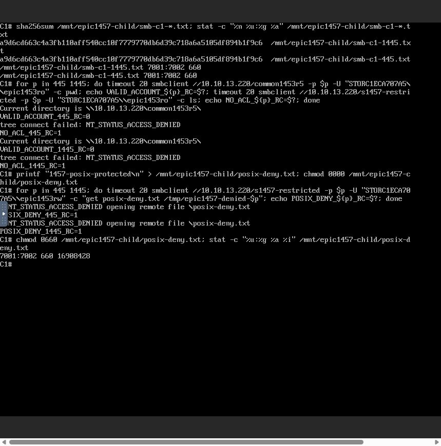
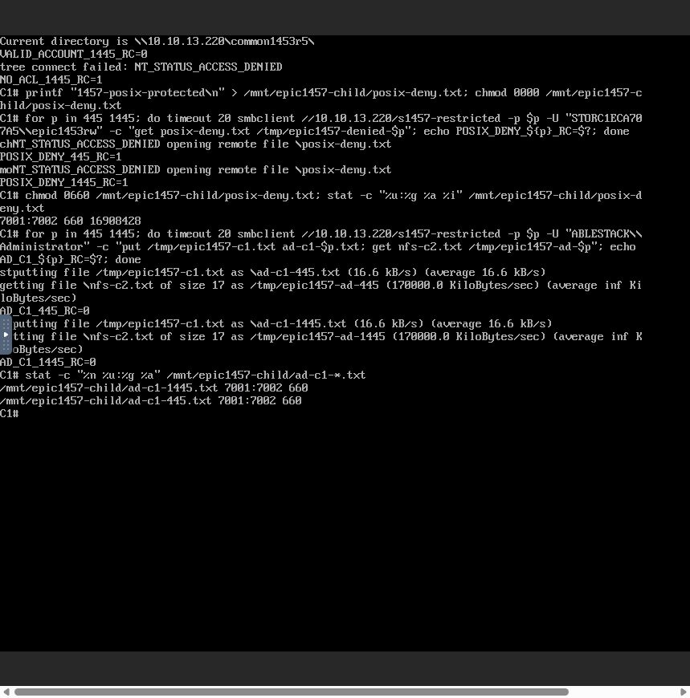
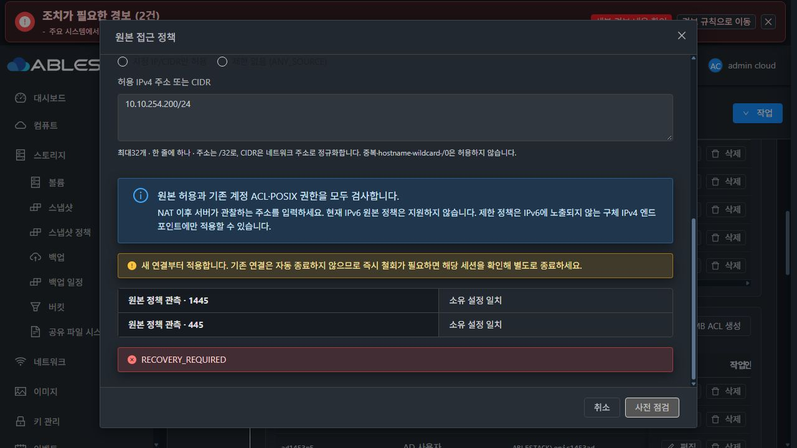

# #1457 UI R2 — 모달 회귀 수정·배포 완료, 원본 정책 저장 확정 결함으로 인수 중단

2026-11-02 KST / Epic #1438 / 기존 Draft PR #1470 / 기존 branch epic/1438-sharedfs

**이슈는 OPEN, 인수 5항목은 미체크입니다.** 요청한 isModal UI 수정은 구현·빌드·13번 실제 생성/편집 검증까지 완료했습니다. 이어 원본 정책 변경의 관리 서버 저장 확정 오류를 발견하여 원인 분석 후 중단했습니다. 새 이슈·PR·브랜치를 만들지 않았고, 오류 후 제품 코드 수정·재배포·재시도·복구 재개·VM 재시작을 하지 않았습니다.

## 이번 UI 수정과 회귀

- 제품 수정 commit **5b2df22b21e309240e761e38232927ea94b7e27f**.
- SharedFSTab.vue:1990의 존재하지 않는 isModal('smbShare')를 기존 **actionModal.type === 'smbShare'**로 변경한 한 줄입니다. API·guest·DB 스키마·공통 권한 보호를 변경하지 않았습니다.
- 새 SharedFSSmbModalRender.spec.js는 실제 부모 template, MoldDialog slot, defaults, openActionModal/closeActionModal/populateSmbShareForm을 실행합니다. unrelated inventory I/O만 대체했습니다.
- 수정 전 **실제 isModal TypeError로 3/3 FAIL**, 수정 후 생성·편집·재진입 **3/3 PASS**. 생성에서만 실제 SmbClientAccessFields를 렌더링하고 기존 identity/inheritance 필드를 유지합니다. 일반 편집은 clientcidrs/confirmanysource를 제출하지 않습니다.
- 관련 UI/SharedFS 조회/listRefreshMixin **6 suite 36 PASS**, 변경 파일 lint PASS, UI production build PASS. 기존 공통 icon 중복 등록 경고와 Jest forceExit 사용은 구분합니다.




## 소스 동기화와 최소 배포

로컬 Europa를 upstream **226b61dffc243131c40711c2c1fc80a307dd0ae0**로 먼저 갱신해 divergence **0/0**을 확인하고 Epic을 rebase했습니다. upstream의 scopeKey와 SharedFS requestScope를 함께 보존했고 관련 조회 시험을 통과했습니다. DAO XML과 Bucket/런타임 카탈로그의 additive SQL 블록도 양쪽을 보존했습니다.

13번에 이미 검증·배포된 UI 호환 소스 export에 이번 조건문 한 줄만 적용하여 빌드했습니다. 이 파일은 현재 canonical source와 SHA256이 동일하며 0c4411ab8cc의 동일 파일과 차이는 해당 조건 한 곳뿐입니다. 이번 배포에 unrelated Bucket UI/backend 변경을 함께 넣지 않았습니다.

- 실제 서비스 /usr/share/mold-management/webapp는 /usr/share/cloudstack-management/webapp로 해석됩니다.
- UI **6자산**만 hash 검증·백업·원자 교체하고 index를 마지막에 반영했습니다.
- HTTP index SHA256 **f68719a8d5e9984218d813b367227b177c1a977b6b1df9583cdb85ef8f14b95e**.
- config.json/color.less hash 보존, 관리 서비스 재시작 0.
- 관리 JAR SHA256 **d98002dbfa7a0cf915175b4f688e6a5151ed9187423a1115fa498b3399f26273** 유지.
- guest는 기존 **1457.sources.1 / 보호 baseline10 / managed12** 유지. 이번 단계는 UI 모듈만 재빌드·재배포했습니다.

[빌드 출처](evidence/ui-build-provenance.json) · [배포 영수증](evidence/ui-deployment.json) · [이전/이후 자산](evidence/ui-delta.json)

## 실제 UI·API·두 콘솔에서 통과한 범위

SharedFS **3f0056db-4dfe-4f13-908d-b809dd565d34**, SystemVM **d9c423e9-ce89-3ba9-9cd8-f48cdb791da2**, IP **10.10.13.220**, 기존 **10GiB SPARSE XFS DATA e070a0aa-dbf5-48c0-83e0-09f874446277**를 사용했습니다. MAC·포맷·디스크 생성 변경 0입니다.

자원/설정 변경은 모두 실제 Mold UI의 점검→영향 확인→적용으로 실행했습니다. API는 그 UI 요청/응답을 관찰했고 숨은 API로 준비하지 않았습니다. 클라이언트 I/O는 실제 Mold noVNC 콘솔에서 수행했습니다.

| 실제 수행 | 결과 |
|---|---|
| 기존 parent/child NFS와 두 클라이언트 /32 ACL, 공통 POSIX 정책 사용 | 두 클라이언트 parent/child mount·읽기·쓰기 성공. 파일7001:7002/0660 |
| UI 신규 s1457-restricted 생성, 원본C1 단독 /32, 기존 고정7001:7002 | COMMITTED, revision54→55. ACL 전 WAITING_FOR_ACL/미게시 |
| UI 기존 로컬 계정RW ACL / 기존 AD 사용자RW ACL | 각각 COMMITTED, revision55→56→57. 이후 두 포트 CONFIG_VERIFIED |
| C1 로컬 계정, 445·1445 | NFS 파일 읽기, SMB 파일 쓰기·NFS에서 동일 내용/소유권 확인 성공 |
| C2 동일 로컬 계정, 445·1445 | NT_STATUS_ACCESS_DENIED. 기존 s1456-fixed는 양쪽 접속 성공 |
| C1 유효하지만 새 공유 ACL 없는 로컬 계정 | 기존 common 공유 인증 성공 + 새 공유는 두 포트 거부 |
| C1 원본·계정 허용, 새 시험 파일mode0000 | 두 포트 읽기 거부. 시험 뒤0660 복구 |
| AD 사용자 C1 / C2 | C1 두 포트 읽기·쓰기 성공 및7001:7002/0660. C2 두 포트 원본 제한 거부 |
| UI hostname/wildcard/정규화 후 중복/0-prefix/IPv6 | 각각 안내·사전 점검 비활성. 잘못된 변경 제출0 |
| 실제 일반 편집 모달 | 기존 name·경로·identity 유지, 생성 전용 원본 필드 없음. 편집 변경 제출0 |






**/24 변경 후 접속 시험, 원본 반전, 마지막 제한 해제, NAT/loopback의 제품 인수, 온라인 기존 연결, 제품 원복, 재시작 인수는 미완료**입니다. 사전 격리 시험 성공을 실제 제품 인수로 대체하지 않습니다.

## 최초 제품 오류와 정확한 하위 원인

실제 UI에서 s1457-restricted의 **10.10.254.224/32 → 10.10.254.0/24** 변경 한 건을 제출했습니다. 입력10.10.254.200/24가 점검/요청에서10.10.254.0/24로 정규화된 것은 정상입니다.

- 요청 **a28f8de6-9991-48c7-979b-46bf3bbebe05**
- 작업 **6f3fd76b-7a26-4f09-bede-1e741310705c**
- async job **fa64f872-bea9-466a-adcb-2c0b9afbadaa**
- 2026-11-02 **12:37:37 KST**, API431 **DIRECTORY_BINDING_RECEIPT_MISSING**
- UI/API **RECOVERY_REQUIRED / COMMITTING**, base57 / target58, canresume=true.
- 게스트 관측은 **VERIFIED**, reload 완료, workerActive=false, rollback=NOT_NEEDED이며 pathbindings가 없습니다.
- 실제 두 owned profile의 testparm 값은 **hosts allow = 10.10.254.0/24 127.0.0.1/32**, hosts deny=ALL입니다. valid users와 force user/group은 유지됩니다.
- 저장 정책을 표시하는 UI는 /32와 이전 revision에 남아 있습니다. 이는 단순 표시 차이로 취급할 문제가 아닌 적용/확정 불일치입니다. 새 변경은 보호 상태로 차단됩니다.

정확한 호출 경로는 다음과 같습니다.

```
SharedFSTab → 전용 SmbClientAccessDialog
 → updateStorageSmbShare(clientcidrs=[10.10.254.0/24])
 → coordinator onlineSmbClientAccess=true 후보/게스트 payload
 → 게스트 네트워크 전용 적용·검증(VERIFIED, 경로 작업 없음)
 → Coordinator.commit:358 → StorageFileSharePaths.applyBindings:121-127
 → onlineSmbOptions만 simple로 인정, 새 onlineSmbClientAccess 누락
 → 변경하지 않은 bound 경로에도 pathbindings를 요구
 → DIRECTORY_BINDING_RECEIPT_MISSING → SQL rollback → RECOVERY_REQUIRED
```

**제가 추가한 새 원본 정책 분기를 기존 경로 확정 보호와 끝까지 연결하지 않은 통합 결함**입니다. 통신·MAC·프로비저닝·UI 조건문이나 upstream 변경을 원인으로 돌리지 않습니다.

- Coordinator:181-195는 두 온라인 작업 유형을 별도 flag로 기록/전달합니다.
- Guest configuration_transaction.py:1110-1121은 두 유형을 동일한 무경로 온라인 처리로 분류하고 원본 정책 엔진을 선택합니다.
- 반면 StorageFileSharePaths.java:124는 기존 onlineSmbOptions만 인정합니다.
- 배포 class SHA **06858c7e59b6de8eec30ac7fc8f741a7700ce5f35a762643a9b6f65782c8e677**가 현재 로컬 컴파일 class와 같습니다. 해당 class에 기존 flag 문자열만 있고 새 flag가 없는 것도 확인했습니다.
- 기존 API/DAO 시험은 전체 suite가 통과했지만 **실제 원본 변경 + bound 공유 + VERIFIED 영수증 없음 + 최종 coordinator→DAO commit** 조합을 빠뜨렸습니다.

[실제 UI 입력·API 응답/431](evidence/ui-contract-evidence.json) · [최종 작업](evidence/failed-operation.json) · [관리 로그/배포 class 확인](evidence/commit-failure-log.json) · [실제 게스트 두 포트 값](evidence/policy-after-cidr.json)



## 중단 상태·보존·정리

오류 확인 뒤 재시도·복구 재개·원복·다른 정책 변경·VM/관리 서버 재시작을 하지 않았습니다. **게스트 /24와 저장 /32의 불일치는 의도적으로 증거/복구 대상으로 남겼고 성공으로 보고하지 않습니다.**

- DATA 기준102객체 모두 존재하고 기존 파일 내용 hash/UID/GID/mode/inode를 유지했습니다.
- 신규 시험 파일7개만 추가됐습니다.
- 시험 child 디렉터리의 ACL은 명시적으로 추가한 로컬/AD ACL에 따라 user1001/user10002 및 default ACL이 추가됐습니다. 이 예정된 변경을 ACL 불변으로 주장하지 않습니다. 기존 다른 경로 ACL은 동일합니다.
- 계정4파일·Samba passdb hash, FS UUID·boot ID·주 IP·MAC이 동일합니다.
- 클라이언트2대의 런타임 PASSWD를 해제하고 NFS mount를 해제한 뒤 로그아웃, 이번에 연 VM/콘솔 탭을 종료했습니다. 주 검증 탭은 중단 화면으로 남겼습니다.
- 시험 자원/파일과 실패 작업을 삭제하지 않았습니다.

[정확한 보존 차이](evidence/preservation-stop.json)

## 다음 최소 개선 방향 — 아직 구현/재시험 안 함

1. 경로 확정의 기존 onlineSmbOptions 예외와 새 onlineSmbClientAccess의 의미를 맞춥니다. **서버가 원본 전용 요청으로 검증한 durable flag**에 한정하고 경로·volume·relative path·pathIdentity 불변을 확인합니다. 일반 경로 변경의 영수증 필요·불일치 거부는 그대로 유지합니다.
2. 실제 coordinator→DAO에 bound 공유를 넣고 원본 전용 VERIFIED/pathbindings 없음→commit/revision 증가/정책 저장을 회귀로 추가합니다. 일반 경로 변경의 영수증 누락·불일치·혼합 요청은 계속 실패해야 합니다. 동일 작업 재개도 확인합니다.
3. 저장 확정 예외의 정확한 code/phase를 durable originalfailure와 기존 UI 진단에 남겨, 현재처럼 원인 {}와 generic RECOVERY_REQUIRED만 보이는 점을 보완합니다. 보호를 해제하거나 UI가 실패를 성공 처리하게 하지 않습니다.
4. 위 수정·사전 실증·모듈 배포 뒤에만 **현재 보존한 동일 작업**을 실제 UI에서 재개해 저장/적용 일치를 회복합니다. 현재 지시의 오류 중단 조건에 따라 지금은 실행하지 않았습니다.

UI 대화상자는 기존 Mold header/footer 고정·본문 스크롤을 유지하고 다크모드로 확인했습니다. 공유 작업 툴바와 세로 탭을 유지했습니다. 온라인 원본 점검의 확인 문구가 생성 mask 문구를 재사용하는 표시 차이, NOT_NEEDED 번역이 변경 전 거부로 보이는 차이는 최종 UI 정리 #1468에 별도 기록하고 여기서 스타일 확장을 하지 않습니다.
