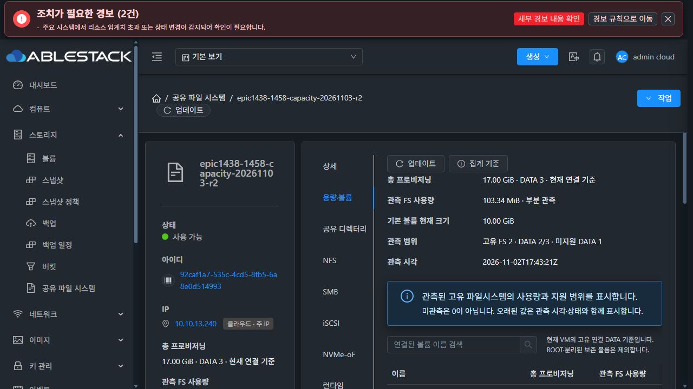
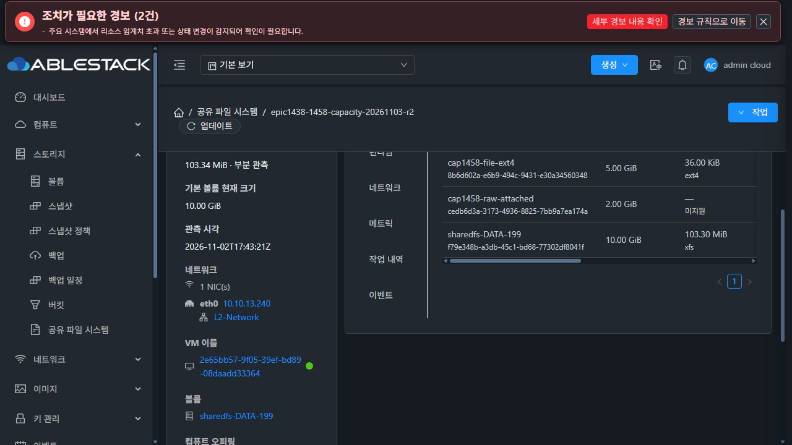
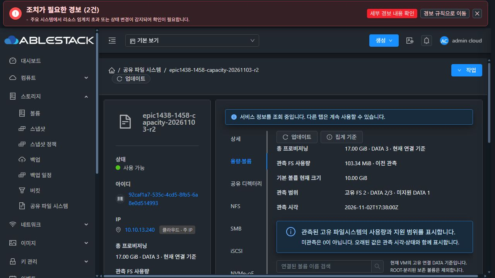
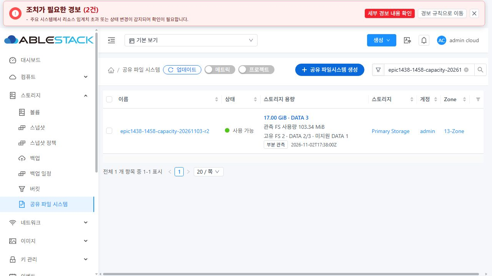
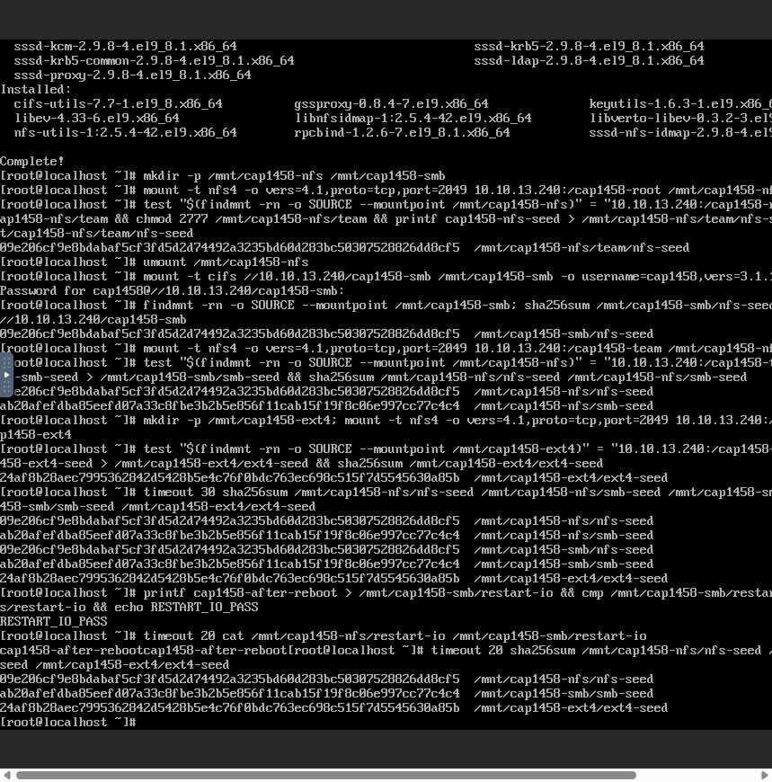

# #1458 고유 DATA 용량 집계 — 최종 인수

2026-11-03 / Epic #1438 / 브랜치 `epic/1438-sharedfs` / Epic 통합 PR #1470.

새 VM·ROOT/DATA·클라이언트를 실제 Mold UI로 생성해 **기본 10GiB XFS + 추가 5GiB EXT4 + 2GiB raw DATA = 17GiB, DATA 3개, 고유 FS 2개**를 검증했다. NFS·SMB가 동일 XFS를 공동 참조해도 중복 합산하지 않으며, 공유 참조가 없는 연결 raw DATA도 포함한다. 원시 장치의 FS 사용량은 미지원/빈 값이고, 미관측은 0으로 만들지 않는다.

이 보고서가 R2 최종 판정이다. [이전 R1 중단 기록](../sharedfs-1458-capacity-20261102/README.md)은 당시 실패·한계를 보존한 이력이며 현재 미배포 상태를 뜻하지 않는다.

## 구현 범위와 최소 영향도

- 기존 `size/sizegb/volumeid`를 보존하고 `SharedFSResponse.capacity`를 추가했다. 목록과 id 단건의 **listSharedFileSystems 조회 경계**에서만 보완한다. 생성·수정 async 응답과 공통 ApiResponseHelper는 바꾸지 않는다.
- 현재 연결 DATADISK를 VM 페이지 단위 batch 조회해 UUID별 논리 크기를 합산한다. hidden·미참조 DATA를 포함하고 ROOT·분리·제거·파기 행은 제외한다. 권한 확인 이후의 대상만 응답한다.
- 목록 요청은 원격 호출을 하지 않는다. 별도 bounded collector/cache가 기존 inventory를 사용한다. 기본 관측 주기 60초, stale 180초, 최대 worker 4개/queue16과 VM별 중복 실행·backoff·membership fingerprint를 사용한다.
- monitor는 lsblk/findmnt와 UUID·device 신원으로 고유 FS당 statvfs를 한 번 수집한다. CLI는 관측한 source를 UUID·serial·FS UUID/type·장치·MAJ:MIN·FSROOT 등으로 검증한 뒤 기존 resolver에 전달한다. ROOT·UUID·크기 보호와 일반 inventory 계약을 유지한다.
- UI는 기존 목록/InfoCard/정보 전용 상세에 요약을 표시하고, 세로 **용량·볼륨** 탭에 고유 DATA 근거·검색·집계 기준 대화상자를 둔다. VM 표준 공통 구성과 테마 변수를 사용한다. 대화상자 header/footer는 고정, body만 overflow:auto이다.
- DB migration·host agent 변경·프로토콜 생성/게시/권한 coordinator 변경은 없다. 공통 볼륨/QGA 사용량 통계 자체를 교정하는 과제로 확장하지 않았다.

## 실제 자원과 SPARSE 확인

| 대상 | 새 자원 |
|---|---|
| SharedFS | `92caf1a7-535c-4cd5-8fb5-6a8e0d514993`, epic1438-1458-capacity-20261103-r2 |
| SystemVM | `2e65bb57-9f05-39ef-bd89-08daadd33364`, i-2-199-VM, 13.1 |
| 서비스 IP | STATIC 10.10.13.240/16, 원래 IP 유지, MAC 수동 변경 0 |
| ROOT | `5ae77a21-5fd6-4874-98a9-0acbba122f84`, 4.88GiB SPARSE, 집계 제외 |
| 기본 XFS DATA | `f79e348b-a3db-45c1-bd68-77302df8041f`, 10GiB SPARSE |
| 추가 EXT4 DATA | `8b6d602a-e6b9-494c-9431-e30a34560348`, 5GiB SPARSE |
| raw DATA | `cedb6d3a-3173-4936-8825-7bb9a7ea174a`, 2GiB SPARSE, 최종 공유 참조 0 |
| 새 Rocky 클라이언트 | `09b62b3d-f807-4b0f-add3-da9c2102a564`, i-2-198-VM, 13.3, IP 10.10.254.220 |
| 클라이언트 ROOT | `0147d91c-c2c1-4240-b1fb-2efd09108779`, 100GiB SPARSE |

원본/클라이언트는 이 라운드에서 새로 생성했다. 기존 offering과 검증된 일반 이미지 기반은 재사용했지만, 이전 시험 VM·DATA·파일을 인수 대상으로 재사용하지 않았다. IP는 생성 전 중복 응답이 없는 것을 확인했다. 데이터 작업은 실제 noVNC 콘솔에서 수행했고 QGA는 native 소프트웨어 사전 실증/배포와 읽기 전용 대조에만 사용했다.

## 인수 결과

| 이슈 인수 항목 | 검증과 결과 |
|---|---|
| 기본+추가 파일/블록 고유 합계 | 실제 UI 생성 후 목록·InfoCard·상세·용량 탭·UI가 호출한 API 모두 17GiB/DATA3. legacy size=10737418240, sizegb=10.00 GiB 유지. ROOT와 별도 미연결 Allocated 2GiB는 제외. |
| 교차 공유·연결 전환·stale | XFS의 NFS 부모/자식 + SMB 공동 참조에도 FS1만 합산. EXT4 연결 직후 UI는 TRANSITION/미관측을 표시하고 수집 후 FS2로 전환. monitor만 180초 이내의 제한된 창에서 중지해 STALE·이전 관측값/시각 보존을 확인했고 자동 재개 후 PARTIAL로 회복. |
| 목록 비용·부분 미지원 | 실제 36개 서비스의 20개 페이지와 검색 목록을 확인했다. 목록에는 상세 volume 배열이 없다. 100-service 회귀에서 batch 1회·dispatcher 호출 0을 검증했다. raw는 미지원/사용량 없음, 구 runtime은 미지원으로 표시하며 0을 만들지 않는다. |
| 미참조 연결 DATA·bind 중복 제거 | iSCSI 대상을 UI로 생성한 뒤 대상 설정만 삭제했다. raw DATA는 VM에 연결된 채 NFS0/SMB0/Block0으로 남아 17GiB 합계에 계속 포함된다. 실제 별칭들이 있어도 고유 FS 사용량은 guest statvfs 합과 정확히 일치한다. |

실제 최종 API: 프로비저닝 **18,253,611,008 bytes**, 고유 FS 사용량 **108,355,584 bytes**. XFS **108,318,720** + EXT4 **36,864** = 정확히 같은 값이다. 측정 시각과 이후 쓰기에 따라 사용량이 달라질 수 있다.

[자동 대조 8항목](evidence/acceptance-checks.json) · [UI가 실행한 단건/목록 응답 68개](evidence/source-capacity-ui-api.json).

hidden·Ready 분리·파기·전환 행은 **실제 DAO 저장→재조회 회귀**로 확인했다. 제품 UI에 없는 hidden 토글이나 SharedFS 일반 VM attach/detach 우회 기능을 추가하지 않았다. 실제 100개 서비스 부하 시험을 했다는 의미는 아니며, 실제 목록은 36개이고 100개는 호출 수 회귀이다.

## 실제 UI·클라이언트·재시작과 데이터 보존

1. UI에서 NFS 기본 export `cap1458-root`, 중첩 `cap1458-team`과 클라이언트 /32 ACL을 구성했다. 실제 클라이언트가 team 경로에 seed를 기록했다.
2. 동일 물리 team 경로를 공통 POSIX 정책으로 관측/등록하고 SMB `cap1458-smb`를 로컬 인증·해당 클라이언트 /32로 게시했다. 기존 team 권한 65534:65534/2777을 유지했고 권장값으로 덮어쓰지 않았다.
3. 실제 콘솔에서 SMB 인증·NFS 중첩 마운트 후 NFS seed를 SMB로 읽고, SMB seed를 NFS로 읽어 해시 일치를 확인했다. 새 EXT4도 NFS 마운트·쓰기·해시 조회가 성공했다. 이 라운드에서 iSCSI 클라이언트 I/O를 했다고 주장하지 않는다.
4. 표준 VM UI의 작업→재시작(강제 OFF)으로 재시작했다. boot ID는 41295047…→48a27f8d…로 바뀌었다. XFS 장치가 /dev/sdb→/dev/sdd로 바뀌어도 FS UUID d2f71eb4…와 데이터/권한을 보존하고 올바르게 재관측했다.
5. 재시작 후 기존 NFS·SMB·EXT4 파일 해시 조회와 새 SMB 쓰기→NFS 읽기/cmp가 성공했다. 관리 서비스 `mold.service`도 재시작하고 UI 재로그인 후 집계·사용량·원래 IP와 데이터 보존을 확인했다. 관리 OS 재부팅 시험을 뜻하지 않는다.
6. 기존 파일 3개의 크기/해시·UID/GID·mode·inode, 부모/자식 디렉터리 UID/GID·mode·inode가 보존됐다. 재부팅 후 장치 번호 재배치는 정상이다. 재시작 I/O 시험 파일 추가에 따른 디렉터리 entry 크기 증가는 손상이 아니다.
7. 실제 라이트/다크 UI, 좌측 toolbar, 세로 탭, Mold 집계 기준 대화상자를 확인했다. 마지막에 원래 다크 모드로 복귀했다. 시험 마운트·콘솔 인증 변수·전용 로컬 DAO DB를 정리했다.

| 파일 | SHA-256 |
|---|---|
| nfs-seed | 09e206cf9e8bdabaf5cf3fd5d2d74492a3235bd60d283bc50307528826dd8cf5 |
| smb-seed | ab20afefdba85eefd07a33c8fbe3b2b5e856f11cab15f19f8c06e997cc77c4c4 |
| ext4-seed | 24af8b28aec7995362842d5428b5e4c76f0bdc763ec698c515f7d5545630a85b |

[VM 재시작 전후 대조](evidence/restart-preservation.json) · [관리 재시작 후 최종 대조](evidence/final-preservation.json).

## 로컬 시험·빌드와 배포 무결성

- 실제 SystemVM 격리 후보 주입 **11 PASS**: mounted source, 정확한 고유 FS, ROOT/UUID/size/MAJ:MIN 불일치 거부, 원래 inventory, stale/zero/구형/손상 cache.
- 서명 bootstrap 첫 실행/반복 **3단계 PASS**, managed 12파일·정상 서명 확인.
- Python native **6 PASS**, 서버/API 직렬화 **7 PASS**, 실제 GenericDao/MariaDB **2 PASS**, 실제 UI 컴포넌트 **2 suites/11 PASS**, 변경 UI lint PASS.
- Maven server `-am package` **26모듈 성공**, DAO2+서버27=**29 PASS/skip0**. 기존 SMB 정책/요청·파일 identity·preflight/디렉터리 보호 회귀 포함. UI production build 성공.
- 모든 빌드는 WSL ext4에서 **로컬**로 수행했다. GitHub Actions 직접 실행 0. 최신 upstream #1551의 릴리즈 전용 Actions 정책도 반영했다. 필수 아닌 push/PR 빌드는 실행하지 않는다.
- 마지막 동기화에서 로컬 base를 upstream **413d1459682b6f4dea6c90773510b8342dba1ec2**로 fast-forward한 뒤 Epic을 rebase했다. base 차이 0/0. 대상 제품 소스 **5,209파일의 해시가 동기화 전후 동일**하므로 변경 없는 제품을 다시 빌드/배포하지 않았다. [동기화 근거](evidence/final-base-sync.json).
- native/UI 빌드 식별의 원래 commit은 689a1ba4781, 관리 조회 경계 수정의 원래 commit은 730eb89f01b이다. 최종 rebase 구현 commit은 각각 **2ae5af626cd**, **8700632800b**이며 제품 소스는 동일하다. native bundle의 기록을 임의로 재서명해 바꾸지 않았다.

| 산출물/배포 | 확인값 |
|---|---|
| 관리 JAR | SHA-256 0e2b6687f89df0ae7194192e109b955757a604e734bbde8cf80e4d053949e31a |
| 관리 변경 | 9 entries 변경+4 classes 추가, 나머지 92,550 entries 불변. 원래 Spring XML에 capacity bean만 추가. 공통 ApiResponseHelper 보존. migration 없음. |
| UI index | SHA-256 0d2bed0ffa346d8f38b7c026987ffba8a53657d26098c47f6746c2a0a079649a |
| UI 배포 | mutable4 변경+hashed73 추가, 577자산·운영 config 보존 |
| native runtime | 1458.capacity.1 / baseline10 / managed12 / 정상 Ed25519 서명 |
| SystemVM 이미지 | 498,361,069 bytes, SHA-256 25ff8e3c47ed4060684719e26cc1ea3c2b818b1d4f12406b895edaf50dbad1b3 |
| UI 등록 템플릿 | d2fd805e-2130-4489-9599-960d9c4c5bd1, Europa-SystemVM-1458-capacity-20261103, Ready |
| 이미지 보존 | qemu check 정상, 33,924 guest 경로와 host 계정 파일 보존 |

[배포 영수증·의존성 사전 점검](evidence/deployment-receipts.json) · [로컬 빌드 결과](evidence/local-build-results.json) · [실제 주입 11항목](evidence/native-candidate-r2-result.json) · [서명 bootstrap](evidence/native-bootstrap-r2-result.json).

첫 관리 부분 패키징에서 최신 전체 Spring XML을 섞어 별도 VmCloneBatchManager 누락으로 503이 발생했다. 즉시 기존 JAR로 원복했고, 공통 helper의 별도 Bucket 의존성도 사전 점검에서 제외했다. 최종 패키지는 **원래 XML+전용 bean, 조회 경계만 수정, 누락 참조0**으로 재조립해 배포했다. 배포 조립 오류를 자체 교정한 것이며 무관한 VM/Bucket 기능을 추가하거나 보호를 완화하지 않았다.

기존 일반 VM 화면에서 SharedFS VM에 직접 attach하려던 준비 경로는 기존 보호에 의해 거부됐다. 같은 요청을 반복하지 않고 Storage Service 전용 생성 경로로 새 SPARSE DATA를 생성했다. 최초 Allocated 2GiB는 미연결 상태로 남아 집계 제외를 확인했다. 사전 점검 확인 만료와 콘솔 입력/도구 경로 오류도 시험 준비 실수로 교정했으며 제품 결함으로 확대하지 않았다.

전체 저장소 CI·기타 환경·대규모 운영 부하가 통과했다는 보고는 아니다.

## 표시 항목과 종료 범위

- 프로토콜 탭의 기존 백킹 볼륨 사용량은 종전 QGA 통계이며 bind 별칭이 중복된 기존 값이다. 새 capacity는 해당 값을 합산하지 않는다. 공통 통계 자체를 고쳤다고 주장하지 않는다.
- 완료 작업에 같이 보이는 ‘변경 전 거부·원복 불필요’ 문구와 로그인 redirect의 탭 선택 차이는 실제 완료·접근·데이터 보존과 분리해 최종 UI 검토 항목으로 남긴다. #1468 전체 UI 정리는 시작하지 않았다.
- 새 시험 서비스·DATA·클라이언트·Ready 템플릿은 검토를 위해 남겼다. 다른 이슈/사용자 자원은 정리하지 않았다. 임시 관측 중지는 자동 해제됐고 monitor active를 확인했다.
- #1458 인수4항목의 범위에서 완료 기록 후 종료한다. Epic #1438과 PR #1470은 계속 OPEN/Draft이며 병합하지 않는다. 다음 이슈 **#1459 다수 Export 부팅 Reconcile의 초기 Probe 지연과 고정 Timeout 제거**는 착수하지 않는다.

## 실제 화면

