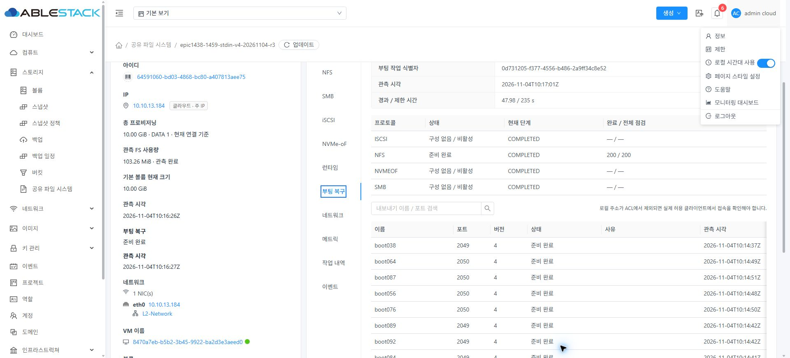
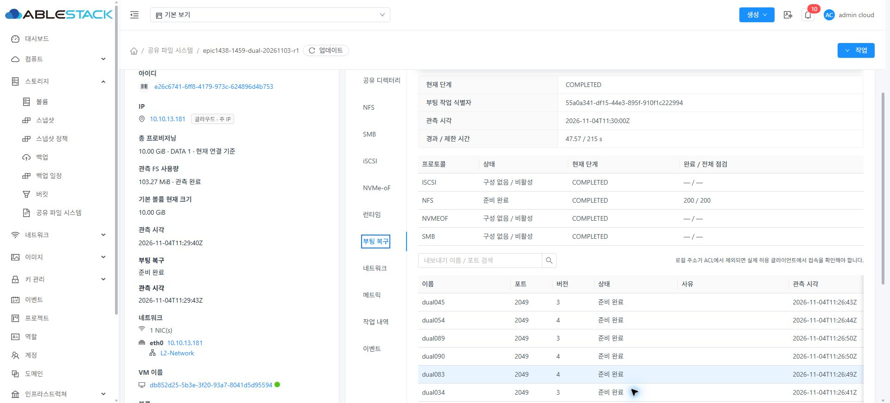
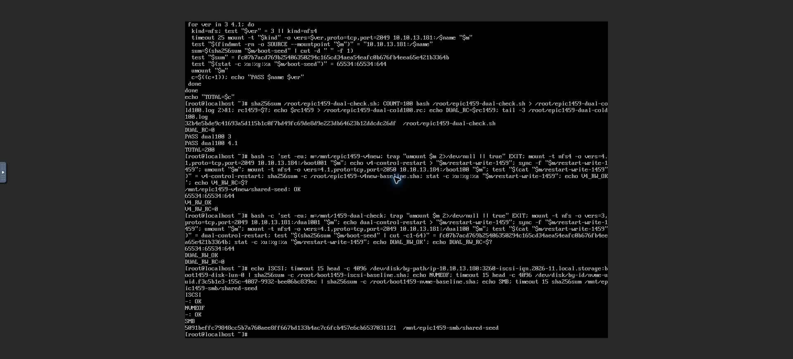
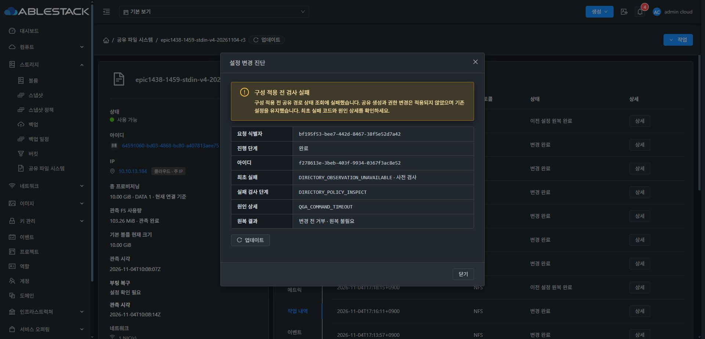
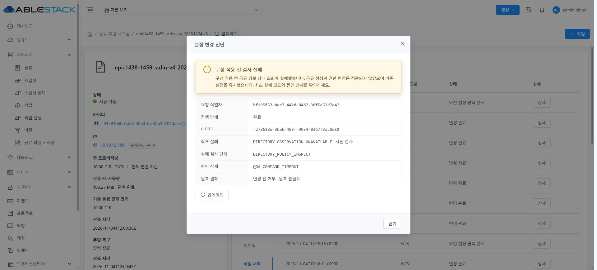

# #1459 최종 인수 — 다수 Export 부팅 복구

2026-11-04, Epic #1438 / 통합 Draft PR #1470. 이 문서는 구현 후 **실제 Mold UI·API 응답·VM 콘솔**로 확인한 결과다. 이전 중단 기록을 성공으로 바꾸지 않고, 후속 수정과 새 검증 근거를 구분한다.

## 변경과 보호 범위

- 부팅 unit을 유지하면서 짧은 launcher와 별도 bounded worker로 네트워크·마운트·프로토콜 준비·개별 export 관측을 분리했다. 작업량 기반 budget, 동일 boot/desired/runtime 신원, 단계별 상태·최초 실패·정리 결과·관측 재개를 제공한다.
- NVMe의 실제 장치 재열거 관측 경로만 원하는 구성 지문에서 분리했다. UUID·크기·ACL 등 원하는 구성의 보호는 유지한다. runtime 활성화 snapshot에는 안정적인 작업 ID를 전달한다.
- UI는 기존 VM 표준의 세로 탭·공통 대화상자·AntD 설명/작업 내역을 사용한다. 요청별 소유권으로 실행 플래그를 정리하고 오래된 응답 차단을 유지한다. NFSv3 접속 명령은 실제 게시된 /공유이름 경로와 일치시켰다.
- 큰 QGA payload는 stdin으로 전달한다. 48KiB 조각의 파일 신원·offset·최종 SHA-256을 검증하고 CLI는 한 번 시작한다. 기존 1MiB byte 제한과 불확실한 쓰기의 예약·복구 보호를 유지한다. 확정적인 실행 전 실패만 즉시 원인을 기록한다.
- 마지막 경로 관측 수정: **inspect 요청 안에서 검증된 물리 그룹별 별칭 매핑만 한 번 조회**한다. 각 행의 UUID·inode·device/owner/mode/ACL fingerprint 관측은 유지한다. 다음 요청은 새로 조회한다. 잘못된 UUID 행·다른 물리 그룹은 캐시를 공유하지 않는다. 신원 교체·ACL drift는 계속 차단한다. RPC 20초와 payload 제한을 늘리지 않았다.
- 읽기 전용 directory inspect 실패의 공개 코드·단계·원인 상세를 coordinator → DAO → API → UI에 보존한다. 임의 원문 예외를 노출하지 않는다. 실행된 읽기 조회 timeout을 started:false로 오표시하지 않는다. DB migration은 없다.

제품 commit은 31e5664a8b0 → db5ad08e4fa → 85e7a9d6441 → 2618826ccb4 → a8c7081c900 → 91f816beedb → 886103a1c6c → f85813849e6 → **4ad6414a063abc5f7d9ac87570f3f66176ca6465**다.

## 구현 전 SystemVM 실증과 회귀

95번째 생성의 이전 실패는 구성 적용 전 read-only inspect가 20초를 초과한 경우다. 같은 물리 경로의 전체 별칭을 매 행마다 재해석했다. 제품 파일을 바꾸지 않는 별도 프로세스의 함수 주입으로 후보를 먼저 검증했다.

| 실제 관측 | units 조회 | findmnt | getfacl | 소요 |
|---|---:|---:|---:|---:|
| 기존 94행 | 94 | 9,118 | 188 | 18.338초 |
| 후보 94행 | 1 | — | — | 0.679초 |
| 후보 95행 | 1 | — | — | 0.641초 |
| 후보 100행 | 1 | 295 | 200 | 0.653초 |
| 후보 새 요청 100행 | 새로 1 | — | — | 0.651초 |

실제 bind mount·Ganesha 두 포트·SMB 교차 읽기/쓰기·원복·별칭 rebind 차단·중복 요청을 포함한 native 7개 검사가 통과했다. 운영 source/PID/설정/데이터는 그대로이며 임시 native 자원은 제거했다. 100행에서도 ACL 관측을 생략하지 않았다.

마지막 변경에 대한 로컬 검증은 Python **17**, 실제 MariaDB coordinator→DAO/API **13**(7+6, skip0), 실제 API 직렬화 fixture를 쓰는 UI **6suite/32**, lint PASS다. Maven 관리 모듈 package **26개**, KVM **38개** reactor와 기존 runtime 전송 회귀 **6개**, UI production build PASS다.

앞선 수정의 독립 회귀는 실제 다중 프로토콜 apply/활성화 snapshot, 부팅 worker·timeout 정리, 실제 Java→QGA stdin 요청, 실제 coordinator→DAO 실행 전 거부/응답 유실 보호, UI 재진입·오래된 응답·접속 명령을 포함한다. 서로 다른 리비전의 시험 개수를 하나의 최신 전체 suite인 것처럼 합산하지 않는다. **빌드는 모두 로컬이며 GitHub Actions는 실행하지 않았다.**

## 13번 배포

| 대상 | 최종 식별/보존 |
|---|---|
| 관리 모듈 | JAR SHA-256 **571421655be73d20bbb44065798035c8011f2397a15a1c2458834ee47b3b833e**. 마지막 수정 3class만 overlay, 다른 92,563 entries 보존 |
| UI | index SHA-256 **2f7f8d00f811d2244d6de1c1a14ef08d6f676d6ac62c7ec46fc66f5f1cbedb4b**. 운영 config/color·이전 assets 유지 |
| 정상 서명 runtime | **1459.directory.1**, catalog **8b1f543d-e792-4adf-b566-d292f46efd0a**. UI 등록→검증→게시→두 서비스 전송·검증·적용 COMPLETE |
| runtime bundle | SHA-256 **142cfe1bfd6c338129fc0c734e6f8fbbb0f0e465ff380cb9e076bf5f194c76c3** |
| manifest | SHA-256 **57febf64fd64a5a361997c72dfd87f91c6a270ee01d5e10cf27831a8055c5543** |
| 활성 helper | SHA-256 **83dca5104d21dbd94408e3cdebda5de2ad975971a6dbd38eb4bcbe6482d89f76**, 재부팅 후 동일 |
| 호스트 정렬 | 13.1/13.2의 기존 runtime 전송 wrapper 3class씩만 현재 브랜치와 정렬, 다른 534 entries·기존 stdin wrapper 유지. API4class는 이미 동일해 교체0, 13.3 변경0 |

이전 1459.boot.2와 비교해 이번 서명 번들의 managed13 중 변경은 shared_directory_policy.py 한 파일이다. 기존 보호된 키로 서명했으며 개인키 평문 파일 생성0이다. 기존 VM에 UI 런타임 업그레이드를 적용했으며, 이번 마지막 변경으로 새 템플릿 이미지를 만들었다는 의미는 아니다.

관리 모듈·호스트 배포 전 백업을 남겼고 서비스는 active다. 관리 서버의 **mold.service/JVM 재시작** 전후 PID 1094295 → 1108951,30.49초, JAR·UI 해시 일치를 확인했다. 관리 OS 전체 재부팅 시험으로 확대하지 않는다.

## 실제 UI·API·클라이언트 인수

사용자 지시대로 **V4 기존 94개 뒤에서 95~100개**, DUAL 기존 59개 뒤에서 60~100개를 이어서 만들었다. VM/DATA를 처음부터 다시 만들지 않았다. 두 DATA는 각각 **10GiB SPARSE XFS**다. THIN 생성·MAC 수동 변경·재포맷0이다. 생성·설정·정상 정지·시작·런타임 등록/적용은 Mold UI, 외부 접속은 실제 클라이언트 noVNC 콘솔로 실행했다. API는 해당 UI가 발생시킨 응답을 대조했다.

| 항목 | V4_ONLY | DUAL |
|---|---|---|
| SharedFS | 64591060-bd03-4868-bc80-a407813aee75 | e26c6741-6ff8-4179-973c-624896d4b753 |
| VM | 8470a7eb-b5b2-3b45-9922-ba2d3e3aeed0 | db852d25-5b3e-3f20-93a7-8041d5d95594 |
| IP / DATA | 10.10.13.184 / ef9a2ff3-31fd-44fe-a97a-2e0669455127 | 10.10.13.181 / 19267e66-d6f9-4de1-8ebd-dcede8092677 |
| 1 export cold boot | READY2/2,2.11초 | READY2/2,1.98초 |
| 10 export cold boot | READY20/20,4.78초 / 클라이언트 TOTAL20 | READY20/20,4.47초 / 클라이언트 TOTAL20 |
| 100 export cold boot | **READY200/200,47.98/235초** | **READY200/200,47.57/215초** |
| 100개 관측 조합 | 100 × NFSv4 ×2049/2050 | 100 × NFSv3/4 ×2049 |
| 외부 클라이언트 | **RC0/TOTAL200**, 두 포트 mount/read/stat/umount | **RC0/TOTAL200**, vers3/4.1 mount/read/stat/umount |
| boot ID | 0d731205-f377-4556-b486-2a9ff34c8e52 | 55a0a341-df15-44e3-895f-910f1c222994 |
| 관리 JVM 재시작 후 | 동일 boot·READY200/200·cleanup COMPLETE | 동일 boot·READY200/200·cleanup COMPLETE |

두 모드 모두 pendingProbes0·externalClientRequired0·omittedExports0, 다른 세 프로토콜은 이 NFS 전용 서비스에서 DISABLED로 독립 표시한다. 관측 완료 뒤 불필요한 반복 apply로 판정하지 않았다.

95번째 UI 생성의 실제 요청은 POST1회, 기존 directoryPolicy 사용, **미변경 owneruid/ownergid/mode/recursivepermission 제출0**이다. 원 실패 요청을 자동 재실행하지 않고 새 요청으로 후속 생성했다.

- V4 원 seed SHA-256 **2f884cdfd4d3c30d01aa1e1e0795bf35f888e73533c8a588ead1167f8a24666f**, FSUUID **08b42571-dbc5-44bd-965b-c5da35d4eb7f**.
- DUAL 원 seed SHA-256 **fc07b7acd769b25406350294c165cd34aea54eafc0b676fb4eea65e421b3364b**, FSUUID **38d2ecba-fd92-4707-9668-cced476f663e**.
- 원 seed는 두 서비스 모두 **65534:65534 /0644 /inode8388737** 보존.
- 최종 관리 JVM 재시작 뒤 V4 boot001:2049에서 새 파일 쓰기→boot100:2050에서 교차 읽기, DUAL dual001:v3 쓰기→dual100:v4.1 읽기, 기존 seed 해시/권한 확인 **각 RC0**.
- 기존 4프로토콜 서비스는 수정하지 않았다. 기존 SMB seed 해시 **5091beffc79848cc5b7a760aee8ff667bd133b4ac7c6fcb457e6cb6537031121**, iSCSI/NVMe-oF 첫4KiB baseline 비교 모두 OK. 기존48개·두 포트96개 접속 근거와 함께 비대상 데이터 보존을 확인한다.

## 계획된 실제 실패의 최초 원인·이력 보존

정상100개 구성 뒤 고유 진단 후보 diag1459-inspect-001의 **읽기 전용 inspect 프로세스 하나만 23초 지연**했다. root0600 요청 파일·후보 이름/Updating 상태·PID/시작 시각을 검증한 감시기가 자동 재개·종료했다. QGA 전체·NFS 서비스·설정·권한·DATA를 변경하지 않았다.

- 요청 **bf195f53-bee7-442d-8467-38f5e52d7a42**, 작업 **f278613e-3beb-403f-9934-0367f3ac8e52**.
- 실제 저장·API·UI 모두 **DIRECTORY_OBSERVATION_UNAVAILABLE / VALIDATING / DIRECTORY_POLICY_INSPECT / QGA_COMMAND_TIMEOUT**.
- 최종 **ROLLED_BACK / COMPLETED / rollback NOT_NEEDED / canresume false**, base105/target106. 읽기 명령이 실행되지 않았다는 started:false는 없다.
- NFS config/desired/PID/활성 helper/seed before=after, 게시100개 유지, 진단 후보 미게시, 감시기 exited.
- 관리 JVM 재시작 후 같은 요청·작업 ID와 원래 진단을 실제 이력 UI/API에서 다시 확인했다.
- 이전95번째의 PREPARATION_REJECTED 기록과 기존 서비스49번째의 불확실한 RECOVERY 보호는 **소급 수정·삭제하지 않았다**. 이전 기록은 당시의 실패 사실로 남긴다.

UI는 “구성 적용 전 검사 실패”·기존 설정 유지·공유 생성/권한 변경 미적용과 원래 코드/단계/원인을 표시한다. 실제 MoldDialog 라이트/다크에서 헤더/푸터 분리·body overflow auto·16px 간격을 확인했다. 다크 코드 rgb197,204,212 / 배경 rgb34,40,47로 읽을 수 있으며 검토 후 라이트를 복원했다.

## 근거와 남은 경계

- [수집한 API·native·배포/시험 요약](evidence/): 부팅 보고는 실제 inventory API의 bootReconcile 부분이며, 인증정보·세션키·impactack·개인키는 포함하지 않는다.
- 100개는 서로 다른 DATA100개가 아닌 **같은 물리 디렉터리를 참조하는 공유100개**다. 문제의 동일 물리 경로 반복 관측을 재현한 구성이다. 실제 별도 물리 그룹의 캐시 격리·UUID/inode/ACL 보호는 회귀로 검증했다.
- 별칭별 사용량을 합산하는 기존 볼륨 표의 표시 차이, NOT_NEEDED 이력의 generic “이전 설정 원복 완료” 문구, 시계 표시 차이는 **#1468 최종 UI 정리** 대상으로 기록한다. 실제 고유 FS·데이터·작업 판단을 변경하지 않았고 #1468은 HOLD다.
- 제한 ACL의 visibility probe/전체 Ganesha 중단은 별도 **#1460** 범위다. 이번 기본 허용 ACL 시험을 그 문제의 해결 근거로 삼지 않는다.
- 전체 Epic/CI 통과·PR 병합·미착수 이슈 완료를 뜻하지 않는다. 다음 검토 대상은 #1460이며 아직 착수하지 않는다.
