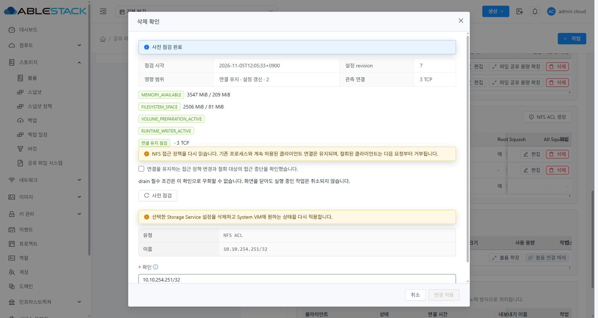
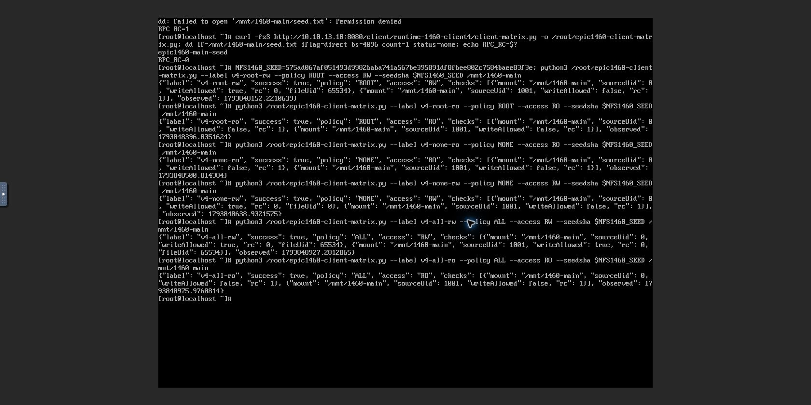
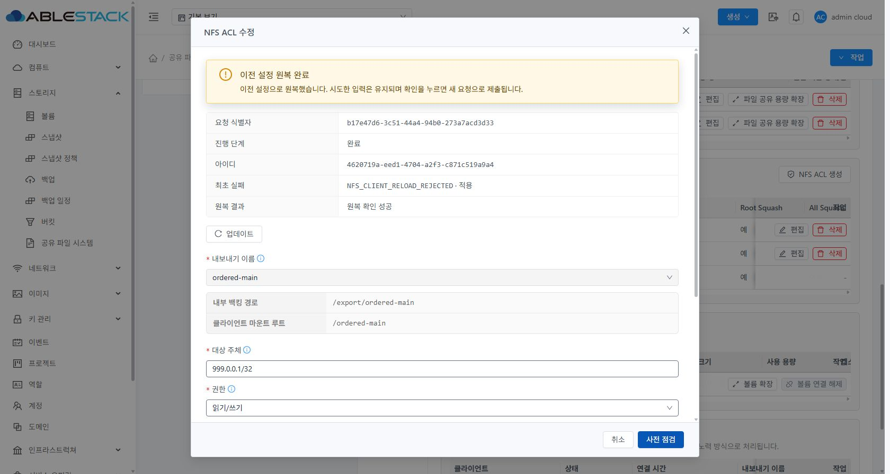
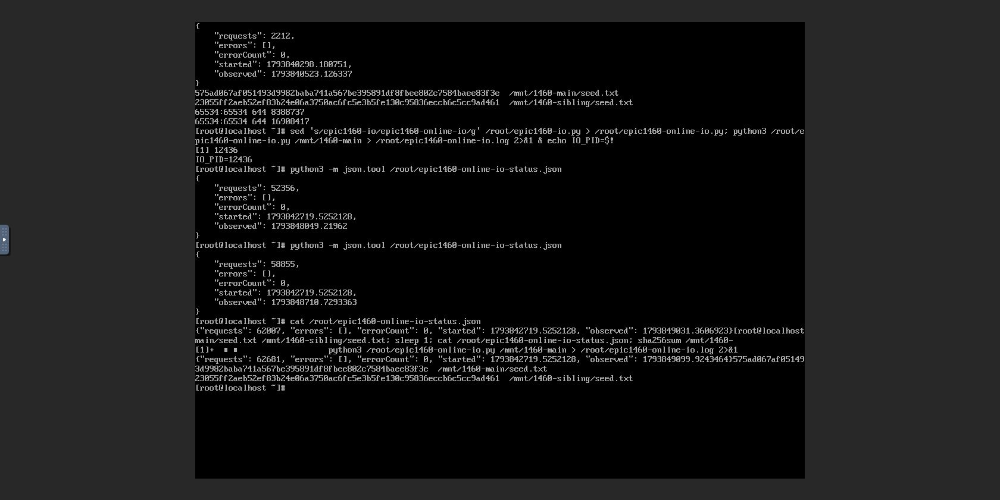
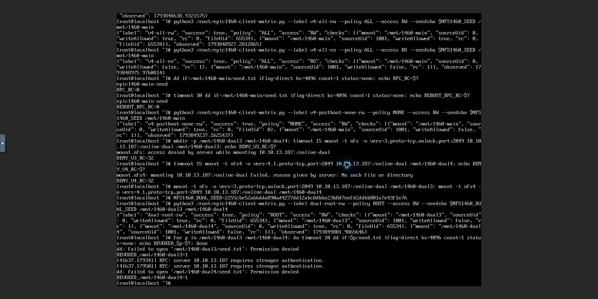
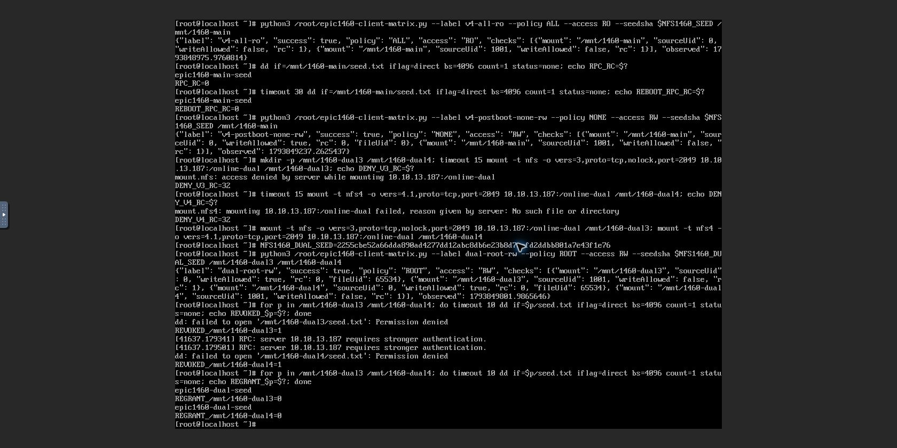
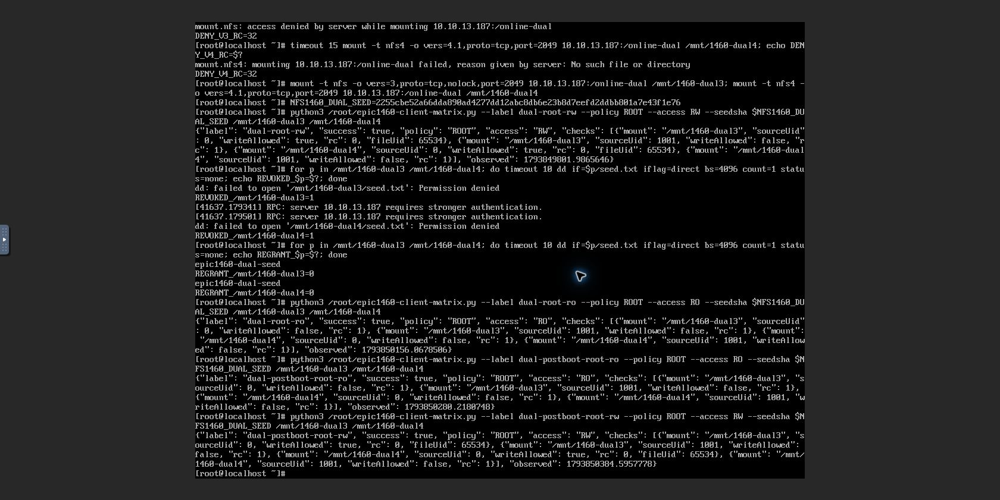
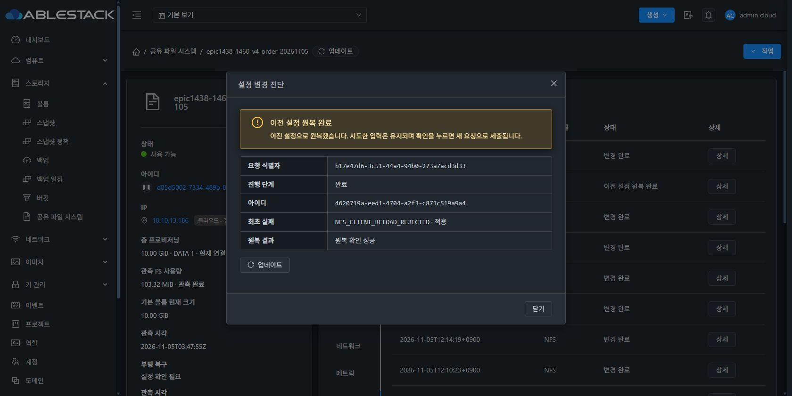
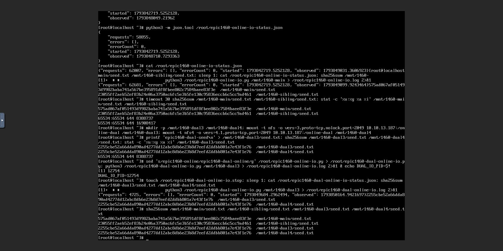
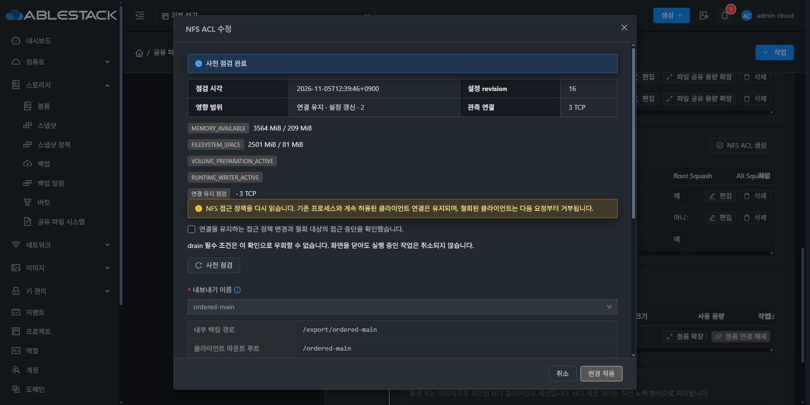

# #1460 제한 ACL의 NFS 관측·온라인 변경 실환경 검증

2026-11-05, Epic #1438 / Draft PR #1470. **인수 기준 5/5 통과.** 기존 #1460 서비스의 후속 변경을 이어서 검증했고, DUAL은 새 VM·ROOT·DATA와 새 서명 이미지로 생성했다. 이 문서의 완료 판정은 #1460 범위에 한정한다. Epic 전체·PR 병합·전체 CI 완료를 뜻하지 않는다.

## 최종 동작과 보호 경계

서버 주소가 사용자 ACL 밖인 정상 NFS는 설정 적용 상태와 로컬 mount 검사 생략을 구분한다. 사용자 ACL에 서버 IP를 추가하거나 정상 다른 Export를 중지하지 않는다. 외부 허용 여부는 실제 클라이언트로 확인한다.

Ready NFS ACL의 검증된 CLIENT-only 변경만 **읽기 전용 UI 사전 점검 → 실제 명령 → 적용·영수증 → coordinator/DAO 확정**에 같은 정책 intent로 연결했다. 실제 before/candidate 렌더와 프로세스·설정 해시·UUID·inode·bind를 검증하고, 승인한 정책 효과가 바뀌면 전체 apply로 fallback하지 않고 거부한다. 같은 PID에서 정책만 reload하며 계속 허용되는 클라이언트는 I/O를 유지하고 철회된 클라이언트는 다음 실제 요청부터 거부한다.

- 공통 UI 파라미터 생성은 false/0을 보존한다. 기존 미변경 POSIX 비제출·권한 변경 확인·오래된 응답 차단을 유지한다.
- 서버가 명령/부모 Export/규칙 UUID를 검증해 intent를 만든다. 호출자가 온라인 실행 모드를 선택하지 않는다.
- 신규/Allocated·지원하지 않는 레이아웃·경로/볼륨/POSIX/recursive 변경·실제 중단 작업은 기존 admission/drain을 유지한다.
- source volume·FS UUID·ROOT·크기·device/inode·bind anchor 보호와 operation/instance 소유 영수증을 유지한다. 기존 경로를 재생성·chown·repin하지 않는다.
- 비교 정규화와 저장 데이터를 분리한다. CLIENT 배열 순서와 저장→재조회→부팅 렌더→후속 변경을 보존한다.
- generic runtime/boot metadata snapshot은 기존 전체 파일 스냅샷 계약을 유지한다. CLIENT-only apply와 섞지 않는다.
- 실제 실패는 최초 코드·단계·해당 포트·원복 결과를 영구 이력과 UI에 보존한다.

관련 제품 commit: `ed483cf25afe` → `7dd8406b1c09` → `8d25213e8d98` → **`0fff973b8f14923db177e76a26cefa53d1c83330`**. 마지막 commit이 CLIENT-only admission 연결 수정이다. 로컬 Europa와 upstream은 **413d1459682b6f4dea6c90773510b8342dba1ec2 / divergence 0 0**으로 시작·최종 확인했다. 작업 브랜치는 `epic/1438-sharedfs`를 유지한다.

## 구현 전 실증·회귀·로컬 빌드

| 검증 | 근거와 결과 |
|---|---|
| 실제 SystemVM 읽기 전용 후보 주입 | [14검사](evidence/native-readonly-result.json) PASS. 정상 연결을 유지한 기존 BLOCKED와 후보 ONLINE_RELOAD 대조, 같은 지문 재관측, 경로/다른 클라이언트/혼합/누락 플래그/stale 거부, legacy·recursive·POSIX·foreign target 보호 |
| 실제 isolated apply→VERIFIED→commit | [17검사](evidence/native-unique-result.json) PASS. bound sibling·두 포트·v4/DUAL, 다음 direct RPC 철회·재허용·RO, 같은 작업 멱등성, 두 번째 포트 parse 실패 원복. 연속 I/O는 이 최종 fixture 기준 **v4 2,129 / DUAL 2,131**, 오류0 |
| 계획한 실환경 실패의 사전 검증 | [잘못된 CIDR 10검사](evidence/invalid-cidr-result.json) PASS. 실제 Ganesha reject·같은 PID 원복·정상 정책/데이터 보존 |
| 서버 | [실제 coordinator→MariaDB DAO/API 시험](evidence/local-tests.json) **50 PASS / skip0**. native 실제 query·VERIFIED 영수증을 사용하고 UI/명령 지문 동등성·SQL 확정·stale 거부 검증 |
| guest | NFS **69**, boot **18**, runtime **23** PASS. actual legacy renderer fixture와 generic metadata snapshot 전체10파일 계약 포함 |
| UI | 실제 SharedFSTab 모달·요청 계약/API 직렬화 fixture·POSIX·보호·접속 명령·locale **6 suites / 57 PASS**, lint PASS |
| 모듈 | WSL ext4에서 Maven **26 modules package PASS**, UI production build PASS |
| 이미지 | 정상 서명·manifest/payload15·baseline12·qemu image check PASS. 이미지 조립 시 무관 guest33,920경로와 WSL 계정 파일 byte 보존 |

수치는 위 최종 원문을 기준으로 한다. 진행 코멘트의 native I/O 각2,137이라는 중간 수치는 최종 native-unique fixture의 2,129/2,131로 정정한다. 실제 UI I/O 수치는 아래 별도 값이다.

**빌드는 전부 로컬, 빌드 Actions 실행0.** PR 갱신 시 GitHub가 자동 실행하는 빌드 없는 **PR Merge Conflict Check** 메타 검사는 이 수치와 구분한다. 수동 workflow dispatch는 하지 않았다. 범위 밖 기존 Checkstyle25개로 `checkstyle.skip=true` 및 기존 `rat.skip=true`를 사용했다. 전체 저장소 정적 검사나 전체 CI가 통과했다는 의미가 아니다.

## 13번 배포

| 대상 | 최종 산출물 |
|---|---|
| 관리 JAR | SHA256 **49fa4bcefe132a4356944a2a9699154f195ee8d934857b4e78432e68aeb6c95c** |
| 관리 변경 경계 | coordinator·Preflight·Rejected 3entries 변경, StorageNfsClientPolicy 1class 추가. 나머지 **92,563 entries** 보존. DB migration/API 응답 class/host agent 변경0 |
| UI | index SHA256 **330784f765854c1e7ddc8be0ab5e8b65c3044e388f72f2f5015ffb2d4014b6b2**, 실제 **app.b51306de.js**. 기존647 application files/config.json/color.less 보존 |
| guest | 정상 서명 **1460.client.4 / baseline12 / managed15**, 신뢰키 ablestack-runtime-cluster13. 개인키 원문 파일 생성0 |
| 번들 | SHA256 **2db6a30011abc49c6611615016366b673439dbf61d9dce0a525c19f0327739e9** |
| 새 이미지 | **498,414,488 bytes**, SHA256 **50b14623d9b57cf39576be57ee3094c32ec1a03f43244acf523bd59128bb6ad5** |
| 실제 UI 등록 Ready 템플릿 | **2bd1e6f7-204f-4bc7-a626-0a99409b60d1**, Europa-SystemVM-1460-client4-0fff973-20261105 |

[관리 overlay](evidence/management-deployment.json) · [UI overlay](evidence/ui-deployment.json) · [guest 배포/파일 차이](evidence/module-deployment.json) · [이미지 조립](evidence/guest-module-build.json) · [서명/manifest 검증](evidence/assembled-image-verification.json)

V4 기존 #1460 VM에는 code 배포 lock 안에서 활성 release만 .3→.4로 교체했다. 이 배포 자체는 desired/config/완료 작업/PID를 변경하거나 서비스를 재시작하지 않았다. 최초 배포 영수증의 정적 파일 목록을 release3/4 실제 해시 차이로 보완했다. 설치기를 다시 실행하지 않았다. 실제 변경은 helper4개와 manifest/integrity 메타데이터다.

## 실제 Mold UI 시험 자원

| 자원 | 식별과 범위 |
|---|---|
| V4 | SharedFS **d85d5002-7334-489b-823f-74b479d03664**, instance ff7aa816-cd83-4507-b9d3-feec13f48432, VM **5d82a2a4-2900-3586-a080-e3aaaef1e512 / i-2-211-VM**, 10.10.13.186 |
| V4 DATA | **d959448c-04dd-4be9-a411-82abcb8cb5da**, 새10GiB SPARSE XFS로 #1460에서 생성한 자원 유지. FSUUID **d9c8176d-fb6c-481e-be20-c328a84c7a28**. ordered-main2049 + bound ordered-sibling2050 |
| 새 DUAL | SharedFS **cb889aa9-aae8-441f-8091-3e3b803e5a4b**, VM **23ccd807-af30-360b-a8ef-c2c29b9bb833 / i-2-214-VM**, 10.10.13.187. 위 .4 Ready 템플릿에서 실제 UI 신규 생성 |
| DUAL DATA | **76827053-fe54-4a8d-a613-ad13bc57580a**, 새10GiB SPARSE XFS. FSUUID **f887b8ec-6601-4bc6-83d7-dba7e247186d**, online-dual2049 v3+v4 |
| 실제 C1 | **a8697776-c010-4b64-bc8e-2175b9c6a3b3**, i-2-212-VM, 10.10.254.250 |
| 실제 C2 | **99dce7f1-c05f-478f-83b0-c46abfc9a9e7**, i-2-213-VM, 10.10.254.251 |

클라이언트도 이번 #1460에서 만든 새 SPARSE ROOT VM이다. 기존 #1459의100개 서비스를 이 시험 결과로 대체하지 않았다. 신규 DUAL IP는 ARP3회/응답0으로 사전 확인했다. Mold의 자동 MAC을 사용하며 수동 MAC 변경·THIN·재포맷0이다. [실제 libvirt/qemu read-only 디스크 증거](evidence/sparse-disks.json)

자원 생성/ACL 추가·수정·삭제/사전 점검/적용/VM 재시작은 **실제 Mold UI**로, 클라이언트 mount·direct RPC·쓰기/읽기·권한 확인은 **실제 noVNC 콘솔**로 수행했다. 숨은 API/QGA로 업무 준비를 대신하지 않았다. QGA는 구현 전 격리 주입·code 배포와 완료 후 읽기 전용 신원/PID 감사에만 사용했다. API 증거는 UI 요청의 수동 재호출이 아니라 브라우저가 실제 보낸 응답을 수동 관측한 것이다.

## V4 실제 인수

1. C1/C2 /32만 허용한 상태에서 서버 IP를 ACL에 넣지 않고 UI는 **설정 적용됨 / ACL 제외·점검 미실시 / 외부 확인 필요**를 구분했다.
2. 정상3 TCP 연결 중 C2 ACL을 UI로 철회했다. 사전 점검 **READY / ONLINE_RELOAD**, 실제 SQL COMMITTED/revision8. C2의 기존 mount 다음 `dd iflag=direct`는 Permission denied였다. C1 연결은 유지했다.
3. UI 재허용은 COMMITTED/revision9. C2 같은 mount에서 다음 직접 읽기 성공.
4. UI 편집으로 **ROOT/NONE/ALL × RO/RW 6조합**을 실제 C2에서 확인했다. ROOT/RW root는65534, NONE/RW root는0, ALL/RW root/UID1001 모두65534로 생성됐다. RO 쓰기는 모두 거부됐고 기존 POSIX0775에 따른 일반 UID의 거부도 유지됐다.
5. 계획한 잘못된 CIDR **999.0.0.1/32**를 UI에서 제출했다. 아래 원복 판정이 API/UI에 일치하고 정상 C2 /32 및 기존 mount 읽기가 복구됐다.
6. 위 정책 변경과 원복 동안 Ganesha **12232/12253 동일**, C1 연속 I/O **62,681회/오류0**. 다른2050 Export와 seed 두 개의 해시·65534:65534/0644·inode를 보존했다.
7. UI에서 VM을 일반 재시작했다. bootId **15d156aa-92f9-4c16-b1a4-b3fcb9e98f23**, IP13.186, 부팅복구 NFS COMPLETED/준비완료. 기존 mount 읽기·권한·inode를 유지했고, 이후 NoRoot/RW UI 변경 **78bcfe00… COMMITTED/revision16**과 실제 root UID0 쓰기를 확인했다.

| 계획한 실패 | 실제 보존 결과 |
|---|---|
| request | b17e47d6-3c51-44a4-94b0-273a7acd3d33 |
| operation | **4620719a-eed1-4704-a2f3-c871c519a9a4** |
| 최초 원인/단계/포트 | **NFS_CLIENT_RELOAD_REJECTED / APPLYING / 2049** |
| terminal / rollback | **ROLLED_BACK / SUCCEEDED** |
| UI / async API | 이전 설정 원복 완료·최초 실패 보존 / jobstatus2·530, terminal과 일치 |
| 무변경 | PID·계속 허용된 I/O·기존 정책·파일 데이터/권한 |

[계획한 실패 실제 API](evidence/v4-negative-api.json) · [최종 V4 운영 감사](evidence/v4-policy-readonly-audit.json)

## DUAL 실제 인수

- 새 VM·DATA에서 NFSv3와v4.1 C1 mount/write가 성공했고, 비허용 C2는 둘 다 거부됐다. C1의 두 mount가 같은 seed SHA를 읽었다.
- C1 I/O와 정상 연결을 유지한 채 UI ACL 추가→철회→재허용. 모두 **ONLINE_RELOAD → COMMITTED**. 철회 뒤 기존 v3/v4 mount의 다음 direct RPC가 둘 다 Permission denied, 재허용 뒤 같은 mount 둘 다 읽기 성공.
- ROOT/RW·ROOT/RO를 두 버전에서 실제 root/UID1001 쓰기와 seed 읽기로 확인했다. RO는 쓰기만 거부하고 데이터·POSIX를 유지했다. 여섯 squash 조합 전체는 위 V4 전용에서 검증했으며 DUAL에서 여섯 조합을 반복했다고 주장하지 않는다.
- 정책 변경 동안 Ganesha **6486 동일**, C1 연속 I/O **4,725회/오류0**. seed SHA/65534:65534/0644/inode8388737·dir inode8388736·FSUUID 유지.
- UI VM 일반 재시작 후 bootId **71079a6b-8d25-4529-b8a4-4da79ca0e981**, 원래 IP13.187/Ready. v3/v4 기존 mount의 RO·데이터 보존, 후속 RW 변경 **0222ae96… COMMITTED/revision8**과 두 버전 root 쓰기를 확인했다.

[정책 전 감사](evidence/dual-before-audit.json) · [정책 후 감사](evidence/dual-after-policy-audit.json) · [재시작 후 감사](evidence/dual-postboot-audit.json)

## 관리 서비스 재시작·API와 UI 판정

최종 SQL 확정 후 **mold.service / 관리 JVM**을 재시작했다. PID1191924→1197976. 관리 OS를 재부팅한 시험은 아니다. 예상한 접속 공백·재로그인 이후 실제 UI로 이력을 다시 조회했다.

- V4: **17개 중 COMMITTED16, 계획된 ROLLED_BACK1, 현재 revision16**. 원복 작업의 최초 원인/단계/rollback SUCCEEDED를 같은 식별자로 다시 확인했다.
- DUAL: **8개 모두 COMMITTED, 현재 revision8**. 준비 중/RECOVERY_REQUIRED 잔류0.
- 실제 C1의 V4 두 포트와 DUAL v3/v4 seed 해시 동일. 실제 C2의 DUAL 두 버전 쓰기·숫자 UID·seed hash PASS.
- 서버가 사용자 ACL 밖인 것은 검사가 생략되는 정상 제한이며, 실제 권한 없는 클라이언트의 접근 거부와 진짜 적용 실패를 혼동하지 않았다.

[관리 재시작 기록](evidence/management-restart.json) · [V4 UI가 재조회한 API](evidence/v4-postmanagement-api.json) · [DUAL UI가 재조회한 API](evidence/dual-postmanagement-api.json) · [기계 판독 인수 요약](evidence/acceptance-summary.json)

## UI 표준·표시 차이·제한

변경한 UI는 기존 SharedFSTab·공통 StorageConfigurationPreflightPanel·MoldDialog와 AntD token을 재사용했다. 컴퓨트 > 가상머신과 같은 Breadcrumb/상세 프레임/세로탭/좌측 작업군·업데이트 아이콘과 문구·콘텐츠 영역을 유지했다. 대화상자의 제목과 버튼 영역은 고정되고 본문만 스크롤한다. 실제 새 안내의 라이트/다크 가독성을 확인했다. 무관한 전체 UI 개편을 시작하지 않았다.

초기 검토용 새 탭 하나가 이전 app.8416c579 HTML 캐시를 불러왔다. 실제 서버 index/관리JAR은 정상 .4 배포본임을 대조했고, 해당 탭의 이전 UI 사전 점검 결과를 신버전 인수에서 제외했다. 임시 캐시 비활성화 후 **app.b51306de**를 확인해 현재 UI의 동일한 정상 점검과 다크 안내를 검증했다. 원래 라이트 설정과 캐시 설정을 복구했다. 제품 설정/DOM 직접 주입은 하지 않았다.

실행·판정·접근·데이터 보존에 영향 없는 아래 문구 차이만 최종 UI 정리 **#1468 HOLD** 대상으로 기록한다. 이 표시 차이로 검증을 중단하거나 보호를 완화하지 않았다.

- 성공 작업의 원복 결과 ‘변경 전 거부·원복 불필요’ 표현.
- 로컬 ACL 제외가 포함된 정상 부팅복구의 상단 ‘설정 확인 필요’와 하위 NFS 준비완료/클라이언트 확인 필요 표현.

이번 재개에서 **예상하지 못한 제품 오류0**. 위 잘못된 CIDR은 사전 실증 후 명시적으로 수행한 원복 인수 시험이다. 로컬 시험 fixture의 UUID/문자열 escaping 및 브라우저 입력·캐시 사전 확인 실수는 교정했으며 실패한 자동화 시도를 제품 성공으로 산정하지 않았다.

## 종료 조건 대조

- [x] 제한 ACL에서 NFSv3/v4 실제 허용·거부.
- [x] 로컬 probe 예상 제외 후 Ganesha·다른 Export·계속 허용된 I/O 유지.
- [x] 실제 설정 실패/원복과 검사 생략·외부 미확인을 UI/API에서 구분.
- [x] ACL 추가·철회·원복·VM 및 관리 서비스 재시작 후 정책·서비스·이력 유지.
- [x] 권한 변경 중 PID/listener 유지 및 철회된 다음 요청 거부.

제품 코드와 이 기록을 origin의 기존 Epic 브랜치로 push해 Draft PR #1470에 반영하고, 완료 코멘트 후 #1460을 닫는다. 다음 순서인 #1461은 별도 설계 지시 전 착수하지 않는다.
