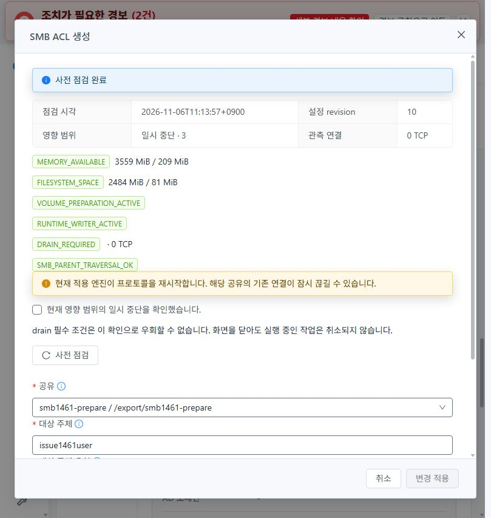
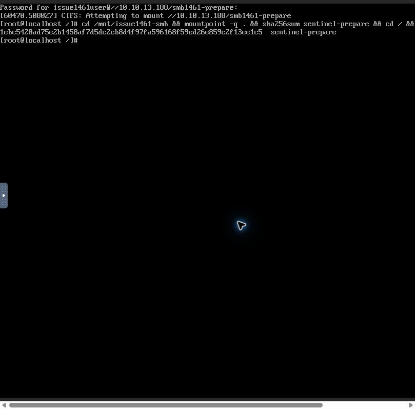
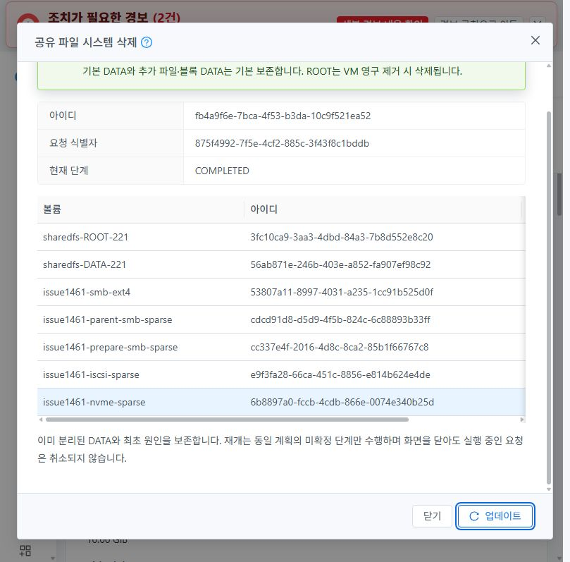
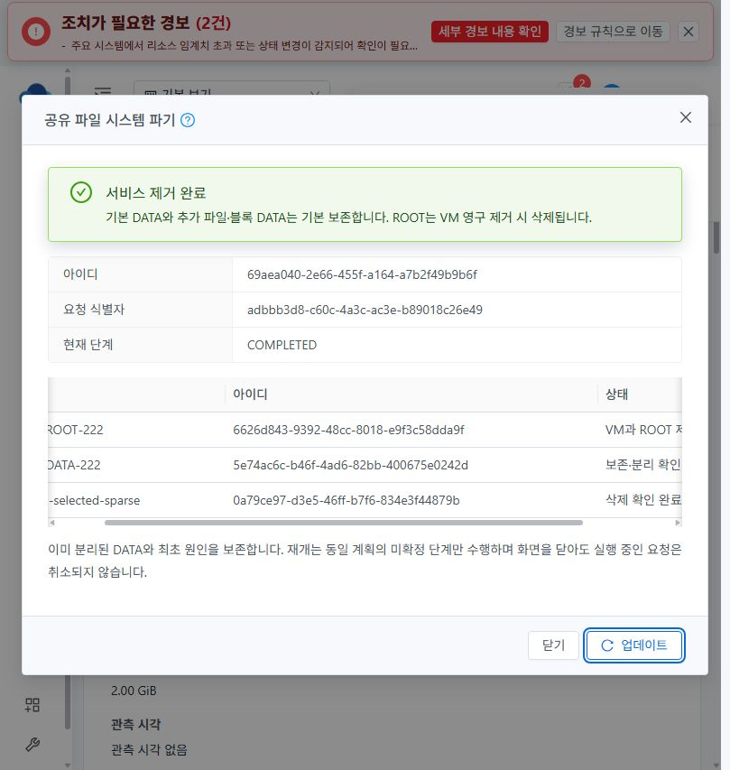
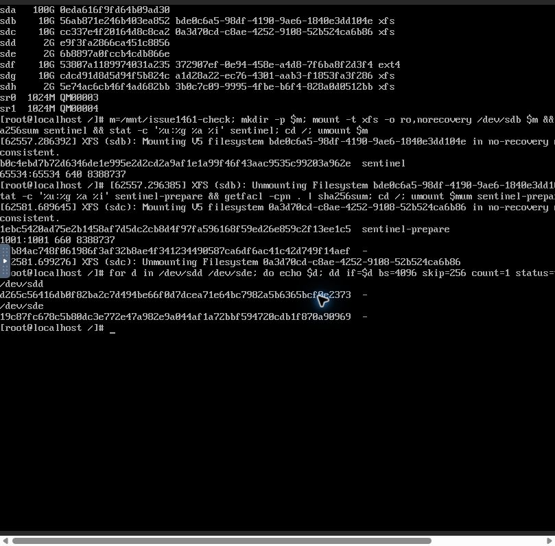
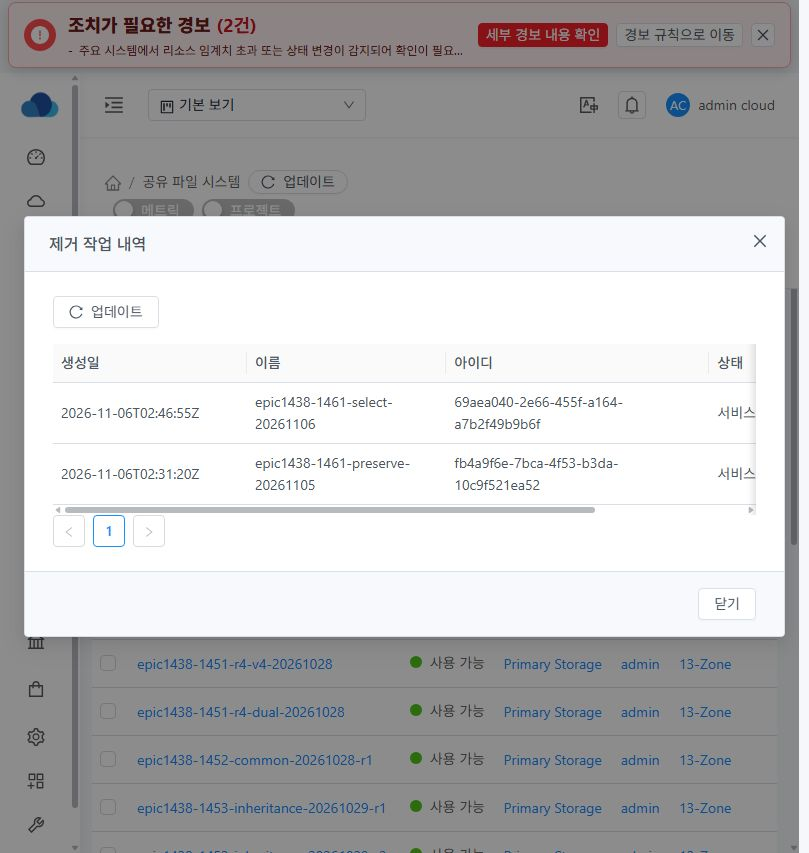

# SharedFS #1461 DATA 보존·선택 삭제 인수 — 2026-11-06

13번 클러스터에서 기본 보존과 선택 삭제를 각각 실제 Mold UI로 실행했다. API와 장치 상태를 대조했고, 보존 DATA 일곱 개를 C2에 다시 연결해 기존 파일과 블록을 읽었다.

## 구현과 배포

- `b6ce4f5fdcf7`의 삭제·재개·이력 구현, `6bca4fd15032`의 기본 SMB 리스너 검증, `23cc7b5d01d8`의 SMB 부모 탐색 사전 점검과 inode 기반 경로 저널, `9b97c749202a`의 SMB 볼륨 준비 분리를 검증했다.
- 트랜잭션 SMB 볼륨 준비는 `volume attach prepare-smb`를 사용한다. 동일 작업·볼륨 ID, 실제 마운트의 SOURCE·UUID·FSROOT를 확인하고 대상 경로를 반환한다. 공유 적용 저널이 새 디렉터리를 만들고 신원을 기록한다. 경로 관측과 생성은 기존 ACL·UUID·inode·bind 보호를 따른다. 시험에서 QGA `umask 077`과 payload 모드 `0600`을 확인했다.
- 서버 회귀 76개 통과. 분리 미확인, 정지 실패, 대상 외 부착, 일부 분리 후 동일 계획 재개, ROOT 제거 실패, 선택 삭제 보호 재검사, 메타데이터 정리 실패 후 재개와 완료 요청 재실행을 포함한다. [기존 SystemVM busy 별칭 격리 검증](../../design/sharedfs-1461-preserve-20261105/README.md)에서 일반 umount 실패 후 후속 detach·VM·볼륨 삭제 호출이 없음을 확인했다. 실환경 두 제거 작업에는 인위적 장애를 주입하지 않았다.
- 로컬 UI production build 완료. 동일 UI 소스의 앞선 회귀 29개를 통과했다. 13번에서 생성 자산 929개 해시를 대조했고, 새 빌드의 `color.less`를 반영했다.
- 관리 JAR SHA-256 `d5be6ed5b3d09b928742cf8f8355e48c7824576dc362054812a2fd716dfa8696`. 직전 배포본에서 변경한 JAR 엔트리는 `StorageServiceManagerImpl.class`다. 서명 런타임 `1461.parent.2`, 매니페스트 소스 `9b97c749202adebf94909e9dca39081658909417`. UI index SHA-256 `0f2780db997788e317a64cea371960e5fc62d6446bcebb747d354c2074c1f010`, 실행 앱 `app.b7f56185.js`.
- 관리 호스트의 배포 공간이 부족해 기존 원복 JAR 세 개를 해시 확인 후 권한이 제한된 보조 스토리지 디렉터리로 옮겼다. 기존 경로에서 같은 바이트를 참조할 수 있도록 연결했고, 직전 활성 JAR을 배포 전 원복 경로에 보존했다.

## SMB 준비부터 재시작까지

1. 실제 SPARSE XFS 마운트의 격리 시험에서 새 준비 명령을 실행했다. 장치·UUID 확인 후 대상 경로가 비어 있었고, 생성 금지 요청은 거부됐다. 같은 작업 ID의 저널에서 새 경로 세 개를 생성하고 inode를 대조했다. 사용자 탐색과 빈 경로 원복이 성공했고 기존 부모 ACL과 inode가 일치했다.
2. Mold UI에서 10GiB SPARSE XFS 볼륨 `cc337e4f-2016-4d8c-8ca2-85b1f66767c8`과 `smb1461-prepare`를 만들었다. `FORMAT_EMPTY` 준비 결과는 `directoryManagedByApply=true`, `directoryCreated=false`, 파일시스템 UUID `0a3d70cd-c8ae-4252-9108-52b524ca6b86`였다.
3. 동일 작업 `7272b089-ebbe-4d48-bc5a-e90e4034dfaf`의 적용 저널에 `export` inode 131과 공유 경로 inode 8388736이 기록됐다. 부모 모드 `0711`, 공유 모드 `0770`으로 작업이 COMMITTED 됐다. ACL 작업 `57b99de2-f6bf-4b9d-a34d-9180652f2b47`은 UI 사전 점검 `SMB_PARENT_TRAVERSAL_OK`를 거쳐 COMMITTED 됐다.
4. C2 콘솔에서 SMB 3.1.1로 기준 파일을 썼다. Mold에서 공유 VM을 재시작했고 부팅 ID가 `7d12ca83-0105-4a9b-a791-2714c3f5b1d2`에서 `661d58bf-6b1b-4083-9b7d-5927eb705efc`로 바뀌었다. 같은 공유에 다시 연결해 읽은 파일의 SHA-256과 서버에서 관측한 UID·GID, 모드, inode, ACL 해시가 일치했다.

## 실제 제거 결과

| 시험 | 실제 UI 및 API 결과 |
| --- | --- |
| 기본 보존 계획 | 원래 공유 `c764c805-3a42-4c60-8ff7-eec7c08bbe4d`의 영향 목록에서 ROOT 1개와 DATA 6개를 확인했다. 전부 SPARSE였다. |
| 복구 가능한 파기 | 작업 `fb4a9f6e-7bca-4f53-b3da-10c9f521ea52`가 SOFT_DESTROYED. VM 정지, DATA 6개 연결 상태를 UI와 API에서 확인했다. |
| 동일 계획의 영구 제거 | 사용자 승인 후 같은 작업을 영구 제거로 진행했다. ROOT `3fc10ca9-3aa3-4dbd-84a3-7b8d552e8c20`와 VM 제거가 확인됐고 DATA 6개 전부 DETACHED_PRESERVED, 작업 COMPLETED였다. |
| 선택 삭제 | 별도 시험 공유 `7247cf21-2828-4a2e-b1bd-a1da04b6f265`. 사용자 승인 후 작업 `69aea040-2e66-455f-a164-a7b2f49b9b6f`로 ROOT `6626d843-9392-48cc-8018-e9f3c58dda9f`와 빈 2GiB DATA `0a79ce97-d3e5-46ff-b7f6-834e3f44879b`만 제거했다. 기본 DATA `5e74ac6c-b46f-4ad6-82bb-400675e0242d`는 DETACHED_PRESERVED였다. |
| 실제 자원 대조 | 제거 직후 API에서 두 ROOT와 선택 DATA는 조회되지 않았다. 보존 DATA 일곱 개 모두 Ready·미연결이었다. |
| 관리 서비스 재시작 | `mold.service`의 PID 변경과 HTTP 정상 응답 후 두 작업 UUID의 COMPLETED 이력을 API 및 실제 Mold 제거 작업 내역에서 다시 확인했다. |

## 보존 DATA 재연결과 실제 데이터

iSCSI와 NVMe/TCP는 제거 전에 C2 실제 콘솔에서 각각 전용 2GiB SPARSE 장치로 연결했다. C2 식별자로 접근을 한정하고 1MiB 오프셋에 4KiB 기준 블록을 기록했다. 세션 종료 후 보존 계획을 실행했다.

Mold UI에서 보존 DATA 일곱 개를 C2 `057629be-6bb2-4aa6-a5ff-ee65bdc054f8`에 재연결했다. API UUID, 하이퍼바이저 시리얼, 실제 콘솔 장치·파일시스템 UUID를 대조했다. XFS는 `ro,norecovery`, EXT4는 `ro,noload`로 마운트해 읽었고 시험 마운트를 해제했다.

| 기존 파일·블록 | 재연결 관측 |
| --- | --- |
| 기본 NFS `sentinel` | SHA-256 `b0c4ebd7b72d6346de1e995e2d2cd2a9af1e1a99f46f43aac9535c99203a962e`, 65534:65534, 0640, inode 8388737 일치 |
| 추가 SMB `sentinel-prepare` | SHA-256 `1ebc5420ad75e2b1458af7d5dc2cb8d4f97fa596168f59ed26e859c2f13ee1c5`, 1001:1001, 0660, inode 8388737 일치. 공유 ACL SHA-256 `d9b84ac748f061986f3af32b8ae4f341234490587ca6df6ac41c42d749f14aef` 일치 |
| iSCSI 원시 블록 | SHA-256 `d265c56416db0f82ba2c7d494be66f0d7dcea71e64bc7982a5b6365bcf0e2373` 일치 |
| NVMe-oF 원시 블록 | SHA-256 `19c87fc678c5b80dc3e772e47a982e9a044af1a72bbf594720cdb1f870a90969` 일치 |
| 기존 EXT4·XFS SMB 부모 | 각각 inode 131073·131, 모드 0700, UID/GID 0:0 및 ACL SHA-256 `fe3b0dfb6ba214108a4bfbc9ce0e518de9559daa0ff32feba77c0f3d6d7accd3` 일치 |
| 선택 삭제 제외 기본 DATA | 파일시스템 UUID `3b0c7c09-9995-4fbe-b6f4-828a0d0512bb`를 읽기 전용 마운트하고 기존 `export/nfs1461select` 디렉터리를 확인했다. |

검증 중 Chrome이 이전 앱 번들을 재사용해 새 번들 로드를 확인하고 ACL 사전 점검을 다시 실행했다. 선택 삭제 시험의 첫 생성 요청은 L2 네트워크의 고정 IP 조건을 빠뜨려 API가 거부했다. 자원이 생성되지 않은 것을 확인한 뒤 미사용 IP를 지정해 생성했다. 보존 DATA 일곱 개는 읽기 전용 마운트를 해제한 상태로 C2에 연결돼 있다.

[API 및 런타임 관측](observations.json)

