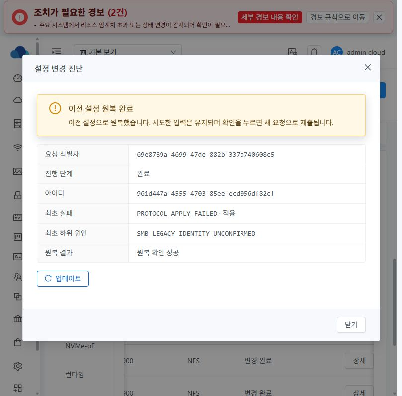
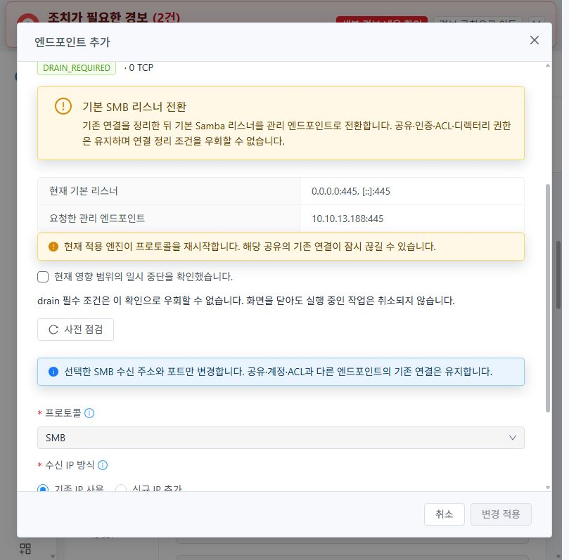
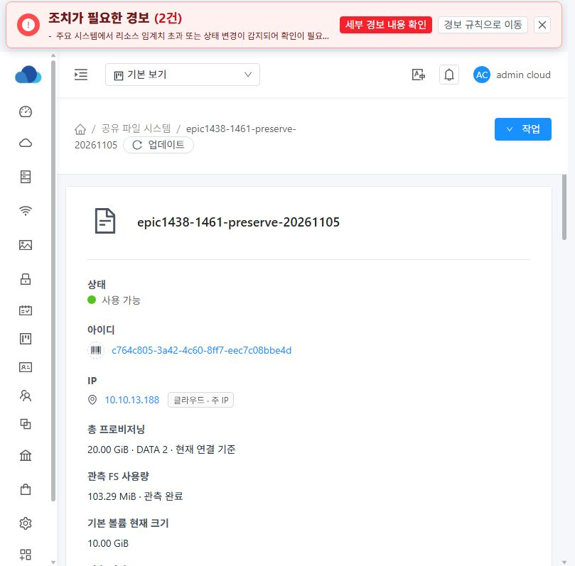
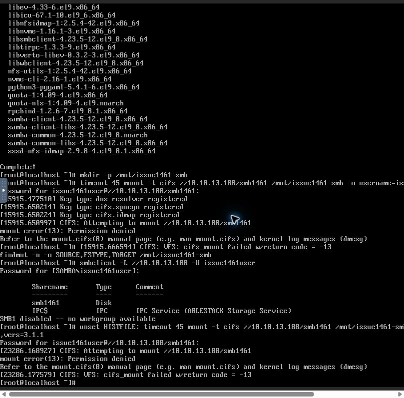

# #1461 기본 SMB 리스너 수정과 실환경 재개 기록 — 2026-11-06

상위 Epic #1438 / Epic Draft PR #1470. **이슈 OPEN, 삭제 인수 0/4, 추가 제품 결함 분석 후 중단**이다. 이 문서는 완료 판정을 대신하지 않는다.

## 이번 수정과 빌드

- 구현: b6ce4f5fdcf7 (#1461 DATA 보존·선택 삭제·동일 계획 재개·이력), 6bca4fd15032 (암묵적 기본 SMB 리스너의 적용/원복 검증·사전 점검·최초 하위 원인), 49d6f5165280 (기본 이미지 해시 프로필).
- 기본 smbd의 PID/start/boot·실행 파일·cgroup·보호된 설정 파일·소유 소켓을 읽기 전용으로 검증한다. 기존 listeners=[]를 임의 엔드포인트로 저장하지 않는다.
- 실제 연결의 drain 조건과 중단 의도 journal을 적용/원복에 함께 사용한다. 기존 UUID/inode/bind/ACL 보호와 오래된 응답 차단을 유지한다.
- write-once 최초 실패 DB 값은 변경하지 않고 관측/DTO에서 안전한 하위 코드만 보완한다. raw stderr나 인증정보를 UI에 전달하지 않는다.
- 구현 전에 실제 SystemVM의 격리 Samba/systemd/network namespace에서 9검사 PASS: 실제 인증 세션 drain, 동일 포트 인계, 원복, 중단 후 동일 작업 재개, 부팅 시 중복 방지, 실제 운영 프로세스·NFS 데이터 불변.
- 로컬 런타임 시험 49개 중 48 PASS·native opt-in 1 SKIP. 위 실제 native 9개는 별도 실행했다. 서버 coordinator→실제 MariaDB DAO→API 응답 28개, 실제 API preflight 직렬화 2개 PASS. UI 8 suite/59개 및 변경 UI lint PASS. Maven 37모듈과 UI production build PASS.
- 빌드 Actions는 실행하지 않았다. 로컬 빌드의 Node/OpenSSL 옵션 누락, 새 이미지 조립에서 payload/프로필 갱신 누락은 배포 전 빌드 검증으로 찾아 교정했다. 이 빌드 조립 오류를 제품 실환경 오류로 집계하지 않는다.

## 실제 배포 경계

- 관리 JAR SHA256: d32af98ba8006efc08718bf51eb6e5b4150d86886edd7c4400983829f4b62043.
- 변경 API preflight response와 서버 preflight/coordinator/manager의 class 및 inner class 10개를 검사해 overlay했다(실제 바이트 변경 6 entry). 무관한 entry는 바이트 동일. 실제 native JAR 참조 11,112개·누락 0. 기존 native engine 메서드/guard와 호환 bootstrap을 보존했다. 이번 리스너 수정의 추가 DB migration/host-agent 배포는 없다.
- UI index SHA256: 5e6040d43a114b9f85628db3a4a97e149758f579996238ddfcb1006ea07096c6. app.642a5642.js 포함 정적 파일 9개만 갱신하고 클러스터 config.json은 바이트 동일하게 보존했다.
- 실제 시험 VM의 서명 런타임: 1461.legacy.1 / payload commit 6bca4fd15032. 신뢰 키·서명·archive·release 무결성을 검증한 operator module deployment이며, 이 배포 자체는 설정·실패 journal을 변경하거나 프로토콜을 재시작하지 않았다.
- 새 기본 이미지 1461.legacy.2 / source 49d6f5165280도 로컬 조립·서명된 baseline/payload 일치·qemu-img check·압축 검사 PASS. 이미지 SHA256: 034ae73e221dca57a691a23b44d69427bfaa95671d0d1302afbb66dbce307167. 13번 artifact 경로에 업로드했으나 **새 템플릿 등록/부팅 검증은 아래 제품 오류로 미진행**이다. .1과 .2의 두 변경 실행 모듈 payload는 동일하며 .2는 조립 프로필/출처를 정렬한 이미지용 manifest다.
- 개인키는 기존 보호된 DPAPI signer에서 RAM/memfd로만 사용했다. 개인키·운영 암호 파일 저장은 없다.

## 실제 UI와 API 관측

업무 요청은 Mold UI로 실행했다. API 대조는 실제 UI가 보낸 요청/응답을 수동 호출 없이 수집했다. 클라이언트 접속은 Mold VM 화면에서 연 noVNC 콘솔을 사용했다.

| 단계 | 관측 결과 |
|---|---|
| 기존 실패 조회 | 최초 하위 원인 SMB_LEGACY_IDENTITY_UNCONFIRMED와 원복 실패 SMB_LEGACY_BINDING_UNCONFIRMED를 구분해 표시 |
| 동일 작업 복구 | request 69e8739a-4699-47de-882b-337a740608c5 / op 961d447a-4555-4703-85ee-ecd056df82cf. UI의 복구 재개→실제 API job 5c2ac262-2d3f-42a6-b583-d1bc0cd73964→ROLLED_BACK/COMPLETED, rollback SUCCEEDED. UI 업데이트 후 같은 결과와 최초 하위 원인 보존 |
| 기본 리스너 인계 점검 | READY / revision5. 실제 0.0.0.0:445와 [::]:445→요청 10.10.13.188:445. SMB_LEGACY_HANDOFF / drainrequired=true / ackrequired=true / 0 TCP |
| UI 인계 적용 | request df320d1b-4281-4214-95d7-9958a998a684 / op 42fd37c9-2eeb-4fe1-9d8e-b0808820a6c7. COMMITTED/COMPLETED·UI 엔드포인트 READY. 기본 smbd는 inactive, 소유 관리 리스너 unit active |
| 기존 SMB 디렉터리 등록 | op 0756e15c-169c-49cf-8b6c-2fd332d1eab6 COMMITTED. 현재 POSIX 값 그대로 등록 |
| 빈 SMB 디렉터리 소유권 지정 | op 41070413-5183-482c-8136-7a4f88534555 COMMITTED. UI 실제 정책 1001:1001/0770 revision2, 비재귀, 기존 ACL 유지 |
| 실제 SMB 접속 | 새 C2 클라이언트 cifs mount error13. Samba는 인증된 uid=1001/gid=1001로 물리 공유 경로 chdir에 실패 |






라이트 UI의 공통 Mold 대화상자·고정 헤더/푸터·본문 스크롤·AntD 배치를 확인했다. 이번 추가 UI의 실제 다크모드 재검토는 제품 오류 중단으로 미완료다. COMMITTED 작업의 rollback NOT_NEEDED를 '변경 전 거부'로 표현하는 기존 표시 차이는 #1468 HOLD로 기록하며, 이번 기능 실패와 혼동하지 않는다.

## 추가 제품 결함의 확정 원인

서비스 c764c805-3a42-4c60-8ff7-eec7c08bbe4d, VM db7810f8-f49c-3fbd-881e-7b0e34de3f8d, SMB DATA 53807a11-8997-4031-a235-1cc91b525d0f (SPARSE EXT4 10GiB).

물리 경로의 namei 결과:

```
/srv/ablestack-storage/volumes/<SMB-DATA>/         root:root          0755
/export                                               root:root          0700
/export/smb1461                                        1001:1001          0770
```

여기서 /export는 위 DATA mount 안의 중간 디렉터리다. ROOT의 /export 경로를 뜻하지 않는다.

1. 실제 host wrapper class에 QGA 실행의 `umask 077; payload=...` 접두부가 존재한다. 암호가 포함될 수 있는 임시 payload를 보호하는 기존 동작이다.
2. 레거시 SMB 생성 분기의 ablestack-storagectl:5023–5026은 누락된 전체 경로를 os.makedirs로 생성한다. 호출자의 0077을 상속해 중간 export가 0700으로 생성됐다.
3. apply_directory_policy와 apply_posix_acl은 공유 leaf에만 mode/ACL을 적용한다. 공유 디렉터리 권한 변경도 기존 부모를 보존한다. 결과적으로 leaf의 정상 ACL·1001 소유권만으로는 부모의 탐색 권한을 통과할 수 없다.
4. 실제 Samba 로그: `chdir_current_service: vfs_ChDir(.../export/smb1461) failed: Permission denied. Current token: uid=1001, gid=1001, 1 groups: 1001`. 암호 입력·네트워크·리스너 bind 실패가 아니다.
5. 부모 생성/마지막 변경 시각은 2026-11-05 13:47:53 UTC다. 현재 소유권 변경(15:56:28 UTC)과 이번 리스너 인계보다 이전의 원래 SMB 공유 생성 시각이다. 이번 리스너 수정은 해당 레거시 mkdir 분기를 변경하지 않았다.
6. 실제 SystemVM의 폐기 가능한 별도 디렉터리에서 0077→os.makedirs→leaf1001/0770 조건으로 사용자 탐색 거부를 재현했다. 그 별도 시험의 중간 디렉터리에만 탐색권을 부여하자 성공했다. 시험 디렉터리는 종료 시 제거했고 실제 DATA의 부모 mode/owner/inode는 불변이다.
7. 현재 리스너/설정/공통 POSIX 검증은 이 레거시 공유의 인증 사용자별 전체 조상 경로 탐색까지 검사하지 않는다. 따라서 UI가 READY·정책 일치를 표시해도 실접속이 거부될 수 있다. 위 9개 리스너 주입 시험은 생성된 중간 경로가 아닌 준비된 시험 공유를 사용했으므로 이 생성 경로를 대신 검증한 결과가 아니다.

## 최소 개선 방향 — 아직 미구현

- UI 사전 점검에 실제 공유 경로의 부모별 탐색 가능 여부를 공개 안전 코드/원인과 연결한다. 알려진 POSIX 차단은 BLOCKED로 안내하고 관측 불가는 UNKNOWN으로 유지한다. 현재 '공통 정책 일치'와 '클라이언트 접근 가능'을 구분한다.
- 레거시 자동 생성에서 **해당 작업이 새로 만들고 소유권·inode로 증명한 중간 디렉터리**의 탐색 정책을 명시하고 적용/검증/실패 원복에 포함한다. 기존 디렉터리나 다른 공유 부모는 자동 chmod/chown하지 않는다. 실제 현재 부모의 교정은 별도 명시적 정책과 신원 검증을 거쳐야 한다.
- QGA의 전역 umask를 느슨하게 바꾸지 않는다. payload/secret 보호, 기존 ACL·ROOT·UUID/inode/bind·드레인 보호를 유지한다.
- 실제 QGA 0077→레거시 경로 생성→로컬 ACL→인증 사용자 traversal→실제 SMB 접속을 연결한다. 새로 만든 부모/기존 보호 부모/다른 공유 참조/실패 원복·재시작을 구분한다.
- 새 이슈나 브랜치를 분기하지 않았다. 이 기록 이후 제품 코드 수정·자원 준비·재시작·삭제를 진행하지 않는다.

## 중단 시 자원·미완료

- 기존 실패 작업은 원복 완료됐고 새로운 리스너/디렉터리 작업 3개는 COMMITTED다. 새 RECOVERY_REQUIRED 작업은 발생하지 않았다.
- NFS 기준 파일 SHA256 b0c4ebd7b72d6346de1e995e2d2cd2a9af1e1a99f46f43aac9535c99203a962e /65534:65534/0640/inode8388737이 실제 SystemVM 읽기 전용 검사에서 동일하다. 이번 turn의 NFS 클라이언트 재접속/재시작 인수로 확대하지 않는다.
- SMB leaf는 빈 상태다. 실제 SMB 쓰기/데이터 기준값을 아직 만들지 못했다. 서비스 VM·기존 SPARSE XFS/EXT4 DATA·새 C1/C2를 보존했다. DATA 삭제0·MAC 변경0·재포맷0.
- iSCSI/NVMe DATA 준비, VM/관리 서버 재시작 후 클라이언트 검증, 기본 DATA 보존·선택 삭제·부분 실패 재개·보존 DATA 재연결 검증 미완료. 최종 인수0/4·이슈 OPEN·Epic PR Draft 유지.
