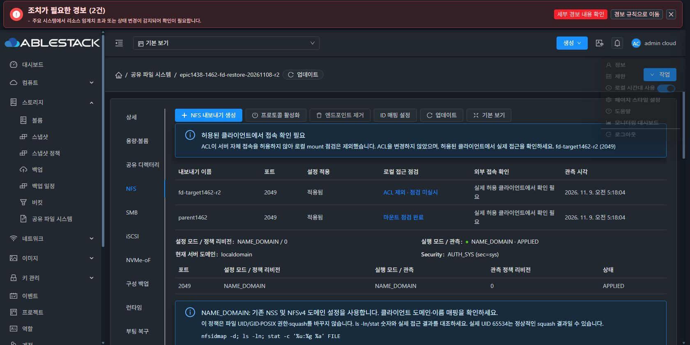
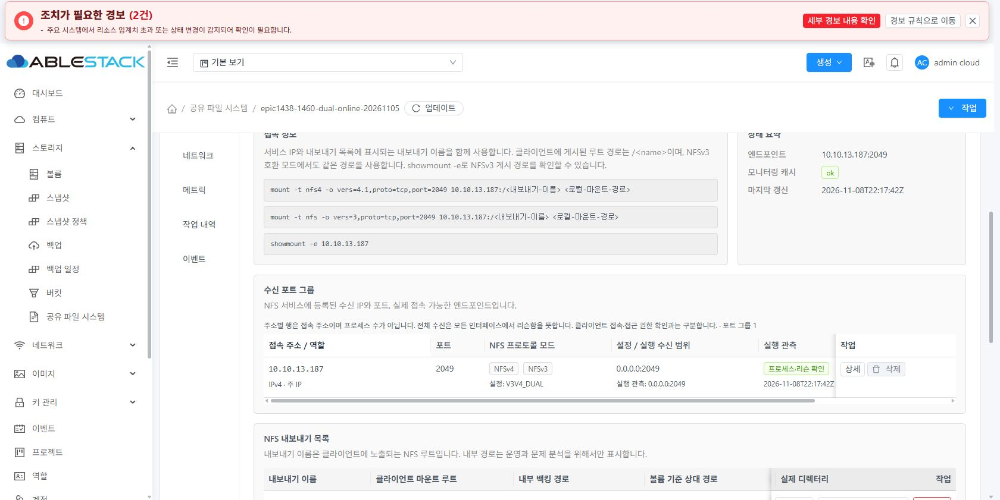
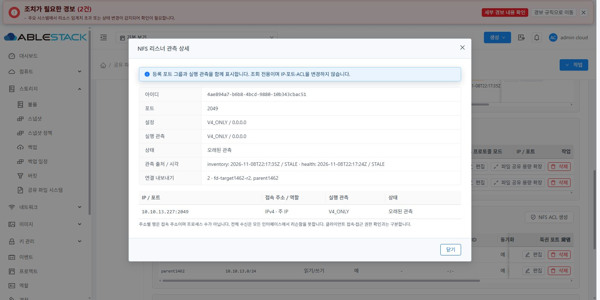
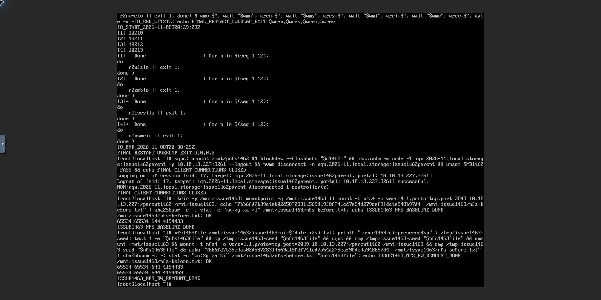

# #1463 NFS 리스너 행 표시 최종 인수 — 2026-11-09

## 결과와 범위

기존 NFS 표를 주소별 행으로 보완했다. 구조화된 API 주소와 실제 Ganesha 관측을 연결해 버전/모드·역할·설정/실행 바인딩·관측 상태/시각·연결 Export·작업을 구분한다. Export 행은 연결 그룹/주소 개수와 전체 tooltip·읽기 전용 상세를 제공한다.

**로컬 UI 빌드·13번 UI 배포·API/실제 UI/실제 noVNC 클라이언트 인수 완료.** API/DB/서버/SystemVM 제품 코드는 변경하지 않았다. 그룹 생성/편집/삭제·ACL·drain/승인·원복과 공통 protocolListenerEntries/Rows는 유지했다. 전체 UI 정리 #1468은 시작하지 않았다.

제품 commit c05141acc8967eb37c975039f3b905294ec6a4c6. [승인된 설계](../../design/sharedfs-1463-nfs-listeners-20261109/README.md)의 범위이며 새 이슈를 분기하지 않았다.

## 구현

- storageNfsListenerPresentation.js는 원래 NFS 등록 행과 structured effectiveendpoints를 보존한다. wildcard/동일 port의 지정IP를 삭제하지 않으며 IPv6 주소/port는 별도 필드로 두고 출력만 bracket 처리한다.
- NFS의 기존 API runtimestate=READY는 DB 상태이므로 실행 확인으로 쓰지 않는다. inventory/health의 동일 port/bind·processRunning/listening·mode·generatedAt/staleAfterSeconds를 사용한다. 없거나 알 수 없는 모드를 V4_ONLY로 기본화하지 않는다.
- 조회 중·미관측·현재 프로세스/리슨 확인·실제 실패·오래된 관측·조회 실패·출처 충돌을 구분한다. 일부 출처만 유효하면 그 출처와 진단을 유지한다. 등록 없는 실행만의 항목은 조회 전용이다.
- 갱신 중 기존 행을 유지한다. NFS가 열린 동안의 표시용 clock만 추가했고 네트워크 poller는 추가하지 않았다. tab 이탈/unmount에 정리하며 원래 owner/scope/generation/AbortController/deadline 보호를 유지한다.
- 삭제는 표시한 alias가 아니라 원래 그룹 UUID/listenIP/port를 기존 SharedFSTab 삭제 모달에 전달한다. 등록 참조·관측 미확인/충돌·진행 중 작업에서는 비활성화하며 서버의 preflight/impact/drain/확인·승인을 재사용한다.
- 신규 StorageNfsListenerTable은 VM과 같은 AntD 표·고정 작업열·페이지 처리·MoldDialog를 사용한다. 원래 breadcrumb·정보 상세·세로탭·좌측 primary/업데이트/넓게 보기와 기존 경로/POSIX/ACL/볼륨/세션 UI를 유지했다. 고정 헤더/셀에는 불투명 테마 배경을 적용했다.

## 로컬 시험과 빌드

| 항목 | 결과 |
|---|---|
| 실제 API fixture 기반 표시 모델 | 13 PASS: 실제 단일/두포트/DUAL, 원문 불변, wildcard+지정그룹, IPv6/family 증거, stale/미관측/조회실패/충돌, Export 중복제거·100그룹·원래 삭제 tuple |
| 실제 새 표·SharedFSTab 연결 | 7 PASS: AntD 100그룹20행/5페이지, readonly modal, 갱신중 같은 DOM행, scope변경닫기, 미지원mode, 삭제 보호·기존 intent/실제 submit tuple, clock 정리/추가poll0 |
| 기존 읽기·삭제·SMB endpoint 회귀 포함 | 총 **5 suites / 48 PASS**, skip0 |
| 변경 파일 lint | PASS, diff whitespace 검사 PASS |
| 제품 UI production build | PASS, Node20/기존 webpack4의 로컬 호환 옵션 NODE_OPTIONS=--openssl-legacy-provider 사용 |
| 빌드 Actions | 수동 실행0, 모든 빌드는 로컬 |
| 빌드 범위 | UI만. Maven/KVM/SystemVM 이미지 재빌드·교체 없음 |

초기 시험 mount의 feature getter·탭 stub 정리와 기대 intent를 실제 기존 계약에 맞춘 뒤 최종 전체 회귀를 통과했다. 초기 빌드의 Node/OpenSSL 옵션 누락은 빌드 환경에서 교정했고 제품 소스/의존성을 바꾸지 않았다. 최종 결과 원문은 evidence/regressions.txt, lint.txt, ui-build.txt다. 기존 중복 아이콘 등록/번들 크기 경고를 전체 CI 통과로 확대하지 않는다.

## 13번 배포 식별자와 보존

- 정상 빌드 자산979개를 검증했다. 실제 변경 기존파일은 index.html·한국어/영어locale3개, 새 hash 자산8개다. 이전 hash 자산은 남겨 기존 열린 UI의404를 막았다.
- 현재 app.d2c48f96.js. UI index SHA256 **b1a5d36337cc3d4f61c5d13cd737738f4c7541ac75b5c8c404f821d0cf6eb6c1**.
- 배포 ZIP SHA256 **b1b81b1c2080c49b7e3547c0c726a27562fbddda4aeb2860d4f31afbcb28bcd9**.
- 관리 JAR SHA256 **a82e218eed0c4e4a7feb98f298798a317d13e0abd9174686f4f931776768d9ad** 그대로, 관리 PID **1709314** 그대로, HTTP200.
- 운영 config.json SHA71c175523a2e251faf574bd5d977c37e81d21c9cc0b8a98dfb1642c6b8a448d7와 color.less SHA2d1ff56949d9f970fae62b2711326f582c88bef79ec799f1fd2cef7e1d0174a9를 보존했다.
- /nfs/secondary/.epic1463-ui-c05141acc896에 전용 배포본/백업/결과가 있다. index는 자산 검증 후 마지막으로 원자 교체했다. 관리·호스트·SystemVM 재시작0이다.
- 제품 API/DB schema·VM runtime1462.iscsiid.1·DATA·CHAP/ACL 변경 없음. 새 디스크/VM/alias/MAC 생성·변경0, THIN0이다.

처음 연 비교 탭은 기존 app.5dcfbf70.js를 브라우저가 캐시하고 있었다. 정상 새로고침 후 네 대상 모두 DOM script가 app.d2c48f96.js임을 확인한 뒤 인수했다. 구버전 화면을 새 UI의 성공으로 기록하지 않았다.

## 실제 UI·API·runtime 대조

| 대상 | API·실제 UI 결과 |
|---|---|
| edff302a… / VM52478e8d… / 13.227 | V4_ONLY, 주IP1행/2049/그룹1/연결Export2. 실제 프로세스·리슨 확인과 stale를 구분. 신규 표·상세와 원래 fd-target/parent1462 Export/ACL/볼륨/세션 유지 |
| d85d5002… / VM5d82a2a4… / 13.186 | 두 그룹2049/2050 각Export1, 두 주소행.2050의 설정13.186과 실제0.0.0.0 바인딩을 구분하며 NFSv4로 표시 |
| cb889aa9… / VM23ccd807… / 13.187 | V3V4_DUAL/2049/1행, 실제 NFSv3+v4와 프로세스·리슨 관측 표시 |
| 8b03d48c… / VM867bfbfb… / 13.233+235 | 기존 **Stopped** VM. 주IP233/별칭235를2행으로 보존하되 실행 버전 UNKNOWN·미관측·삭제 비활성. 이 대상을 실제 다중IP 접속 성공으로 확대하지 않음 |
| 정상 업데이트/탭 왕복 | 갱신 중 원래 주소 행 유지, 최신값으로 복귀.30초 관측 유효기간 경과 시 “오래된 관측”과 마지막 버전/시각 유지. NFS→SMB→NFS에서 원래 psmb1462와 NFS 표 유지 |
| readonly 상세/Export 연결 요약 | 실제 UI에서 동일 그룹 UUID/port·출처별 READY/STALE·연결Export를 확인. 현재 실행 정보와 등록 정보를 분리. API 쓰기 없음 |
| 보호 | 실제4대의 모든 참조 중인 행 삭제 버튼 비활성. 원래 그룹의 요청 tuple/사전 점검·승인·보호는 회귀로 검증 |
| 라이트·다크/VM 표준 | 실제 UI 둘 다 확인, 원래 다크로 복원. 실제 셀 라이트75,85,99/흰색·다크197,204,212/34,40,47. 고정 헤더 다크39,46,54로 불투명. 모달header109~164/footer667~732는841px 안, body overflow auto |

실제 UI 행·자산·테마·삭제 비활성의 원문은 evidence/actual-ui-rows.json이다. 부분 실패·IPv6·100그룹은 실제 API 계약의 합성 회귀와 실제 AntD 컴포넌트로 검증했다. 실환경에서100그룹을 새로 만들거나 IPv6네트워크/실제 listener 장애를 유발하지 않았다. 설계 단계의3대 SystemVM 격리 주입18점검도 설계 증거에 보존했다.

## 실제 noVNC 클라이언트와 데이터 보존

이번 검증은 기존 SPARSE 시험 자원과 현재 정상 서비스의 관측/접속만 사용했다.

- 클라이언트 VM464a0a92-18f1-4bbf-b0d9-b52cf81f4a52의 **실제 Mold 콘솔**에서 .227:/parent1462 NFSv4.1/TCP2049를 마운트했다. 클라이언트 ROOT100GiB SPARSE도 현재 API로 재확인했다. 클라이언트 SSH/QGA로 대체하지 않았다.
- 배포 전후 nfs-before.txt SHA256 **7bb6fd7b39e4ab02d58728314569d19f0f741ed7a54d279caf9fde4a948b97d4**,65534:65534/0644/inode4194433 보존.
- 고유 시험 파일 issue1463-ui-1794175912.txt 쓰기→sync/cmp→umount→실제 재마운트→cmp/원본 SHA 재확인 PASS. 새 파일65534:65534/0644/inode4194459, SHA256 **db428a7781470fdb3f21dd5b9e4bfa65bd73be04bd4a96adeed73d14c13d98b0**.
- 서비스의 기존26개 파일 해시, parent inode/UID/GID/0775·ACL·계정·private0700·WWN·NVMe UUID·IP/MAC·desired/intent·identity store·boot까지14비교항목 모두 동일. 새 시험 파일1개만 추가해27개다.
- 구성 revision23/protectionfalse 유지. 네 프로토콜 등록 설정/엔드포인트/참조개수 그대로이며 최종 health는 NFSok·Ganeshaok·SMB/iSCSIactive 등 기존 정상 상태다.
- 종료 시 sync/umount와 ISSUE1463_CLIENT_CLEANUP_PASS를 실제 콘솔로 확인했다. 시험 DATA·권한·새 증거 파일은 보존했다.

이 이슈는 NFS 표시 변경이므로 SMB/iSCSI/NVMe의 복원·대용량·AD 시험을 다시 실행하지 않았다. 해당 설정/장치 신원·기존 회귀·서비스 상태 보존으로 영향 범위를 확인했다.

## 근거

evidence/에는 UI 배포 결과·API before/after·네이티브 before/after/비교·실제 DOM·원문 시험 로그를 보존한다. 인증정보/개인키 원문은 포함하지 않는다. 예상하지 못한 제품 코드 오류 없이 인수를 완료했으며 Epic Draft PR은 병합하지 않는다.
