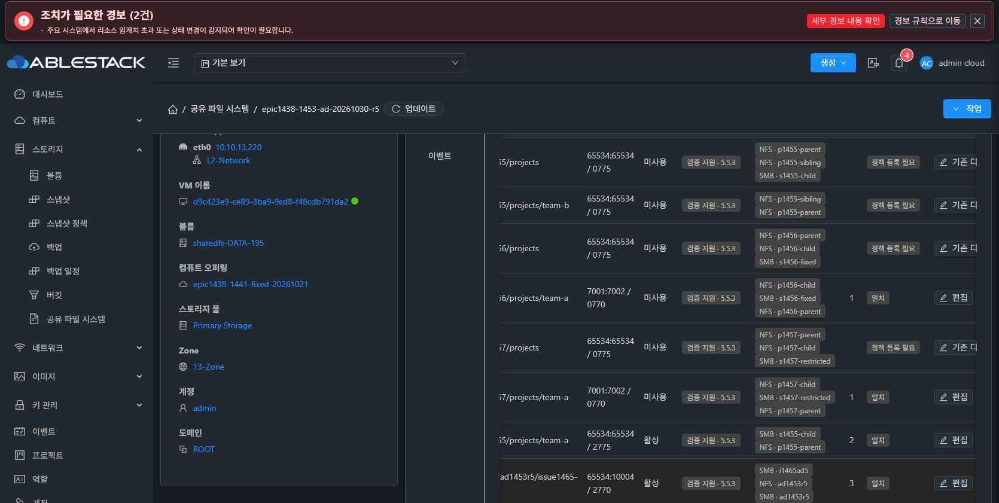
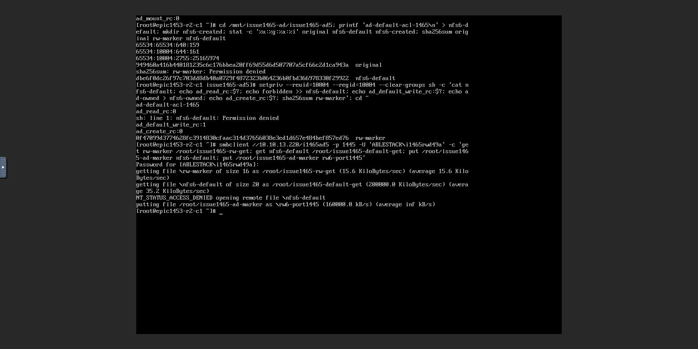
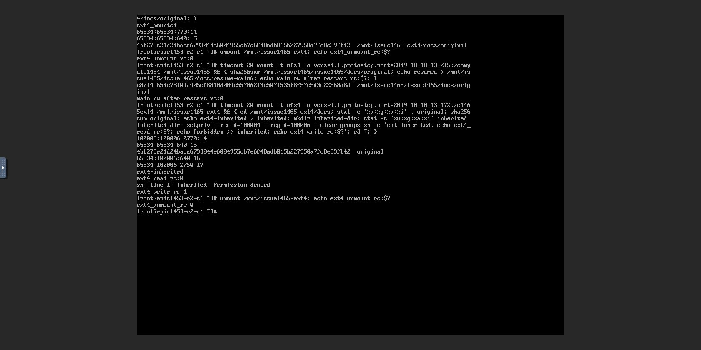
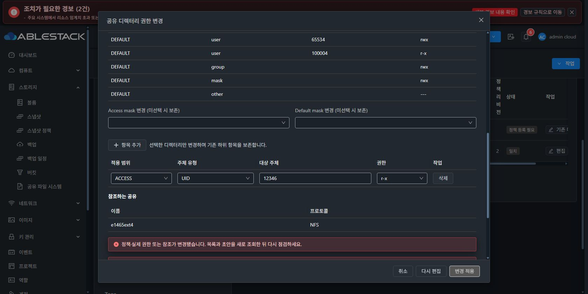
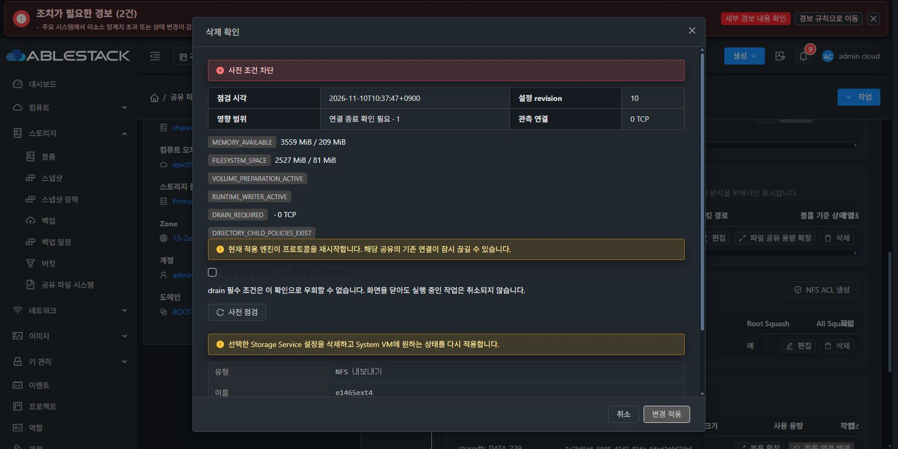
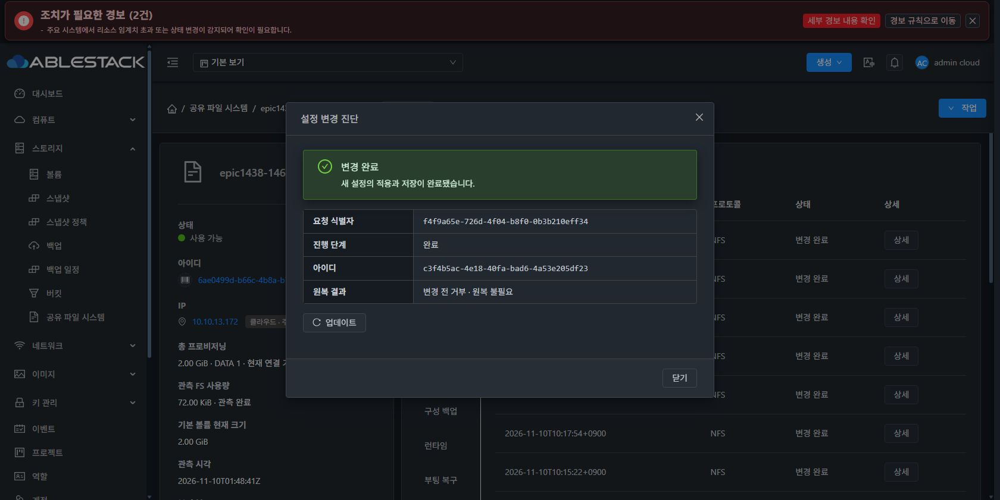
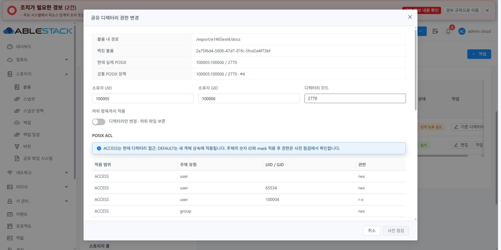
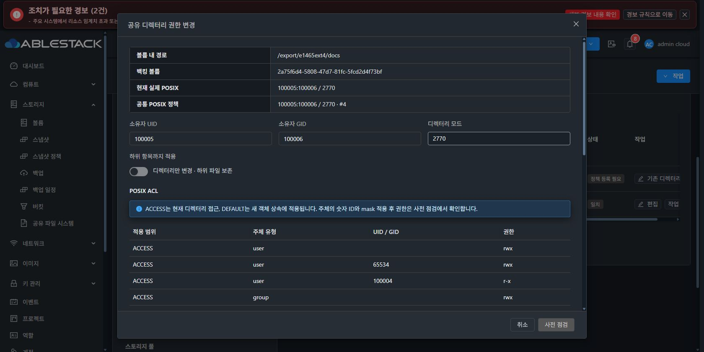

# #1465 최종 인수 결과 — 2026-11-10

## 완료 판정
**하위 디렉터리 POSIX 소유권·access/default ACL 기능과 이번 선택적 null 직렬화 교정을 인수했다.** 실제 API, Mold UI, 두 noVNC 클라이언트, XFS/EXT4 SystemVM과 VM/관리 서버 재시작에서 검증했다. 예상하지 못한 제품 오류는 이번 재개에서 발생하지 않았다. 의도한 ACL 거부·충돌·stale·부모 삭제 보호는 성공한 음성 시험으로 구분한다.

상위 Epic #1438 / 통합 Draft PR #1470. 이 문서는 종전 중단 기록을 대체하는 최신 완료 근거이며 종전 실패 기록은 이력으로 보존한다.

## 코드와 최소 변경 경계
- 이번 제품 commit **8801bf942c085c2b7ad01c074d0cdd46b5bc8907**.
- MANAGED readiness의 선택적 `coveredBy/pid=null`만 생략해 Gson의 필드 부재와 통일한다. 과거 null 포함 proof도 같은 규칙으로 비교한다.
- 실제 PID·coveredBy·instance·주소·포트·READY/COVERED 및 기존 unit/config/socket 신원 검증은 유지한다. 다른 null 필드, 전역 Gson 설정, implicit proof는 변경하지 않는다.
- 실제 coordinator의 private Gson 객체→직렬화 payload→Python 게스트 공통 정책 검사 회귀를 추가했다. 실제 captured normal report와 합성 COVERED report를 구분하며 PID/포트/주소/covering 관계 변조를 거부한다. 기존 코드에서 동일 직렬화 차단 실패를 먼저 확인했다.
- 전체 #1465 구현은 기존 공통 정책/트랜잭션/DAO/VM 표준 UI를 확장한다. FD의 FS UUID·device/inode·mount ID 보호, 비재귀 변경, 실제 ACL snapshot/원복, SMB 소유 ACL의 원자 metadata 반영, VERIFIED 이후 영수증 확정, FSAL 실행 능력 검사를 포함한다.
- UI 제품 소스는 이번 null 교정에서 추가 변경하지 않았다. 직전 로컬 생산 빌드/배포본을 유지하고 관련 실제 컴포넌트 회귀·실제 UI를 다시 검증했다.

## 구현 전 실제 SystemVM 실증 및 로컬 회귀
실제 AD SystemVM의 managed445/1445 report를 Gson2.10.1로 직렬화해 기존 오류를 재현했다. /run 후보 모듈 주입 후 같은 wire와 기존 nullable proof는 수용하고 PID·주소·포트·실제 coveredBy 변조는 거부했다. 비게시 private SPARSE XFS 경로에서 적용→검증→원복을 수행했고 운영 registry·설정·계정 파일을 보존했다.

| 검사 | 최종 결과 |
|---|---|
| Java 실제 Gson/게스트 계약10 + 실제 coordinator/MariaDB DAO39 + 보호1 | 50 PASS, skip0 |
| 게스트 directory/FSAL/implicit/transaction | 81 PASS, 기존 native전용 1 SKIP |
| 실제 UI 컴포넌트/보호/작업 내역 | 3 suite, 25 PASS |
| Maven server -am package | PASS |
| 서명 runtime6 빌드·manifest 검증 | PASS |
| 새 QCOW2 disk 검사·서명 payload17개·33935 기존 경로·계정 파일 | PASS |

모두 WSL ext4에서 로컬 실행했다. Actions 수동 실행0이며 전체 저장소 CI 통과로 확대하지 않는다. 테스트용 loopback MariaDB는 신원 확인 후 종료했다.

[실제 SystemVM 사전 결과](evidence/native-pretest.json) · [실증 코드](evidence/managed-systemvm-probe.py) · [계약10](evidence/contract-tests.txt) · [DAO39](evidence/dao-tests.txt) · [보호1](evidence/guard-tests.txt) · [게스트](evidence/guest-tests.txt) · [UI](evidence/ui-tests.txt) · [패키징](evidence/package.txt)

## 13번 배포
| 산출물 | 버전/검증값 |
|---|---|
| 관리 JAR | SHA256 aaf83406ddb48af5d0559cea9b1ca64f5dce4eee7e6aa1151ef2a113843d3335 |
| 관리 overlay | 종전 b33ca547...에서 bootstrap baseline33 JSON만 교체. 이번 Java 제품 class 변경 없음 |
| UI index | fbab766094d722174557bbb1fb988dbe6c2ec8625cc61295ec007641de003f1b, 운영 config/테마/기존 자산 보존 |
| 정상 서명 런타임 | 1465.directory-acl.6 / ABI1 / schema1 / layout2 / 17 files |
| 런타임 archive SHA256 | 674cbde6d3dbe2e22e55719eb00c8eb8d645fe76e72a8ddd6f25916b13e88d6d |
| manifest SHA256 | 5f22a0dc8842ede68e0246a695d2ae7392a49b813f115eda64ec27dcb12d9817 |
| 실제 UI 카탈로그 | ffee2633-b031-43a1-a063-1aacb61050f9 / VERIFIED→PUBLISHED |
| 새 전용 템플릿 | 8629e9e2-2fd7-45f7-97e4-874a8f7098c2 / SHAREDFS / KVM / Debian12 x86_64 / Download Complete |
| 이미지 SHA256 | bcda672082027d2376030fad0aad99fd109ca5dff79c1ca5bbf8b5c21124f2ab, 499740227 bytes |

실제 UI로 main·AD SystemVM에 runtime6 다운로드/사전 점검/승인/COMPLETE를 확인했다. 새 템플릿은 서명 runtime6·baseline33·검증된 Ganesha5.5.3 POSIX ACL prefix/profile을 포함하며 stock 패키지는 유지한다. 별도 mount namespace의 복제 이미지에만 주입했고 host/guest passwd/group/shadow/gshadow는 불변이었다. 서명 개인키는 보호 저장소에서 memfd로만 사용했다.

이미지는 관리 서버의 여유 NFS 영역에 보관하고 전용 정적 파일 경로에 읽기 전용 bind로 제공했다. ROOT에 500MB를 중복 저장하지 않았다. 새 이미지/시험 VM을 보존한다. 시험에서만 Zone `sharedfsvm.compute.template.uuid`를 새 UUID로 지정했고 마지막에 **원래 빈 값으로 복구**했다. 공용 SYSTEM VM 선택과 기존 비동적 오퍼링 생성 조건을 변경하지 않는다. 새 이미지 재사용은 해당 zone의 전용 템플릿 설정/온라인-compute 조건을 따르며, 기존 비지원 Ganesha 빌드에는 ACL 기능을 허용하지 않는 보호를 유지한다.

[관리 manifest](evidence/management-manifest.json) · [서명 manifest](evidence/manifest.json) · [이미지 빌드/무결성](evidence/guest-module-build.json)

## 실제 UI·API·두 클라이언트 인수
클라이언트 aaa3c43c-4f32-48f2-bdd5-e3930f908a07(.254.224), e6744029-299e-4585-981b-65e312d9e752(.254.223)의 실제 Mold noVNC에서 수행했다. 클라이언트 I/O를 QGA/숨은 API로 대체하지 않았다. 원본 파일은 재작성·재귀 chmod/chown하지 않았다.

| 대상 | 실제 확인 |
|---|---|
| main XFS .13.215 / ae065dba-927a-4f38-85c0-9d997dd6e849 | implicit SMB readiness 공통 정책 확정, 로컬 UID100004 ACCESS rwx / DEFAULT r-x, 새 객체 GID/setgid/ACL 상속, NFS CIDR 거부→허용, RW 연결 유지·RO 쓰기 거부 |
| AD XFS .13.220 / 3f0056db-4dfe-4f13-908d-b809dd565d34 | managed445/1445, AD_GROUP RW·AD_USER RO 확정, AD_USER10004 ACCESS rwx / DEFAULT r-x 공통 정책을 실제 UI로 최초 확정. SMB 두 포트 접속·새 쓰기와 RO 거부, NFS 동일 UID 접근·default 쓰기 거부 |
| 새 EXT4 .13.172 / 6ae0499d-b66c-4b8a-b73f-cb086fb15998 | 새 VM dd63b8d8-1c18-398b-8e99-000ae651dc76와 새 SPARSE ROOT/DATA, 실제 UI NFS 게시 후 경로 관측·등록→owner100005/GID100006/mode2770→BOTH UID65534 rwx/100004 r-x→두 클라이언트 상속·실효 접근 |
| 동시 편집 | 같은 정책 revision2를 연 A/B에서 B만 먼저 확정. A 사전 점검 DIRECTORY_POLICY_STALE, 적용 비활성, UID12346 미반영 |
| 선택 ACL 제거 | UID12345 ACCESS만 UI 최종 확인 후 제거. 다른 access/default 및 원본 데이터 보존, public policy revision4 APPLIED |
| 충돌/참조 보호 | SMB 소유 UID10003 덮어쓰기 DIRECTORY_ACL_POLICY_CONFLICT. 참조 정책 해제 비활성. 부모 NFS 삭제 DIRECTORY_CHILD_POLICIES_EXIST·적용 비활성, DATA detach 비활성 |
| 미게시 정책 해제 | native 원복 시험의 기존 비게시 경로를 UI로 관측/등록→UID12350 access/default 적용→정책 등록 해제. 등록만 제거하고 실제 ACL/owner/mode/inode/파일 SHA 보존 |
| 실패 원복 | 실제 SPARSE EXT4의 private registry에서 권한·ACL·metadata를 부분 변경한 뒤 one-shot 실패 주입. restore 후 전체 ACL/uid/gid/mode/inode/data와 원래 registry 일치. 운영 registry 불변 |

NFS source RO나 SMB 계정 ACL 거부를 POSIX 허용으로 우회하지 못했다. 반대로 SMB RW 계정도 named default POSIX ACL이 읽기만 허용한 다른 소유자의 파일을 덮어쓰지 못했다. 소유자가 자기 파일에 가지는 권한은 POSIX 규칙대로 유지한다. mode/mask/umask가 새 객체 실효 권한에 영향을 주며 기존 자식에는 소급하지 않는다.

실제 네트워크 시험은 NFSv4.1 AUTH_SYS와 AD SMB에 해당한다. Kerberos NFS, 새로운 AD alias 기능, 다른 프로토콜 확장 시험을 이번 범위에 추가하지 않았다.

## 원본 데이터와 재시작
- main 원본 inode133 / 65534:65534 / 0640 / SHA256 e8714e65dc78104a405cf8810d004c55786219c5071535b8f57c5d3c223b8a8d.
- AD 원본 inode159 / 65534:65534 / 0640 / SHA256 949460a416b440181235c6c176bbea20ff69d55d6d507707a5cf66c2d1ca943a.
- 새 EXT4 원본 inode15 / 65534:65534 / 0640 / SHA256 4bb278e21d24baca6793044e6004955cb7e6f48adb015b227950a7fc8e39fb42.
- 세 VM을 실제 UI에서 정리 옵션 없이 재시작했다. boot ID 변경, 같은 FS UUID(main eb2e98ae..., AD9c8ddfe9..., EXT4 62b3fe8d...), 정책·선택 파일 ACL/owner/mode/inode/SHA의 완전 일치를 native/API와 대조했다. 재포맷하지 않았다.
- 실제 클라이언트 재마운트/SMB 재인증 후 읽기·새 쓰기와 동일 RO/POSIX 거부를 확인했다.
- mold.service 재시작 동안 두 클라이언트의 기존 NFS 연결에서 읽기/쓰기가 계속됐다. UI 재로그인 후 작업 내역과 같은 UUID 영수증을 확인했다.
- main/AD/EXT4 작업 수 14/75/10, 최신 UUID/상태/revision이 관리 재시작 전후 동일하고 nonterminal=[]다. AD c1661860-a396-4207-925c-3dd113d0045e COMMITTED rev66→67, 등록 해제 c3f4b5ac-4e18-40fa-bad6-4a53e205df23 COMMITTED rev9→10.
- 최종 API main policy4 / AD policy3 / EXT4 policy4 모두 APPLIED. 미게시 정책은 제거됐으며 실제 ACL은 VM/관리 재시작 후에도 보존됐다.
- 3개 SharedFS의 ROOT/DATA 6개 모두 API provisioningtype=sparse. MAC 수동 변경0. 종료 시 두 클라이언트의 시험 NFS mount를 모두 해제했다.

[재시작 비교: main](evidence/main-restart-comparison.json) · [AD](evidence/ad-restart-comparison.json) · [EXT4](evidence/ext4-restart-comparison.json) · [관리 전](evidence/operations-before-management-restart.json) · [관리 후](evidence/operations-after-management-restart.json) · [SPARSE](evidence/volumes-sparse.json) · [최종 정책](evidence/final-policies.json)

## 시험 실수와 표시 정리의 구분
- 초기 EXT4 시험은 VM Ready만 보고 아직 남은 UI 프로토콜 승인 전에 마운트를 시도했다. 그때 생성된 클라이언트 로컬 파일은 제거하고 **실제 NFS 게시·마운트 성공 이후 inode14/15**부터 인수 근거로 삼았다.
- 사전 점검이 만료되면 UI에서 재관측하고 새로 확인했다. A 화면이 다른 화면의 revision 갱신 전 값을 제출했을 때는 정상 revision 보호로 거부됐고 화면 갱신 후 정상 등록했다.
- native 실패 주입 시험의 입력/일회성 callback을 실제 server 계약에 맞게 교정했다. 시험 코드 오류를 제품 실패/제품 재리비전으로 계산하지 않는다.
- NOT_NEEDED의 “변경 전 거부” 번역, 좁은 탭 표 제목 줄바꿈·가로 스크롤, 오래된 전역 토스트 등 실행/권한/데이터 판정에 영향 없는 표시 정리는 #1468에 기록한다. #1468 구현은 시작하지 않는다.
- 실제 라이트/다크에서 Breadcrumb·ResourceLayout 세로 탭·small table·MoldDialog와 고정 헤더/푸터·본문 스크롤·필드 간격/대비를 검토했다. 검토 후 원래 다크 테마로 복원했다.

## UI 증거

