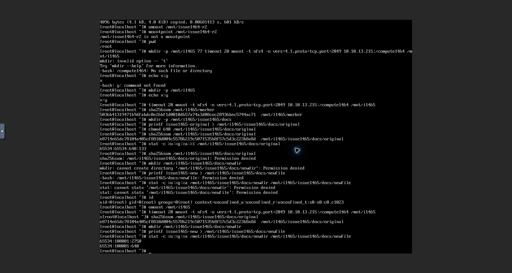
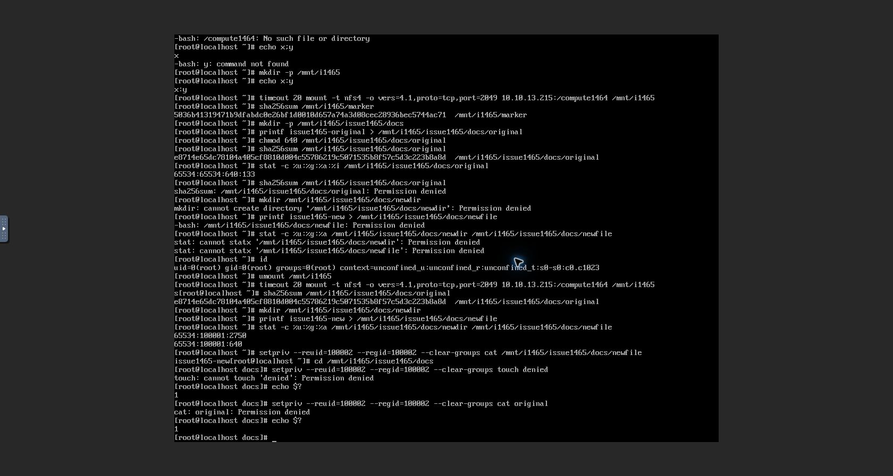
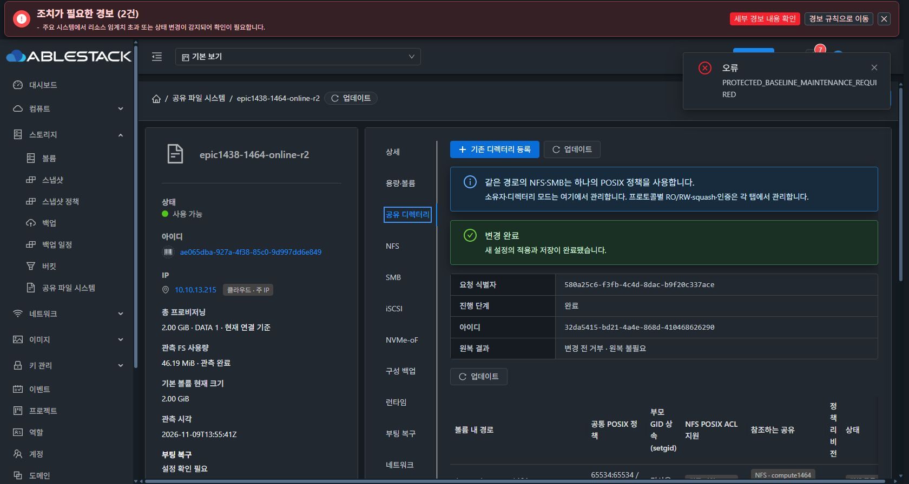
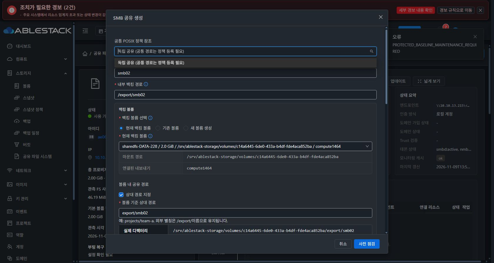

# #1465 FSAL POSIX ACL 개선·13번 인수 기록

2026-11-09. **FSAL 결함 수정과 실제 NFS 인수는 통과했다. 이후 SMB 자동 관리 ACL과 관리 DB 정책의 동기화 결함을 확인해 제품 검증을 중단했다. 이슈는 열림, Epic PR 제품 코드 반영은 보류다.**

## 기준과 구현

- 브랜치 `epic/1438-sharedfs`. 착수 시 local Europa와 upstream Europa는 `413d1459682b6f4dea6c90773510b8342dba1ec2`, divergence 0 0이었다.
- 이전 구현 `f3ca9cbefae3fba80c90c90df788cd37f4f2ea33`.
- FSAL gate·빌드·회귀 `febdc1f1c28b0f7f31743226029abb5e0e03074b`.
- 네이티브 빌드의 /etc·/var·/run 상태 경로 보존 `264c439fe49dbb34845bb404d3679fe97d6792f7`.
- 새 `ganesha_posix_acl.py`는 root 보호 profile·바이너리/라이브러리 SHA·실제 프로세스 executable과 mapped libraries를 검증한다. 패키지 버전이나 helper schema만으로 지원을 인정하지 않는다.
- 서버는 NFS에 노출되는 named/default ACL 변경에 실제 READY·supported·fingerprint를 요구한다. UI는 지원 판정과 차단 원인을 표시하고 적용을 비활성화한다. legacy owner/mode 경로는 보존한다.
- 기존 공통 FD·UUID·inode·ACL·snapshot·원복·writer·drain 보호를 유지했다. 새 DB schema는 없다.
- VM 표준의 기존 ResourceLayout·MoldDialog·AntD table/alert를 사용했다. 이전 라이트/다크 설계·컴포넌트 회귀를 유지했다. 이번 전체 다크 실환경 인수는 중단 시점에 미완료다.

## 실제 SystemVM 사전 시험과 로컬 빌드

공식 Ganesha V5.5.3 commit `2a57b6d53295426247b200cd100ba0741b12aff9`, bundled ntirpc `bf7fd0259c33ce95f5f2bf22817a8912f7fe5188`를 고정했다. Debian bookworm의 별도 Podman vfs 저장소에서 로컬 빌드했다. 기존 전역 Podman 저장소는 삭제하지 않았다. Actions를 실행하지 않았다.

`ENABLE_VFS_POSIX_ACL=ON`, GSS/DBUS/NFSIDMAP 유지, VFS 이외 FSAL 제외. 별도 prefix `/opt/ablestack-ganesha/5.5.3-posix-acl`로 배포하며 시스템 패키지 4.3-2는 보존한다. 상태 경로는 /etc·/var·/run/ganesha다.

실제 SPARSE XFS DATA에서 private network+mount namespace와 loopback NFSv4.1을 사용해 다음 6개를 통과했다.

1. named UID의 읽기·쓰기
2. 새 파일 GID와 새 폴더 setgid 상속
3. default ACL을 받은 새 파일의 주체별 읽기
4. 읽기 전용 주체의 쓰기 거부
5. 이전 객체의 데이터·권한 비재귀 보존
6. 실제 mapped VFS·core·ntirpc 신원 확인

[사전 시험 원문](evidence/network-pretest-final.txt) · [고정 빌드 profile](evidence/ganesha-posix-acl-profile-final.json)

시험 초기 core Transports 옵션·loopback-only 주소 해석·기존 파일 생성 순서·noVNC shifted 문자 입력 오류는 시험 도구를 교정했다. 제품 오류로 집계하지 않는다. 원본 공유 설정이나 MAC을 교정 용도로 바꾸지 않았다.

| 로컬 검증 | 결과 |
|---|---|
| API 계약·guard·실제 MariaDB coordinator/DAO | 41 PASS, 0 failure/skip |
| 디렉터리 helper | 27 PASS |
| 새 native 지원 판정 | 7 PASS |
| updater 현재17파일·이전16파일 등 호환 | 28 PASS |
| 실제 Vue 컴포넌트 | 18 PASS |
| 변경 UI lint | PASS |
| Maven 모듈 package·UI production build | PASS |

위 검증 수는 이번 실행 수다. 전체 저장소 CI·미완료 SMB/AD 실환경 인수의 통과로 확대하지 않는다.

## 배포와 실제 UI 흐름

대상 SharedFS `ae065dba-927a-4f38-85c0-9d997dd6e849`, instance `fd68bdfb-194f-4130-9ecf-748f1b3caca2`, VM `9a7bf4cb-6c75-38f3-91d2-0ae671838d06` / host13.3 i-2-228-VM / STATIC 10.10.13.215다.

- ROOT 8GiB와 DATA 2GiB 모두 기존 SPARSE다. DATA `c14a6445-6de0-433a-b4df-fde4aca852ba`, XFS `eb2e98ae-2c46-4935-8e5f-2c90e1401750`.
- 관리 JAR SHA256 `21012dfb4c0919068a338fefbbfea376f861809d7f66f7ff7ef054b29f04fbcf`, UI index `04c2e994986dd7c77cf67bc78fe8f68f25b80d7d0e7aa14c4838de2bdbe276ee`. 임베디드 updater와 baseline29를 소스와 대조했다.
- 검증된 native package SHA256 `b66878a886d625d364e143e8cefd9946ea4a2970221868904d59d7b7ec91202b`와 root 보호 profile, 관리 Ganesha unit dropin을 대상 VM에 운영자 배포했다.
- 실제 Mold UI에서 SystemVM 재시작 cleanup=false. 원래 IP·DATA·파일을 보존하며 새 실행 파일과 실제 mapped VFS로 기동했다.
- 기존 helper .1에서는 UI 편집 점검이 `DIRECTORY_NFS_POSIX_ACL_UNAVAILABLE` UNKNOWN으로 적용을 차단했다. schema-only capability가 승인 조건을 통과하지 못함을 확인했다. 실제 구4.3 process 판정은 BLOCKED UNSUPPORTED다.
- 기존16파일 번들 .1을 UI에서 재검증해 VERIFIED를 확인했다.
- 새 정상 서명17파일 `1465.directory-acl.2`를 UI 등록→검증→게시했다. ID `cfb809c8-0cc5-4e89-9b63-17913f18ff24`, bundle SHA `a2ac50e934b7b254a237f6ffe06575731f9cf92869da878900c1bafd5aaa07f3`, manifest SHA `8594c405c50d661718497e7f004c335be4248f0bb7f522249aa909159acce29a`.
- UI 다운로드 준비의 첫 시도는 `PROTECTED_BASELINE_MAINTENANCE_REQUIRED`로 차단됐다. 배포 누락된 보호 updater의 기존 SHA `5aa833742715373865e98efc9d368d1a9d35fabda820ca51cb026b8bd1d2e95d`가 이전 확정 소스와 같음을 확인했다. 백업 후 빌드본 SHA `7a331eb42e1771bde4bd7d5511e3f19bf4e0eed4fa9eee1232462ce268de48b6`와 baseline profile29를 명시적 운영자 모듈 배포로 맞췄다. 보호를 우회하거나 current signed release를 변조하지 않았다.
- 이어서 UI 다운로드·서명/17파일 검증 PREFLIGHT_OK→명시 승인→적용 COMPLETE. 현재 .2, 이전 .1, 실행 파일 검증 일치다.
- UI/API 모두 `검증 지원 · 5.5.3`이다. actual executable·core/VFS/ntirpc hashes와 listener process를 검증한다.
- UI에서 ACCESS UID100003 r-x 한 항목만 추가했다. owner/gid/mode 미변경 필드가 candidate에서 빠졌고 DEFAULT ACL은 그대로다. operation `cab94b26-e464-4436-87f4-1222ea70191c` COMMITTED, 정책 revision2→3, 설정 revision6→7.
- 활성 TCP1 상태의 drain 보호를 관측했다. 클라이언트를 정상 unmount한 뒤 재점검 TCP0으로 적용했다.

기본 template 이미지의 전역 교체·신규 VM 인수 완료를 주장하지 않는다. 이번 native 교정은 위 보존 대상 SystemVM에 적용했다. 새 템플릿/다른 AD member 반영 및 남은 전체 인수는 중단 후 미완료다.

## 실제 외부 클라이언트 NFS

클라이언트 `464a0a92-18f1-4bbf-b0d9-b52cf81f4a52` / actual 10.10.13.226, 실제 Mold noVNC에서 명령을 실행했다. 기존 NFS 허용 CIDR 10.10.13.226/32·RW·root_squash를 바꾸지 않았다.

동일 서비스 `10.10.13.215:/compute1464`를 NFSv4.1/TCP2049로 다시 mount했다.

- 이전 거부되던 원본 읽기와 새 파일/폴더 생성 성공.
- 새 폴더 UID65534/GID100001/mode2750, 새 파일 UID65534/GID100001/mode0640.
- UID100002는 default ACL을 받은 새 파일 읽기 성공, 새 파일 생성은 Permission denied/exit1.
- UID100002의 기존 original 읽기는 기존 ACL 그대로 Permission denied/exit1. 자동 재귀 변경하지 않았음을 확인했다.
- root_squash로 매핑된65534는 기존 original을 읽고 같은 SHA를 확인했다.

## 새 제품 결함 — SMB 자동 ACL과 DB 정책 불일치

정책 `14072e98-4ff9-37a0-af44-e7804e3048e6` / `export/compute1464/issue1465/docs`, revision3이다.

1. 실제 UI에서 이 정책을 선택해 `smb1465docs` 공유를 만들었다. operation `bf8884ef-0c2a-4685-91f7-a0335df6e07a` COMMITTED. 기존 NFS와 같은 물리 inode132를 참조한다.
2. UI에서 기존 로컬 그룹 `nogroup` READ_WRITE ACL을 추가했다. 새 계정/암호를 만들지 않았다. operation `32da5415-bd21-4a4e-868d-410468626290` COMMITTED, 설정 revision8→9.
3. 제품의 기존 SMB 자동 처리로 access/default 양쪽에 `group:65534:rwx`가 추가됐다. guest registry는 `ownedacl={g:65534:rwx}` 및 실제 access/default 배열을 저장한다.
4. 같은 API 응답의 DAO-backed `posixacl`에는 이 두 항목이 없다. 정책 revision은 양쪽3이고 UID/GID/mode·FS UUID·inode는 같다. 외부 변경이 아닌 제품 자신이 만든 차이다.
5. 서버 `StorageDirectoryPolicies.response()`는 DB metadata 배열과 실제 배열을 그대로 전체 비교해 DRIFT를 반환한다.
6. UI는 APPLIED 정책만 재사용 옵션에 포함하므로, 방금 정상 적용된 이 정책이 새 SMB 생성의 공통 정책 목록에서 사라진다. setgid 작업 역시 비활성화한다. 표시만의 차이로 처리할 수 없다.

원인 경로:
- `shared_directory_policy.py:1018-1023`: 자동 owned ACL과 실제 배열을 guest registry에 저장.
- `StorageDirectoryPolicies.java:336-340`: DB ACL metadata 변경은 공통 정책 명령 candidate 경로에서만 수행.
- `StorageDirectoryPolicies.java:472-474`: 소유권 출처 구분 없이 DB/관측 배열 전체 비교.
- `SharedFSTab.vue:3108`, `StorageDirectoryPolicyPanel.vue:27`: 잘못된 DRIFT가 기능 진입을 막음.

[실제 API 응답](evidence/api-policy-after-smb.json) · [guest registry/디스크/지원 판정](evidence/guest-final.json) · [COMMITTED 작업 기록](evidence/api-operations.json)

### 다음 최소 수정 방향 — 아직 구현하지 않음

- 명시적 공통 ACL과 SMB 자동 소유 항목을 구분한 유효 정책을 계산한다. 실제 SMB 요구사항·검증된 ownedacl 영수증에 해당하는 delta만 같은 SMB 트랜잭션의 정책 metadata에 반영하거나 공통 비교/후속 candidate overlay에 포함한다.
- 단순히 DRIFT를 무시하거나 관측 전체 ACL을 자동 채택하지 않는다. UUID/inode·revision·명시 managedEntries·외부 ACL·mask·실제 충돌 보호를 유지한다.
- 적용/원복의 DB·guest 정책을 같은 경계에서 보존한다. 조회에서는 DB를 쓰지 않는다.
- 실제 SMB ACL 생성→guest 영수증→coordinator→DAO 확정→재조회 APPLIED→UI 재사용→후속 공통 정책 편집의 연속 회귀를 추가한다. 자동 ACL 제거·충돌·실패 원복·재시작도 연결한다.
- 정상 COMMITTED 작업의 원복 설명이 ‘변경 전 거부’로 보이는 별도 문구 차이는 최종 UI 정리 #1468 기록 대상으로 분리한다. 이 표시 차이가 중단 사유는 아니다.

## 보존과 미완료

최종 읽기 전용 진단에서 원본 inode133·65534:65534·0640·SHA `e8714e65dc78104a405cf8810d004c55786219c5071535b8f57c5d3c223b8a8d`, global marker SHA `5036b41319471b9dfabdc0e26bf1d0010d657a74a3d08cec28936bec5744ac71`, 디렉터리 inode132·100001:100001·2770, XFS UUID 모두 보존됐다. NFS2049와 SMB445 listener는 실행 중이다. 원복/수동 DB 갱신으로 결함을 숨기지 않고 현 상태를 보존했다. 클라이언트 NFS mount는 정상 해제했고 이번 전용 로컬 MariaDB 시험 프로세스만 종료했다.

- 미완료: SMB 인증/AD·두 클라이언트의 신규 ACL 인수, EXT4 경로, 실패 원복·해제/선택 ACL 제거·충돌/재시작의 최종 실환경 인수, 새 template 이미지 반영.
- #1465는 열림이다. 전 항목 통과 조건에 따라 Epic PR #1470에 제품 코드를 push하지 않았다.
- 로컬 변경과 증거를 보존하고 다음 지시를 기다린다.
