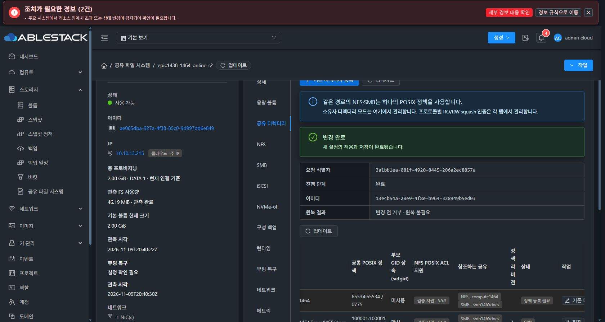
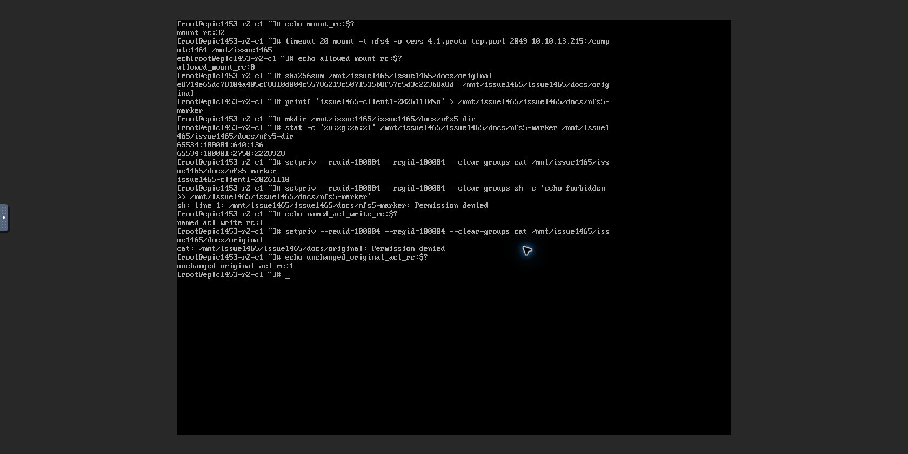
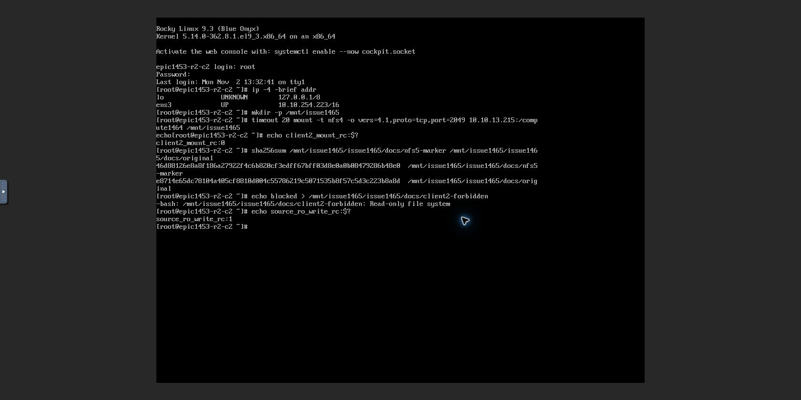
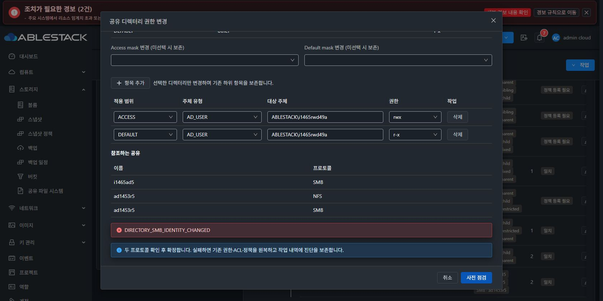

# #1465 implicit SMB 준비 상태 개선·실제 인수 중단 기록 (2026-11-10)

## 판정
**구현·로컬 회귀·13번 배포와 기본 SMB 공통 정책 변경은 통과했다. 명시 SMB 리스너의 공통 ACL 변경에서 새 제품 결함을 확인해 중단했다. #1465는 미완료이며 Epic PR 제품 코드 push와 이슈 종료는 하지 않는다.**

코드 commit: `9f68215225736a2b9aa0a314cfd84a187e9e7ac0`. 작업 브랜치 `epic/1438-sharedfs`. 착수 시 local Europa와 upstream은 `413d1459682b6f4dea6c90773510b8342dba1ec2`, divergence 0/0이었다. Windows 소스는 변경하지 않았다.

## 구현과 사전 시험
- 공통 정책의 점검·snapshot·apply·verify·restore에 기존 엄격한 `implicit_legacy()`/재검증을 연결했다.
- manifest/명시 리스너가 있으면 기존 managed 검증만 사용한다. implicit fallback으로 우회하지 않는다.
- 기본 SMB의 instance·unit·PID/start/boot·cgroup·설정 소유권/해시·실제 소켓 검증을 유지했다.
- 기존 MoldDialog 점검 표에 SMB 검증 방식을 추가했다. VM 표준 배치·라이트/다크 토큰을 유지했다.
- 구현 전 실제 SPARSE XFS SystemVM에서 private registry/비게시 경로의 적용·검증·원복 및 기존 데이터 불변을 확인했다. AD managed 445/1445 READY와 변조 PID 차단도 읽기 전용으로 확인했다.

사전 시험은 Python 내부 report 직접 비교였다. **이번에 드러난 Java Gson 직렬화 경계는 사전 시험에 빠졌다.** 이를 인수 통과로 확대하지 않는다.

## 로컬 빌드와 배포
| 항목 | 결과 |
|---|---|
| Java 계약·실제 coordinator/MariaDB DAO | 49 PASS |
| UI 컴포넌트 | 25 PASS |
| directory·FSAL·implicit | 55 PASS, 기존 native 전용 1 SKIP |
| 구성 트랜잭션/updater | 53 PASS |
| UI lint / Maven server -am package / Node14 UI build | PASS |

관리 JAR SHA256: `b33ca5479d419b0a729d802dee157739b692d2df5358afd3728c4a3ea7b152ac`.
기존 JAR의 변경 class와 baseline32만 교체했다. UI는 변경 파일만 배포하고 운영 config.json·테마·기존 assets를 보존했다.

서명 런타임 `1465.directory-acl.5`, 17개 파일, archive SHA256 `4c74b9a56d3988e54531a123bebad2acd3896dd13cbff48eb966a3815a00fd86`.
실제 UI 등록→검증→게시→다운로드·사전 점검→적용 COMPLETE를 main(13.215)와 AD member(13.220)에 확인했다.
AD VM에는 사전 검증한 Ganesha5.5.3 POSIX ACL 빌드와 protected updater14/baseline32를 준비하고 UI 재시작 후 AD join·Winbind·실행 바이너리를 확인했다.
전용 QCOW2 후보 이미지도 로컬 빌드·서명/파일 무결성 검사를 통과했으나 **등록·새 VM 부팅 인수는 미실행**이다. 이미지 SHA256 `c918dce06a6535e718b04bcc78aa3fe4b401b9b0c1f795cb06f446a042bcdb5c`. host/guest 계정 파일 불변 확인. 모든 사용 디스크는 SPARSE, MAC 임의 변경 없음.

## 실제 UI/API/클라이언트에서 통과한 범위
- main SharedFS ae065dba-927a-4f38-85c0-9d997dd6e849의 공통 docs 정책: UID100004 ACCESS rwx / DEFAULT r-x 추가, implicit 검증 표시, 최초 apply COMMITTED(rev11→12).
- 실제 noVNC 두 클라이언트에서 NFS source CIDR 거부→정확한 /32 추가 후 접속, client1 RW 연결 유지·후속 쓰기, client2 source RO 쓰기 차단을 확인했다. POSIX 허용으로 source RO를 우회하지 못했다.
- 새 파일·폴더의 GID/setgid/default ACL, UID100004 읽기 허용·쓰기 거부, 기존 파일 비재귀 보존을 확인했다.
- main 기존 파일 inode133/65534:65534/0640과 SHA e8714e65dc78104a405cf8810d004c55786219c5071535b8f57c5d3c223b8a8d 유지.
- AD member 3f0056db-4dfe-4f13-908d-b809dd565d34의 새 자식 issue1465-ad5를 실제 클라이언트 NFS로 만들고 UI로 등록→setgid2770→SMB i1465ad5 생성→AD_GROUP RW / AD_USER RO ACL을 각각 COMMITTED했다.
- 실제 그룹 사용자의 SMB445 인증·파일/디렉터리 생성 성공. 새 디렉터리 UID/GID10004:10004/mode2770, 파일 UID/GID10004:10004/mode0660 확인.
- AD 자식 원본 inode159/65534:65534/0640 및 SHA949460a416b440181235c6c176bbea20ff69d55d6d507707a5cf66c2d1ca943a 유지.
- 두 클라이언트 NFS mount는 설정 변경 전 정상 unmount했다. 실제 AD RO 접속·1445 접속·최종 재시작 인수는 다음 오류 때문에 실행하지 않았다.

## 새 오류와 정확한 하위 원인
UI에서 AD_USER ACCESS rwx / DEFAULT r-x를 공통 정책에 추가했다. 점검은 AD 이름→UID10004를 해석했으나 실제 적용의 VALIDATING 단계에서 `DIRECTORY_SMB_IDENTITY_CHANGED`로 거부됐다.

작업 `dbdba40e-3410-4948-b1a1-3d5ae65d8d0c`, request `c775d1d4-7a9a-4530-a2a7-c87c9c0c2496`, base66/target67, **ROLLED_BACK / COMPLETED / rollback NOT_NEEDED**. 권한·구성 변경 이전 거부다. 인스턴스는 Running/revision66/active operation null. 정책은 revision2, managedEntries=[] 유지.

실제 경로:
1. Python managed readiness는 정상 profile마다 `coveredBy: null`을 포함한다.
2. Java `bindSmbReadiness()`가 이를 승인 후보에 복사한다.
3. coordinator의 기존 `new Gson().toJson(payload)`는 null 객체 필드를 생략한다.
4. guest preflight/prepare가 재조회한 readiness와 승인 proof를 Python dict로 엄격 비교해 null과 필드 부재를 다르게 판단한다.

네트워크 장애나 실제 프로세스 교체가 아니다. 실제 두 리스너는 주소13.220, 포트445/1445, PID65675/65700, READY가 동일했다. **현재 실제 report를 같은 Gson2.10.1로 직렬화한 뒤 실제 SystemVM의 읽기 전용 readiness 검증에 넣으면 오류, 원본 report는 ACCEPTED**다. 유일한 차이는 두 리스너의 coveredBy 필드 부재다. endpoint/PID/상태 차이는 없다. 재적용·재시도하지 않았다.

[원본/직렬화 비교](evidence/managed-wire-diagnosis.json) · [실패 작업](evidence/ad-operation-failed.json) · [실제 데이터](evidence/ad-data-preserved.json) · [정책](evidence/ad-policy-preserved.json)

## 다음 최소 개선 방향 (미구현)
- readiness 승인 모델에서 의미 없는 optional null만 일관되게 생략한다. normal profile의 coveredBy=null, covered profile의 pid=null을 동일 규칙으로 처리한다.
- 실제 coveredBy 값, 정상 process PID, instance·주소·포트·READY/COVERED 및 기존 unit/config/socket 신원 검증은 유지한다.
- 전역 Gson 설정 변경이나 모든 필드 null 무시는 하지 않는다.
- 실제 native report→coordinator와 동일 Gson payload 직렬화→guest preflight/prepare 회귀를 연결한다. normal/covered profile, 실제 coveredBy·PID 변조 거부를 함께 시험한다.
- UI는 이미 최초 오류 코드를 표시했다. 별도 우회 버튼이나 보호 완화 없이 정상 승인 데이터 계약을 교정한다.
- 수정 승인 후 실패한 공통 AD ACL 단계부터 UI 점검·적용을 새로 수행하고 AD 두 클라이언트/두 포트·EXT4·제거/원복·VM/관리 서버 재시작 등 미완료 인수를 이어간다.

표시만 다른 overview·probe cache·완료 작업 overdue 문구는 #1468 최종 UI 정리 항목으로 구분한다. 이번 오류는 기능 차단이므로 표시 차이로 취급하지 않는다.

## 증거

제품 오류 확인 후 추가 구현·기능 시험을 중지했다. 자체 로컬 DAO 시험 DB만 신원 확인 후 종료했고 시험 증거와 클러스터 자원은 보존했다. Epic PR 제품 push·이슈 종료는 보류한다.
