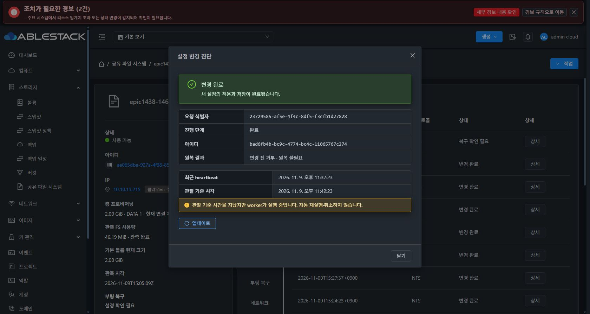
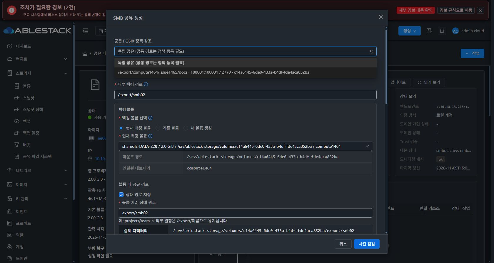
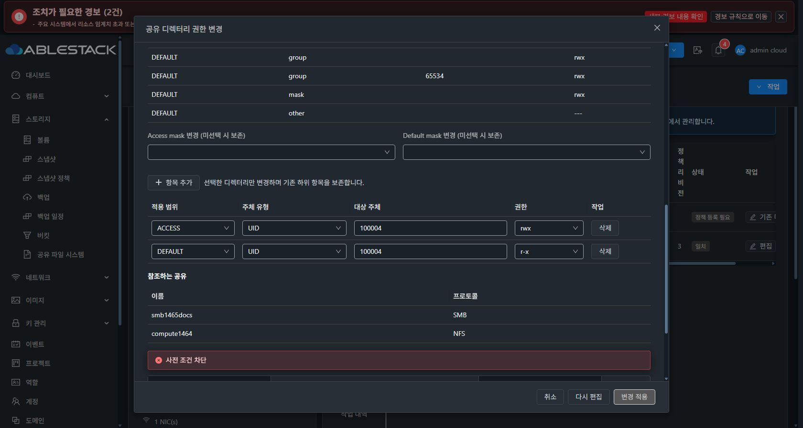

# #1465 최초 apply 응답 교정·동일 UUID 재개·후속 점검 중단

2026-11-09~10. **최초 영수증 누락과 SMB 소유 ACL metadata 동기화는 실제 UI에서 해소했다. 후속 공통 정책 편집은 정상 기본 SMB 데몬을 인식하지 못하는 사전 점검 결함으로 차단돼 중단했다.**

## 구현·사전 시험·로컬 빌드

브랜치 `epic/1438-sharedfs`, 착수 시 local Europa/upstream Europa `413d1459682b6f4dea6c90773510b8342dba1ec2`, divergence0 0 확인. 구현 commit **88677dabec28d964861302ba902b77c545f26cec**.

- apply/resume 성공 경로는 VERIFIED 전이→영수증 조립→원자 status 저장→반환 순서다. commit과 중복 요청에도 같은 성공 영수증을 반환한다. 미검증·ROLLED_BACK에 남은 영수증은 노출하지 않는다.
- SQL 확정 실패의 첫 안전한 오류 코드를 originalfailure에 보존하고 writer 예약을 유지한다. 조회에서 권한·DB를 수정하지 않는다.
- 실제 SystemVM의 이미 적용된 게스트 상태를 사용하는 **읽기 전용 replay probe**를 먼저 실행했다. 실제 RuntimeAdapter.verify와 Transaction.execute를 사용하되 live apply와 mount registry 변경은 하지 않았다. scratch journal에서 최초 apply 반환·저장 status·show·resume·commit·중복 apply가 같은 영수증을 갖고 중복 실행0회임을 확인했다. 활성 파일·registry·기존 작업 status hash는 불변이다.
- 이 **최초 반환값**을 actual guest fixture→coordinator→실제 MariaDB DAO 회귀에 연결했다. 이전처럼 show 응답만을 최초 반환의 대체로 사용하지 않았다.
- 기존 DB metadata에 자동 소유 ACL이 빠진 상태에서 게스트 RW→RO가 바뀐 조합도 시험했다. 누락/위조 영수증 차단, 예약 유지, 같은 UUID 재개, 최초 실패 이력 보존, 실제 serializer→UI 오류 표시를 검증했다.
- API·스키마·VM 표준 UI 제품 자산은 바꾸지 않았다. 첫 실패 코드 표시는 기존 VM 표준 진단 컴포넌트에 실제 API 필드를 전달한다.

| 검증 | 결과 |
|---|---|
| API/guard·실제 coordinator/MariaDB DAO | 48 PASS |
| native directory/FSAL + 직접 Transaction 최초 반환 | 38 PASS |
| configuration transaction/updater 호환 | 53 PASS |
| 실제 serializer UI 컴포넌트 | 23 PASS |
| 변경 시험 lint | PASS |
| Maven server 및 의존 모듈 package | BUILD SUCCESS |

모두 로컬 실행이며 Actions를 사용하지 않았다. 이 숫자는 아래 미완료 실환경 인수까지의 성공을 의미하지 않는다.

[실제 SystemVM probe](evidence/native-probe.py) · [최초 apply 반환 원문](evidence/native-probe.json) · [DAO failure 실제 직렬화](evidence/failure-wire.json)

## 배포

- 관리 JAR SHA256 **86e83dd75cb9a507cc8853cd9bf28c31ea69342e30e96c8d42e53759ab42dde6**. Coordinator class와 baseline31 resource 두 entry만 변경했다. 이전 JAR은 secondary storage에 백업했다.
- mold 재시작 후 active/HTTP200 및 UI 로그인 확인. 초기 기동 중 잠깐 연결 거부된 뒤 정상 기동한 것을 별도로 확인했다.
- 정상 서명17파일 **1465.directory-acl.4**, bundle SHA `ac68117b0059429ed00d3e422c6d80388d4fe1c26b57ce0603b80ccfdaa62a4d`, manifest SHA `f5e3fee95376c02870fc7449e46fde9b2b68433e426ddbd2a9fe40d857303847`, 184378bytes.
- 기존 cluster13 신뢰키 유지·개인키 평문 파일 없음. 실제 UI 등록→검증→게시→다운로드·검증→명시 적용 COMPLETE.
- VM 표준/다크 UI 자산 index는 이전 배포를 유지했다. 신규 UI production 빌드는 필요하지 않았다.

## 실제 UI 동일 UUID 재개와 정상화

대상 SharedFS `ae065dba-927a-4f38-85c0-9d997dd6e849`, instance `fd68bdfb-194f-4130-9ecf-748f1b3caca2`, VM `9a7bf4cb-6c75-38f3-91d2-0ae671838d06` / i-2-228-VM / 10.10.13.215.

ROOT8GiB `9fed478c-a363-49fa-bcba-0bad084f7390`, DATA2GiB `c14a6445-6de0-433a-b4df-fde4aca852ba` 모두 API provisioningtype=sparse다. 새 디스크·MAC 변경은 없다.

1. 새 서버 모듈 배포 후 UI 작업 내역에서 기존 operation **bad6fb4b-bc9c-4774-bc4c-11065767c274**, request `23729585-af5e-4f4c-8df5-f3cfb1d27828`를 열었다.
2. UI의 **복구 재개**를 실행해 같은 UUID가 **COMMITTED/COMPLETED**, base9→target10으로 확정됐다. 기존 guest VERIFIED 영수증을 재관측했으며 설정을 다시 적용하지 않았다. 기존 실행 child/시작 기록은 그대로다.
3. UI 진단 업데이트 후 완료가 표시되고 복구 버튼이 제거됐다. 정책은 API·UI **APPLIED/일치**가 됐다. access/default의 자동 소유 그룹 ACL과 ownedacl이 DB·게스트에서 같고 명시 managedEntries는 보존됐다.
4. SMB 생성 모달에서 이 공통 정책이 다시 선택 목록에 나타났다. 시험 확인 후 취소했고 새 SMB 공유를 만들지 않았다.
5. writer 예약이 해제된 다음 런타임4를 정상 UI 경로로 적용했다. active writer 보호를 우회하지 않았다.

## 런타임4 최초 신규 적용 인수

UI에서 기존 LOCAL_GROUP nogroup ACL을 RO→RW로 수정·점검·승인·제출했다.

- operation **143ca511-691d-416e-a0e1-d89492102d6f**
- request `800c2790-2dee-4740-976c-9ec2c020b0eb`
- **최초 적용 한 번으로 COMMITTED**, base10→target11. 별도 재개 없음.
- 최초 VERIFIED 응답에 directoryAclReceipts가 있으며 SQL 확정 관측에 그대로 남았다. DB·게스트 access/default/ownedacl은 `g:65534:rwx`로 일치한다.
- UID/GID100001:100001·mode2770·policyrevision3 및 기존 명시 ACL은 그대로다.

[동일 UUID 실제 API](evidence/same-uuid-resumed.json) · [정책 일치](evidence/policy-after-resume.json) · [최초 신규 적용 실제 API](evidence/fresh-apply-committed.json)

## 후속 공통 정책 편집 중단 — 기본 SMB 준비 상태 오판

실제 UI에서 같은 디렉터리에 UID100004의 ACCESS rwx·DEFAULT r-x를 추가하려고 **사전 점검만** 실행했다. 서버가 **BLOCKED / DIRECTORY_SMB_NOT_READY**로 차단하고 적용 버튼을 비활성화했다. 제출·새 configuration operation 생성은 없고 모달을 취소했다.

### 실제 상태와 코드 경로

- 저장 SMB desired-state: enabled=true, shares1, listeners=[].
- 관리 listener manifest는 없다. 기본 `smbd.service`가 active이며 PID92197이 IPv4 0.0.0.0:445·IPv6 [::]:445 LISTEN을 소유한다.
- 제품의 `ablestack-storagectl` SMB 적용 경로는 manifest가 없으면 기본 smbd를 enable/start/restart하도록 구현돼 있다. 실제 신규 SMB ACL 적용과 검증도 이 경로로 성공했다. 명시 endpoint를 추가하지 않은 것이 불법 구성은 아니다.
- `DirectoryPolicies.verify_protocols()`는 `SmbListenerProfiles.show().listeners`가 비어 있으면 무조건 DIRECTORY_SMB_NOT_READY를 던진다.
- `show()`의 legacy fallback도 `normalized(desired)`가 정확히1개일 때만 작동한다. 현재 정상 implicit 구성은 명시 listeners0개라 show는 configured=false/listeners=[]를 반환한다.
- 따라서 **SMB apply는 정상 기본 데몬을 사용하지만 공통 directory preflight는 명시 listener 모델만 인정하는 경로 불일치**다. 새 endpoint 생성으로 이 결함을 우회하지 않았다.

[실제 desired/show/daemon/socket 대조](evidence/legacy-reader-diagnosis.json)

### 기존 엄격한 검증 경로로 실증

기존 `SmbListenerProfiles.implicit_legacy(desired, instanceUuid)`와 `verify_implicit_legacy(proof)`를 실제 VM에서 읽기 전용으로 호출했다.

- IMPLICIT_LEGACY 검증 성공.
- 현재 instance UUID, /usr/sbin/smbd 실행 파일·PID/start/boot·cgroup·unit enable 상태, root 보호된 smb.conf·desired-state의 mode/owner/hash, testparm의 실제 port/interface/bind, 그 프로세스가 소유한 IPv4/IPv6 socket을 검증했다.
- smbd92197/start648591, port445, sockets0.0.0.0/[::] 확인.
- 설정/registry 파일 hash 불변. 준비 상태 판정 실패는 실제 daemon 미기동·계정/네트워크 시험 준비 누락이 아니다.
- 클라이언트 SMB 인증 인수는 아직 수행하지 않았다. 이 listener 신원 검증을 실제 사용자 접속 성공으로 확대하지 않는다.

[실제 implicit proof](evidence/legacy-identity-proof.json)

### 놓친 경계와 최소 개선 방향 — 아직 구현하지 않음

이번 수정의 목표였던 최초 apply→coordinator→DAO는 실환경에서 통과했다. 후속 directory edit는 별도의 프로토콜 health reader를 사용하며, 이 reader의 implicit legacy 조합이 native apply 검증에 포함되지 않았다. local ACL 시험의 protocol hook도 이 실환경 교차 경계를 대신할 수 없다.

1. 관리 manifest가 없는 enabled implicit 구성에만 기존 implicit_legacy/verify_implicit_legacy를 공통 정책의 사전 점검·적용 후 검증에 연결한다.
2. 명시 profile이 있거나 namespace/불명확한 manifest가 있으면 기존 managed 경로와 차단을 유지한다. active445 하나만 보고 허용하거나 가짜 endpoint 행을 만들지 않는다.
3. 프로세스·인스턴스·설정 owner/hash·실제 IPv4/IPv6 소켓 proof를 승인 fingerprint/후속 검증에 연결해 점검과 적용을 일치시킨다. 기존 계정 ACL·POSIX·UUID/inode·drain·원복 보호를 유지한다.
4. 실제 SystemVM에서 implicit0개/listener관리1개 이상 두 모드의 directory preflight→apply→verify→원복과 daemon/파일/소켓 신원 변조 거부를 먼저 시험한다. UI·API·coordinator/DAO까지 연결한다.
5. UI는 기본 listener를 사용 중이라는 점검 모드와 실패 사유를 기존 VM 표준 컴포넌트에서 구분한다. 실제 명시 listener 목록을 임의로 늘리지 않는다.

## 현재 상태·보존·미완료

- 복구 작업과 신규 SMB 작업 모두 COMMITTED, 최신 설정revision11. 현재 RECOVERY_REQUIRED나 부분 적용을 남긴 상태가 아니다.
- 공통 정책 APPLIED/일치. 계획했던 UID100004는 디스크 ACL에 없고 새 작업도 생성되지 않았다. 총 구성 작업11개/최신143ca511 COMMITTED 확인.
- 디렉터리 inode132·owner100001:100001·2770, 원본 inode133·65534:65534·0640·SHA `e8714e65dc78104a405cf8810d004c55786219c5071535b8f57c5d3c223b8a8d`, XFS UUID `eb2e98ae-2c46-4935-8e5f-2c90e1401750` 보존.
- 표시만의 차이: 완료 작업의 오래된 overdue 안내와 NOT_NEEDED의 ‘변경 전 거부’ 문구, 이력 모달 갱신 필요는 최종 UI 정리 #1468 대상으로 기록한다. 이번 중단 사유는 실제 제출을 막는 readiness 오판이다.
- SMB/AD·두 클라이언트·EXT4·선택 ACL 제거/해제·실패 원복·최종 재시작·새 template 인수는 미완료다. 기존 AD·클라이언트·템플릿을 변경하지 않았다.
- 전용 로컬 DAO 시험 MariaDB만 종료했다. 제품 설정에 추가 구현·재시도·우회를 하지 않고 다음 지시를 기다린다.
- #1465는 열림, Epic PR #1470 제품 push·이슈 종료는 보류한다.
