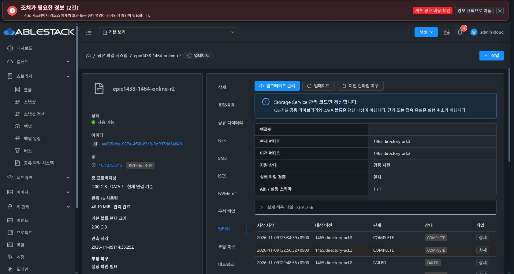
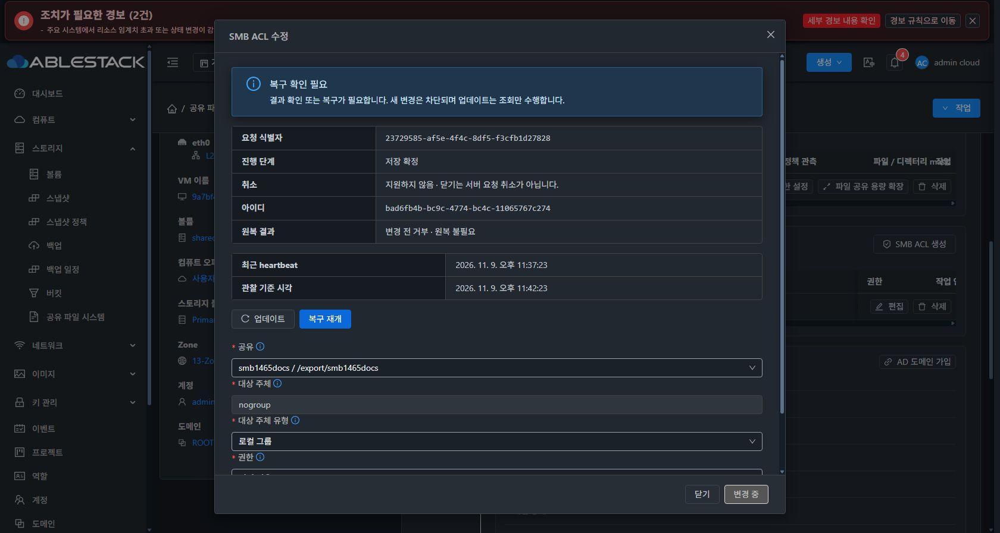

# #1465 SMB 소유 ACL 동기화 개선·실환경 중단 기록

2026-11-09. **로컬 빌드·13번 배포 후 실제 UI에서 최초 적용 응답의 영수증 누락을 확인해 중단했다. 게스트는 VERIFIED, 관리 작업은 RECOVERY_REQUIRED/COMMITTING이다. 이슈는 열림이며 Epic PR 제품 코드 push는 보류했다.**

## 구현·사전 시험·빌드

- 작업 브랜치 `epic/1438-sharedfs`. local Europa/upstream Europa `413d1459682b6f4dea6c90773510b8342dba1ec2`, divergence0 0 확인 후 진행했다.
- 구현 commit `e4e4bbfa610ca0f2b51fa3ab07a16c1a39bb6cfa`.
- `StorageDirectoryAclReceipts`는 실제 SMB before/after 소유 ACL delta를 기존 정책과 대조하고 같은 configuration SQL 확정에 포함한다. 조회 시 DB를 자동 수정하지 않는다.
- 서버의 source identity·UUID·FS UUID·inode·owner/mode·revision·명시 managedEntries·principalBindings 보존과 ACL overlay를 검증한다. 검증되지 않은 외부 ACL·누락/위조 영수증은 확정하지 않는다.
- 유효 ACL·ownedacl metadata를 저장하고 후속 공통 정책 payload로 전달한다. 자동 항목을 제거해도 scope별 명시 ACL은 남긴다. 마지막 SMB 공유 삭제도 기존 소유 ACL을 정리할 수 있도록 대상 경로를 유지했다.
- snapshot ACL은 숫자 ID로 수집한다. 이전 복원 회귀의 observe mock에서 누락된 실제 acl 응답을 채웠다. 실제 observe가 반환하는 getfacl 결과를 시험에서도 사용한다.
- 실제 SPARSE XFS SystemVM의 기존 작업 snapshot과 registry/FD/디스크 ACL로 후보 검증을 시험했다. 이어 scratch helper 모듈을 사용해 실제 RuntimeAdapter.verify와 Transaction 상태 응답의 영수증 발급을 확인했다. 활성 파일·registry·ACL은 수정하지 않았다.
- 이 사전 시험은 전체 Transaction.execute의 최초 반환을 실행하지 않았다. 아래 실패를 놓친 경계를 명시한다.

| 검증 | 이번 결과 |
|---|---|
| API/guard·실제 coordinator/MariaDB DAO | 48 PASS |
| native 디렉터리 helper·FSAL | 37 PASS |
| configuration transaction·updater | 53 PASS |
| 실제 API serializer를 사용한 UI 컴포넌트 | 19 PASS |
| 변경 시험 파일 lint | PASS |
| Maven server 및 의존 모듈 package | BUILD SUCCESS |

UI 제품 코드는 변경하지 않았고 기존 VM 표준·다크 스타일을 유지했다. UI production 자산을 다시 만들거나 바꾸지 않았다. Actions는 실행하지 않았다.

## 배포

- 관리 JAR SHA256 `33121c298208b636f36a96f013e9efe8a4112b56db0a941fc1b894b401b237ec`.
- 변경 entry는 DirectoryAclReceipts/DirectoryPolicies/ConfigurationCoordinator class와 baseline30 resource다. 나머지는 기존 검증 JAR을 유지했다. 기존 JAR은 secondary storage에 백업했다.
- 13번 mold 재시작 후 active/HTTP200, 실제 UI 재로그인 확인.
- 정상 서명17파일 런타임 `1465.directory-acl.3`: bundle SHA `c7d375938df7fd3952f9be61937b2a7f648a50443e1272645d1d17505c5fe98e`, manifest SHA `eb2fe0243dc1d2760197b30e7ff8b019124c0a43aac5bdc83afae8afd34dfe9a`, 184364bytes.
- 기존 cluster13 보호 신뢰키를 유지하고 개인키는 평문 파일에 쓰지 않았다.
- 실제 UI 등록→검증→게시→다운로드·검증→명시 승인→적용 COMPLETE. 번들 ID `c99100a7-6918-43c8-b9ea-d260cc63bdc4`.
- 정적 파일의 첫 배포 경로가 /client context root를 중복 포함해 HTTP404였다. 카탈로그 등록 전에 올바른 실제 webapp/storage-runtime 경로로 옮기고 전송 SHA/HTTP200을 확인했다. 제품 오류로 분류하거나 제품 소스를 바꾸지 않았다.
- 새 SystemVM template 이미지·AD member 모듈 배포는 시작하지 않았다.

## 실제 UI 실패

대상 SharedFS `ae065dba-927a-4f38-85c0-9d997dd6e849`, instance `fd68bdfb-194f-4130-9ecf-748f1b3caca2`, VM `9a7bf4cb-6c75-38f3-91d2-0ae671838d06`, IP10.10.13.215다. ROOT8GiB/DATA2GiB는 기존 SPARSE다.

실제 UI에서 기존 `smb1465docs`의 LOCAL_GROUP `nogroup` ACL을 READ_WRITE→READ_ONLY로 수정했다. 사전 점검·명시 승인 후 한 번 제출했다.

- request `23729585-af5e-4f4c-8df5-f3cfb1d27828`.
- operation `bad6fb4b-bc9c-4774-bc4c-11065767c274`, base9/target10.
- async job `5148da52-2ff4-43ed-9537-9f50c808b062`, job5500, **530 DIRECTORY_ACL_RECEIPT_MISMATCH**.
- 게스트: SMB 적용·검증과 before/after 영수증 파일 생성 성공, VERIFIED.
- 서버: 첫 응답에 영수증이 없어 SQL transaction을 rollback하고 RECOVERY_REQUIRED/COMMITTING으로 예약 유지.
- UI: 복구 확인 필요, 새 변경 차단. 복구 재개·재시도·원복은 실행하지 않았다.

## 정확한 하위 원인

이번에 추가한 `Transaction.bindings_status()`는 새 ACL 영수증을 **state VERIFIED/COMMITTED인 경우에만** 붙인다. 그러나 기존 `Transaction.execute("apply")` 성공 경로는 다음 순서다.

1. 실제 RuntimeAdapter.verify가 영수증 파일을 작성한다.
2. current는 여전히 RUNNING/VERIFYING이다.
3. bindings_status를 호출하므로 새 영수증을 첨부하지 않는다.
4. 이후 current를 VERIFIED/COMMITTING으로 바꾸고 status를 저장·최초 응답을 반환한다.
5. 서버는 최초 응답의 VERIFIED를 보고 확정을 시도하지만 영수증 누락 보호에 의해 거부한다.

따라서 저장된 status도 영수증이 없는 VERIFIED다. 이후 show는 이미 VERIFIED인 current를 읽고 bindings_status를 호출해 영수증을 붙인다. 파일 생성 경쟁이나 네트워크 유실이 아니다. **응답 조립 조건과 상태 전이 순서의 결정적 불일치**다. 빠른 최초 응답과 후속 조회가 다른 모양을 갖는다.

실제 호스트 응답 로그:
- 23:37:26.924 최초 VERIFIED: pathbindings 있음, directoryAclReceipts 없음.
- 23:37:27.930 이후 VERIFIED 조회: 두 영수증 모두 있음.

실제 SystemVM에서 같은 영수증 파일로 읽기 전용 대조:
- RUNNING 상태로 조립: ACL 영수증 없음.
- VERIFIED 상태로 조립: ACL 영수증 있음.
- status/registry 파일 불변.

[호스트 응답 경계](evidence/host-response-ordering.json) · [읽기 전용 결정적 대조](evidence/native-ordering-diagnosis.json) · [서버 예외](evidence/management-exception.txt) · [실제 작업](evidence/api-failed-operation.json)

서버 예외 지점은 `StorageDirectoryAclReceipts.apply():90`의 missing receipt 보호다. SQL rollback도 실제 로그에 남았다. 서버의 UUID·ACL 검증을 완화해 통과시킬 문제가 아니다.

### 시험에서 놓친 이유

실제 게스트 verify→상태 응답은 확인했지만 상태 응답을 명시적으로 VERIFIED 상태에서 조립했다. Java DAO/실제 serializer 회귀 역시 그 검증 완료 후 응답 fixture를 사용했다. **실제 Transaction.execute의 최초 반환→coordinator 경계가 연결되지 않았다.** 정상 fixture를 사용한48/19 PASS를 이 경계까지의 인수 성공으로 볼 수 없다.

기존 configuration 트랜잭션 회귀는 새 영수증이 포함된 실제 SMB 최초 반환을 검사하지 않았다. 이 시험 경계를 빠뜨린 것은 이번 구현·검증의 부족이다.

## 현재 영향과 보존

- 게스트에는 자동 그룹 ACL `g:65534:r-x`가 access/default에 적용돼 있다.
- DB는 이전 SMB READ_WRITE/설정revision9와 공통 정책metadata를 유지한다. target10은 확정되지 않았다.
- 설정 writer 예약을 유지하며 새 변경이 차단된다. 현 상태는 원복 완료가 아니다.
- 정책revision3, UID/GID100001:100001·mode2770, inode132와 FS UUID `eb2e98ae-2c46-4935-8e5f-2c90e1401750` 유지.
- original 파일 inode133·65534:65534·0640·SHA `e8714e65dc78104a405cf8810d004c55786219c5071535b8f57c5d3c223b8a8d` 유지.
- NFS FSAL 지원은 READY5.5.3이다. 이번 중단 후 클라이언트/재시작 인수를 수행하지 않았다.
- 다른 AD service와 두 클라이언트는 상태를 읽기만 했고 새 설정·계정·MAC·디스크를 만들거나 바꾸지 않았다.
- 이번 전용 로컬 MariaDB 시험 프로세스만 종료했다.

## 다음 최소 개선 방향 — 구현하지 않고 대기

1. apply 및 resume 성공 경로는 **VERIFIED 전이→공통 영수증 조립→원자 status 저장→반환** 순서로 맞춘다. 아직 검증하지 않은 상태나 ROLLED_BACK에는 영수증을 노출하지 않는다.
2. apply/show/resume/commit/중복 요청 반환의 성공 계약을 동일하게 만든다. 디스크 파일이 있다는 이유만으로 검증 상태를 올리지 않는다.
3. 실제 Transaction.execute의 즉시 반환을 직접 생성해 coordinator→DAO로 전달하는 회귀를 추가한다. 후속 show와 동등성, 최초 응답/조회 경로, 누락/변조 차단, 동일 UUID 재개와 중복 apply0회를 검사한다.
4. COMMITTING의 최초 알려진 거부 코드도 작업 originalfailure와 UI에 보존한다. 현재 job 결과에는530/원인이 있지만 작업 originalfailure는 비어 UI에 실제 코드가 보이지 않는다. 예약은 유지한다.
5. 후속 승인 시 현재 같은 operation UUID의 검증된 결과를 재관측해 확정한다. 신규 작업이나 게스트 재적용으로 대체하지 않는다.

이슈 #1465는 열림, Epic PR #1470 제품 push·종료는 보류다. 남은 SMB/AD·두 클라이언트·EXT4·원복/삭제/충돌·재시작 인수·새 template 반영은 미완료다.
