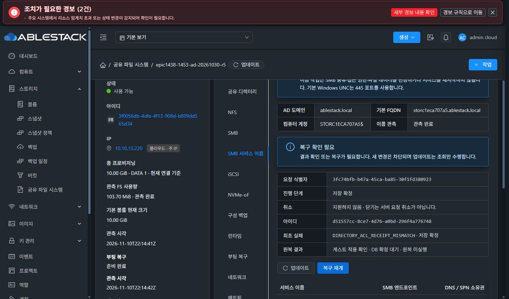
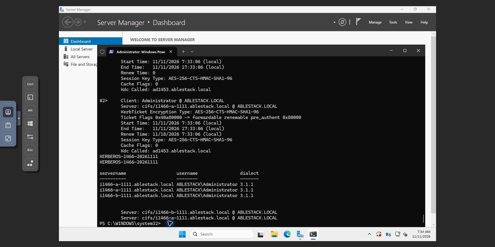
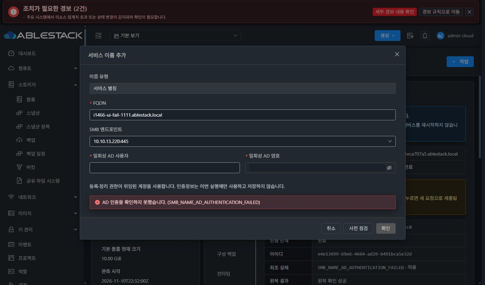

# #1466 완료: SMB 서비스 이름 확정·새 Windows Kerberos 실환경 인수

2026-11-11 KST. 구현 `18d7c1f5b9e`, Epic `epic/1438-sharedfs`, Europa `2250b0e7fb87dea26ab8442f52c69dce763c079b`. #1436을 보존했다. [이전 중단 기록](live-acceptance-20261111.md)은 당시 증거로 보존하며, 현재 판정은 이 문서의 **PASS**다.

## 최소 수정과 보호

- `StorageSmbServiceNames.namesOnly()`가 작업 종류·단일 이름 명령·네트워크 무변경·이름 외 전체 테이블 무변경을 확인한 경우에만 공통 SMB/POSIX 영수증 검사를 제외한다. 일반 SMB/디렉터리 변경의 영수증, FS UUID·inode·ACL 보호는 유지한다.
- 동일 UUID 복구에서 변경하지 않은 공유·ACL·정책 행을 다시 쓰지 않는다. 이름 영수증의 UUID·요청 지문·AD computer GUID/SID·DNS node GUID·CREATED/REUSED 소유권 검증은 그대로 실행한다.
- COMMITTING+VERIFIED의 미확정 작업은 ‘게스트 적용 확인 · DB 확정 대기 · 원복 미실행’으로 안내한다. 최초 오류·서버 잠금·일회성 입력 초기화는 유지한다. VM 표준 descriptions/세로 탭/대화상자·다크 테마 구조를 바꾸지 않았다.
- 실제 캡처한 VERIFIED 응답, 실제 bound SMB 공유와 aclPolicyVersion1 정책을 coordinator→MariaDB DAO에 연결해 최초 확정·동일 UUID 재개·재조회·미변경 행 비저장을 검증했다. 실제 SMB의 영수증 누락/위조와 이름 작업을 가장한 공유 변경은 계속 거부한다.

## 로컬 빌드·13번 배포

| 확인 | 결과 |
|---|---|
| backend package / DAO 포함 회귀 | 58 PASS, 실패·오류·생략0 |
| 실제 UI 컴포넌트 회귀 | 15 PASS |
| 최종 JAR 참조/Spring 회귀 | 5 PASS, 생략0 |
| 수정 UI·시험 ESLint | PASS |
| UI production build | PASS |
| 관리 JAR | `aef93d4371defacdc5cb595ce1548d841be1c16864dac0c642ff4988bd143d10` |
| UI index | `77aa703a2b85b63a75ccfc3e286a6d9993b3b7540da65f6ef3e7110c6161dc8f` |

현재 배포 JAR f077b6…에 변경 클래스4개만 반영하고 그 외 항목을 바이트 대조로 보존했다. #1436·기존 Spring XML/인터페이스/런타임 리소스·Host agent를 교체하지 않았다. UI985파일 대조, 변경8(신규5), 운영 config.json·color.less 보존. 관리 서비스 active / HTTP200. GitHub Actions 빌드는 실행하지 않았다. 이번 수정에는 DB 스키마 변경이 없다.

SystemVM 런타임은 기존 정상 서명 `1466.smb-ad-names.2`를 유지했다. DATA는 기존 10GiB SPARSE XFS, Windows ROOT는 이번 인수용 새 VM의 101GiB QCOW2/SPARSE다. THIN·MAC 수동 변경·DATA 재포맷은 없다.

## 실제 UI·API·새 Windows 결과

| 항목 | 실제 결과 |
|---|---|
| 첫 별칭 복구 | UI ‘같은 작업 복구’로 d51557cc-8ce7-4d76-a0bd-296f4a776748 → COMMITTED. 기존 요청·리소스 UUID 유지, revision67→68, 소유권 저장, 최초 오류 이력 보존 |
| 두 번째 FQDN | UI 점검→승인→생성, fab5c052-9a68-426c-926c-c10bc0309f32 → COMMITTED, revision69 |
| 두 이름 | i1466-a-1111.ablestack.local / i1466-b-1111.ablestack.local → 10.10.13.220:445, DNS/SPN CREATED, 최종 API·UI MATCH |
| 새 Windows | i1466w-1111-01 / c65c240d-0b12-4b44-b21a-e440e35cd31c, ROOT6254ef33-9adb-497f-89fc-46428a923167, q35-windows-16-v1, AD 계정 실제 콘솔 로그인 |
| Kerberos·SMB | 두 cifs/FQDN TGS, ABLESTACK/Administrator, SMB3.1.1. A의 s1456-fixed에 작성한 시험 파일을 B에서 읽음 |
| 외부 SPN 충돌 | 실제 AD 서버 이름의 다른 소유 계정 → UI SMB_NAME_SPN_CONFLICT, 승인/제출 차단 |
| DNS 충돌 | 시험 A 레코드가 다른 IP를 가리킴 → UI SMB_NAME_DNS_CONFLICT, 승인/제출 차단 |
| 재사용 소유권 | 외부에서 준비한 시험 DNS/SPN을 UI에서 REUSED로 등록·삭제. 등록392b4450… / 삭제2fa9a7b7… COMMITTED, 외부 DNS/SPN 보존을 DC에서 확인 |
| 실제 부분 실패 원복 | 현재 활성 모듈을 사용하는 SystemVM 시험에서 SPN 적용 뒤 DNS ACCESS_DENIED 주입. 원복 영수증 VERIFIED, 시험 SPN 제거, 기존 computer/다른 SPN 무변경 |
| UI/API AD 실패 | 의도한 잘못된 일회성 암호1회 → e4e13699-b9e6-4664-ad29-b491bca5e32d ROLLED_BACK/COMPLETED, 최초 SMB_NAME_AD_AUTHENTICATION_FAILED/APPLYING, 원복 SUCCEEDED, canresume=false. UI 실제 사유·원복 성공, 입력 초기화 확인 |
| 재시작 | 실제 VM UI에서 SystemVM 정상 재시작. 새 bootId6d92bdfc-a12c-400a-a43c-7f77c22547dd, 부팅 복구 UI SMB READY/COMPLETED, 런타임·원래 IP·FS UUID·두 이름 소유권 유지 |
| 재접속 | Windows 콘솔에서 기존 티켓 purge 후 두 FQDN의 새 CIFS TGS 발급. 두 이름으로 시험 파일 재조회, SMB3.1.1 |
| 데이터·권한 | 기존 파일의 모든 캡처 해시·디렉터리 UID/GID7001:7002·0770·inode8388760·access/default ACL 동일. 시험 파일0660/UID7001:GID7002, SHA256 a5a0d18e40d236ce1131bfa2735bb219a3b21ec5ade512702494d1da53d1b8ad |

SMB PID2614/2629는 이름 CRUD 동안 유지됐고 VM 재시작 뒤에는 새 PID2359/2372로 정상 리스너를 재구성했다. 기존 HOST/RestrictedKrbHost SPN4개와 AD computer GUID/SID는 유지했다. 부팅 시 준비 전 ENDPOINT_NOT_READY는 준비 완료 후 MATCH로 전환되는 것을 실제 UI에서 확인했다.

이름 CRUD·사전 점검·같은 UUID 복구·VM 재시작·클라이언트 명령은 실제 Mold UI/콘솔로 실행했다. API는 결과 대조에 사용했다. 부분 실패를 만드는 격리 시험과 AD 충돌 fixture 준비·정리는 SystemVM/QGA에서 수행했다. 이를 UI 실행으로 표현하지 않는다.

## 시험 환경 교정과 남은 표시 정리

새 Windows의 기본 시간대/CMOS 시각이 AD와 달랐다. 실제 콘솔에서 시간대를 KST로 설정하고 DC의 `net time /domain:ablestack.local /set /yes` 결과로 맞췄다. 첫 상대 시각 조정은 실행 중 PowerShell의 시간대 캐시 때문에 부정확했으며 이 직접 DC 동기화로 교정했다. Kerberos 허용 오차·인증·암호를 변경하지 않았다. NTP 서비스의 시간 데이터 부재와 [Microsoft 시간 동기화 계약](https://learn.microsoft.com/en-us/windows-server/networking/windows-time-service/windows-time-service-tools-and-settings)을 구분했다. 이 시험 VM 외의 시간 설정을 변경하지 않았다.

조회 중 일시적 관측 불가 안내는 읽기 전용 API에서 MATCH를 대조한 뒤 UI에서도 정상 관측됐다. 해당 시점에 변경 요청을 제출하지 않았다. 단순 표시인 OBSERVED 번역과 COMMITTED 이력의 NOT_NEEDED 문구는 #1468 최종 UI 정리 검토 항목으로 기록한다. 이 항목 때문에 시험을 중단하거나 #1468 구현을 시작하지 않았다.

실패·충돌·재사용 시험의 임시 DNS/SPN은 보존 검증 후 관리자 fixture 정리로 제거했다. 최종 서비스 이름은 정상 A/B 두 개뿐이며 모두 MATCH다. 잘못된 인증 시험의 이름은 NXDOMAIN이고 Creating 예약을 남기지 않았다. 시험 파일과 정상 서비스·새 Windows는 검토를 위해 보존했다. 추가 권한·서명 개인키·운영 암호는 저장하지 않았다.

## 증거

- [완료/빌드·배포 요약](evidence/20261111-names-only-completion.json)
- [같은 UUID 확정 API](evidence/20261111-names-only-resumed-api.json)
- [최종 두 이름 MATCH API](evidence/20261111-names-only-final-names-api.json)
- [의도한 UI/API 인증 실패·원복](evidence/20261111-names-only-intentional-auth-failure-api.json)
- [실제 SystemVM 부분 실패·원복](evidence/20261111-names-only-native-failure-proof.json)
- [재사용 외부 항목 보존](evidence/20261111-names-only-reused-external-records-preserved.json)
- [재시작 후 기존 데이터·ACL 비교](evidence/20261111-names-only-data-after-restart.json)
- [시험 fixture 최종 정리](evidence/20261111-names-only-dc-final-fixtures-clean.json)

