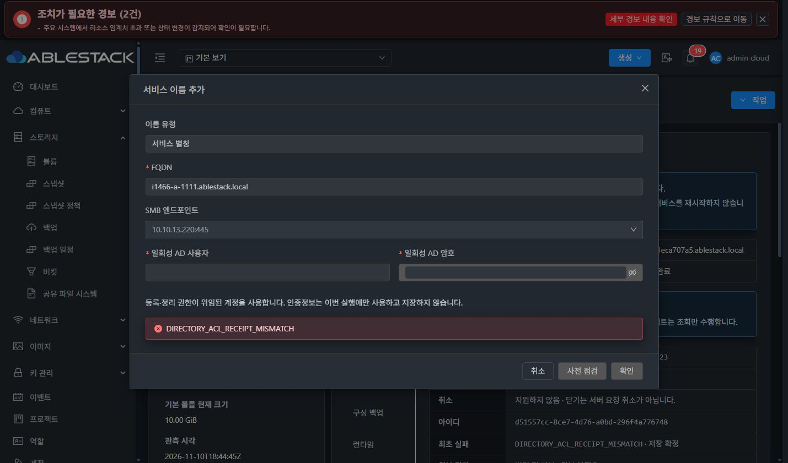
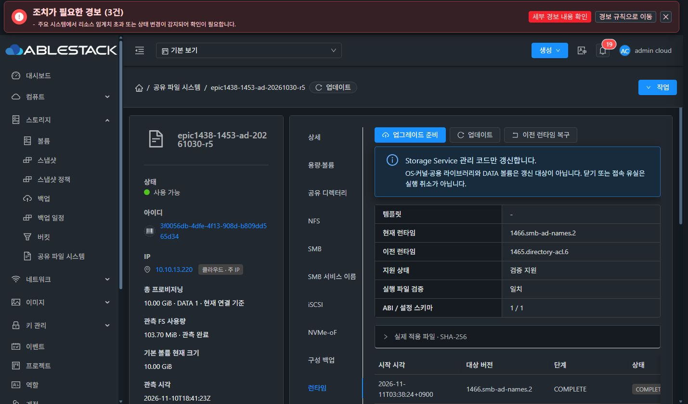

# #1466 실환경 인수 — 첫 별칭 DB 확정 결함으로 중단

2026-11-11 KST. 제품 코드 기준 `7e3bb196c00a0f0ec35e21a00d7c64af9cf8e3ff`, Europa base `2250b0e7fb87dea26ab8442f52c69dce763c079b`. Epic #1438 / Draft PR #1470에서 진행했다. **첫 제품 오류의 원인을 확인한 뒤 구현·기능 검증·복구 재시도를 중단했다. #1466은 OPEN이며 인수 완료가 아니다.**

## 완료한 빌드·배포·준비

- 로컬 backend package 성공, 실제 API 요청/직렬화·coordinator→MariaDB DAO 등을 포함한 39건 통과(실패/오류/생략0).
- 기존 SMB 생성/편집과 이름 UI 컴포넌트 25건 통과. UI production build 성공.
- 이번 feature의 재빌드 클래스 45개를 현재 13번 관리 JAR와 대조해 바이트 동일함을 확인했다. 현재 JAR `f077b695d8851c090d18d89ccf79cc61b22c4e442afffe535c8052ea20e7c365`를 유지하여 #1436과 기존 코드를 보존했다. 관리 서버/Agent를 불필요하게 재시작하지 않았다.
- UI 배포: index SHA256 `33447d6b3b2a2956f6cf7067571ff41f8db8cb5ea0429c0c4e801f2cf275ba23`. 배포 파일985개 확인, 변경51개(신규48개). 운영 config.json·color.less와 관리 JAR 해시는 전후 동일. UI HTTP200.
- 로컬 빌드/정상 서명 런타임 `1466.smb-ad-names.2`를 실제 UI에서 등록→검증→게시→다운로드·검증→적용했다. UI COMPLETE, 현재18파일 무결성 일치, 이전 버전1465.directory-acl.6 보존. archive SHA256 `4613ffc9dafc4848e4ab6e79ff659b054146afd8cf1533a0a886b3f54c1b58a8`, manifest SHA256 `ca84ff0e24a0d945dfcb9e3d6c85372d2b7048423801126cdb9fb9fc073b6eb5`, keyId `ablestack-runtime-cluster13`. 개인키는 보호된 signer에서 메모리/memfd로만 사용했다.
- 새 Windows `i1466w-1111-01` / VM `c65c240d-0b12-4b44-b21a-e440e35cd31c` / i-2-241-VM을 UI로 생성했다. ROOT `6254ef33-9adb-497f-89fc-46428a923167`, 101GiB QCOW2/SPARSE, 4CPU/8GiB, UEFI/SCSI, 실제 16포트 프로파일 `q35-windows-16-v1`. 주 IP10.10.254.226/MAC02:0d:00:cc:00:bb는 Mold가 할당했다.
- 실제 콘솔 부팅·로컬 로그인 및 AD 가입 명령/재부팅을 확인했다. AD에 새 컴퓨터 I1466W-1111-01$가 생성되고 원래 SharedFS 컴퓨터 GUID/SID/KVNO2는 유지됐다. **Windows AD 대화형 로그인·Kerberos/SMB 접속 인수는 아직 수행하지 않았다.**

### 준비 중 자체 교정한 항목 — 제품 코드 결함과 구분

1. 보호된 updater14의 SystemVM 해시7a331e…와 관리 JAR 내 승인 모듈e847e0…가 달라 최초 런타임 준비가 정상 보호 코드로 차단됐다. 제 배포 준비 누락이다. 새 모듈을 실제 SystemVM의 /run 임시 경로에서 read-only capabilities로 실행하여 기존17파일 무결성·현재 버전·활성 updater 무변경을 실증했다. root:root/0644를 보존하는 원자적 관리자 모듈 배포로 맞춘 뒤 UI 검증/적용이 통과했다. 서버의 requireAlignedUpdater 보호나 기존 integrity.json은 변경하지 않았다.
2. 새 Windows가 무관한 DHCPv6 DNS를 우선 사용했다. AD 서버 자체의 SRV/DNS와 MAC은 정상이었다. **새 시험 VM의 IPv6 DHCP/router discovery/DNS 선택만** 교정하여 IPv4 AD DNS10.10.13.247로 기본 SRV 조회가 성공했다. 다른 VM·Mold 네트워크·MAC은 변경하지 않았다. IPv6 DNS 설정의 [Microsoft 공식 계약](https://learn.microsoft.com/en-us/windows-server/administration/windows-commands/netsh-interface)을 확인했다.
3. 콘솔 키 입력 helper의 @가2로 전달된 가입 요청은 실제 입력 문자열을 확인해 교정했다. 암호를 추측해 반복하거나 기존 AD 암호를 변경하지 않았다. 인증정보는 OS/웹의 마스킹된 입력에만 사용했고 이 문서/저장소에 저장하지 않았다.

## 첫 제품 오류 — 04:00:38 KST

실제 UI의 SMB 서비스 이름 탭에서 `i1466-a-1111.ablestack.local` / 10.10.13.220:445를 입력했다. 사전 점검에서 DNS/SPN 생성 소유권·공유/ACL/DATA 무변경 범위를 확인하고 승인→확인을 실행했다.

| 항목 | 실제 값 |
|---|---|
| 공개 요청/비동기 job | 3fc74bfb-b47a-45ca-ba85-30f1fd380923 / 5684 |
| 구성 작업 UUID | d51557cc-8ce7-4d76-a0bd-296f4a776748 |
| 새 이름 리소스 UUID | 4869309e-c044-487a-a15a-8402ccaaf8de |
| 요청 종류 | SmbAdServiceName / CREATE |
| 최초 실패 | DIRECTORY_ACL_RECEIPT_MISMATCH / COMMITTING |
| 현재 서버 상태 | RECOVERY_REQUIRED, active_configuration_operation_id=669 |
| configuration revision | 67 유지, 목표68 미확정 |
| 이름 DB 행 | id1, Creating/revision1, ownership_json={} |
| 게스트 결과 | state=VERIFIED, smbServiceNameReceipt.state=VERIFIED |
| AD 실제 확인 | A=10.10.13.220, cifs/i1466-a-1111.ablestack.local이 기존 STORC1ECA707A5$에 생성됨 |

기존 HOST/RestrictedKrbHost SPN4개, computer GUID7189b3df-b6d3-4089-83bf-c1ec9d79bf68/SID…-1106/KVNO2는 보존됐다. DNS node GUID는 d9b3d6d0-e669-4e0b-9211-5764b697a9e4다. **AD 변경은 이미 적용됐으므로 '아무 변경도 없었다'고 판단하면 안 된다.**

## 정확한 코드 원인

1. 이름 전용 게스트 트랜잭션은 DNS/SPN과 이름 영수증만 반환한다. 디렉터리 POSIX ACL은 변경하지 않으므로 directoryAclReceipts는 없다.
2. StorageServiceConfigurationCoordinator.commit() 461~464행은 이름 영수증 확정보다 먼저 공통 StorageDirectoryAclReceipts.apply()를 호출한다.
3. StorageDirectoryAclReceipts.apply() 63~90행은 SMB 프로토콜이며 기존 ACL 정책이 연결된 공유가 있으면 영수증을 요구한다. 리스너/온라인 옵션/클라이언트 정책 등은 제외하지만 새 **이름 전용 작업은 제외하지 않는다.**
4. 실제 서비스에는 ACL 정책748e9a0f-9833-32fb-821a-235b8c2fad60(aclPolicyVersion1)과 SMB 공유 i1465ad5의 기존 연결이 있었다. 따라서 90행의 **require(observation.has("directoryAclReceipts"))**가 false다. 관리 서버 실제 stack도 apply():90 → coordinator.commit():462를 가리킨다. 실제 ACL 값 비교에 들어가기도 전에 실패한 것이다.
5. SQL transaction이 확정되지 않아 이름 Creating 예약과 revision67/복구 보호가 남았다. 이름 영수증을 검증·저장하는 StorageSmbServiceNames.applyVerified() 330행 이후 경로에는 도달하지 못했다.

before/candidate snapshot 대조:

| 테이블 | 전/후 후보 행 수 | 기존 값 |
|---|---:|---|
| StorageFileShareVO | 14 / 14 | 동일 |
| StorageAccessRuleVO | 25 / 25 | 동일 |
| StorageDirectoryPolicyVO | 6 / 6 | 동일 |
| StorageServiceProtocolVO | 3 / 3 | 동일 |
| StorageBlockTargetVO | 0 / 0 | 동일 |
| StorageSmbServiceNameVO | 0 / 1 | 이번 별칭만 추가 |

**DNS/AD 인증 실패나 #1436 PCI 회귀가 아니다. 이름 메타데이터 작업에 기존 SMB/POSIX ACL 변경용 확정 조건을 적용한 범위 판별 결함이다.**

### 기존 회귀가 놓친 이유

StorageSmbServiceNameCoordinatorDaoTest.setup() 71~73행은 FileShare DAO를 mock으로 두고 withSmbServiceNames만 연결하며 DirectoryPolicy DAO/기존 bound 공유를 구성하지 않았다. 실제 apply()의 70행에서 조기 종료해 이번 조건을 통과하지 않았다. 실제 SystemVM 실증은 게스트 DNS/SPN 처리·원복을 검증했지만 기존 ACL 정책이 있는 Cloud plan→DAO 확정까지 연결하지 못했다.

## 현재 영향과 안전한 수정/재개 방향 — 아직 구현하지 않음

- 해당 인스턴스의 새 구성 변경은 복구 보호로 차단된다. 관리 서버는 active/HTTP200이며 기존 SMB445/1445와 NFS2049 리스너가 유지된다. XFS UUID9c8ddfe9-3e23-46f0-9476-5c794b004841 및 마운트가 존재한다. 실제 Windows SMB/Kerberos·데이터 보존 인수 완료로 확대하지 않는다.
- UI가 NOT_NEEDED를 '변경 전 거부·원복 불필요'로 표시하지만 현재 의미는 **게스트 성공 후 별도 원복이 실행되지 않았다**는 것이다. COMMITTING+VERIFIED와 무변경 거부를 구분하는 안내가 필요하다. 보호 상태·최초 실패·일회성 입력 초기화는 유지한다.
- 수정은 검증된 **이름 전용 계획**에만 한정해야 한다. 명령 집합·작업 종류와 이름 외 share/ACL/directory 테이블 무변경을 확인하고, 해당 경우에만 POSIX ACL 영수증 요구를 제외한다. 이름 자체의 UUID·요청 지문·computer GUID/SID·DNS node GUID·CREATED/REUSED 검증은 그대로 통과해야 한다. 일반 SMB/디렉터리 변경에서 영수증을 빼거나 production DirectoryPolicy DAO를 제거하는 방식은 사용하지 않는다.
- 실제로 캡처한 게스트 VERIFIED 응답과 기존 bound SMB/aclPolicyVersion1을 실제 DAO fixture에 넣어 생성→확정 및 동일 UUID 재개를 연결해야 한다. 일반 SMB에서 영수증 누락/위조는 계속 거부하고, 이름 요청을 가장한 share/ACL 변경도 차단하는 회귀가 필요하다.
- 수정·사전 검증 후에는 **같은 작업 d51557cc…를 재관측·재개**하여 소유권을 DB에 확정해야 한다. 새 CREATE, 수동 DNS/SPN 삭제, Creating 행 삭제나 active writer 강제 해제는 하지 않는다. SQL/게스트 사이의 같은 UUID·revision/소유권 근거를 유지한다.

이번에는 복구 재개·원복·재전송·제품 코드 수정을 실행하지 않았다. 두 번째 FQDN, 실제 Windows Kerberos/SMB I/O, 충돌/소유권/의도한 실패 원복, 이름 구성 후 재시작·데이터 보존은 미완료다. 이슈는 닫지 않고 다음 지시를 기다린다.

[실제 작업/게스트 영수증·테이블 비교](evidence/20261111-first-product-analysis.json)

