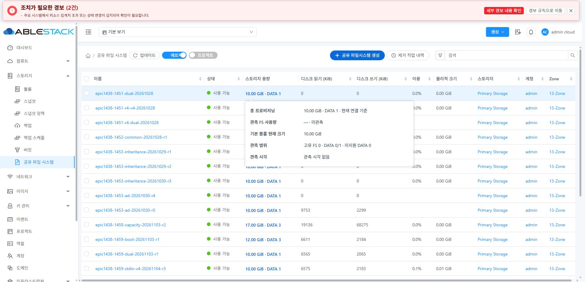
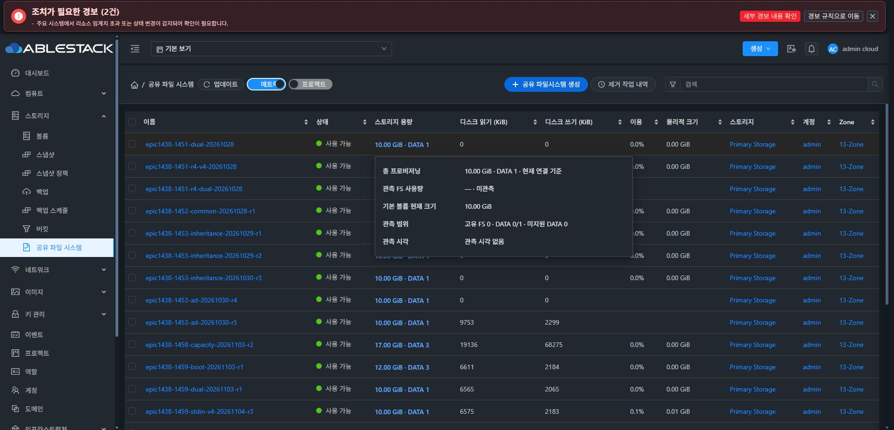
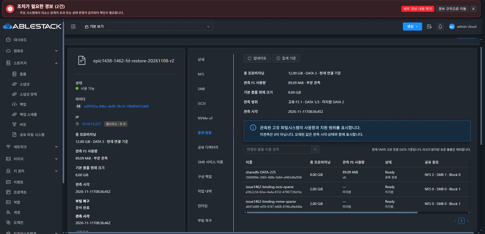
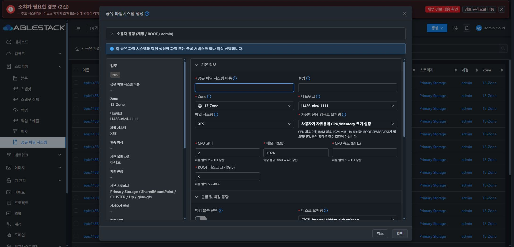
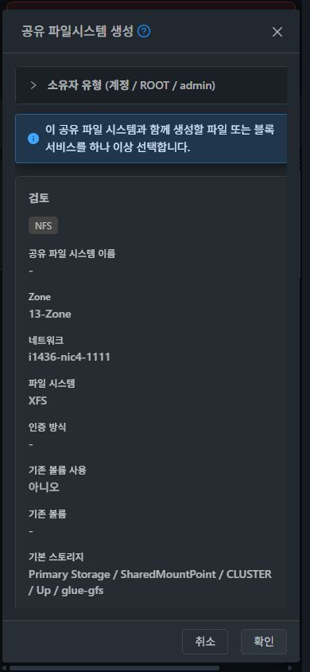
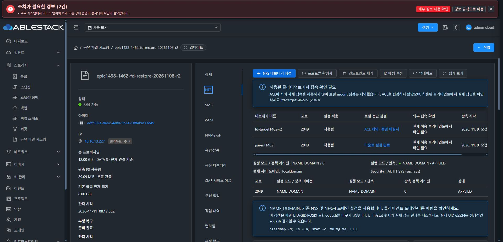

# 최종 배포 UI 갤러리

아래 images/는 최종 정규 production 빌드 2d0179f4a64 / index ca28d87c4f3a…의 실제 13번 UI다. review-images/는 앞선 구현/검토 단계의 폼 열기·취소 증거이며 최종 산출물의 버전 증거로 혼용하지 않는다. 원래 다크/한국어로 복구했으며 영문 smoke는 새 레이블/레이아웃 확인에 한정한다.

| 화면 | 라이트 | 다크 |
|---|---|---|
| 목록 메트릭 | [이미지](images/list-light.png) | [이미지](images/list-dark.png) |
| 상세 | [이미지](images/details-light.png) | [이미지](images/details-dark.png) |
| NFS | [이미지](images/nfs-light.png) | [이미지](images/nfs-dark.png) |
| SMB | [이미지](images/smb-light.png) | [이미지](images/smb-dark.png) |
| iSCSI | [이미지](images/iscsi-light.png) | [이미지](images/iscsi-dark.png) |
| NVMe-oF | [이미지](images/nvmeof-light.png) | [이미지](images/nvmeof-dark.png) |
| 용량·볼륨 | [이미지](images/capacity-light.png) | [이미지](images/capacity-dark.png) |
| 공유 디렉터리 | [이미지](images/directory-light.png) | [이미지](images/directory-dark.png) |
| SMB 서비스 이름 | [이미지](images/smb-names-light.png) | [이미지](images/smb-names-dark.png) |
| 구성 백업 | [이미지](images/backup-light.png) | [이미지](images/backup-dark.png) |
| 작업 내역 | [이미지](images/operations-light.png) | [이미지](images/operations-dark.png) |
| 런타임 | [이미지](images/runtime-light.png) | [이미지](images/runtime-dark.png) |
| 부팅 복구 | [이미지](images/boot-light.png) | [이미지](images/boot-dark.png) |
| 네트워크 | [이미지](images/network-light.png) | [이미지](images/network-dark.png) |
| 메트릭 | [이미지](images/metrics-light.png) | [이미지](images/metrics-dark.png) |
| 이벤트 | [이미지](images/events-light.png) | [이미지](images/events-dark.png) |
| 생성 대화상자 | [이미지](images/create-dialog-light.png) | [이미지](images/create-dialog-dark.png) |
| 용량 마우스 오버 | [이미지](images/capacity-hover-light.png) | [이미지](images/capacity-hover-dark.png) |

## 주요 변경 실제 화면

### 용량 한 줄·마우스 오버

### 용량 탭 상단 24px 간격

### 고정 생성 헤더·푸터 / 본문 유지

### 조회 중 콘텐츠 유지·단일 spinner

## 나머지 최종 화면

| 화면 | 이미지 |
|---|---|
| backup-en-dark | [실제 화면](images/backup-en-dark.png) |
| capacity-en-dark | [실제 화면](images/capacity-en-dark.png) |
| catalog-details-dark | [실제 화면](images/catalog-details-dark.png) |
| catalog-history-dark | [실제 화면](images/catalog-history-dark.png) |
| catalog-list-dark | [실제 화면](images/catalog-list-dark.png) |
| catalog-register-dialog-dark | [실제 화면](images/catalog-register-dialog-dark.png) |
| create-1366-dialog-dark | [실제 화면](images/create-1366-dialog-dark.png) |
| create-390-dialog-dark | [실제 화면](images/create-390-dialog-dark.png) |
| iscsi-content-dark | [실제 화면](images/iscsi-content-dark.png) |
| list-normal-light | [실제 화면](images/list-normal-light.png) |
| nfs-refresh-complete-dark | [실제 화면](images/nfs-refresh-complete-dark.png) |
| nfs-refresh-pending-dark | [실제 화면](images/nfs-refresh-pending-dark.png) |
| nvme-content-dark | [실제 화면](images/nvme-content-dark.png) |
| smb-content-dark | [실제 화면](images/smb-content-dark.png) |
| vm-standard-details-dark | [실제 화면](images/vm-standard-details-dark.png) |
| vm-standard-nic-dark | [실제 화면](images/vm-standard-nic-dark.png) |

## 단계별 폼 검토 (최종 버전 사진과 구분)

모든 폼은 열기·표시·취소만 수행했다. 생성/삭제/인증/복원/업그레이드/원복 실행 성공을 뜻하지 않는다. 상세 버전·URL은 [단계별 수집 원장](evidence/intermediate-ui-index.json)을 따른다.

| 화면 | 이미지 |
|---|---|
| ad-name-create-dialog-light | [검토 화면](review-images/ad-name-create-dialog-light.png) |
| ad-rejoin-dialog-light | [검토 화면](review-images/ad-rejoin-dialog-light.png) |
| ad-service-names-light | [검토 화면](review-images/ad-service-names-light.png) |
| after-backup-upload-dialog-dark | [검토 화면](review-images/after-backup-upload-dialog-dark.png) |
| after-compute-dialog-dark | [검토 화면](review-images/after-compute-dialog-dark.png) |
| after-delete-plan-dialog-dark | [검토 화면](review-images/after-delete-plan-dialog-dark.png) |
| after-directory-edit-dialog-dark | [검토 화면](review-images/after-directory-edit-dialog-dark.png) |
| after-iscsi-acl-dialog-dark | [검토 화면](review-images/after-iscsi-acl-dialog-dark.png) |
| after-iscsi-create-dialog-dark | [검토 화면](review-images/after-iscsi-create-dialog-dark.png) |
| after-nfs-acl-dialog-dark | [검토 화면](review-images/after-nfs-acl-dialog-dark.png) |
| after-nfs-create-dialog-dark | [검토 화면](review-images/after-nfs-create-dialog-dark.png) |
| after-nfs-edit-dialog-dark | [검토 화면](review-images/after-nfs-edit-dialog-dark.png) |
| after-nvme-host-acl-dialog-dark | [검토 화면](review-images/after-nvme-host-acl-dialog-dark.png) |
| after-nvme-namespace-dialog-dark | [검토 화면](review-images/after-nvme-namespace-dialog-dark.png) |
| after-nvme-subsystem-dialog-dark | [검토 화면](review-images/after-nvme-subsystem-dialog-dark.png) |
| after-operation-diagnostics-dialog-dark | [검토 화면](review-images/after-operation-diagnostics-dialog-dark.png) |
| after-resource-edit-dialog-dark | [검토 화면](review-images/after-resource-edit-dialog-dark.png) |
| after-restore-review-dialog-dark | [검토 화면](review-images/after-restore-review-dialog-dark.png) |
| after-runtime-rollback-dialog-dark | [검토 화면](review-images/after-runtime-rollback-dialog-dark.png) |
| after-runtime-upgrade-dialog-dark | [검토 화면](review-images/after-runtime-upgrade-dialog-dark.png) |
| after-smb-acl-dialog-dark | [검토 화면](review-images/after-smb-acl-dialog-dark.png) |
| after-smb-client-policy-dialog-dark | [검토 화면](review-images/after-smb-client-policy-dialog-dark.png) |
| after-smb-create-dialog-dark | [검토 화면](review-images/after-smb-create-dialog-dark.png) |
| after-smb-creation-policy-dialog-dark | [검토 화면](review-images/after-smb-creation-policy-dialog-dark.png) |
| after-smb-edit-dialog-dark | [검토 화면](review-images/after-smb-edit-dialog-dark.png) |
| before-create-dark | [검토 화면](review-images/before-create-dark.png) |
| before-nvme-dark | [검토 화면](review-images/before-nvme-dark.png) |
| before-vm-standard-dark | [검토 화면](review-images/before-vm-standard-dark.png) |
| capacity-spacing-fixed-light | [검토 화면](review-images/capacity-spacing-fixed-light.png) |
| fixed-create-390-light | [검토 화면](review-images/fixed-create-390-light.png) |
| preparation-status-dialog-light | [검토 화면](review-images/preparation-status-dialog-light.png) |
| qualified-compute-dialog-light | [검토 화면](review-images/qualified-compute-dialog-light.png) |
| review-capacity-list-multiline-light | [검토 화면](review-images/review-capacity-list-multiline-light.png) |
