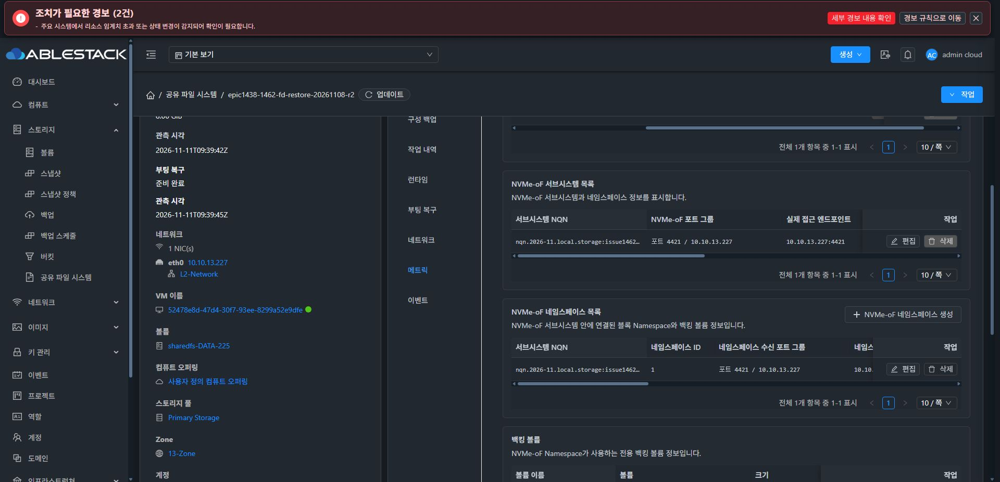
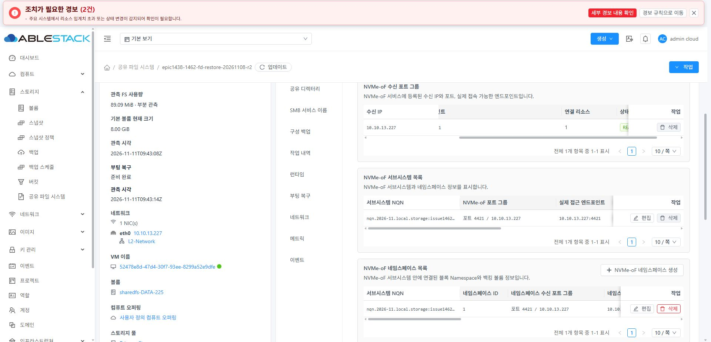
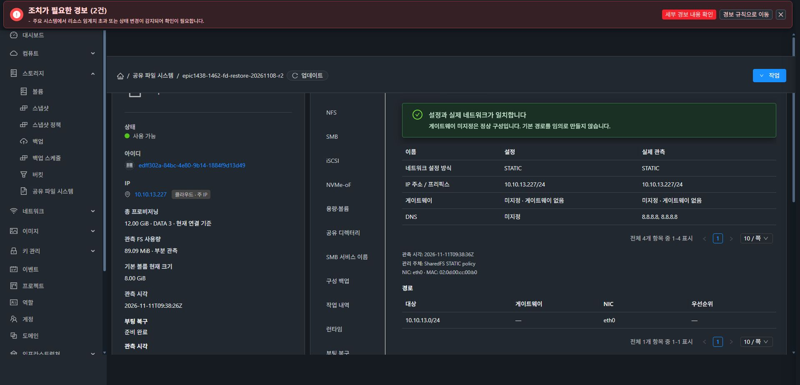

# #1468 추가 교정 — 페이지네이션·고정 열·상단 간격

사용자가 추가 요청한 세 항목을 구현하고 로컬 UI 빌드·13번 정적 UI 배포·실제 UI 검증을 완료했다. 기존 생성 폼 본문, 서비스 구성, 권한·작업 보호와 API 요청은 유지했다. 새 이슈/브랜치를 만들지 않고 기존 Epic 브랜치/PR에서 처리했다.

## 반영 결과

| 요청 | 변경·실제 확인 |
|---|---|
| 페이지네이션 통일 | VM 이벤트 탭의 실제 UI와 DetailTab.scss/EventsTab.vue를 대조했다. 작은 크기, 우측 정렬, 위 간격20px, 전체/범위 표시, 페이지 크기 선택·이동 입력으로 통일했다. 기본 크기는 원래 값을 유지한다. |
| 첫 열 고정·한 줄 | 첫 데이터 열을 왼쪽 고정하고 폭/nowrap/ellipsis를 적용했다. 긴 이름/NQN은 한 줄로 잘리고 기존 title/tooltip은 유지된다. 실제 NQN span은 18.84375px 한 줄, client244px < scroll271px, 전체 title 보존을 확인했다. |
| 작업 열 고정 | 마지막 작업(action/actions/details/view) 열을 오른쪽 고정하고 가운데 열만 수평 스크롤한다. 실제 NVMe 표에서 scrollLeft0→400 시 첫 열 x982·작업 열 x1697.25는 동일, 가운데 x1183.875→783.875로 이동했다. |
| 부팅 복구 간격 | 기존 툴바/안내 리본 -5px 겹침 → 24px 간격. |
| 네트워크 간격 | 기존 -12px 겹침 → 24px 간격. a-space 전역 여백 간섭을 VM detail-tab-toolbar로 분리했다. |

## 최소 변경과 보존

- SharedFSTable은 AntD Table을 그대로 렌더링하는 SharedFS 전용 표시 어댑터다. 기존 셀/링크/작업 슬롯, sorting/filtering, row key, 이벤트/selection/expand와 데이터는 전달하고 columns를 복사해 표시 속성만 보완한다. 서버·게스트·DB는 변경하지 않는다.
- SharedFS 관련16개 컴포넌트의46개 표에 연결했다. 제거 이력/카탈로그 이력은 기존 서버 pager를 유지하고 표의 client pager를 꺼서 이중 페이징하지 않는다. 제거 이력의 서버 요청은 기존20개로 고정하므로 크기 선택을 추가로 허용하지 않는다.
- 공통 NIC 표는 SharedFSTab provider가 있는 경우에만 같은 표시를 사용한다. 일반 VM 기본 경로는 기존 a-table이다. 실제 일반 VM NIC 화면의 SharedFS 어댑터0개, 기존 VM NIC/locale 회귀 PASS를 확인했다.
- 이벤트는 VM 공통 ListView·서버 페이징·원래 API 요청을 유지하며 SharedFS 하위에서만 첫 열 고정 CSS를 적용했다.
- 전역 VM UI/테마를 덮어쓰지 않는다. 어댑터 표의 고정 셀·hover·페이지네이션은 기존 semantic token을 사용한다.
- 원래 조회 리본 제거, 업데이트 단일 icon/loading 전환, 동일 자원 콘텐츠 유지와 stale 응답·권한/ACL·drain 보호를 유지했다.
- API 호출 AST96곳과 기존 생성 본문/CSS 동일성 확인. API를 실행한 시험이 아니다.

## 검증

- **로컬 UI31 suites / 277 tests PASS**, 변경 파일 lint PASS, 기존 npm run build 정규 production build PASS. GitHub Actions 미실행.
- 새 실제 AntD 컴포넌트 회귀22건: 고정 열/원본 불변, native fallback 셀·링크/버튼, 실제 페이지 이동·안정적인 row, VM pager 문구/옵션, 서버 한 번의 page 이벤트, NIC opt-in/일반 경로,16개 실제 export 경계 연결을 포함한다.
- 실제 다크 UI: NFS7표·SMB5표·iSCSI5표·NVMe6표, 용량·디렉터리·서비스 이름·백업·작업 내역·부팅 복구·네트워크·이벤트를 검토했다. 조건부 미노출 폼/빈 상태의 계약은 컴포넌트 회귀와 구분한다.
- 라이트 UI: 부팅 복구·네트워크·NVMe·용량·작업 내역의 고정 셀/문구/페이지네이션·경계를 확인했다.
- 작업 내역의 실제24개 행에서 1페이지1~20 → 2페이지21~24 이동, 페이지 크기20→10 변경 후11~20/전체24 표시를 확인했다. 새 서비스/작업을 생성한 시험이 아니다.
- 실제 VM 표준 페이지네이션을 배포 전/후 대조하고 일반 VM NIC 화면도 읽기 확인했다.
- 원래 다크·한국어로 복구했다. 새 console error0, 열린 폼0. 기존 전역 경보2건과 과거 실패 이력은 보존했다.
- **별도 Cloud API 정상 동작 시험·클라이언트 I/O·VM/서비스 재시작·설정 변경/복원·자원 생성/삭제는 하지 않았다.** 이 UI 교정을 기능 전체 재인수로 확대하지 않는다. 디스크·DATA·MAC·SystemVM·보호 정책 변경 없음.

[실제 화면 갤러리](table-review/gallery.md) · [로컬 검증 요약/로그 해시](table-review/validation-summary.json) · [고정 열 스크롤 측정](table-review/fixed-scroll-proof.json) · [말줄임 측정](table-review/ellipsis-proof.json) · [전체 UI 관찰](table-review/coverage.json)

## 배포·Git

- 소스 commit a94fbc1e9a083e7ebc6145f2e8da654f9b79f38e.
- UI index SHA256 **318c047708bd7780acaf85fe86ddf56910f414eedae6b94fff60ddc68d356549**.
- 13번 /usr/share/cloudstack-management/webapp의 정적 UI만 교체. 이전 index·전체 파일 manifest 검증과 원복 경로를 유지했다.
- 관리 JAR SHA256 aef93d4371defacdc5cb595ce1548d841be1c16864dac0c642ff4988bd143d10 보존.
- config.json SHA256 71c175523a2e251faf574bd5d977c37e81d21c9cc0b8a98dfb1642c6b8a448d7 보존.
- color.less SHA256 2d1ff56949d9f970fae62b2711326f582c88bef79ec799f1fd2cef7e1d0174a9 보존.
- mold.service active, UI HTTP200, 관리 서버 재시작·DB migration 없음. [배포 영수증](table-review/ui-deployment.json).
- local Europa/upstream0/0인 기존 epic/1438-sharedfs 브랜치에서 origin으로만 push하고 기존 [Epic PR1470](https://github.com/ablecloud-team/ablestack-cloud/pull/1470)에 반영한다. #1468은 완료/종료 상태를 유지하고 후속 교정 기록을 추가한다. PR은 Draft·미병합이다.
