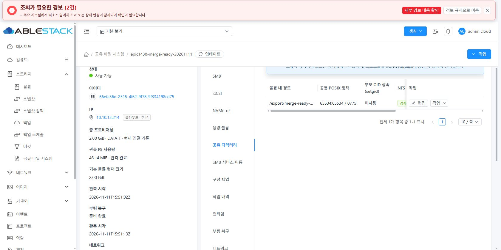
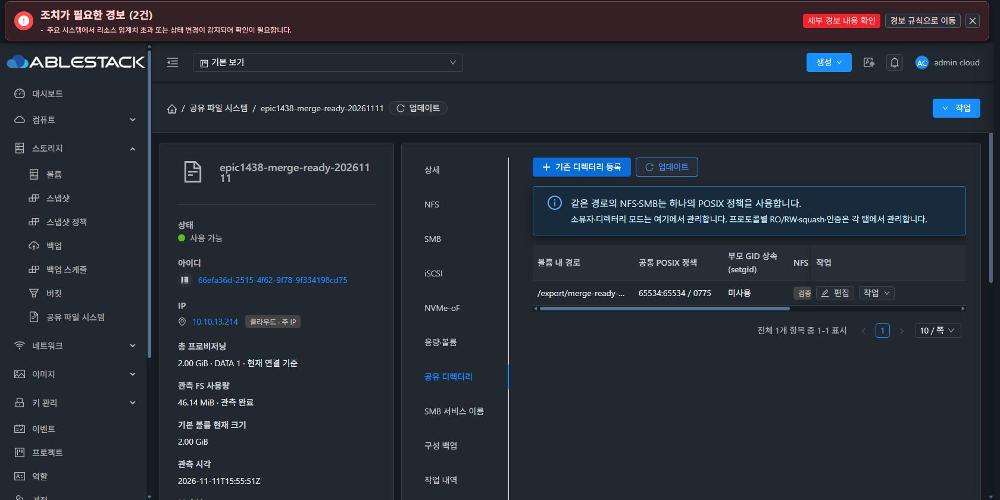
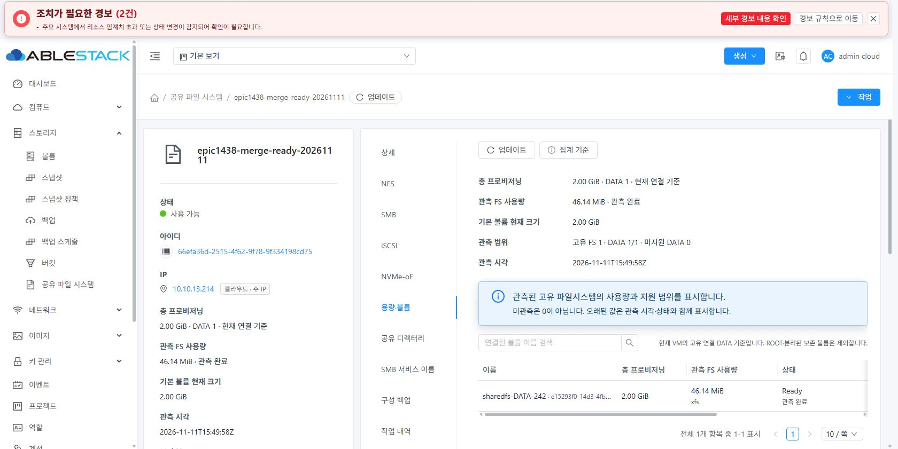
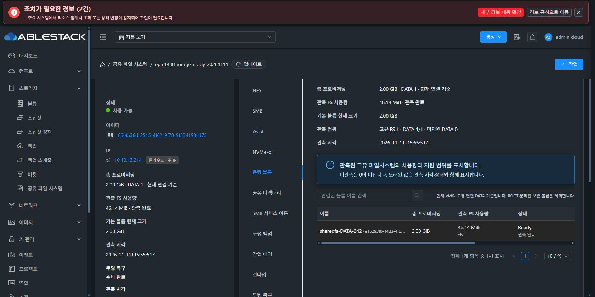

# SharedFS 공유 디렉터리·용량 표 헤더 교정

2026-11-12 KST. 병합된 Europa `b810a46951ec547553b21be7e5aba32491618d24`에서 분기했다. 제품 수정은 `5541d37c3ff`의 두 표 class와 한정 LESS 스타일뿐이다.

## 원인과 변경

실제 13번 UI에서 공유 디렉터리의 ‘부모 GID 상속 (setgid)’ 헤더는 열 110px / 내부 가용 폭 94px에 텍스트 135.23px가 줄바꿈 없이 표시됐다. 다크 테마의 small-table 규칙은 고정 헤더 배경도 transparent로 덮어써, 가로 스크롤 시 용량 표의 뒤쪽 제목까지 비쳤다.

컴퓨트 > 가상머신 > 볼륨의 실제 헤더를 조회해 `white-space: normal`, `overflow-wrap: break-word`, `word-break: normal`을 기준으로 적용했다. 두 대상 표만 `sharedfs-wrap-headers`로 선택하고, 이미 쓰는 테마 토큰을 우선 적용해 헤더·고정 셀의 배경을 불투명하게 유지한다. 호버 배경도 동일 토큰을 사용한다.

열 너비·열 순서·첫 열 한 줄 말줄임·고정 위치·AntD 페이지네이션·body slot·API 호출·보호 조건은 변경하지 않았다. VM과 다른 SharedFS 표는 새 스타일에 포함되지 않는다.

## 로컬 확인과 배포

- 관련 컴포넌트 lint 통과.
- 기존 SharedFSTable / SharedFSCapacity / SharedFSDirectoryPolicy 회귀: 3 suites, 46 tests PASS.
- 정규 `npm run build` 성공. GitHub 빌드 Actions 호출 없음.
- 13번 UI manifest 992파일 검사. 다른 배포 여부와 관리 JAR SHA를 대조한 후 변경된 정적 파일 12개만 적용했다.
- UI index SHA256: `a81c23f1af92272a60f1bb5df16c71b808e7695512ba2eb8bed54a3489ed15eb`.
- 관리 JAR SHA256 `f743335d13e7d794e1eac02ece139895e85a925ef48705fe3c5aba5e9e2891e9`, 사이트 config.json·color.less는 배포 전후 동일. 관리 서버 재시작·SystemVM/볼륨 변경 없음. mold active / UI HTTP200.
- 이번 수정에서 새 디스크를 생성하지 않았다. 기존 SPARSE DATA와 정책을 그대로 사용했다.

## 실제 UI 검증

Chrome의 실제 Mold UI에서 표시 설정을 조작해 라이트·다크를 전환했다. 원래 다크 모드로 복귀했다. 임시 viewport override나 브라우저 DOM/CSS 주입은 사용하지 않았다.

기본 1680px 화면에서 표 콘텐츠 폭은 728px다. 두 표×두 모드×가로 스크롤 왼쪽/오른쪽 총 8조건을 확인했다. [실제 DOM/색상/기하 검증 결과](evidence/ui-verification-summary.json).

- 헤더가 모두 VM 표준 줄바꿈 속성을 사용하고 인접 열로 넘치는 헤더 0개.
- 고정 헤더 배경 불투명, body 고정 열 sticky 유지, 첫 열 nowrap + ellipsis 유지.
- 가로 스크롤 끝: 디렉터리 0→492px, 용량 0→452px. 일부 열이 고정 열 뒤로 가려지는 정상적인 스크롤 동작을 제목 넘침과 구분했다.
- ‘부모 GID 상속 (setgid)’는 같은 110px 열에서 줄바꿈 후 텍스트 범위 83.11px로 제한된다.
- 헤더 글자/배경 대비: 라이트 최소 7.56:1, 다크 최소 8.47:1.
- 각 탭의 업데이트 버튼 실행 후 기존 행과 페이지네이션 유지. 디렉터리 65534:65534 / 0775, 정책 revision1·일치, native 5.5.3 지원 보존. 용량 DATA 2GiB / XFS / Ready 유지.
- 최종 브라우저 console error 0. 기존 전역 경보2건은 변경하지 않았다.

스타일 회귀 검증이며 서비스 설정 변경·외부 클라이언트 I/O·백업/복원을 다시 시험한 것으로 확대하지 않는다. 제품 보호를 해제하거나 백그라운드 API로 화면을 대체하지 않았다.

## 라이트·다크 실제 화면

| 공유 디렉터리 · 라이트 | 공유 디렉터리 · 다크 |
|---|---|
|  |  |

| 용량·볼륨 · 라이트 | 용량·볼륨 · 다크 |
|---|---|
|  |  |
