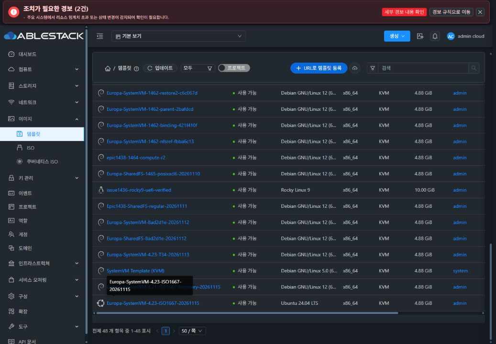

<!--
Licensed to the Apache Software Foundation (ASF) under one
or more contributor license agreements.  See the NOTICE file
distributed with this work for additional information
regarding copyright ownership.  The ASF licenses this file
to you under the Apache License, Version 2.0 (the
"License"); you may not use this file except in compliance
with the License.  You may obtain a copy of the License at

  http://www.apache.org/licenses/LICENSE-2.0

Unless required by applicable law or agreed to in writing,
software distributed under the License is distributed on an
"AS IS" BASIS, WITHOUT WARRANTIES OR CONDITIONS OF ANY
KIND, either express or implied.  See the License for the
specific language governing permissions and limitations
under the License.
-->

# #1694 우분투 템플릿 이름 표시 보정 검증

## 결과와 원인

2026-11-16, 13번 클러스터의 실제 한국어 UI에서 재현·보정·정리를 완료했습니다. Ubuntu 24.04 LTS 템플릿 `Europa-SystemVM-4.23-ISO1667-20261115`의 이름 앞부분이 보이며 긴 이름만 한 줄 말줄임됩니다. 저장된 이름과 템플릿 정보는 변경하지 않았습니다.

원래 이름 셀 400px에서 좌우 padding을 제외한 내용 폭은 **384px**입니다. Ubuntu SVG는 23.625px이고 기존 inline 묶음은 **385.625px**가 되어, 바깥 셀의 ellipsis가 내부 이름 묶음 전체를 숨겼습니다. Debian/Rocky/Windows의 18.375px 아이콘은 같은 경계에서 들어갔습니다. 접근성 트리의 이름 존재와 실제 화면의 가시 폭을 따로 확인했습니다.

## 제품 변경

- `ListView.vue`: 템플릿 주 목록에만 flex 컨테이너를 적용했습니다. 아이콘24px·코멘트22px 슬롯을 고정하고 이름에 남은 폭을 줍니다. 이름 툴팁의 hover/focus, 상세/코멘트 링크와 목록 복귀 문맥을 보존합니다. VM/VNF/ISO의 이름 분기는 그대로 유지합니다.
- `templateSearch.js`: 사용자 아이콘 UI 시험에서 확인된 `showIcon` 유실을 보정했습니다. 목록/상세 모두 camelCase와 소문자 옵션의 true/false를 보존합니다.
- `InfoCard.vue`: 아이콘 응답을 복원하자 노출된 기존 `getImage` 메서드 누락을 복구했습니다. 상위 OS 이미지 우선 정책을 보존하며 자체/연결 이미지로 대체합니다. 이미지가 있어도 상세 카드가 렌더링됩니다.
- 제품 소스3개, 테스트2개만 변경했습니다. OsLogo·AutogenView 및 Backend/DB/Agent/SystemVM 변경은 없습니다.

제품 커밋: `bcec25bf003` → `67a3c4bfee9` → **`f79f1ae75244e4fe3c003ce304e8bf8085b07520`**.

## 검증

| 구분 | 결과와 범위 |
| --- | --- |
| 변경 Lint | 제품3개·테스트2개 PASS |
| 목록/검색 회귀 | 5 suites / 81 tests PASS: ListViewTemplateType, TemplateSearchForm, templateSearch, AutogenTemplateRead, IsoListSearch |
| 상세 카드 회귀 | 2 suites / 14 tests PASS: InfoCardIconLifecycle, InfoCardSSHKeyPairVmQuery. 카드 실제 렌더링3개 사례 포함 |
| 합계 | 별도 두 실행의 **7 suites / 95 tests**, 실패0 |
| 소스 CSS 레이아웃 fixture | Ubuntu/Debian/Windows/사용자 이미지/아이콘 없음 × 짧은·긴 한글/영문 이름 × 코멘트 유무20행을 양 테마·1440/1280/810/390 폭에서 **160건 PASS** |
| 실제 13번 목록 | 기존48행을 양 테마·4개 폭에서 확인. 요청 폭과 window.innerWidth 일치, 아이콘≤24px·한 줄·이름 폭>100px, 기하 오류0. 세로 스크롤바가 있으면 clientWidth는10px 작음 |
| 사용자 이미지+코멘트 | 내용384px 안에 이미지24px·이름328px·코멘트22px 표시. 기본 Ubuntu 아이콘 복원 후 이름350px |
| 툴팁/탐색 | 이름 키보드 초점·포인터 hover에서 원문 전체 표시. Enter 상세 진입, breadcrumb로 page1/pagesize50 복귀. 코멘트 링크가 같은 템플릿 코멘트 탭으로 진입 |
| 부가 열 | 상태/OS/아키텍처/하이퍼바이저/크기/계정/유형이 nowrap·ellipsis, 원문 title/상태 title 보존 |
| 공통 소비 화면 | ISO8개의 ID/이름과 VM103개 중 첫20개의 ID/이름 보존, VM 상세 카드 표시. VNF0 빈 목록 유지. 세 목록의 템플릿 전용 클래스0 |
| 최종 브라우저 오류 | 최종 배포 로드 이후 error0. 초기 배포에서 발견한 오류는 아래 복구 이력과 구분 |

fixture는 source CSS·실제 SVG/DOM을 재현한 별도 레이아웃 시험이며 Mold 업무 API를 호출하지 않습니다. 짧은/긴 합성 이름과 아이콘 없음은 fixture 근거입니다. 실제13번에서는 원래 Ubuntu/Debian/Rocky/Windows 행과 사용자 이미지·코멘트 조합을 확인했습니다. 좁은 화면은 기존 표의 가로 스크롤을 유지합니다. 이번 작업이 전체 모바일 UI 개편을 의미하지 않습니다.

## 범위 제한 배포와 복구

운영 UI는 앞선 범위 제한 배포의 입력을 포함하고 있어, canonical tree 전체 빌드를 그대로 올리면 관련 없는 VPC 등의 변경이 섞입니다. 운영 빌드 입력 **`/root/work/.build-iso-vnf-sync-20261116-bm2k765y/ui`**의 나머지 파일을 보존하고 위3개 입력만 canonical Git 소스와 SHA-256 일치 확인 후 빌드했습니다. 이 경로는 배포 입력 보관용이며 별도 Git 소스 트리로 관리하지 않습니다.

- 다른 절대 빌드 경로의 산출물은 chunk636개 변경으로 검출되어 **배포하지 않았습니다**. 같은 운영 빌드 경로에서 최종 생산 빌드772초/PASS.
- 중간2개 소스 배포에서 사용자 아이콘의 상세 카드 오류를 실제 UI로 발견해 즉시 이전 index로 복구했습니다. 브라우저 조건부304가 새 index를 유지하지 않도록 복구 index의 mtime도 갱신했습니다.
- getImage 복구와 렌더링 회귀 테스트 후 최종3개 소스를 재빌드·배포하고 상세/목록/정리를 다시 검증했습니다. 중간 오류를 최종 PASS로 합산하지 않았습니다.
- 최종 활성 변경 **5개**: `index.html`, `js/app.f55c66b5.js`, `js/chunk-aeede570.6104745d.js`, `css/app.1256dd27.css`, `css/chunk-aeede570.4c1c8760.css`.
- 기존7145개 비-index 파일의 SHA-256 보존, 설정3개와 Backend jar 동일, Mold PID **2620448** 동일. 관리 서버 재시작 없이 정적 파일 HTTP 해시까지 확인했습니다.
- 최종 index SHA-256: `882d9ac877c6aaa545d46305374f77a17c089007c189320d947063dcfbffee7e`.
- 최종 백업: `/var/tmp/template1694-backup-nl18i_3f`. 최초 백업: `/var/tmp/template1694-backup-83zn20jq`. 이미 열린 브라우저와 복구를 위해 과거 해시 파일은 보존했습니다.

## 테스트 자원 정리

Mold의 업무 조회·아이콘 업로드/삭제·코멘트 추가/삭제는 모두 브라우저 UI에서 수행했습니다. SSH는 정적 산출물 배포와 파일/PID 검증에만 사용했습니다.

- 대상 템플릿 UUID: `1cce97d2-a4b6-49c7-871a-3f52d70ce858`.
- 전용 코멘트 `qa-tpl1694-comment-20261116` 삭제 후 **코멘트0**.
- 전용 사용자 이미지 삭제 성공 알림과 목록의 **Ubuntu SVG 복원·사용자 이미지0** 확인.
- 원래 템플릿 **48개 ID·이름·상태·OS·아키텍처·유형 모두 보존**. 템플릿/VM/계정/역할/프로젝트/네트워크는 생성하지 않았습니다. 감사 이벤트는 보존했습니다.
- 최종 테마는 원래 다크로 복원하고 임시 viewport를 해제했습니다.

## CI 부채 분리

최종 제품 head f79f1ae의 [Lint 43805384250](https://github.com/ablecloud-team/ablestack-cloud/actions/runs/43805384250)는 실패했습니다. 완료된 준비 기준 head833bf7f의 [Lint 43777628868](https://github.com/ablecloud-team/ablestack-cloud/actions/runs/43777628868)와 실패 훅 **16개가 동일**하고 제품/테스트 변경5개 경로의 추가 진단0입니다. 취소된 run을 기준으로 삼지 않았습니다.

[License Check 43805384352](https://github.com/ablecloud-team/ablestack-cloud/actions/runs/43805384352)의 미승인/unknown **4,077개**는 기존과 동일하며 변경 제품 경로는 승인 상태입니다. **전체 CI 성공으로 표시하지 않습니다. #926·#1044는 별도 OPEN 유지**합니다. 후속 검증 문서 커밋의 CI 상태는 PR에 별도로 남깁니다. 변경40개 파일에 해당하는18개 훅 그룹은 통과/해당 없음입니다. 전체 pre-commit 구성은 사용하지 않는 yamllint 환경의 Python≥3.10 요구와 로컬3.9.25 차이로 초기화가 막혀, 적용 훅을 개별 실행했습니다. 이 환경 문제를 제품 결함으로 합산하거나 전체 훅 성공으로 표시하지 않습니다.

## 추적과 후속

[#1694](https://github.com/ablecloud-team/ablestack-cloud/issues/1694) 완료 근거입니다. 상위 [Epic #1692](https://github.com/ablecloud-team/ablestack-cloud/issues/1692)는9개 중1개 구현 완료이며, 다음은 **#1695 KISO-01 공통 API/권한 계약**입니다. [Draft PR #1703](https://github.com/ablecloud-team/ablestack-cloud/pull/1703)은 설계/목업과 이번 제품 보정을 함께 추적합니다. 쿠버네티스 ISO의 다른8개 구현이나4.21/4.23 업로드·전체 ACL 검증을 이번 템플릿 표시 시험으로 대체하지 않습니다.

## 근거 파일

- [최종 UI 결과](evidence/ui-final-result.json), [실제 양 테마/4개 폭](evidence/actual-layout-matrix.json), [공통 회귀](evidence/regression-after.json), [정리 ledger](evidence/test-resources.json).
- [fixture](layout-fixture.html), [fixture 결과160건](evidence/layout-matrix.json), [배포 결과](evidence/deployment-result.json), [CI 비교](evidence/ci-lint-comparison.json).
- [수정 전](evidence/before-ubuntu-1440.jpg), [사용자 이미지+코멘트](evidence/after-custom-comment-hover-1440.jpg), [사용자 이미지 상세](evidence/after-detail-custom-icon.jpg), [최종 기본 아이콘/이름](evidence/final-ubuntu-name-restored.jpg).

