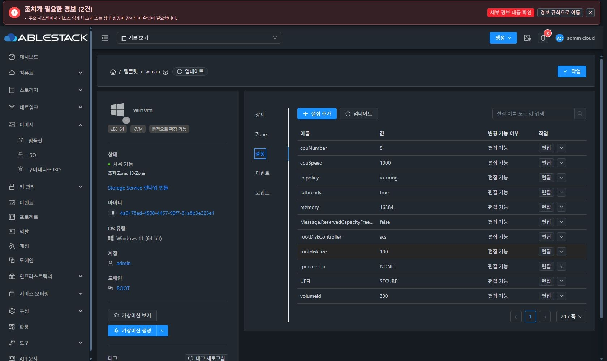

<!--
Licensed to the Apache Software Foundation (ASF) under one
or more contributor license agreements.  See the NOTICE file
distributed with this work for additional information
regarding copyright ownership.  The ASF licenses this file
to you under the Apache License, Version 2.0 (the
"License"); you may not use this file except in compliance
with the License.  You may obtain a copy of the License at

  http://www.apache.org/licenses/LICENSE-2.0

Unless required by applicable law or agreed to in writing,
software distributed under the License is distributed on an
"AS IS" BASIS, WITHOUT WARRANTIES OR CONDITIONS OF ANY
KIND, either express or implied.  See the License for the
specific language governing permissions and limitations
under the License.
 -->

# 템플릿 탭 표준화·SHAREDFS 대화상자 구현 및 13번 UI 검증

[#1661](https://github.com/ablecloud-team/ablestack-cloud/issues/1661) · [#1662](https://github.com/ablecloud-team/ablestack-cloud/issues/1662) · [PR #1663](https://github.com/ablecloud-team/ablestack-cloud/pull/1663) · 2026-11-14 KST

## 구현 내용

템플릿 상세의 Zone·설정·VNF 콘텐츠를 운영 VM 설정/NIC의 도구 모음·표·행 작업·페이지 배치에 맞췄다. Zone은 선택해도 표가 이동하지 않으며 펼침 영역을 기본/2차 스토리지로 구분하고 다크 테마 토큰을 사용한다. 설정에는 검색, 읽기 전용 표시, 분리된 초안, 전체 맵 보존, 동시 수정 감지, 불명확한 쓰기 결과의 재전송 방지를 적용했다. 기존 1~4개 비디오 장치와 각 video.ram=16384 구성도 유지한다. VNF의 NIC와 속성은 별도 섹션 안에서 같은 표시 규칙을 사용한다.

- USER/SYSTEM: **상세 → Zone → 설정 → 이벤트 → 코멘트**.
- VNF: **상세 → Zone → 설정 → VNF 설정 → 이벤트 → 코멘트**.
- SHAREDFS: **상세 → Zone → 설정 → 런타임 번들 → 이벤트 → 코멘트**.

표시 이름만 `런타임 번들`로 줄였으며 기존 `runtime.catalog` 키·딥링크와 전역 Storage Service 메뉴는 유지했다. 카탈로그는 전역 정보이며 현재 템플릿의 설치·호환성 검증 결과가 아님을 유지한다.

SHAREDFS 유형 정책은 생성/수정 대화상자 문맥에 따라 구분한다. Root의 특정 Zone/KVM URL 등록에서만 지원 프로필을 구성하고, 로컬 업로드·프로젝트 등록·기존 다른 유형의 SHAREDFS 전환은 비활성 사유를 표시한다. 기존 SHAREDFS는 유형·아키텍처를 고정하고 설명 등 허용 필드만 수정한다. 등록 전 소유자·프로젝트·명령 권한·스키마를 재확인한다.

## UI에서 발견하고 수정한 문제

| 재현 | 보정 및 최종 확인 |
|---|---|
| readonlydetails가 비어 있으면 설정 추가가 열리지 않음 | 빈 초안명을 읽기 전용 키로 판단하지 않도록 수정. 실소유자 추가·수정·삭제 확인 |
| 아주 긴 설정 값 때문에 표 폭이 약 3962px로 늘어남 | 설정/VNF 표의 열 배치를 고정. 3696px 길이 값도 284px 셀에서 한 줄 생략되고 전체 tooltip 제공 |
| 2쪽 마지막 행 삭제 후 저장값 10개가 남아도 빈 표 표시 | 데이터 수에 맞춰 마지막 유효 페이지로 이동. 11→10개 삭제에서 1쪽 10행 확인 |
| 1680px Zone의 끝 작업이 부분적으로 가려짐 | 기본 표 800px 안에서 날짜·상태·행 작업 폭 조정. 선택 전후 표 이동 0px |
| SHAREDFS 생성창의 잠긴 체크 옵션이 다크에서 검게 표시됨 | 해당 프로필의 비활성 체크·선택 값에 테마의 보조 글자색 적용. 선택 상태와 잠금 조건 유지 |
| VNF 모바일 대화상자의 중복 닫기 버튼 | NIC/속성의 취소·확인을 공통 하단 영역으로 통합. 양 테마 390px에서 버튼 2개와 실제 저장 확인 |
| VNF 긴 설명/행 작업의 불필요한 확장 | 고정 열과 한 줄 생략, 기본 800px 표에서 이름/작업 공간 확보. 최종 UI 확인 기록은 아래 증거에 포함 |

## 설정 정보 누락 우려의 대조 결과

`winvm`은 API의 저장값 **11개가 모두 표시**된다. 기본 10개/쪽에서는 10+1로 나뉘며 20개/쪽을 선택하면 11개가 한 화면에 보인다. `Rocky9`의 API 응답에는 `rootDiskController=scsi` 하나만 저장되어 있고 UI도 같은 한 개를 표시한다. 추가 가능한 설정 후보는 저장된 값과 별도 데이터이며, 관리자에게 27개·일반 소유자에게 24개가 제공된다. 두 계정의 후보를 각각 UI 검색으로 모두 확인했다. 서버에 저장되지 않은 값을 임의 기본값으로 채우지 않았다.

## 실환경 검증

모든 제품 생성·변경·삭제는 13번 웹 UI로 수행했다. 브라우저가 발생시킨 API 응답은 UI 결과를 대조하는 증거로만 읽었다. CLI는 소스·테스트·빌드·정적 파일 배포와 임시 이미지 fixture 관리에 사용했다.

| 영역 | 확인 내용 |
|---|---|
| 생성/수정 | Root SHAREDFS URL 등록 Ready, 지원 프로필 필드/소유자 고정, 설명 수정 후 유형·x86_64·Ready 보존 |
| 제한 문맥 | 최초 전체 Zone의 비활성 사유, 로컬 SHAREDFS 비활성, 일반 USER의 SHAREDFS 전환 차단, Root 프로젝트 등록 차단 |
| 업로드 | 일반 소유자의 QCOW2 로컬 USER 업로드, SHA-256, 4.23 SystemVM에서 Ready/가용 Zone 1/1 |
| 설정 | 실제 소유자 추가·수정·검색, 12개 페이지 처리, 긴 값/tooltip, 마지막 페이지 삭제 보정, 2개 비디오 장치/RAM 쌍과 1개로 교체, 마지막 cleanupdetails=true 및 빈 상태 |
| 설정 오류 | 브라우저에서 listTemplates 요청만 차단해 기존 10행 보존·오류 표시·변경 차단 확인. 저장 전 조회 실패에서도 초안/모달 보존 후 수동 재시도 성공. 다른 UI 탭에서 수정한 설정을 감지해 기존 맵 덮어쓰기 차단 |
| ACL | Root, 개인 소유자, 공유 수신자, 프로젝트 관리자/일반 구성원, 실제 Read-Only User 역할과 빈 QA 하위 도메인의 DomainAdmin을 구분. DomainAdmin의 USER 등록 Ready·설명/소유 설정 수정, SHAREDFS 미노출 및 상위 도메인 비공개 템플릿 접근 차단도 확인. 프로젝트 일반 구성원의 설정·VNF NIC/속성 쓰기와 공유/읽기 전용 역할의 쓰기 차단 확인 |
| VNF | NIC 11개 10+1 페이지, 필수/선택 구간과 잘못된 입력 거부, 구간 내 순서 변경, 검색 중 순서 변경 차단, 긴 설명, 속성 저장/검색, 비밀 값 마스킹 및 값 검색 제외. 여러 NIC 수정 후 실제 비밀 값 보존 확인. 지원 속성 조회 실패 시 Add/Edit 비활성·기존 데이터 보존, 재시도 복구 확인 |
| 유형/탭 | USER/SYSTEM/VNF/SHAREDFS 순서, runtime.catalog 딥링크. 수정 API가 없는 읽기 전용 역할은 기존 정책대로 VNF 탭을 숨기고 상세로 복귀 |
| 시각/키보드 | 1680/1024/390px 라이트·다크의 Zone/설정/VNF 및 SHAREDFS 생성·수정 대화상자, 표 내부 스크롤, 대화상자와 버튼 위치, ESC/편집 버튼 초점 복귀, Enter 작업 메뉴/확인, Ctrl+Enter 저장 |
| 공통 회귀 | 기존 VM 설정/NIC, ISO 상세, 볼륨 상세를 읽기 비교. 템플릿 전용 스타일 클래스가 ISO/볼륨에 적용되지 않음 |

조회 실패·동시 수정은 위 표처럼 실제 UI에서 확인했다. 서버 431 거부, 중복 제출, 불명확한 POST 결과 조회, 늦은 응답/세션·프로젝트 전환의 세부 경계는 별도로 단위 테스트로 검증했으며 실제 UI 수행으로 확대 기재하지 않는다.

실제 다중 Zone/비KVM 환경은 제공되지 않았다. 기능은 유지하고 해당 실환경 검증은 이전 사용자 승인과 같은 **NOT_RUN_SCOPE_ADJUSTED**로 구분한다. 현재 업로드는 4.23에서 수행했으며 4.21/4.23 교체 검증의 이전 결과는 [T03/T04 보고서](../epic-1638-t03-t04-20261113/README.ko.md)에 있다. 이번 UI 변경에서 SystemVM을 재생성하거나 이전 4.21 검증을 새 실행으로 계산하지 않았다. CirrOS의 SHAREDFS 등록은 유형/등록 정책 검증이며 실제 SharedFS 게스트 호환성·서비스 운영 검증으로 간주하지 않는다.

전체 탭을 오프라인으로 만들면 기존 전역 네트워크 오류 처리에 따라 다른 배경 요청이 세션을 종료할 수 있어 단일 컴포넌트 검증에 적합하지 않았다. 요청 차단을 listTemplates 하나로 한정해 재검증했고, 모든 브라우저 네트워크 차단은 복구했다. 이 전역 동작은 이번 변경의 회귀나 CI 부채로 합산하지 않았다.

## 화면 증거

기준: [운영 VM 설정](screenshots/vm-settings-reference-dark-1680.jpg), [운영 VM NIC](screenshots/vm-nic-reference-dark-1680.jpg).

| 대상 | 1680px 다크 / 라이트 | 1024px 다크 / 라이트 | 390px 다크 / 라이트 |
|---|---|---|---|
| Zone | [다크](screenshots/zone-dark-1680-final.jpg) / [라이트](screenshots/zone-light-1680.jpg) | [다크](screenshots/zone-dark-1024.jpg) / [라이트](screenshots/zone-light-1024.jpg) | [다크](screenshots/zone-dark-390-final.jpg) / [라이트](screenshots/zone-light-390.jpg) |
| 설정 | [다크](screenshots/winvm-settings-all-11-dark-final.jpg) / [라이트](screenshots/winvm-settings-all-11-light-1680.jpg) | [다크](screenshots/settings-dark-1024-final.jpg) / [라이트](screenshots/settings-light-1024-final.jpg) | [다크](screenshots/settings-dark-390-final.jpg) / [라이트](screenshots/settings-light-390-final.jpg) |
| VNF | [다크](screenshots/vnf-dark-1680-final-code.jpg) / [라이트](screenshots/vnf-light-1680-sections-final.jpg) | [다크](screenshots/vnf-dark-1024-final.jpg) / [라이트](screenshots/vnf-light-1024-final.jpg) | [다크](screenshots/vnf-dark-390-final.jpg) / [라이트](screenshots/vnf-light-390-final.jpg) |
| SHAREDFS 생성 | [다크](screenshots/register-sharedfs-dark-1680-final.jpg) / [라이트](screenshots/register-sharedfs-light-1680-final.jpg) | [다크](screenshots/register-sharedfs-dark-1024-final.jpg) / [라이트](screenshots/register-sharedfs-light-1024-final.jpg) | [다크](screenshots/register-sharedfs-dark-390-final.jpg) / [라이트](screenshots/register-sharedfs-light-390-final.jpg) |
| SHAREDFS 수정 | [다크](screenshots/edit-sharedfs-dark-1680.jpg) / [라이트](screenshots/edit-sharedfs-light-1680.jpg) | [다크](screenshots/edit-sharedfs-dark-1024.jpg) / [라이트](screenshots/edit-sharedfs-light-1024.jpg) | [다크](screenshots/edit-sharedfs-dark-390.jpg) / [라이트](screenshots/edit-sharedfs-light-390.jpg) |

VNF 모바일 하단 작업: [NIC 다크](screenshots/vnf-nic-dialog-dark-390-standard-footer.jpg), [NIC 라이트](screenshots/vnf-nic-dialog-light-390-standard-footer.jpg), [속성 다크](screenshots/vnf-property-dialog-dark-390-standard-footer.jpg), [속성 라이트](screenshots/vnf-property-dialog-light-390-standard-footer.jpg).

## 빌드·최소 배포

- 기준 브랜치: local/origin/upstream ablestack-europa `b8c8300a6303265f364f30c9f4992e8a8671a7e6`. 작업 브랜치: `dhslove/template-tabs-1661-1662`.
- 현재 운영 UI archive baseline `460b33770cb071d869f61c2aac0d81773890ebc3`와 기존 Epic #1638 overlay 위에 이번 22개 UI 입력 변경만 적용했다. 전체 Europa UI/백엔드를 다시 배포하지 않았다.
- 집중 회귀 **29 suites / 474 tests PASS**, 변경 JavaScript/Vue 19개 scoped ESLint PASS. 운영 입력 빌드도 **7 suites / 192 tests PASS** 후 production build를 수행했다.
- 최종 제품/배포 코드: `4a2f5237b3d87eb6a834e813f0f406846bb787ed`. 마지막 배포 정적 파일 7개, index SHA-256 `a70a72b89234fc6d3b5592e17f0be63a7adbbe25b8fa2330aa2cf6fce57976c9`.
- 최종 배포 SHA·파일 수·백업·index 해시와 보호 파일/PID/백엔드 JAR 비교는 [deployment.json](evidence/deployment.json), [실행 검증](evidence/final-runtime-verification.json), [소스 경계](evidence/source-boundary.json)에 기록한다.
- DB 스키마·호스트 agent·SystemVM 런타임 변경 없음. config.json/WEB-INF/web.xml 및 테마 변수 905개 보존. 이전 해시 asset과 롤백 백업 보존.

## 테스트 자원 정리

UI에서 만든 USER 2개/SHAREDFS 1개/VNF 1개, 프로젝트 1개, 테스트 계정 3개와 빈 QA 하위 도메인 1개만 정리했다. VM·네트워크·볼륨은 생성하지 않았다. 강제 삭제를 사용하지 않았고 계정은 비활성화 후 삭제했다. 최종 템플릿 46개·기존 계정 3개·프로젝트 0개·도메인 ROOT만 남는 상태를 UI에서 확인했다. 호스트 3개와 4.23 시스템 VM s-244-VM/v-245-VM도 실행 중이다. 정확한 UUID·삭제 job/status 및 최종 목록/인프라 보존 결과는 [자원 원장](evidence/resource-ledger.json)과 [UI 증거](evidence/ui-cases.json)에 기록한다. 임시 HTTP 이미지 한 개는 SHA-256을 확인한 뒤 제거했고 HTTP 404 및 보호 파일 보존을 확인했다. 운영 SystemVM 이미지 경로와 기존 다운로드 파일은 보존했다.

## CI 부채 분리

기존 CI #926·#1044는 별도로 유지한다. License Check의 기존 RAT **4077**은 동일하며 이번 제품 입력 변경 경로의 새 라이선스 문제는 없다. 저장소 전체 Lint 결과와 변경 경로 교집합은 [CI 판정](evidence/ci-classification.json)에 기록한다. 이 보고서는 전체 CI가 green이라고 주장하지 않는다.
