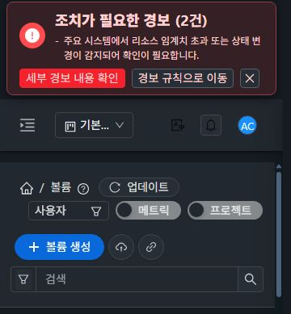
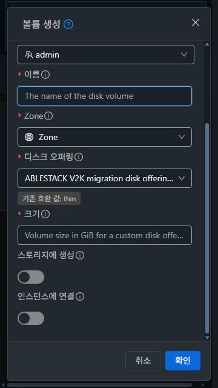

<!--
Licensed to the Apache Software Foundation (ASF) under one
or more contributor license agreements. See the NOTICE file
distributed with this work for additional information
regarding copyright ownership. The ASF licenses this file
to you under the Apache License, Version 2.0 (the
"License"); you may not use this file except in compliance
with the License. You may obtain a copy of the License at

  http://www.apache.org/licenses/LICENSE-2.0

Unless required by applicable law or agreed to in writing,
software distributed under the License is distributed on an
"AS IS" BASIS, WITHOUT WARRANTIES OR CONDITIONS OF ANY
KIND, either express or implied. See the License for the
specific language governing permissions and limitations
under the License.
-->

# #1249 UI Node14 검증 복구

대상 이슈: [#1249](https://github.com/ablecloud-team/ablestack-cloud/issues/1249).
PR: [#1551](https://github.com/ablecloud-team/ablestack-cloud/pull/1551).

## 범위와 기준선

- 기준선: `5eefe176cd0ab240e6e2dafb3fc0e455ae349877`.
- 구현/검사 소스: `06fc02ebe1dd6886a72a127844e772ea95bc824c`.
- WSL ext4 전용 checkout, Node14.21.3, 새 `npm ci` 설치.
- `package-lock.json` SHA256: `23379939285231d360907e8d7242206efd5359654b9903614788040680133ffc`. 의존성 버전 변경 없음.
- 제품 `ui/src` 코드는 변경하지 않았다. 현재 제품 계약과 Node14 지원 범위에 맞춰 fixture를 수정했다.
- 전체 Cloud/Maven/RPM/qemu 빌드는 실행하지 않았다.

기준선과 수정 소스는 같은 잠금 파일로 설치한 의존성을 사용했다. 기준선 전체 unit은 coverage 수집 없이 진단했으며, 최종 전체 unit은 기본 coverage 설정을 유지한다. 2026-10-06의 90-suite 로그를 재실행한 결과와 혼동하지 않는다. 현재 기준선은 260 suites/3925 tests이고, 17 suites/61 tests 실패를 재현했다.

## 실패 원인과 수정 설계

| 구분 | 기준선 실패 | 원인과 수정 |
| --- | --- | --- |
| Node14 배열 API | 10 suites/39 tests | Array.at 미지원. 12개 fixture의 48회 접근을 호환 접근으로 변경. -1은 slice(-1)[0], -2는 길이 기반 인덱스로 바꿔 빈 배열과 짧은 배열의 undefined 의미도 유지한다. 전역 polyfill을 넣지 않는다. |
| 스냅샷 작업 ID | 1 suite/2 tests | Node14 crypto.webcrypto는 undefined. 테스트 범위에서 randomFillSync 기반 getRandomValues를 제공하고 복원한다. 실제 난수와 UUIDv4 형식 기대값을 유지한다. |
| NIC enabled 계약 | 2 suites/3 tests | 기존 linkstate/API fixture가 제거된 계약을 기대했다. KVM/updateVmNic, enabled 필드를 기준으로 하고 폐기된 API 권한만으로 동작을 제공하지 않는 조건과 상충하는 legacy metadata를 검증한다. |
| Wall 비동기 수명 | 1 suite/2 tests | 가용성 조회가 먼저 수행되는 현재 경로에서 rule 조회의 resolver에 도달하지 못했다. 가용성→rule 순서를 모사하고 432 실패, 두 단계 각각의 unmount 이후 조회·polling 부활 방지를 검증한다. |
| AutoScale UserData | 1 suite/11 tests | 현재 값 조회/명시적 변경/readiness와 검증된 선택 row 전달이 fixture에 없었다. 실제 data·computed 계약을 적용하고 숨은 수동 초안 배제, 언어와 무관한 None, 불일치 metadata 거부, 미준비 3조건의 POST 차단을 검증한다. |
| OAuth schema 거부 | 1 suite/3 tests | closeAction의 포커스 복원에 필요한 Vue nextTick이 plain fixture에 없었다. 실제 nextTick을 제공하며 schema 거부·form 미개방 기대값을 유지한다. |
| 사용자 지정 ROOT 디스크 | 1 suite/1 test | 실제 watcher의 affinity 배열 기본값이 fixture에 없었다. 빈 기본 배열을 복원하고 크기/strict 설정과 watcher 반복 제한을 유지한다. |

전체 lint는 기준선의 `bucketS3Session.spec.js` Promise 인자명 오류 1건으로 재현했다. deferred helper를 표준 resolve/reject 인자명으로 수정했다. lint 비활성화나 예외 지시문은 추가하지 않았다. 범용 저장소 Checkstyle/license/lint 정비인 #1109/#926과 구분한다.

NIC 계약의 근거는 [enabled 통합 변경](https://github.com/ablecloud-team/ablestack-cloud/commit/001c69f2caaa4ec37fdf1d7a0deabcee4e206331)과 현재 `vmNicActions`/`GuestNetworkSummary`의 조건이다. UserData의 실제 오래된 응답 차단은 기존 `UserDataSelection.spec.js`의 늦은 이전 검색/소유자 변경 검증에서도 유지한다.

## UI Build 개선

잠금 설치, production, 소스 수정 없는 lint, coverage 포함 전체 unit 단계를 분리했다. 앞선 검사 실패가 뒤 검사를 감추지 않으면서 job 실패는 유지한다. 성공을 강제하는 continue-on-error나 test skip은 없다. UI workflow는 명시적 ref를 받는 릴리즈 재사용 경로로만 호출한다. 비릴리즈 모듈 빌드는 로컬에서 실행한다.

qualification artifact에는 실제 checkout SHA, Node/npm, 각 단계 결과, 전체 unit JSON, coverage, 소스/잠금 파일 해시 및 배포 dist 해시를 남긴다. 빌드가 테스트와 제품 소스를 변경하지 않았는지도 검사한다.

## GitHub 실행 상태

GitHub UI Build dispatch는 포크와 upstream에서 모두 `422: Actions has been disabled for this repository`로 거절됐다. API의 Actions 설정은 enabled=true였고 같은 설정 재적용 및 workflow enable로 해제되지 않았다. GitHub Actions 화면은 사용량으로 fork 실행이 중지됐으며 관리자가 재활성화할 수 있다고 표시했다.

이 결과는 실행 전 차단이다. GitHub UI Build PASS나 등록된 CI 성공으로 표시하지 않는다. 이후 사용자 지시로 비릴리즈 모듈 빌드는 로컬이 원칙임을 확정했다. 이번 검증은 로컬 전체 검사로 수행하며 Actions 재실행은 하지 않는다. 이전 이슈의 GitHub UI Build 게이트는 이 운영 원칙과 로컬 결과로 대체한다.

## Actions 실행 범위

사용자 지시에 따라 Build, UI Build, Rocky9.7/9.8 RPM, UI RPM의 push/PR 및 독립 수동 빌드 진입점을 제거했다. 릴리즈에서 호출하는 workflow_call 인터페이스와 작업은 유지한다. 세 릴리즈 진입점(정식/개발/브랜치 개발)은 기존 workflow_dispatch를 유지한다. 실제 릴리즈 호출 대상과 모든 입력 인자의 호환성을 정적으로 검증했다. Apache 전용 Simulator/Coverage/Sonar/Docker 자동 빌드도 릴리즈 재사용 경로로 정리했다. 라이선스·소스 lint·병합 충돌 검사는 기존 자동 실행을 유지한다.

## 최종 로컬 검사

| 검사 | 결과 |
| --- | --- |
| 잠금 설치 | Node14.21.3, npm ci 성공, 잠금 파일 변경 없음 |
| 전체 lint | --no-fix, 오류 0 |
| 전체 unit | 260 suites / 3930 tests PASS, 실패 0, 대기 0 |
| 기본 coverage | statements 27.34%, branches 29.49%, functions 23.00%, lines 24.27% |
| production | prebuild/build/postbuild 전체 exit 0 |
| workflow | actionlint 1.7.12, 13개 빌드/릴리즈 파일 PASS; inline provenance Python compile PASS |

기준선의 원래 4개 suite를 포함한 17개 실패 suite가 모두 통과했다. 잘못된 API 기대값을 현재 계약으로 수정하면서 Wall 가용성 단계 unmount 1개, enabled/legacy metadata 우선순위 1개, UserData 미준비 POST 차단 3개를 추가하여 총 test 수가 3925→3930이 됐다. coverage 수집이나 실패 검사를 끄지 않았다.

UI tree는 `a195e7f6e18d0eb4b53d01c5d5464602a8895485`이며 후속 workflow/문서 변경이 UI 소스·테스트·잠금 파일을 바꾸지 않았는지 확인한다. source/dist manifest와 실행 결과는 evidence에 기록했다.

## 31·32 UI 검증 및 보존

두 클러스터 모두 활성 webapp에 정적 파일 645개를 같은 manifest로 배포했다. app.08a94b66.js / app.4c772cd9.css, index SHA256 `11ff1fdcfc4ddb6bd75dae14793ec3ccece0451333c343af4676f89b82928d36`가 일치한다. 서버 설정/config.json/WEB-INF와 9개 라이브러리, 관리 서비스 PID는 보존했다. /client HTTP200, 관리 서비스 active, FT async/progress marker를 확인했다.

실제 UI의 설정 radio와 스토리지/컴퓨트 메뉴를 사용했다. 모바일 메뉴는 전용 drawer 링크를 선택하고 바깥 영역으로 닫아 콘텐츠를 확인했다. 각 조건은 볼륨→가상머신→볼륨 왕복 시 테마/배치/페이지 가로 넘침과 주 작업의 폰트·배경·둥근 형태를 비교했다.

| 클러스터 | 너비 px | 테마 | 주 작업 대비 | 검색 안내 대비 | 입력 폭 px | 즉시 전환/왕복/VM 표준/넘침 |
| --- | --- | --- | --- | --- | --- | --- |
| 31 | 360 | dark | 5.19 | 5.88 | 203.00 | PASS |
| 31 | 360 | light | 5.19 | 4.97 | 203.00 | PASS |
| 31 | 768 | dark | 5.19 | 5.88 | 210.00 | PASS |
| 31 | 768 | light | 5.19 | 4.97 | 210.00 | PASS |
| 31 | 1280 | dark | 5.19 | 5.88 | 169.64 | PASS |
| 31 | 1280 | light | 5.19 | 4.97 | 169.64 | PASS |
| 32 | 360 | dark | 5.19 | 5.88 | 203.00 | PASS |
| 32 | 360 | light | 5.19 | 4.97 | 203.00 | PASS |
| 32 | 768 | dark | 5.19 | 5.88 | 210.00 | PASS |
| 32 | 768 | light | 5.19 | 4.97 | 210.00 | PASS |
| 32 | 1280 | dark | 5.19 | 5.88 | 169.64 | PASS |
| 32 | 1280 | light | 5.19 | 4.97 | 169.64 | PASS |

- 양 클러스터 주 작업 hover 대비 6.96:1, 키보드 focus-visible 2px 테두리 확인.
- 검색 0건→지우기→20행 복구, 지우기 아이콘 대비 5.88:1 확인.
- listVolumes XHR만 차단해 오류 안내와 마지막 정상 20행 보존을 확인하고, 네트워크 차단을 해제한 뒤 명시적 재시도로 복구했다. 로그인 상태를 유지했다.
- 360×640 대화상자(31 dark / 32 light): 제목 Header·액션 footer가 고정되고 body만 실제 스크롤됐다. 확인을 제출하지 않고 취소했다.
- 브라우저와 native JPEG의 실제 너비·높이·시그니처를 대조했다. 임시 뷰포트와 네트워크/hover 강제 상태를 해제했다.
- Glue HEALTH_OK, RGW 3개 running. 확인용 `qa-bkt-1540-32-files`의 실제 객체 바이트 13개, 버전/marker 13개, 키 revision·계정 정보·보호 설정이 배포 전과 동일하다. 잔여 QA 개체/진행 중 quota 작업은 없다.

## 기존 승격 게이트 연결

#1230 / PR #1229에서 분리한 범용 UI 검증 정비 결과다. 종료된 Kubernetes 기능/Epic을 다시 열지 않는다. GitHub 실행 상태와 로컬 검증 상태를 구분하며, 실행 전 차단을 runtime PASS로 덮지 않는다.

워크플로우 13개를 actionlint 1.7.12로 검사했다. 기존 Docker login-action v2의 지원 중단 런타임 오류는 입력 호환성을 확인한 공식 v4.7.0 SHA 고정으로 수정했다. Docker 빌드나 레지스트리 접속은 실행하지 않았다.

Windows/WSL의 기존 dirty FT 작업트리 22개와 변경·미추적 파일 해시 2,144개가 작업 전과 일치했다. 기존 버킷/테마/볼륨 feature 작업트리 5개도 원래 HEAD와 clean 상태를 유지했다. 병합 후 다시 대조한다.
