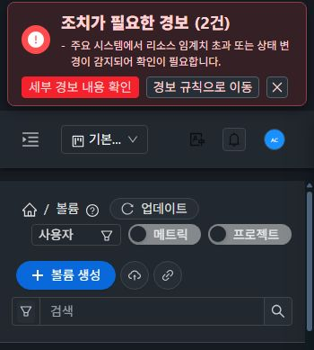
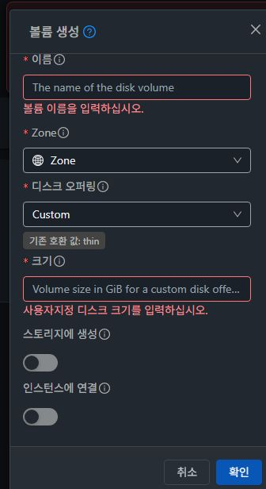

# #1549 볼륨 목록 대비·반응형 검증

2026-11-02. 기준 Europa `e54c9bb4fa5ee400387159707df4b6dbe3568f78`, 최종 UI 소스 `8194a6405e31acfc8e7e84b99f4bb25dadeb4834`.

## 문제와 변경

볼륨 목록의 레거시 primary/검색 placeholder가4.5:1 미만이고, 다크 검색/지우기 아이콘도 흐렸다. 모바일에서는 세 작업과 검색이 한 줄에 눌려 입력 영역이10px까지 줄었다.

VM의 기존 semantic 규칙을 공통 `list-toolbar.css`로 옮겨 VM/볼륨 목록에만 opt-in으로 적용했다. VM 선언은 selector 이름을 제외하면 동일하다. 볼륨에만 flex wrap·최소 검색 폭·검색/clear 토큰·조회 loading veil 보완을 추가했다. 다크모드의 기존 important 검색 규칙보다 우선하도록 동일 구조 범위에 제한한 selector를 사용한다. 공통 ActionButton/SearchView·토큰 값·API·권한·소유 범위·busy gating·검색 로직은 변경하지 않았다.

| 대상 | 수정 전 | 최종 실제 UI |
|---|---:|---:|
| 볼륨 생성 일반 글자 |3.24:1|5.19:1|
| 생성 hover |—|6.96:1|
| 검색 안내 라이트/다크 |1.84/4.18:1|4.97/5.88:1|
| 검색 아이콘 다크 |1.90:1|8.47:1|
| 지우기 아이콘 다크 |1.13:1|5.88:1|
| refresh loading 글자 라이트 |기존 VM 관측4.10:1|볼륨7.56:1|
| 360px 검색 입력 폭 |10px|203px|

## 실제 UI 인수

- 31(GFS2)·32(RBD), 라이트/다크,360/768/1280px12조건 모두 활성 CSS까지 확인했다. 주 작업·검색 안내는4.5:1 이상, 검색/clear 아이콘도 실제 측정4.5:1 이상이다. RGBA 아이콘은 배경과 합성해 대비를 산정했다. 정상 목록의 hidden clear DOM은 판정 대상에서 제외하고 값 입력 후 보이는 clear를 별도로 검증했다.
- 모든 조건에서32px/14px/400/round와 생성→로컬 업로드→URL 업로드 순서, 가로 overflow 없음, 검색 폭100px 이상을 확인했다. 모바일에서 검색은 필요한 경우 다음 줄로 배치된다.
- 실제 모바일 양방향 테마 전환4건을 포함해 같은 URL/viewport에서10회 선택·html/body/실제 배경 일치를 기록했다. hash 화면 이동의 CDP loader ID가 같으며 VM의 주 작업5.19·검색4.97/5.88과 기존 style을 유지한다.32 버킷 목록도 동일하고 확인용 버킷이 보인다.
- 실제 Tab/Shift+Tab 포커스2px outline, hover6.96을 라이트/다크에서 확인했다. pseudo state는 검증 후 해제했다. 텍스트 주 작업이 앞, 업로드/검색 보조 아이콘은 뒤다.
- 두 클러스터에서 키워드 검색0개→clear→복구, 고급 검색 이름 조건 적용0개→재설정→20개, 두 행 선택/해제·작업 순서 유지를 확인했다.
- XHR1개를 일시 정지해 조회 loading과 글자7.56·주 작업5.19를 확인하고 재개했다. 두 클러스터에서 실제 목록 요청 차단을 관측했으며20개 마지막 데이터·로그인·테마를 유지하고 실패 안내를 표시했다. 차단 해제 후31 업데이트/32 재시도 버튼으로 복구했다. 볼륨의 기존 preserveOnFailure 동작을 검증한 것이며 전역 네트워크 처리 변경은 없다.
- 볼륨 생성 대화상자 진입/취소 및 빈 필수값 검증을31·32×라이트/다크4조건에서 수행했다. 이름/크기 오류2개를 표시하고 createVolume 요청은0이었다.360×640에서 Body가224px 스크롤되는 동안 Header/Footer 위치가 그대로다. 소유자 유형·도메인·계정·Zone·오퍼링 등 기존 필드를 유지한다. 실제 볼륨 생성·업로드·삭제·위험 작업은 실행하지 않았다.
- danger/disabled/주 작업 loading selector는 기존 VM 의미를 보존하도록 소스 검토했다. 현재 목록의 주 작업은 해당 상태로 전환되지 않으므로 이 상태를 실제 실행한 결과로 확대하지 않는다. 생성 폼의 오류·조회 loading/failure는 실제 UI로 확인했다.

## 테스트와 배포

- 변경 Vue lint PASS. Node20.20.2의 집중5 suites/72 tests PASS:ActionButton/ThemeLifecycle/GuiTheme/VolumeSearchSelect/VolumeOperationDialogs.
- Node14.21.3에서는69 PASS/3 FAIL. VolumeSearchSelect의 mock.calls.at()3개가 변경 전 Europa에서도 똑같이 실패했다(12 PASS/3 FAIL). 제품 회귀와 분리했으며 기존 #1249 후속 범위로 권장한다. 테스트를 끄거나 기대값을 바꾸지 않았다. unit 이후 변경은 CSS 우선순위뿐이고 Vue/JS는 동일하다. [실행 출처와 로그 hash](evidence/tests-summary.json).
- 기존 Node14 환경·WSL ext4에서 최종 UI production build PASS. 전체 Cloud/Maven/qemu/GitHub Actions 빌드는 실행하지 않았다. 등록 CI와 이 결과는 별도로 보고한다.
- 동일 정적647개를 활성 `/usr/share/cloudstack-management/webapp`에만 배포했다. WEB-INF/config/9 libraries/PID/FT marker를 보존하고 HTTP200·Mold active·두 클러스터 파일 해시 일치·Glue HEALTH_OK/RGW3을 확인했다.
- app `app.c5899397.js`, CSS `app.4c772cd9.css`, index SHA256 `e5ff8154255eacdaff9233856ed8abf3f5ff173f5b34b52a4e74221cacd1138a`. CSS 우선순위 수정에서는 JS app hash가 같으므로 실제 CSS hash까지 인수했다.

## 보존·범위·다음 작업

확인용 `qa-bkt-1540-32-files`의13객체·버전/marker13·원문 bytes·키 revision/account details/보호 설정이 시작 시점과 동일하다. snapshot SHA256 `8962694351f0109f1aba38639debd2e0d4f9596caa049031b8f7324008023371`. 기존 FT dirty 작업트리는 사전 snapshot으로 보호하고 병합/동기화 뒤 대조한다. 임시 viewport·요청 차단·pseudo state는 해제했고31 light/32 dark를 복원했다.

대비 인수 범위는 볼륨 목록 주 작업·검색 안내·검색/clear 아이콘 및 실제 확인한 상태다. 전체 메뉴·모든 모달의 접근성 전수 완료를 뜻하지 않는다. 다음은 기존 OPEN #1249의 Node14 UI 테스트 호환성 정비를 권장한다. 이번3개 재현과 기존4 suite 문제는 각각 확인하며 이 작업으로 #1249를 종료하지 않는다.

[전체12조건](evidence/ui-summary.json), [배포](evidence/health-summary.json), [버킷 보존](evidence/retained-comparison.json). JPEG는 native 캡처이며 실제 크기는 image-dimensions.json에 기록했다. 인증정보와 운영 자원 목록 원문은 공개하지 않았다.
